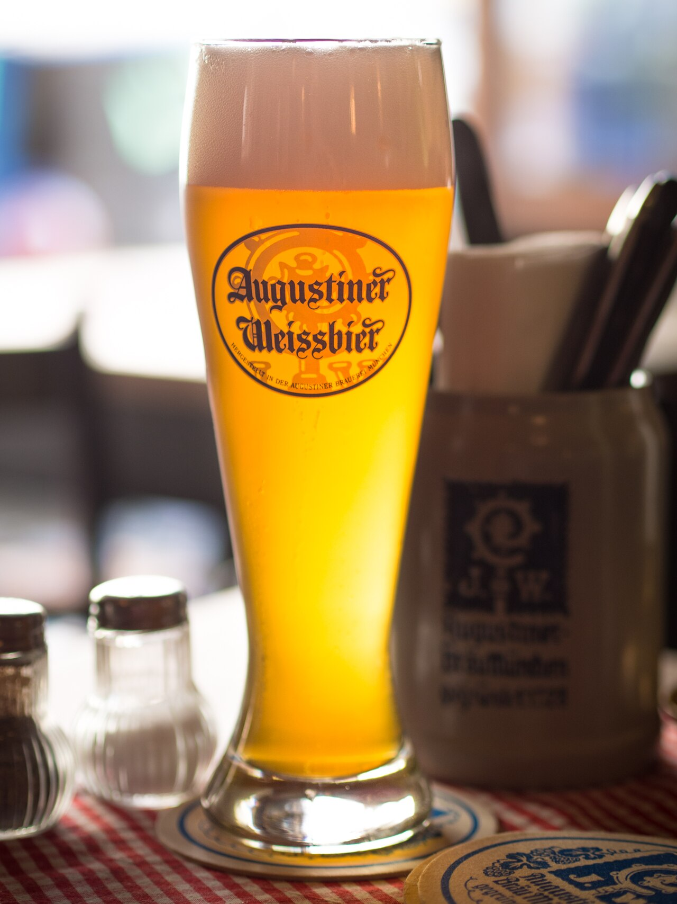

# Wheat beer

Wheat beer is top-fermented beer in which wheat makes up a large share of the grain bill. German wheat beer is marked by clove and banana esters and bottle conditioning; Belgian witbier is seasoned with orange peel and coriander; American wheat ale is cleaner and more easy-drinking. The proteins and starch that wheat contributes directly shape body, head and haze.

Figure: Wheat beer. Image: Takeaway, CC BY-SA 3.0, via Wikimedia Commons ([source page](https://commons.wikimedia.org/wiki/File:2013_Augustiner_Weissbier_Munich_pub.jpg)).

## Definition and standards

Wheat usually accounts for more than 50% of the grain bill, and German Weissbier commonly uses 50–70%. German wheat beer often has 4.9–5.6% alcohol and about 8–15 IBU; Belgian witbier commonly has 4.5–5.5% and about 8–20 IBU; American wheat ale commonly has 4.0–5.5% and about 15–30 IBU. Classification rests on ingredient share, yeast and seasoning, not on colour. Most wheat beer is top-fermented, but not every beer containing wheat should be called wheat beer.

Style names are easily confused. Weissbier and Weizen usually mean German wheat beer, Hefeweizen emphasises the retained yeast, and Dunkles Weissbier is the dark version; witbier is the common name for Belgian wheat beer. On a label, the wheat share, yeast type and whether spices are used say more than the word “wheat”.

## Origin and history

Bavaria is the core home of German wheat beer. The 1516 Reinheitsgebot limited beer to barley, hops and water, and wheat brewing was long tied to ducal privileges and monopoly arrangements, so German wheat beer developed as a distinct and stable tradition. In the mid-20th century wheat beer declined for a time, then recovered as brewers and drinkers turned back to it.

Belgian witbier nearly disappeared in the 1950s, and its revival at Hoegaarden in 1966 brought it back to the market. American wheat ale took shape in the [craft beer](ref:craft-beer) wave of the 1980s, when brewers borrowed German ingredients but used a more neutral yeast and a more restrained aroma. Today [Germany](ref:germany) and [Belgium](ref:belgium) remain the two most important traditional homes.

## Ingredients and process

[Wheat](ref:wheat) may be used as malt or as unmalted grain; Belgian witbier often adds oats as well. Wheat is richer in protein and beta-glucan, which brings a fuller body and a longer-lasting head but also makes filtration harder and the beer hazy. Because wheat grains lack the husk of barley, lauterung often needs a filtering aid such as rice hulls.

[Fermentation](ref:fermentation) is top-fermenting. German wheat beer uses a specific yeast, usually at 17–20°C, producing clove phenols (4-vinylguaiacol) and banana ester (isoamyl acetate); a little wort is added at bottling for a second fermentation, so carbon dioxide and yeast remain in the bottle. Witbier adds orange peel and coriander during the boil or late fermentation; American wheat ale mostly uses neutral yeast to let malt and hops lead.

## Flavour profile

German wheat beer is pale gold and hazy, with a thick, lasting head. The aroma is dominated by clove and banana, possibly with bubblegum and grainy sweetness; the body is medium, bitterness low and the finish refreshing. Witbier leans more towards citrus, coriander and spice, with slightly higher acidity and a soft texture. American wheat ale is usually cleaner, with bready malt and light citrus hops, and weaker yeast esters.

Haze from yeast and wheat protein is normal and not a sign of spoilage. Sharp solvent notes, obvious sourness or cardboard flavours are more likely to point to process or hygiene problems.

## Tasting and serving

Wheat beer is best at around 6–10°C, and witbier a little cooler at 4–8°C. A tall wheat beer glass helps retain the head; with German Hefeweizen the yeast at the bottom of the bottle can be swirled gently into the glass for fuller aroma and haze. With food it suits white sausage, salads, seafood and soft cheese, and witbier also works with lighter Asian dishes.

Wheat beer is best drunk fresh, since hop and ester aromas fade with age. Store away from light in a cool place and avoid repeated warming. Bottle-conditioned products may contain a little sediment, and whether to pour it in is a matter of personal preference.

## Common misconceptions

First, assuming wheat beer must use 100% wheat. Most recipes use about half wheat, with barley still forming the base.
Second, assuming every wheat beer has clove and banana aromas. Witbier and American wheat ale express their yeast very differently.
Third, treating haze as spoilage. Wheat protein and yeast produce normal haze.
Fourth, assuming wheat beer is gluten-free. Wheat itself contains gluten, so it is not a gluten-free product.
Fifth, assuming wheat beer belongs only to Germany. Belgium and the United States have both developed stable styles.

Wheat beer is a family, not one recipe. German wheat beers use a high share of malted wheat, top fermentation and often bottle conditioning, giving clove and banana notes. Belgian witbier adds orange peel and coriander, while American wheat ales tend to be cleaner and lighter. Shared ingredients do not make these the same style; the yeast, spice and country tradition change the result.

Start with the production rule. From there, consider the strength, then the usual serving. That is how a practical judgment about Wheat beer is built.

[Beer](ref:beer) and [Barley](ref:barley) are the two useful reference points for Wheat beer. [Beer](ref:beer) sets out legal definition; [Barley](ref:barley) brings in materials and process. Read them together.

**At a glance:** A top-fermented beer made with a large share of wheat; German wheat beer is marked by clove and banana esters and bottle conditioning, Belgian witbier by orange peel and coriander, and American wheat ale is cleaner, with wheat shaping body, head and haze.

Wheat beer is a top-fermented beer with a large wheat share; German versions show clove and banana, Belgian witbier adds orange peel and coriander.

**Key facts.**

| Item | Detail |
| --- | --- |
| In one line | A top-fermented beer made with a large share of wheat; German wheat beer is marked by clove and banana esters and bottle conditioning, Belgian witbier by orange peel and coriander, and American wheat ale is cleaner, with… |
| Parent style | Beer |
| Aroma family | Grain and yeast |

**Sources and limits.** The key claims about Wheat beer are checked against the following sources: Beer Judge Certification Program, Deutscher Brauer-Bund, Brewers Association (public US craft industry statements on wheat ale and its variants; no original wording is reproduced) and 4 sources in total. Prices, batches and status change; the body is project-written and does not reproduce source text.

For Wheat beer, this page was last checked in 2026; prices, batches and availability change, so confirm them against the sources below.

## Further reading

- [Beer](ref:beer): where wheat beer sits in the beer style system.
- [Wheat](ref:wheat): the material basis for wheat protein, body and head.
- [Barley](ref:barley): the source of base malt in wheat beer.
- [Fermentation](ref:fermentation): top fermentation and the formation of yeast esters.
- [Germany](ref:germany): the Bavarian wheat beer tradition and the Reinheitsgebot.
- [Belgium](ref:belgium): the home of witbier and its spice tradition.
- [Craft beer](ref:craft-beer): the background for American wheat ale.
