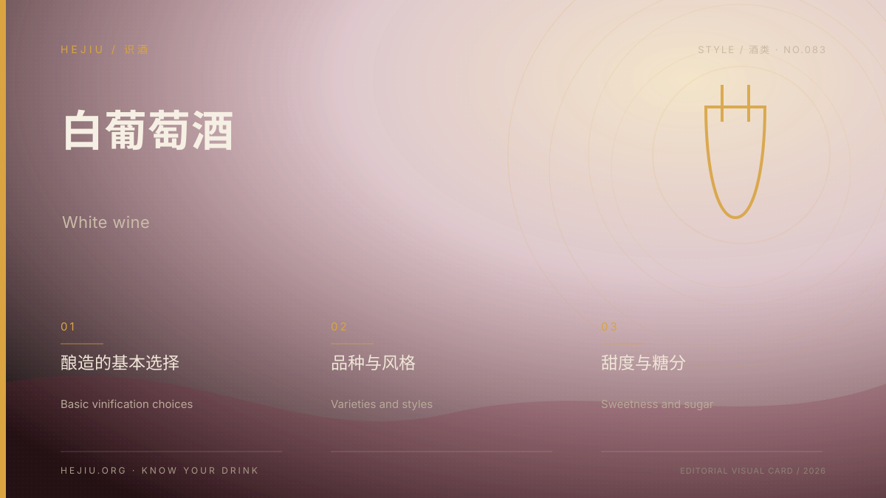

# White wine

White wine is made from white grape varieties, or from destemmed dark varieties. Unlike red wine, white wine usually does not let the liquid stay in contact with skins for long, so it is pale in colour and low in tannin, with acidity and aroma as its main structural pillars. Its range is wide: from crisp, dry, drink-now wines to rich wines shaped by oak and lees, and to base wines for sparkling wine.

Figure: thematic illustration for White wine. Image: AI-assisted illustration generated with Doubao Seedream 5.0 (project-owned); not a photograph of the subject.

## Basic vinification choices

The first step in white winemaking is usually a quick pressing to separate juice from skins and seeds, limiting colour and tannin extraction. After pressing, the juice may be settled clear or sent straight to fermentation. Fermentation temperatures are usually lower than for red wine, to preserve delicate fruit and floral aromas; too warm and the aroma turns coarse, too cool and fermentation may stall.

After fermentation, producers face several key choices. Whether to allow malolactic conversion changes the acidity profile and creamy notes; whether to age on lees affects texture and bread or nut aromas; whether to use oak affects vanilla, toast and spice. There is no single answer; it depends on variety, region and target style.

## Varieties and styles

Chardonnay is relatively neutral and readily takes on texture from oak and lees, so it can be made crisp and unoaked or rich and buttery. Riesling usually has high acidity and clear aroma, from dry to sweet. Sauvignon Blanc often shows grass, citrus and tropical fruit; Pinot Grigio is usually light and easy to drink.

White wine can also be made from dark varieties such as Pinot Noir or Grenache, as long as the skins are separated early and the juice itself is pale. Such wines are sometimes called “blanc de noirs”, a term especially common in Champagne and sparkling wine.

## Sweetness and sugar

The OIV gives verifiable sugar thresholds for wine. Dry wine contains at most 4 g/L sugar, or 9 g/L when total acidity is no more than 2 g/L below the sugar content. Medium dry may reach 12 g/L, or 18 g/L under specified acidity conditions. Semi-sweet may reach 45 g/L. Sweet wine has a minimum of 45 g/L. These figures describe residual sugar ranges, not subjective sweetness intensity, because acidity, alcohol and aroma all change perception.

Sweet white wine can get its sweetness from late harvest, noble rot, ice wine or stopped fermentation, not necessarily from added sugar. Specific methods and permitted practices are governed by regional rules. When a label says “sweet”, check residual sugar, acidity and alcohol as well rather than relying on taste alone.

## Regions and labels

White-wine regional labels are also primarily geographical and regulatory information. Alsace, Burgundy and the Loire in France; Mosel and Rheingau in Germany; Friuli in Italy; Rías Baixas in Spain are common white-wine regions. The EU PDO/PGI system, France's AOC and Italy's DOCG set permitted varieties, yields, winemaking methods and label terms.

The same variety behaves very differently in different climates. Cool-climate whites usually have higher acidity and lighter body; warm-climate whites may have riper fruit and higher alcohol. Altitude, aspect, soil drainage and day-night temperature range also affect the ripening rhythm. Reducing these conditions to “terroir” can obscure specific viticultural and winemaking choices.

## How to drink

White wines are usually served cooler than reds, to preserve acidity and aroma. Too cold and the aroma closes down; too warm and the alcohol stands out. Light, dry whites suit cooler temperatures; oak-treated, fuller whites can be served a little warmer. There is no single correct temperature; adjust to the wine's structure and personal preference.

For food, high-acid whites suit seafood, salads, sour dishes and fried food, because acidity cuts through fat and cleanses the palate. When pairing sweet wine with dessert, the wine should be at least as sweet as the dessert, otherwise it tastes flat. Oak-treated whites go well with cream sauces and roasted poultry.

## Lees, bâtonnage and oxygen management

The lees left after fermentation are an important variable in white-wine style. Lees consist mainly of dead yeast cells; prolonged contact can add texture, roundness and bread or nut aromas, while bâtonnage stirs the lees regularly so that more components enter the liquid. Longer contact and more frequent stirring usually make the effect more pronounced, but it must be controlled to avoid cloudiness or an excessively heavy feel.

Oxygen management is equally important. White wine is more sensitive to oxygen than red, and excessive contact makes fresh fruit fade early and colour deepen; a moderate oxygen exposure can help the wine open and reduce reductive odours. Inert vessels, temperature control, sulphur dioxide use and dissolved-oxygen control at bottling are the tools producers use to balance this.

## Common misconceptions

First, white wine is not necessarily simple. Lees- and oak-treated whites can be very complex and can age for a long time.

Second, not all white wines should be ice-cold. Too low a temperature suppresses aroma; light dry whites can be slightly cool, while richer styles should be a little warmer.

Third, sweet white wine is not necessarily sweetened. Late harvest, noble rot, ice wine and stopped fermentation can all bring sweetness, and the permitted methods are governed by regional rules.

## Boundary

This style describes the category and basic methods, not specific estates, vintages or prices. Check the label, producer information and professional reviews for variety proportions, residual sugar, strength, oak use and ageing potential. White wine can also be the base for [sparkling wine](ref:sparkling), but sparkling wine has its own process and labelling rules.

**Short definition:** Wine made from white grapes, or from destemmed dark grapes, usually without skin fermentation; acidity, aroma, lees and oak treatment together shape the style.

For White wine, begin with the production rule. Then look at the strength, and finally ask the usual serving. The answers point to different choices, not to a single score.

[Wine](ref:wine) and [Grape](ref:c-extra-1) answer different questions about White wine: legal definition and materials and process. Read them as a pair, not as alternatives.

**Key facts.**

| Item | Detail |
| --- | --- |
| In one line | Wine made from white grapes, or from destemmed dark grapes, usually without skin fermentation; acidity, aroma, lees and oak treatment together shape the style. |
| Parent style | Wine |

**Sources and limits.** The key claims about White wine are checked against the following sources: International Organisation of Vine and Wine (OIV) (Used to check sugar levels, carbon dioxide content and minimum strength), European Union (Used to check EU wine categories, geographical indications and labelling rules), Oxford University Press (Used for entries on white-wine vinification, lees and oak treatment) and 4 sources in total. Prices, batches and status change; the body is project-written and does not reproduce source text.

## Further reading

- [Wine](ref:wine): an overview of still, sparkling, fortified and sweet wines.
- [Sparkling wine](ref:sparkling): second fermentation, pressure and sweetness levels.

Further reading: [Grape](ref:c-extra-1), [Fermentation](ref:c-extra-2).

## Related images

Image: Sparkling wine. Credit: bgvjpe, CC BY 2.0, via Wikimedia Commons ([source page](https://commons.wikimedia.org/wiki/File:Glass_of_champagne.jpg)). Related image for White wine.
