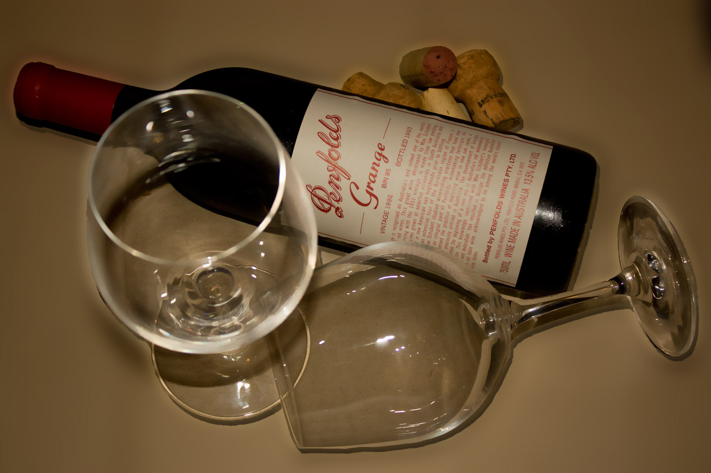

# Penfolds Grange

Penfolds Grange is the flagship wine of Penfolds in Australia, first made by Max Schubert in 1951. It is mostly Shiraz with a little Cabernet Sauvignon, aged in American oak, and is one of Australia's most representative fine wines.

Figure: Related photograph of Penfolds Grange. Image: Rexness, CC BY-SA 2.0, via Wikimedia Commons ([source page](https://commons.wikimedia.org/wiki/File:Penfold%27s_Grange_(4553358229).jpg)).

## Definition and position

Grange is a single product name, not a grape variety or a region. It is a dry red [wine](ref:wine) made by Penfolds. Penfolds itself was founded in 1844, while Grange came out of post-war experimentation, first made in 1951; early bottles borrowed the name "Hermitage" before Grange became a brand of its own.

Understanding Grange requires separating three levels: Penfolds is the company and brand, Grange is the flagship product, and Shiraz is the main variety. Calling it "Australia's Lafite" is only an analogy and cannot replace specific judgments about variety, winemaking and vintage.

## Origin and environment

Grange is a multi-region blend, with fruit from several South Australian regions, commonly including Barossa Valley, McLaren Vale, Clare Valley and Coonawarra. Warm regions contribute ripe black fruit and body, while cooler regions add acidity and aromatic layers.

The point of multi-region blending is not to hide origin but to stabilise style and balance vintage variation. Southern Australia has hot, dry summers, and irrigation and water management directly affect ripeness; harvest timing sets the course of strength, acidity and tannin. The vintage on the label is the harvest year, not the bottling year.

Within one region, rainfall, heatwaves and harvest windows change from year to year, and so do acidity and flavour. Multi-region blending reduces single-region vintage swings, which is part of why Grange is relatively consistent. Blending cannot remove vintage differences, only recast them, so vintage remains the first variable when comparing Granges.

## Raw materials and varieties

The main variety is Shiraz (Syrah), often with a little Cabernet Sauvignon for structure and acidity. Shiraz brings blackberry, black pepper, liquorice and meaty notes, while Cabernet Sauvignon adds framework and ageing potential. The blend proportion changes with vintage rather than following a fixed recipe.

Ripeness determines sugar, acid, [tannin](ref:tannin) and aroma precursors. Grange aims for ripe but not overripe fruit, avoiding jammy flavours and excessive alcohol. Fruit is handled by parcel before fermentation and combined later, which is key to understanding its consistency.

## Production

The typical flow is: harvest, destem and crush, ferment, macerate, press, malolactic fermentation, oak ageing, blending, clarification and bottling. Grange traditionally uses American oak with a high proportion of new barrels, bringing vanilla, coconut and cedar notes and softening tannin.

[Oak ageing](ref:oak-ageing) is a core part of the style. American oak expresses aroma more directly and contrasts with Shiraz fruit; ageing time and barrel mix are adjusted by vintage. The wine also ages in bottle after bottling, where tannin and aroma continue to integrate, so young and mature vintages perform very differently.

## Flavour and tasting

Grange is usually full-bodied, with blackberry, black pepper, mocha, cedar and tobacco notes, firm tannin, supporting acidity and a long finish. When young, fruit and oak dominate; with age, spice, leather and earth emerge and the structure integrates.

Look at the colour, check whether the aroma is clean and free of volatile acidity or excessive oak, then feel body, tannin texture and acid balance. Strength is stated as [alcohol by volume](ref:abv), commonly around 14%–14.5% vol, though specific vintages vary. High alcohol magnifies heat, so serving temperature and decanting matter.

## Product lines and labels

Penfolds ranges from everyday wines to its flagship, with Grange at the top. The vintage, varieties, region information and strength on the label are the basics for identity; Grange is not a single-vineyard wine but a blend under a brand.

"Bin" numbers are Penfolds' product numbering system, not a quality grade; different numbers have different positioning and style. Buy through official channels and check anti-counterfeit and import labels. Price and scarcity do not mean every vintage is equally strong, and vintage variation remains central.

## Drinking and pairing

Serve at about 16–18°C. Young vintages can be decanted for 1–2 hours; older vintages should be decanted briefly and checked for sediment, using a decanter if needed. Roast beef, lamb, braised meat and hard cheese suit it; very spicy or very acidic dishes disturb the balance of tannin and fruit.

Finish an opened bottle reasonably soon; leftovers can be decanted into a smaller container and kept cool and dark. Ice dilutes aroma and structure and is not traditional for dry red. Drink in moderation and avoid rapid drinking on an empty stomach; aged bottles need more careful temperature and humidity control.

## Common misconceptions

First, treating Grange as a region. It is a multi-region blend.
Second, that older vintages are always better. Grange has a drinking window, and too much or too little age is not ideal.
Third, treating Bin numbers as grades. They are a product system, not a score.
Fourth, that Shiraz and Syrah are different varieties. They are the same variety under different names.
Fifth, using price in place of tasting. Vintage, storage condition and channel also shape the experience.

To read Penfolds Grange, start with the base and the stated strength, then the sweetness or bitterness, then how it is served; no single check settles it.

Setting [Wine](ref:wine)'s style beside [Tannin](ref:tannin)'s region and vintage makes the boundary between them visible.

**In brief:** The flagship wine of Penfolds in Australia, first made by Max Schubert in 1951 from mostly Shiraz with a little Cabernet Sauvignon, aged in American oak.

Treating Penfolds Grange as a drink style or a brand mixes two different questions: identity and use. Separate them before comparing.

**Key facts.**

| Item | Detail |
| --- | --- |
| In one line | The flagship wine of Penfolds in Australia, first made by Max Schubert in 1951 from mostly Shiraz with a little Cabernet Sauvignon, aged in American oak. |
| Style | Wine |
| ABV | 14–14.5% vol |

**Sources and limits.** The key claims about Penfolds Grange are checked against the following sources: Penfolds (Grange history, varieties and winemaking), OIV (international technical definitions for wine), Oxford University Press (Consulted for entries on Penfolds, Grange and Australian Shiraz). Prices, batches and status change; the body is project-written and does not reproduce source text.

**Read alongside.** Put Penfolds Grange next to Wine, Oak ageing, Tannin: the first fixes identity and boundary, the others provide a region, process or peer comparison. Read this page first, then return to those entries; the links become coordinates, not decoration.

## Further reading

- [Wine](ref:wine): the broad category and basic classification of wine.
- [Oak ageing](ref:oak-ageing): how American oak shapes aroma and tannin.
- [Tannin](ref:tannin): the source of red-wine structure and ageing potential.
- [Alcohol by volume](ref:abv): what the 14%–14.5% vol label means.
