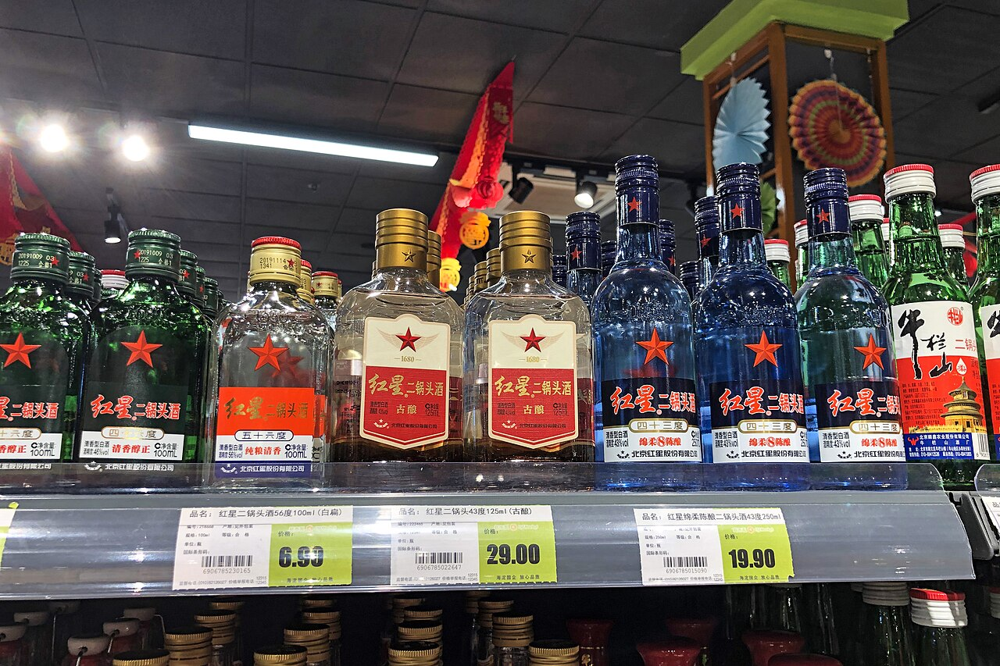

# Erguotou

Erguotou is a traditional Beijing baijiu process and product category, named because distillation takes only the spirit that condenses from the second pot. It is made mainly from sorghum with fuqu or daqu, and common strengths range from 43% to 56% ABV. The style is light-aroma and direct.

Figure: Erguotou. Image: N509FZ, CC BY-SA 4.0, via Wikimedia Commons ([source page](https://commons.wikimedia.org/wiki/File:Red_Star_Erguotou_on_shelves_(20200202160825).jpg)).

## Definition and position

Erguotou is both a process term and a product name. It belongs to the light-aroma route within [baijiu](ref:baijiu): separate steaming and separate burning, fermentation in earthen jars or cement pits, and cutting heads and tails to keep the middle fraction. The name comes from the "second pot": the first spirit off the still is harsh and the tail carries off-flavours, so the middle fraction of the second pot is considered the cleanest.

What needs separating is that erguotou is not the exclusive name of one brand: it is a process and category formed in Beijing and used by several producers. Red Star, Niulanshan and others all make erguotou, with clearly different raw materials, starter types, strengths and blends.

## Origin and environment

Beijing lies in the northern North China Plain with a temperate monsoon climate: cold and dry winters, warm and rainy summers. The dry winter helps qu making and storage, while day-night temperature swings affect fermentation temperature control. Water and sorghum supply around Beijing form the basic conditions for erguotou production.

Erguotou's origin story is closely tied to everyday life in Beijing. It has long existed as a mass-market spirit with a wide price range, from daily drinking to mid- and high-priced products that stress traditional craft. Understanding this helps avoid equating "cheap" with "low quality".

## Raw materials and qu

The main material is sorghum, requiring high starch and low impurities. Some products use fuqu, which has strong saccharifying power and a short fermentation cycle; others use daqu, which gives a more complex aroma at higher cost. Neither route is inherently better: the difference lies in the style target and production cost.

[Qu making](ref:qu-making) determines saccharifying efficiency and aroma precursors. Fuqu light aroma is usually more direct and clean, while daqu light aroma has more layers. Grind size, cooking degree and qu dosage all affect fermentation start-up and yield. The production standard and the ingredient list on the label are the first-hand information for judging the process route.

## Production

The typical flow is: crush, moisten, cook, cool, add qu, ferment in jars or pits, distil, grade and store, blend and bottle. Light aroma stresses separate steaming and burning, avoiding contact between the fermented mash and pit mud to reduce unwanted microbes and off-flavours.

[Distillation](ref:distillation) is the source of the name: the run is cut into fractions, with heads and tails kept apart and the middle fraction used as the main base spirit. Producers differ in how exactly they handle the "second pot" and where they cut, so the name is a traditional summary rather than a uniform technical parameter.

Storage usually uses ceramic jars or stainless steel tanks. Ceramic jars are slightly permeable and favour slow oxidation and aroma integration; stainless tanks seal well and suit temperature control and large volumes. Blending combines base spirits of different grades and ages in set proportions to stabilise the style, not simply to dilute strength with water. Dilution water must be treated to avoid introducing off-notes, and the rest and filtration after blending also affect how clean the entry feels.

## Flavour and tasting

Erguotou usually has a punchy entry, direct aroma and a clean finish, with ethyl acetate-led light aroma, grain notes and a little fruit. High-strength versions are noticeably hot, while lower-strength versions are softer. It is not known for complex layers; the evaluation focus is cleanliness, balance and the finish.

Taste from a small cup: first check whether the aroma is clean and free of obvious off-notes, then sip to feel the entry impact and sweetness. High-strength spirit should not be gulped; adding water lowers the heat but changes the aroma structure. When comparing with strong aroma or sauce aroma, use the light-aroma evaluation framework.

## Product lines and labels

Erguotou covers strengths from 43% to 56% ABV and products from bare bottles to gift boxes. The producer, aroma type, strength, standard and volume on the label are the basics for identity. Counterfeits and similar names exist in the market, so buy through official channels and check anti-counterfeit marks.

Terms such as "traditional craft" and "vintage" must be read with company explanations and labels. Erguotou does not improve with age indefinitely, and long storage can cost the fresh aroma; home storage should be away from light, cool and free of strong odours and heat.

## Drinking and pairing

Traditionally it is served neat in a small cup, and it is also often used in cocktails or infused fruit liquors. Because the strength is high, it should not be drunk quickly; with Beijing snacks, salt and fat change how the alcohol is perceived. Hotpot, roast duck and braised dishes all suit it, but heavy chilli magnifies the heat.

When used in mixed drinks, the high strength significantly changes the final balance, and the sugar and acid in a recipe need re-adjusting. Ice lowers aroma release and suits a preference for freshness, but it is not the traditional way. After opening, finish the bottle reasonably soon and avoid long exposure to air and light.

## Common misconceptions

First, treating erguotou as one brand. It is a process and category name, and several producers make it.
Second, that higher strength is more authentic. Strength serves product design, and lower-strength versions have their own aim.
Third, that cheap means low quality. The price range is wide, so judge by label and process.
Fourth, that all erguotou is fuqu. Daqu routes also exist and taste different.
Fifth, judging authenticity by packaging or price. Anti-counterfeit checks, channels and labels are reliable.

**Short definition:** A traditional Beijing baijiu process and product category, named for the spirit taken from the second distillation pot; light-aroma and direct, commonly 43% to 56% ABV.

Start with the base and the stated strength. From there, consider the sweetness or bitterness, then how it is served. That is how a practical judgment about Erguotou is built.

**Key facts.**

| Item | Detail |
| --- | --- |
| In one line | A traditional Beijing baijiu process and product category, named for the spirit taken from the second distillation pot; light-aroma and direct, commonly 43% to 56% ABV. |
| Style | Baijiu |
| ABV | 43–56% vol |

**Sources and limits.** The key claims about Erguotou are checked against the following sources: Industry body (erguotou process and light-aroma baijiu terms; baijiu's position in beverage-alcohol classification), Oxford University Press (Consulted for entries on Chinese baijiu and light-aroma styles). Prices, batches and status change; the body is project-written and does not reproduce source text.

## Further reading

- [Baijiu](ref:baijiu): the broad category and aroma-type system behind erguotou.
- [Qu making](ref:qu-making): how fuqu and daqu shape the light-aroma style.
- [Distillation](ref:distillation): the background to cutting heads and tails and the "second pot".
- [Alcohol by volume](ref:abv): the measure for comparing versions from 43% to 56% ABV.
