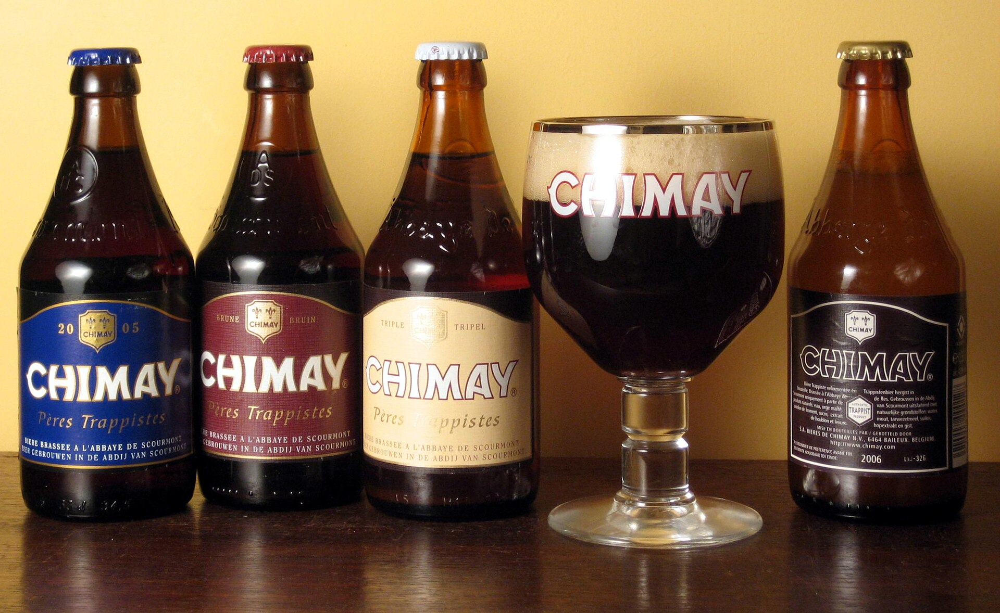

# Chimay Blue

Chimay Blue (Chimay Bleue) is the dark [Trappist ale](ref:abbey-beer) of Scourmont Abbey in [Belgium](ref:belgium), commonly [9% ABV](ref:abv) and refermented in the bottle for about 21 days. Its 75 cl version carries a second name, Grande Réserve. The two are the same beer in different formats, not two recipes, and that distinction matters when you are comparing prices or cellaring advice.

Figure: Related photograph of Chimay Blue. Image: Uploaded by photographer., CC BY-SA 3.0, via Wikimedia Commons ([source page](https://commons.wikimedia.org/wiki/File:Chimays.jpg)).

## 1956: How a Christmas Beer Became Blue

Chimay's own history places the ancestor of Blue in 1954, when the monastery brewed a Christmas beer sold only at the end of the year. In 1956 it became the year-round "blue cap" and joined the permanent range. Blue was therefore not a founding recipe. It emerged after the Second World War, when the monks resumed brewing and began working with a newly isolated yeast. The Christmas origin still explains its dark fruit and spice profile.

## Scourmont: Founded in 1850, Brewing in 1862

In 1850 a group of monks from Westvleteren's Sint-Sixtus Abbey established Notre-Dame de Scourmont on the high plateau donated by the Prince of Chimay. The brewery was completed and brewed its first beer in 1862. In 1876 the monks learned to make a semi-soft cheese, and Chimay cheese was born. Beer, cheese, hospitality and a charitable foundation still form one economic system; the brewery is not an isolated craft operation.

## The 1948 Yeast and Twenty-One Days in Bottle

In 1948 Father Théodore isolated the yeast strain that Chimay still uses. The brewery's process page explains what happens later: the beer is flat when it is bottled, fresh yeast and sugar are added, and a second [fermentation](ref:fermentation) takes place in the bottle. The official figure is 21 days at stable temperature and humidity. The brewery describes this as a "champagne method" that takes about three weeks. It creates the carbonation, lifts the alcohol slightly and makes the beer easier to digest.

## Nine Percent Blue, Seven Percent Red, Eight Percent White

The three core beers differ by more than colour. Red is 7% ABV, first brewed in 1862 and therefore the oldest in the range; its 75 cl version is called Première, and its profile leans on orange, peach, apricot and toffee. White, also sold as Chimay Triple, is 8% ABV, created by Father Théodore in 1966, and follows a blond, hoppy, citrus direction. Blue is 9% ABV, the darkest of the three, with dried fruit, caramel, cocoa, mocha and spice. The range also includes Gold at 4.8% and Green at 10%, but they sit outside this comparison.

## Two Wells on the Abbey Grounds

Chimay describes water as the main ingredient and states that brewing water comes only from the two wells inside the abbey grounds. The monastery was built on a marshy plateau precisely because water was abundant. Mineral content affects mashing, fermentation and the dry finish of the beer. This is the concrete reason why the same 9% recipe is difficult to reproduce exactly elsewhere: the site is part of the process.

## Fifty-Five Thousand Bottles an Hour

Blue is bottled in 33 cl, 75 cl, 1.5 L, 3 L and 6 L formats, plus draught; Red also comes in cans. The bottling line runs at about 55,000 units an hour. That scale may surprise drinkers who associate Trappist beer with tiny batches, but scale is not incompatible with the label. The Authentic Trappist Product rules concern where the beer is made, who supervises it and where the income goes, not how much is produced.

## Grande Réserve: The 75 cl Alias

The 75 cl Blue is called Grande Réserve, a name that emphasises its ability to mature in the bottle. Chimay releases a limited collector's bottle every two years; the official list runs from 2014 through 2026. The collector's edition changes the bottle design, not the liquid. Buying the standard 75 cl or the collector's version is a question of whether you intend to drink or to keep, not a question of quality tier.

## Drinking at 10–12 °C

Chimay recommends serving Blue at 10–12 °C. Too cold and the dried fruit and cocoa collapse into plain bitterness; too warm and the 9% alcohol becomes prominent. A tulip-shaped glass or the Chimay glass, with a gentle pour down the side to leave room for the head, works well. A little yeast sediment at the bottom is normal for a bottle-refermented beer; you can keep it or leave it. Nine percent is not spirit strength, but the warmth grows as the beer rises in temperature, so slow drinking is rewarded.

## Pairing: Why Blue Wants Red-Beer Cheese

Chimay says Blue pairs with every Chimay cheese, especially Chimay à la bière rouge, the cheese washed or infused with the red beer. The logic is straightforward: Blue's cocoa and caramel meet the cheese's nutty, creamy notes, while 9% alcohol cuts through the fat. The malt sweetness of the red-beer cheese echoes Blue's dried fruit. Red at 7% is lighter and fruitier, better as an opener; White at 8% is drier and more citrus-led, better with fish or salad. Ordering all three at once tends to blur their pairing advantages.

## What €4.20 and €10.50 Mean

Chimay's 2021 abbey price list gives Blue 33 cl at €4.20 and Grande Réserve 75 cl at €10.50. These are brewery/abbey-shop prices, not global retail prices. Supermarkets, bars and export markets will diverge because of tax, freight, batch and promotion. Treat the abbey price as a benchmark rather than a floor: its value is that it is not inflated by secondary-market scarcity.

## The "Trappist Is Just Marketing" Myth

The Authentic Trappist Product label is not a decorative badge. The International Trappist Association requires that the product be made inside or immediately next to the monastery, that production be supervised by the monks, and that most of the income support the community, solidarity projects and charity. Chimay reinforced the structure in 1996 by creating the Chimay-Wartoise foundation, which separated the commercial companies from the monastic community. A second common confusion is "abbey beer" versus "Trappist beer": the former can be a commercial style, while the latter requires the abbey and association framework.

## Buying and Keeping a Bottle

Check the bottling date, volume and ABV on the label. Bottle refermentation gives Blue some ageing capacity, but older is not automatically better. Store it cool, dark and upright, avoiding sharp temperature swings. Once opened, drink it in one sitting if possible; the carbonation fades quickly. If you want to understand the ageing claim, taste a fresh bottle beside one kept for two or three years rather than relying on the vintage on the cap.

## Further Reading

- [Beer](ref:beer): the broad category and its style framework.
- [Belgium](ref:belgium): the regional background for Trappist brewing.
- [Abbey ale](ref:abbey-beer): the difference between Abbey and Trappist.
- [Barley](ref:barley) and [water](ref:water): two primary ingredients.
- [Fermentation](ref:fermentation): the bottle-conditioning step.
- [Rochefort 10](ref:rochefort) and [Westmalle Tripel](ref:westmalle): two Trappist reference points.

For Chimay Blue, begin with the base and the stated strength, then the sweetness or bitterness, and finish with how it is served; that order keeps the account grounded.

Read [Beer](ref:beer) for the style side of Chimay Blue, and [Abbey beer](ref:abbey-beer) for the region and vintage side. Together they locate it.
