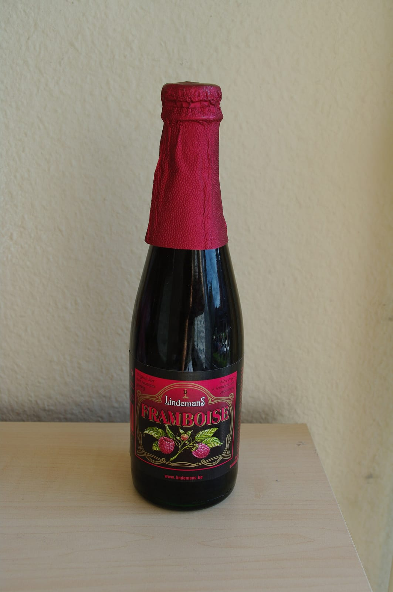

# Lindemans Framboise

Lindemans Framboise is made by the Lindemans family brewery in the Pajottenland region of Belgium, using a spontaneously fermented lambic base with raspberries added before bottling. It is commonly 2.5%–4% ABV in 250 mL or 750 mL bottles, and its sweet style differs from traditional dry lambic.

Figure: Related photograph of Lindemans Framboise. Image: Soti, CC BY-SA 3.0, via Wikimedia Commons ([source page](https://commons.wikimedia.org/wiki/File:Lindemans_Framboise.JPG)).

## Definition and position

Separate the levels first: beer is the broad category, lambic is the spontaneous-fermentation tradition, Belgium is the region, Lindemans is the brewery and brand, and Framboise is the specific product. Keeping the four apart prevents confusion between "fruit beer" and "traditional lambic".

This is not a Trappist ale and not a controlled top-fermentation product. Its base relies on wild microbes from the air and wooden barrels, and the finished beer is flavoured with fruit; the sweetness comes mainly from added sugar or juice, not from spontaneous fermentation itself. Comparing it with [Chimay Blue](ref:chimay) shows the difference between the two traditions.

## Producer and brand

Lindemans is a family brewery in Vlezenbeek (Sint-Pieters-Leeuw), in the Pajottenland south-west of Brussels; public material traces its history to 1822. Its range centres on lambic bases and fruit products, and it is one of the more widely distributed producers in this tradition.

Brewery, brand and product are three levels: the brewery answers the base beer and craft, the brand answers positioning and range, and the product answers fruit type, ABV and volume. Family ownership and historic years belong to corporate narrative and cannot replace the specification and batch on the label.

## Region and ingredients

The product comes from the Pajottenland in [Belgium](ref:belgium), regarded as the core lambic area. The mild, fairly humid climate and the microbial community in the air and the brewery are part of what makes spontaneous fermentation possible, so the place and the brewery environment are themselves part of the process.

The ingredients are [barley](ref:barley), [wheat](ref:wheat) and [water](ref:water), plus hops and raspberries. Lambic usually uses aged hops mainly for preservative effect rather than bitterness, and a high wheat share shapes body and microbial nutrition. Fruit variety, proportion and handling differ by product line.

## Production

After boiling, the wort is cooled in shallow pans so wild yeasts and bacteria from the air inoculate it naturally, and it is then matured in wooden barrels ([oak ageing](ref:oak-ageing)). This stage takes years, and the liquid gradually turns acidic and dry, with citrus, grain and woody notes that form the base for later blending.

Before bottling, the brewery blends lambics of different ages, adds raspberries and sugar, then carries out [fermentation](ref:fermentation) and bottling. Sugar and juice make the finished drink sweeter and easier to approach and lower the acidity; that is a different direction from unsweetened traditional dry lambic, and no single standard should be used to judge both.

## Specification and label

The common [alcohol by volume](ref:abv) is 2.5%–4% ABV, with market versions differing in what they state, and the usual volumes are 250 mL and 750 mL. The label should be checked for product name, fruit type, ABV, net content, ingredients, producer and batch.

Where the label uses words such as "lambic" or "spontaneous fermentation", they should be read together with the range description; these terms lack a single mandatory definition, and sweet fruit lambic and dry traditional lambic may use similar wording. The local-language back label, importer and anti-counterfeit information support identity checks.

## Flavour and tasting

Typical aromas are fresh raspberry, strawberry jam and citrus peel, with grain and a light acidity. The palate is sweet with low-to-medium acidity, a light body and a finish of fruit and gentle malt. It is closer to a fruit-flavoured beer experience than to the acidic, dry style of traditional lambic.

Serve at about 5–7 degrees Celsius in an open glass; too cold suppresses the fruit, too warm makes the sweetness cloying. Mind the sediment and leave it behind when pouring if preferred. Carbonation and fruit aroma fade quickly after opening, so drink soon.

## Drinking and pairing

Fruit desserts, soft cheese, salads and light food pair well; sweet-and-sour fruit notes complement dairy fat and fruit, but the beer does not suit heavy red meat. It also works as a low-ABV drink before a meal or in the afternoon. Avoid strongly bitter or very spicy food, which creates a clash of flavours.

The ABV is low but the beer should still be drunk in moderation. After opening, refrigerate and finish soon rather than warming and cooling repeatedly; store in a dark place, upright and cool. Excessive drinking is harmful to health, and minors should not drink.

## Buying and storage

Buy through regular channels and check anti-counterfeit marks, the local back label, importer and batch number, and confirm the product name and fruit type. Prices move with market and channel, so this entry gives no figures; other fruit lines and traditional lambic from the same brewery should be checked separately rather than generalised from one specification.

Keep unopened bottles in a dark, cool place, standing upright to limit sediment disturbance; deep freezing is unnecessary, but heat and sharp temperature swings should be avoided. Fruit lambic is not suited to long cellaring, and the drinking window should follow brewery advice and the label.

## Common misconceptions

First, equating fruit lambic with traditional lambic. The former is sweet and the latter dry and acidic, with different process aims.
Second, assuming all lambic is Trappist beer. Abbey ales and lambic are two separate traditions.
Third, treating sweetness as a result of spontaneous fermentation. Sweetness usually comes from added sugar or juice.
Fourth, assuming a low ABV means it cannot intoxicate. Volume and pace matter as much as strength.
Fifth, judging quality by packaging or origin stories. Ingredients, craft and label information are more reliable.

Lindemans Framboise is best read by starting with the base and the stated strength, moving to the sweetness or bitterness, and ending with how it is served.

[Beer](ref:beer) and [Barley](ref:barley) are the nearest useful comparisons: one clarifies style, the other tests region and vintage.

**Key facts.**

| Item | Detail |
| --- | --- |
| In one line | A raspberry lambic from the Lindemans family brewery in the Pajottenland, Belgium, made on a spontaneously fermented lambic base with raspberries added. Commonly 2.5%–4% ABV in 250 mL or 750 mL bottles; the style is swee… |
| Style | Beer |
| Region | Belgium |
| ABV | 2.5–4% vol |

## Further reading

- [Beer](ref:beer): categories and basic production.
- [Belgium](ref:belgium): the two traditions of abbey ale and lambic.
- [Barley](ref:barley): the main ingredient for mashing and fermentation.
- [Wheat](ref:wheat): the base of lambic.
- [Water](ref:water): how water and environmental microbes matter.
- [Fermentation](ref:fermentation): spontaneous fermentation and later flavouring.
- [Oak ageing](ref:oak-ageing): the maturation logic of the lambic base.
- [Alcohol by volume](ref:abv): label differences across 2.5%–4% ABV.
- [Chimay Blue](ref:chimay): a comparative read on abbey ale.
