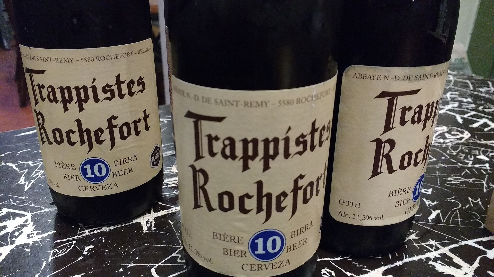

# Rochefort 10

Rochefort 10 is a dark [Trappist ale](ref:abbey-beer) from Abbaye Notre-Dame de Saint-Rémy in [Belgium](ref:belgium), commonly [11.3% ABV](ref:abv) in 33 cl bottles. Its name is the most misread part: the brewery states plainly that "10" does not refer to alcohol. It comes from an old Belgian unit used to express wort density. Almost every Chinese introduction repeats the error, so it is worth starting there.

Figure: Related photograph of Rochefort 10. Image: Fernando Losada Rodríguez, CC BY-SA 4.0, via Wikimedia Commons ([source page](https://commons.wikimedia.org/wiki/File:Trappistes_Rochefort_10_(Caf%C3%A9_Kafka).001_-_Brussel.JPG)).

## The "10" Is a Density Unit, Not 10% ABV

All three core Rochefort product pages carry the same note: the number derives from an old Belgian measurement of wort density and has nothing to do with final strength. The actual figures are 11.3% ABV for No. 10, 9.2% for No. 8 and 7.5% for No. 6. The old unit is conceptually close to today's [original gravity](ref:original-gravity), but it should not be converted directly into degrees Plato or sugar content; historical measurement methods were not uniform. Once that is clear, "10" stops looking like a strength grade.

## Eight Hundred Years at Saint-Rémy

The Abbey of Notre-Dame de Saint-Rémy was founded in 1230 in what is now Namur province. The monks follow the Rule of Saint Benedict, "ora et labora" — pray and work — and organise the day around seven offices. The abbey was abandoned and sold during the French Revolution, and the monks did not return until 1887, when they rebuilt the church and a brewery. Its motto, "Curvata resurgo" ("bent over, I stand up straight"), summarises that history.

## 1595: The First Written Brewing Record

The first written record of brewing at Rochefort dates from 1595. At that time beer was a kind of liquid bread for the community, not a commercial product. For centuries the abbey's main income came from farming, quarrying and marble; Rochefort marble can still be seen in St Peter's Basilica in Rome and at Versailles. The monks began selling beer to supplement their income in 1910, turned brewing into a profession in 1952, and built a new brewery in 1960.

## 1950, the "Merveille" and the Missing Eighth

The modern range begins with Rochefort 6 in 1950, which the brewery calls "Trappiste" and describes as the lightest and oldest of the current beers. Rochefort 8 began in the 1950s as a Christmas beer called "Spéciale" before joining the regular line. Rochefort 10 arrived in the early 1950s as the second beer in the range and was nicknamed "Merveille" (Wonder). The order was therefore not 6, 8, 10: it was 6, then 10, with 8 joining later.

## The 1960 "Cathedral of Beer" and the 2020 Brewhouse

The brewery completed in 1960 had stained glass and copper vessels and became known as "the cathedral of beer". It served for six decades. In 2020 Rochefort opened a new brewhouse and retired the old building as a heritage site. The new equipment allowed the range to add Triple Extra, the only pale ale Rochefort makes. Production remains deliberately limited: the brewery says its beers are made on a small scale to honour monastic values and tradition.

## 11.3% Quadrupel: Six at 7.5%, Eight at 9.2%

The core numbers can be laid out simply. No. 6 is 7.5% ABV, amber-ruby, balanced and lightly caramel. No. 8 is 9.2% ABV, dark, with more caramel and dark berry fruit, and is the most popular Rochefort in Belgium. No. 10 is 11.3% ABV, dark brown with a creamy head, and concentrates roasted, coffee, chocolate and spice notes. "Quadrupel" is a habit-based category, not a legal grade; Rochefort's own pages use "dark ale" and the number, not the word quadrupel.

## Tridaine Water and the Abbey Wells

Rochefort's water comes from the Tridaine spring on the abbey's land. The brewery tells a useful story: the monks were mining the hillside when the Tridaine water burst out, and people who know the site suggest that this water gives the beer its character. The official ingredient list is water, malted barley, sugar, yeast, hops and spices. Water is first on that list because it is the largest component, not because the list is arranged decoratively.

## The Friday Tasting with a Monk

Every Friday, Rochefort holds a tasting in the presence of a monk before the beer is released for distribution. That detail explains the institution better than the word "Trappist" alone: the brewers handle the process, while the monastic community supervises and has the final word. It also explains why the range is narrow and the volume limited. Scale is intentionally kept within what the abbey can personally oversee.

## Serving at 12–14 °C in 33 cl

Rochefort recommends serving No. 10 at 12–14 °C in its standard 33 cl bottle. That is warmer than a typical lager, and deliberately so: the roasted, coffee and chocolate aromas need warmth to open. Serve it too cold and the 11.3% alcohol collapses into plain bitterness; serve it too warm and the alcohol becomes hot. Pour slowly down the side of the glass and leave room for the head. At 11.3%, this is not a beer to rush.

## Pairing: Why 11.3% Wants Stew

The roasted, coffee, chocolate and spice profile of No. 10 suits Flemish beef stew (carbonnade flamande), red-wine braises, hard aged cheese and dark chocolate above 70% cocoa. The 11.3% alcohol cuts through fat, while the roasted bitterness meets caramelised onions and meat juices. Compared with Chimay Blue at 9%, Rochefort 10 is more roasted and bitter, while Blue is rounder and more chocolate-caramel. That is why Blue suits washed cheese so well, and No. 10 has more authority with stew and hard cheese.

## Rochefort and Chimay: Two Trappist Systems

Both beers carry the Authentic Trappist Product label, but the institutions differ. Chimay was founded in 1850, began brewing in 1862, runs a bottling line at about 55,000 bottles an hour, and sells formats from 33 cl to 6 L with wide export reach. Rochefort was founded in 1230, has brewing records from 1595, produces on a limited scale, centres on 33 cl, and relies on the Friday tasting with a monk. In the glass, Chimay Blue at 9% leads with chocolate, caramel and candied fruit; Rochefort 10 at 11.3% leads with roast, coffee and spice. The certification is shared; the operating model and flavour direction are not.

## What €4.50 Buys for 33 cl

In November 2026, an abbey shop listed Rochefort 10 at €4.50 for 33 cl. Other retail and bar channels are usually higher, depending on tax, freight and venue. Prices move with channel and batch; the abbey-shop figure is a benchmark, not a global price. Nor does "scarce" automatically mean "auction-priced": Rochefort is not a mass-export brand like Chimay, but its standard bottle remains affordable.

## The "Higher Number Means Better Ageing" Myth

The number expresses wort density, not vintage, grade or cellaring potential. No. 10 is the strongest of the current core range, but No. 6 was the first beer in 1950; a higher number does not mean "better", and it does not mean "age it longer". The other common error is treating Trappist as a synonym for abbey beer. An abbey beer can be a commercial brewery's interpretation of a monastic style; a Trappist beer requires production at the monastery, supervision by the monks and income directed to the community and charity.

## Buying and Keeping a Bottle

Check the 11.3% ABV, the 33 cl format and the bottling date, then compare the price with the abbey shop's €4.50 for 33 cl; a much higher figure usually reflects import and channel margin. Store the bottle cool, dark and upright, avoiding sharp temperature changes. A dark 11.3% ale has good stability, but "can be kept" is not the same as "improves with age". Taste a fresh bottle beside an older one before deciding to lay any down.

## Further Reading

- [Beer](ref:beer): the broad category and its style framework.
- [Belgium](ref:belgium): the regional background for Trappist brewing.
- [Abbey ale](ref:abbey-beer): the difference between Abbey and Trappist.
- [Barley](ref:barley) and [water](ref:water): two primary ingredients.
- [Fermentation](ref:fermentation): the fermentation base of a dark ale.
- [Original gravity](ref:original-gravity): the key to reading the number "10".
- [Chimay Blue](ref:chimay) and [Westmalle Tripel](ref:westmalle): two Trappist reference points.
