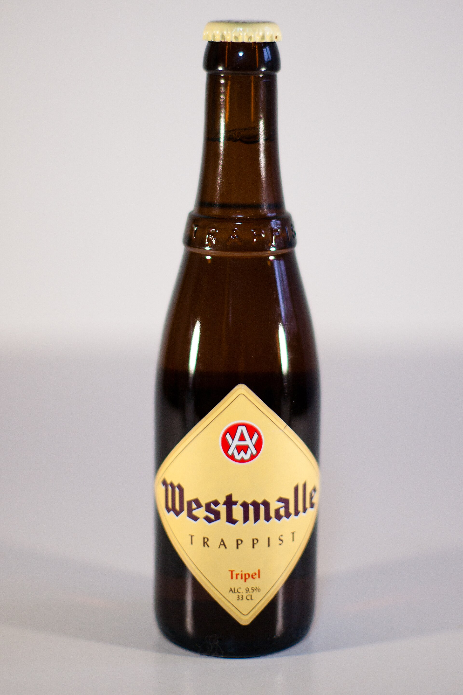

# Westmalle Tripel

Westmalle Tripel is a pale Trappist tripel brewed at Westmalle Abbey in Belgium, commonly 9.5% ABV in 330 mL bottles and fermented again in the bottle. It is known for banana, citrus, spice and a dry bitterness and is a benchmark of the tripel style.

Figure: Related photograph of Westmalle Tripel. Image: Ludovic Péron, CC BY-SA 3.0, via Wikimedia Commons ([source page](https://commons.wikimedia.org/wiki/File:Westmalle_-_Tripel.jpg)).

## Definition and position

Separate the levels first: beer is the broad category, abbey ale is a tradition and institutional background, Belgium is the region, Westmalle is the abbey and brand, and Tripel is the specific product. Keeping the four apart prevents confusion between the style name, the certification mark and the flavour in the bottle.

"Tripel" is a style name for a stronger, paler Belgian ale with noticeable bitterness, usually carrying spice and fruit notes; it is not a legal grade, and it does not mean "fermented three times". Tripels differ greatly between breweries in recipe and ABV, so the specification should be checked on the label.

## Producer and brand

Westmalle is brewed at Westmalle Abbey in Malle, Antwerp province, Belgium. The abbey has a direct supervision relationship with the brewery, which belongs to the Trappist beer system. The range centres on a pale tripel and a dark dubbel with stable styles, making it one of the representative Trappist producers.

Abbey, brewery and product are three levels: the abbey answers supervision and where proceeds go, the brewery answers equipment and craft, and the product answers ABV, volume and style. Public material places the launch of the tripel in the 1930s; the exact year should be checked against brewery material.

## Region and ingredients

The product comes from Flanders in [Belgium](ref:belgium). The two main Belgian traditions are abbey ale and lambic spontaneous fermentation, and Westmalle belongs to the former: controlled yeast, fermentation in relatively closed equipment, and a repeatable house style.

The ingredients are [barley](ref:barley), [wheat](ref:wheat) and [water](ref:water), plus hops and sugar. Barley supplies starch and enzymes for mashing, wheat adds softness, and sugar raises the fermentable content in some stronger products. The exact recipe and proportions are undisclosed, so this page does not treat a single ingredient as the whole explanation of style.

## Production

Malted grain is mashed into wort, fermented with yeast ([fermentation](ref:fermentation)), then matured and blended before bottling. Tripels usually use pale malt and sugar, giving a lighter body at a higher strength; warmer fermentation brings banana and spice aromas.

A small amount of sugar and yeast is added at bottling so the bottle continues to produce carbon dioxide and aroma, creating a second fermentation. The sediment at the bottom is normal yeast and protein deposition and can be left behind when pouring. Specific process parameters belong to abbey brewery information and are only partly public, so this page gives no single set of figures.

## Specification and label

The common [alcohol by volume](ref:abv) is 9.5% ABV, with 330 mL bottles plus gift and market-specific versions. The label should be checked for product name, style, ABV, net content, ingredients, producer and batch; the presence of a Trappist certification mark should also be checked bottle by bottle.

"Tripel" is a style description, not a guarantee that every product with the name comes from an abbey; some commercial products use terms such as "abbey beer", which is a different framework. The local-language back label, importer and anti-counterfeit information support identity checks.

## Flavour and tasting

Typical aromas are banana, pear, citrus and clove, with bready malt and light pepper. The palate is distinctly sweet with a medium-to-full body, bitterness arriving toward the end and a dry spiced finish. At 9.5% ABV the aroma is concentrated and the alcohol more noticeable, and too cold a temperature flattens the layers.

Serve at about 8–10 degrees Celsius in a tulip-shaped glass that gathers the aroma; too cold closes the flavour, too warm pushes the alcohol forward. Mind the sediment when pouring and avoid putting all of it in the glass. After opening, refrigerate and finish soon.

## Drinking and pairing

Roasted meat, poultry, aged cheese and seafood pair well; the dry bitterness cuts fat and lifts savoury flavours, making this one of the few strong beers that suits fish. Avoid overly sweet or highly acidic dishes, which can mask the finer aromas.

The high ABV calls for controlling portion and pace. Carbonation fades after opening, so finish within a few days; store in a dark place, upright and refrigerated. Excessive drinking is harmful to health, and minors should not drink.

## Buying and storage

Buy through regular channels and check anti-counterfeit marks, the local back label, importer and batch number, and confirm the bottle mark and product name. Prices move with market and channel, so this page gives no figures; the brewery's dubbel should be checked separately rather than generalised from the tripel.

Keep unopened bottles in a dark, cool place, standing upright to limit sediment disturbance; deep freezing is unnecessary, but heat and sharp temperature swings should be avoided. Bottle conditioning means the liquid keeps changing slowly, so the drinking window should follow abbey advice and the label.

## Common misconceptions

First, reading Tripel as "fermented three times". It is a style name, not a fermentation count.
Second, treating "Trappist style" as certification. Certification has its own mark and institutional requirements.
Third, assuming pale beer is low in alcohol. Tripels are usually stronger than ordinary lagers.
Fourth, treating bottle sediment as spoilage. It is normal deposition from the second fermentation.
Fifth, judging quality by packaging or stories. Ingredients, craft and label information are more reliable.

**In brief:** A pale Trappist tripel from Westmalle Abbey in Belgium, commonly 9.5% ABV in 330 mL bottles and fermented again in the bottle. Known for banana, citrus, spice and a dry bitterness, it is a benchmark of the tripel style. 

For Westmalle Tripel, begin with the base and the stated strength. Then look at the sweetness or bitterness, and finally ask how it is served. The answers point to different choices, not to a single score.

[Beer](ref:beer) explains style; [Barley](ref:barley) adds region and vintage. Put Westmalle Tripel between them before deciding what it is.

**Key facts.**

| Item | Detail |
| --- | --- |
| In one line | A pale Trappist tripel from Westmalle Abbey in Belgium, commonly 9.5% ABV in 330 mL bottles and fermented again in the bottle. Known for banana, citrus, spice and a dry bitterness, it is a benchmark of the tripel style. |
| Style | Beer |
| Region | Belgium |
| ABV | 9.5–9.5% vol |

## Further reading

- [Beer](ref:beer): categories and basic production.
- [Belgium](ref:belgium): the two traditions of abbey ale and lambic.
- [Barley](ref:barley): the main ingredient for mashing and fermentation.
- [Wheat](ref:wheat): the base of wheat beer.
- [Water](ref:water): how water chemistry affects fermentation and flavour.
- [Fermentation](ref:fermentation): top fermentation and bottle conditioning.
- [Alcohol by volume](ref:abv): what 9.5% ABV means on the label.
- [Chimay Blue](ref:chimay): a comparative read on a dark abbey ale.
- [Rochefort 10](ref:rochefort): a comparative read on another strong abbey ale.
