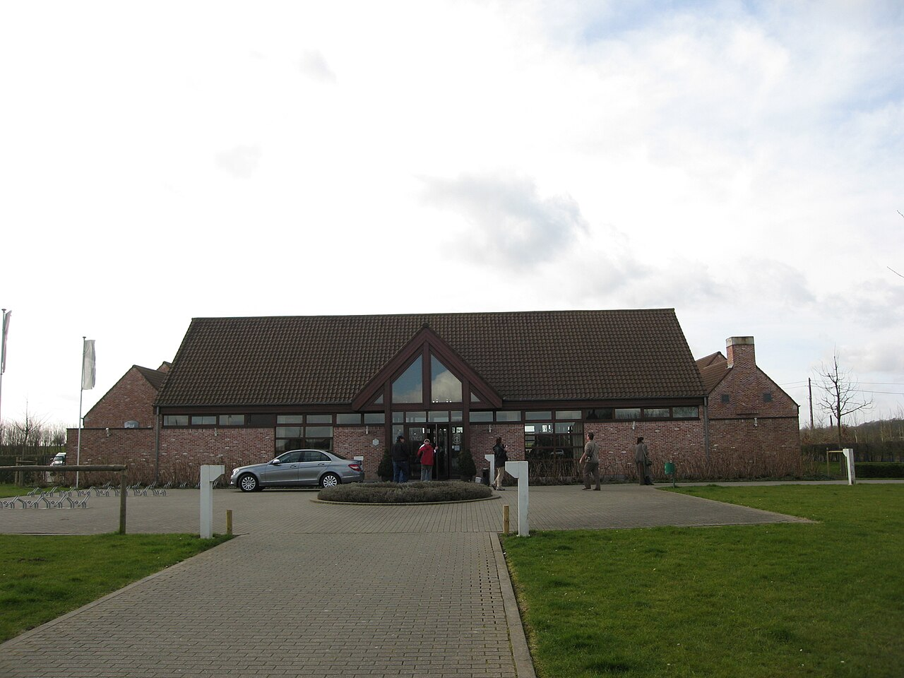

# Westvleteren 12

You can hardly order Westvleteren 12 in a Belgian bar, yet on the secondary market it is often priced at several times its official price. The split easily suggests a carefully managed limited edition. The truth is the opposite: its scarcity comes from an institution that refuses to expand. The monks brew only at the abbey, sell only at the pace of monastic life, and explicitly oppose resale.

Figure: Westvleteren 12. Image: Jamie Lantzy, CC BY 3.0, via Wikimedia Commons ([source page](https://commons.wikimedia.org/wiki/File:WestieRestuarant.JPG)).

## Scarcity is not marketing: the system behind a bottle

Westvleteren 12 is brewed by the Sint-Sixtus Abbey in Vleteren, West Flanders, Belgium, usually 10.2% vol in 330 mL, and refermented in the bottle. It belongs to no large brewing group and has no ordinary distribution system; output is set by the abbey's labour, equipment and daily routine, not by market demand.

This is the reverse of the commercial limited edition. A commercial release usually manufactures scarcity to create a premium and then recovers that premium through channels; Westvleteren treats sales limits as a way of sustaining monastic life and publicly asks buyers not to hoard or resell. Only with that in mind does "hard to buy" make sense rather than "justifiably expensive".

## Sint-Sixtus Abbey: brewing since 1838

Sint-Sixtus is a Cistercian (Trappist) abbey in West Flanders. Brewing began in 1838, initially for the monks and their guests, and later expanded to outside sales in order to support the community and its charitable work. Brewing is part of the abbey economy, not a separate commercial project.

The abbey currently sells Blonde, 8 and 12; the three differ in strength and colour, with 12 the darkest and strongest. The range is small and there are no frequent special editions. That restraint is itself a feature of monastic brewing.

## The three Trappist conditions

"Trappist" is not a marketing word open to anyone. The International Trappist Association requires that the beer be brewed inside the monastery, by monks or under their supervision; that proceeds support monastic life and charity rather than profit; and that production and sales accept association verification. Only when all conditions are met may a product carry the "Authentic Trappist Product" mark.

The rule separates "abbey style" from "abbey product". Many beers labelled Abbey or abbey-style are made by commercial breweries that borrow the style name; Westvleteren is brewed inside the monastery. Identification should rest on the mark and the producer, not on gothic lettering.

## What "12" means: a number, not a strength

"12" is neither alcohol strength nor vintage but the abbey's product number. Reading it as "12% vol" is the most common error; the actual strength is 10.2% vol. Likewise, 8 is not an exact 8% vol statement but another product in the sequence.

Numbering of this kind is common among Belgian abbey beers, but the meaning differs between breweries. Some numbers refer to original gravity, others are merely customary. When comparing across brands, do not infer strength from the number; read the strength on the back label.

## Quadrupel: a customary category without legal status

"Quadrupel" is a commercial and drinking convention, not a grade defined in Belgian law. It usually means a darker, sweeter, stronger abbey-style ale than a tripel, but there is no uniform minimum for colour, sugar or strength. Quadrupels from different breweries can differ widely.

Westvleteren 12 is often treated as a reference point for the category: deep brown liquid, obvious dark dried fruit and caramel, high alcohol warmth, and fine bubbles from bottle conditioning. But "quadrupel" only says roughly which tradition it belongs to; it cannot replace a description of the specific beer.

## Raw materials and bottle conditioning

Public information indicates [water](ref:water), [barley](ref:barley) malt, hops and sugar, with some sources also mentioning [wheat](ref:wheat); the abbey has not published a complete recipe or proportions. What is certain is that dark malt and sugar together build colour, caramel flavour and fermentable sugar, while hops mainly balance sweetness rather than shout aroma.

After fermentation the beer is bottled with sugar and yeast, and a second [fermentation](ref:fermentation) and carbonation take place in the bottle. This has two consequences: fine bubbles and a persistent head, and slow change after packaging, developing reductive aromas and a more integrated palate. Bottle conditioning also means storage conditions directly shape the result, and heat or light accelerates ageing.

## Flavour: from dark dried fruit to alcohol warmth

The liquid is deep brown with red highlights and a thick head. Aroma is dominated by dark dried fruit such as raisin and prune, caramel, toasted bread and peppery spice, with sweeter alcohol notes as the beer warms. The entry is sweet and full, the middle turns dry, and the finish brings bitterness and clear alcohol warmth.

At 10.2% vol it sits high among dark abbey ales, but the alcohol is usually wrapped in sugar and malt thickness rather than sharp like a spirit. Serve at 12–14 degrees Celsius: colder suppresses aroma, warmer pushes alcohol forward. A wide tulip or chalice-shaped glass lets the aroma open.

## How to buy: reservation, rationing and the anti-resale request

Genuine bottles are sold only at the abbey. Purchase normally requires registering through the abbey's published reservation system and collecting at an appointed time; the number of bottles per person and the interval between purchases are regulated, and the exact rules change with the abbey's arrangements. The abbey explicitly opposes resale and reminds buyers that secondary prices are not official.

Check the producer information, product number and bottling date on the bottle. "Limited edition" or "anniversary" claims without official channel evidence deserve caution; real Westvleteren packaging is plain, and the important information is the production data on the label, not an outer box.

## Ageing, temperature and glassware

Bottle conditioning gives it ageing potential: when young, sweetness and alcohol are more prominent; after several years the fruit turns towards dried fruit, leather and spice and the palate integrates. But older is not automatically better. Store at a stable 10–12 degrees Celsius, away from light and vibration; temperature swings age the beer unevenly.

Once opened, finish the bottle, since the remaining beer rarely keeps its carbonation. Take the bottle out of the cellar a day ahead so it warms slowly; do not heat it in warm water, and do not add ice to the glass.

## Common misconceptions

First, taking "12" as strength or vintage. It is a product number, and the actual strength is 10.2% vol.
Second, taking Trappist for a marketing label. It requires monastic production and association certification.
Third, assuming it can be bought freely. Official channels are limited, rationed and reservation-based.
Fourth, treating quadrupel as a legal grade. It is a customary category without uniform standards.
Fifth, judging quality by resale price. Scarcity drives price, which is not the same as flavour assessment.
Sixth, assuming every abbey beer is Trappist. Abbey style and Trappist certification are two different things.

## Further reading

- [Beer](ref:beer): the category and style framework.
- [Belgium](ref:belgium): the regional background of abbey brewing.
- [Barley](ref:barley), [wheat](ref:wheat) and [water](ref:water): the main raw materials.
- [Fermentation](ref:fermentation): the key process in bottle conditioning.
