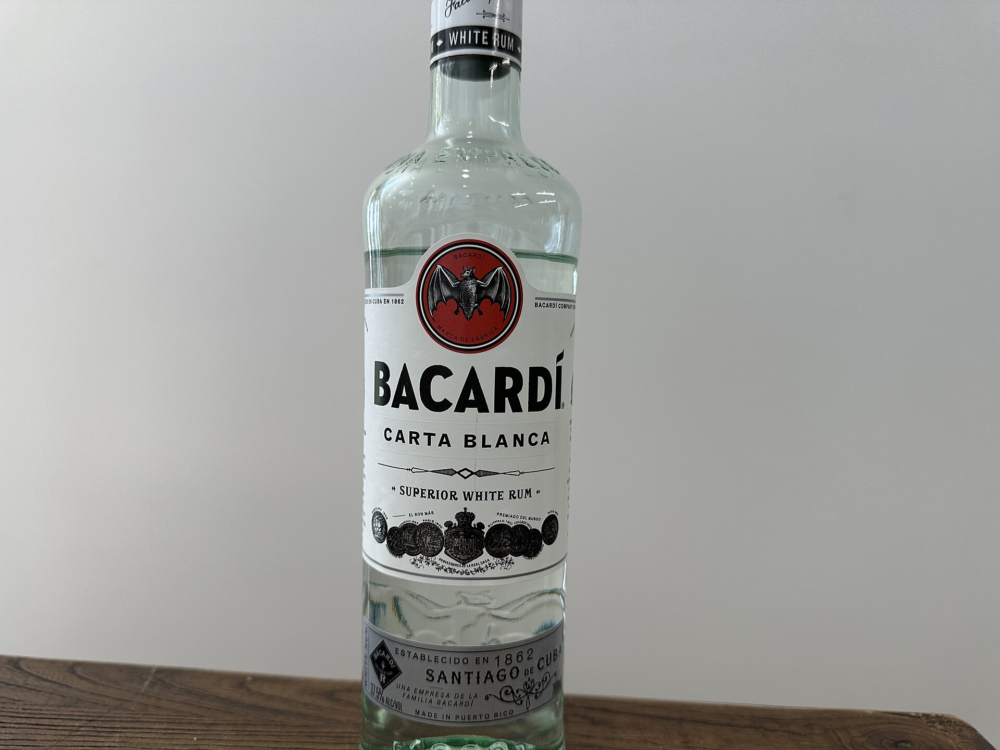

# Bacardí Carta Blanca

Bacardí Carta Blanca is a white rum made from molasses, fermented, distilled and charcoal-filtered, commonly 40% ABV. The brand began in Santiago de Cuba in 1862 and is now headquartered in Bermuda, making it one of the most widely distributed rum brands.

Figure: Related photograph of Bacardí Carta Blanca. Image: Indrajit Das, CC BY-SA 4.0, via Wikimedia Commons ([source page](https://commons.wikimedia.org/wiki/File:Bacardi_Carta_Blanca_Rum_02.jpg)).

## Definition and position

Bacardí Carta Blanca is a white rum within [rum](ref:rum), a distilled spirit made from sugarcane molasses or juice. It is not a vaguely "sugarcane-flavoured alcoholic drink" but a spirit category with defined raw materials, distillation and filtration. White rum stresses a clean, light profile, in contrast to the caramel and aged notes of dark rum.

Brand and product need separating: Bacardí is the brand and Carta Blanca is a specific product. The brand also includes gold, dark and aged rums with different raw materials and goals, and one description cannot cover all products.

In rum classification, white, gold and aged rums are not simply ordered by colour. White rum stresses a clean body after fermentation and distillation, gold rum may see brief wood contact or colouring, and aged rum centres on barrel time and blending complexity. Buying by colour alone easily misses process differences. Regulations also recognise agricole rum made from cane juice, which runs parallel to the molasses route.

## Origin and history

Bacardí was founded by Facundo Bacardí Massó in Santiago de Cuba in 1862. Cuban sugarcane growing and sugar production provided ample raw material, and Caribbean distilling traditions shaped early methods. The brand internationalised during the 20th century and later moved production and headquarters out of Cuba after the revolution.

Today Bacardí has production in Puerto Rico, Mexico and elsewhere, and its products are sold in many countries. Relocated production means different products under one brand may come from different plants, so the label is the guide. "Cuban style" describes flavour and history, not a guarantee that every bottle is made in Cuba.

## Raw materials

The main material is sugarcane molasses, a by-product of sugar production. Molasses contains fermentable sugars and minerals, and is usually diluted and adjusted before fermentation. Some rums ferment cane juice directly for a fresher cane character, but the mainstream white-rum route still uses molasses.

Raw-material quality shapes the fermentation start. Poor storage or handling of molasses brings burnt or off notes, so producers control temperature and hygiene. Water is used repeatedly in dilution, fermentation and reduction, and water quality also affects the final palate.

## Production

The typical flow is: molasses dilution, fermentation, [distillation](ref:distillation), dilution, charcoal filtration, blending and bottling. Fermentation ranges from more than ten hours to several days, with temperature and yeast strain setting flavour precursors; distillation is usually continuous, giving higher strength and a cleaner spirit.

Charcoal filtration is the key white-rum step: it removes some colour, fusel alcohols and heavier flavours, making the body lighter. The degree of filtration is a producer decision; over-filtering costs character, while under-filtering may leave off-notes. The spirit is then reduced to 40% ABV, rested, blended and bottled.

## Flavour and tasting

White rum is usually light and clean, with cane sweetness, a little vanilla and citrus, a soft entry and a short finish. It differs from the vanilla, caramel and spice of aged rum, and evaluation focuses on cleanliness and balance rather than complexity.

Sip a little neat to feel sweetness and heat, then add ice or water and watch the aroma change. White rum should not be judged by heavy-oak standards; obvious sharpness, solvent notes or cloying sweetness indicate a quality or storage problem.

## Product lines and labels

Bacardí's range includes white, gold, dark and aged rums. The strength, volume, origin and product name on the label are the basics for identity. "White" refers to colour and style after filtration, not to being unaged or unprocessed.

Counterfeits and similar names exist in some markets, so buy through official channels. Mixing rum and sipping aged rum have different roles, and price differences come from process and ageing rather than brand premium alone. For a specific product, sweetness and whether sugar is added should follow the label and official information.

## Drinking and pairing

White rum is best suited to cocktails: the Mojito, Daiquiri and Cuba Libre all use it as a base. Balance lime acidity, syrup sweetness and ice dilution; the clean body carries these flavours without dominating them.

Neat serving can include ice, but the spirit should not be gulped. Light seafood, tropical fruit and citrus desserts pair well; very spicy or heavily sauced dishes mask its delicate aroma. Store opened bottles away from light; long exposure to air and heat dulls the aroma.

## Common misconceptions

First, that white rum is unaged. White rum may be briefly aged and then filtered; white does not mean unprocessed.
Second, treating Bacardí as a category. It is a brand; rum is the category.
Third, that all rum comes from Cuba. Production is now diversified.
Fourth, that white rum is only for mixing. It can be sipped, though the profile is light.
Fifth, judging quality by sweetness. Added sugar and process choices vary, and sweet does not mean good.

**In brief:** A white rum made from molasses, fermented, distilled and charcoal-filtered, commonly 40% ABV, and a base for Mojitos and Daiquiris.

Start with the base and the stated strength. From there, consider the sweetness or bitterness, then how it is served. That is how a practical judgment about Bacardí Carta Blanca is built.

Carta Blanca is the flagship white rum, charcoal-filtered and light enough for Mojitos and Daiquiris; the label's ABV varies by market, so check the bottle.

**Key facts.**

| Item | Detail |
| --- | --- |
| In one line | A white rum made from molasses, fermented, distilled and charcoal-filtered, commonly 40% ABV, and a base for Mojitos and Daiquiris. |
| Style | Rum |
| ABV | 40–40% vol |

**Sources and limits.** The key claims about Bacardí Carta Blanca are checked against the following sources: Bacardí (brand history, raw materials and product information), European Union (rum definitions and minimum strength), Oxford University Press (Consulted for entries on rum and Bacardi). Prices, batches and status change; the body is project-written and does not reproduce source text.

**Read alongside.** Put Bacardí Carta Blanca next to Rum, Distillation, Alcohol by volume (ABV): the first fixes identity and boundary, the others provide a region, process or peer comparison. Read this page first, then return to those entries; the links become coordinates, not decoration.

## Further reading

- [Rum](ref:rum): the definition, raw materials and main types of rum.
- [Distillation](ref:distillation): how continuous distillation affects a clean body.
- [Alcohol by volume](ref:abv): the 40% ABV label and the reduction process.
