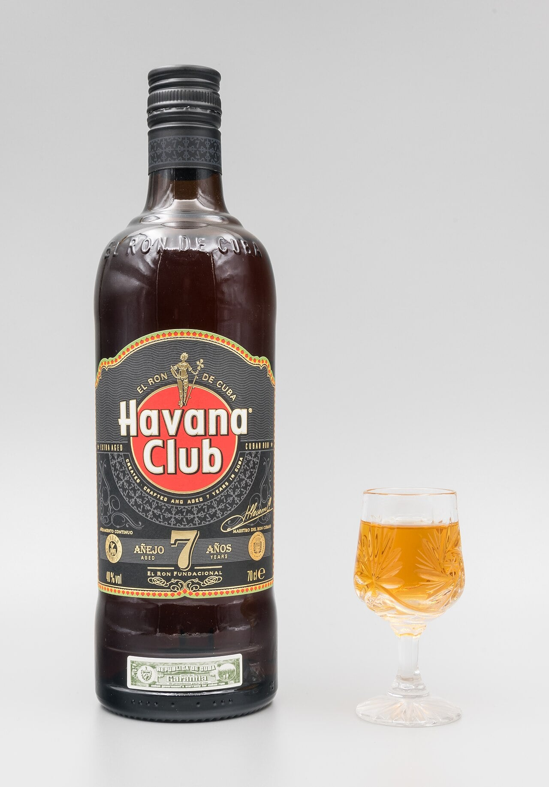

# Havana Club 7

Havana Club 7 is a Cuban rum brand. Molasses-based rums are blended and aged, commonly at 40% ABV, with vanilla, caramel, tobacco and tropical-fruit notes.

Figure: A bottle of Havana Club 7 Años with a tulip glass of rum; the “7 Años” age statement is visible on the label. Image: Jacek Halicki, CC BY-SA 4.0, via [source page](https://commons.wikimedia.org/wiki/File:2023_Havana_Club_A%C3%B1ejo_7_A%C3%B1os_(3).jpg).

## Definition and position

Havana Club is the brand, 7 is the product name, and rum is the category. It belongs to aged rum within [rum](ref:rum), not white rum. "Havana" points to the Cuban capital and its rum tradition, but does not mean every bottle is made in Havana.

Ownership has a long dispute: a Cuban state enterprise produces with the French group Pernod Ricard, while another company uses a similar trademark in some markets. Buyers should read the producer, origin and import information on the label rather than judging by brand name alone.

Aged and white rums differ not only in colour but in tannin, vanillin and ester changes from wood contact. Filtration and added sugar also change the final palate, so "darker" does not mean "longer aged", and "sweeter" does not mean "better".

## Origin and history

Cuban sugarcane growing and sugar production gave rum its raw-material base, and Caribbean distilling traditions shaped local methods. The Havana Club brand was created in the 1930s and later went through nationalisation and international partnership after the Cuban revolution, forming today's production and sales structure.

The complexity of origin and history means "Cuban rum" is both a geographical description and a market story. Understand a product by separating brand history, production place and specific batch rather than letting the story replace label information.

## Raw materials

The main material is sugarcane molasses. Molasses is diluted and adjusted for sugar content before fermentation, and yeast and temperature set flavour precursors. Some rums use cane juice, but the mainstream aged-rum route still uses molasses for stable sugar and fuller body.

Water is used repeatedly in fermentation, dilution and reduction, and its quality affects the palate. Poor handling of raw materials or water brings off-notes, so producers control storage temperature and hygiene. The specific recipe is producer information.

## Production

The typical flow is: molasses treatment, fermentation, [distillation](ref:distillation), ageing, blending, reduction and bottling. Ageing usually uses oak barrels, and [oak ageing](ref:oak-ageing) brings vanilla, caramel, spice and wood notes and rounds the body.

Blending after ageing is central to aged rum: base spirits of different barrel ages and styles are combined to reach a stable aroma and palate. The "7" in the name is a product designation; the age structure and proportions are set by the producer, and it does not mean the youngest liquid in the bottle is necessarily 7 years old.

Warehouse temperature and humidity affect exchange between liquid and wood and the share lost to evaporation. In tropical climates maturation is usually faster and flavour changes more pronounced, which is one reason Cuban rum differs from rums aged in temperate climates.

## Flavour and tasting

Havana Club 7 usually shows vanilla, caramel, tobacco, tropical fruit and light spice, with a rounded palate, noticeable sweetness and a medium finish. It is more complex than white rum but still a blended aged rum, not a single-cask extreme.

Sip a little neat to feel sweetness and wood, then add a large ice cube and watch the aroma open. Obvious solvent notes, heavy cloying sweetness or a bitter tail indicate a quality or storage problem. Sweetness may come from ageing and added sugar, and the label and official information are the guide.

## Product lines and labels

Havana Club products include white rum, aged rums and premium series, with 7 in the mid-range aged segment. Strength, volume, origin, producer and age designation on the label are the basics for identity.

Market versions may differ in recipe and labelling, and imported products should carry compliant local labelling. Buy through official channels and check anti-counterfeit and importer information; price and scarcity do not equal quality, and batch variation still needs actual tasting.

Blenders combine base spirits by aroma profile, aiming for balance among sweetness, wood and fruit. Batch variation therefore exists, and the same product bottled in different years may differ slightly, which is why tasting matters more than labels alone.

## Drinking and pairing

Suited to neat serving or with ice, and to Cuban-style cocktails. A large ice cube lowers the heat and releases aroma slowly; cola masks most detail and suits casual drinking rather than tasting.

Cigars, dark chocolate, caramel desserts and grilled meat pair well; light seafood is overwhelmed by sweetness and wood. Store opened bottles away from light in a cool place and finish reasonably soon to avoid long oxidation.

## Common misconceptions

First, treating "7" as the minimum age of the liquid. It is a product designation, and the age structure is set by the producer.
Second, that all Cuban rum is made in Cuba. Brand and origin relationships are complex; read the label.
Third, treating aged rum as white rum with added colour. The two have different processes and goals.
Fourth, that more sweetness is better. Sweetness is a style choice, not a quality standard.
Fifth, using a cocktail experience in place of neat tasting. Mixers mask detail.

For Havana Club 7, begin with the base and the stated strength. Then look at the sweetness or bitterness, and finally ask how it is served. The answers point to different choices, not to a single score.

**Short definition:** A Cuban rum brand; molasses-based rums are blended and aged, commonly 40% ABV, with vanilla, caramel and tropical-fruit notes. 

A common misreading treats Havana Club 7 as a drink style or a brand. The correction is to ask which style it belongs to, then who makes it and which vintage or batch, and keep the answers apart.

**Key facts.**

| Item | Detail |
| --- | --- |
| In one line | A Cuban rum brand; molasses-based rums are blended and aged, commonly 40% ABV, with vanilla, caramel and tropical-fruit notes. |
| Style | Rum |
| ABV | 40–40% vol |

**Sources and limits.** The key claims about Havana Club 7 are checked against the following sources: Havana Club (product range, ageing and strength information), European Union (rum definitions and categories), Oxford University Press (Consulted for entries on Cuban rum and Havana Club). Prices, batches and status change; the body is project-written and does not reproduce source text.

**Read alongside.** Put Havana Club 7 next to Rum, Distillation, Oak ageing: the first fixes identity and boundary, the others provide a region, process or peer comparison. Read this page first, then return to those entries; the links become coordinates, not decoration.

## Further reading

- [Rum](ref:rum): the definition, raw materials and main types of rum.
- [Distillation](ref:distillation): how distillation shapes the body.
- [Oak ageing](ref:oak-ageing): the source of aroma in aged rum.
- [Alcohol by volume](ref:abv): the 40% ABV label and the reduction process.
