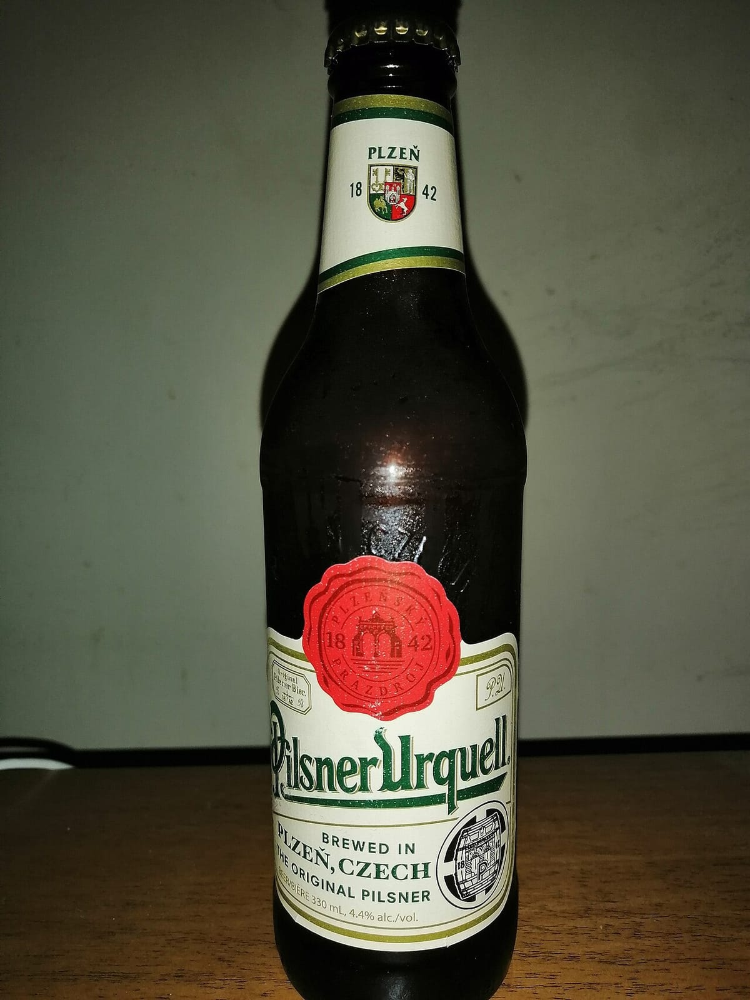

# Pilsner Urquell

Pilsner Urquell is brewed in Plzeň, Czechia, first made in 1842 and one of the prototypes of pale lager. It uses local soft water, Saaz hops, triple decoction and open fermentation, at about 4.4% ABV.

Figure: Pilsner Urquell. Photograph: Pilsner Urquell 330mL Bottle. Credit: Latterdaystan, CC BY-SA 4.0, via Wikimedia Commons ([source](https://commons.wikimedia.org/w/index.php?curid=92861055)).

## Definition and position

Pilsner Urquell is a specific brand and product and is also regarded as the beginning of the "Pilsner" style. In [beer](ref:beer), pale lager means bottom-fermented, cold-conditioned, light-coloured beer with a clear bitterness; Pilsner Urquell is the historical prototype, but not every product called "Pilsner" comes from Plzeň.

"Pilsner" later became a style name, and many countries make their own Pilsner-type beers. A protected origin and a style name are different things: the first points to a specific place and producer, the second describes process and flavour direction. When reading a label, separate brand, style and origin, and when you see "Pilsner", first ask whether it means style or brand.

## Origin and environment

Plzeň lies in western Czechia with a temperate continental climate: cold winters, mild summers and moderate rainfall. Local water is known for being soft, and low mineral content helps the bitterness and aroma of hops stand out and affects the stability of saccharification and fermentation. This water was once a key condition for the style.

[Terroir](ref:terroir) here refers more to water, soil and agriculture than to vineyard-like site differences. Czech malting barley and Saaz hops form the raw-material base; the hops bring herbal, spicy and faintly citrus notes that are central to Pilsner bitterness and aroma.

## Raw materials

The main materials are barley malt, water, hops and yeast. Barley is malted and kilned to provide fermentable sugar and colour; Pilsner uses pale malt, giving the beer its golden colour. Saaz hops are fine and clean in bitterness and are a key clue to the style.

Water quality affects mash pH and mineral balance. Soft water makes hop bitterness seem direct rather than coarse and helps the yeast work. Ingredient proportions, malt kilning and hop timing all change the final aroma and bitterness.

## Production

The typical flow is: milling, mashing, lautering, boiling, cooling, pitching yeast, primary fermentation, secondary fermentation and cold conditioning. Pilsner Urquell traditionally uses triple decoction, removing part of the mash, boiling it and returning it, to improve saccharification and shape flavour.

Primary fermentation uses open vessels, making it easier to observe foam and remove impurities; cold conditioning follows, settling yeast and stabilising flavour. Filtration and pasteurisation affect shelf life and freshness. Specific plant details are producer information; this entry describes the public traditional route only.

Saaz aroma needs appropriate bitterness behind it. Hops are usually added in stages: early additions give bitterness, later additions preserve aroma. The "clean" bitterness of Czech Pilsner is linked to soft water, pale malt and low mineral content rather than simply using more hops.

Czech beer culture is deep, and Pilsner is often an everyday mealtime beer rather than a festival-only drink. That setting also shaped strength and package formats and made pale lager the country's most common beer type.

## Flavour and tasting

Pilsner Urquell typically shows malt sweetness, herbal and spicy Saaz hops, clear but balanced bitterness, a clean finish and a medium-light body. It is not a heavy or highly bitter IPA and does not rely on intense fruit; evaluation focuses on cleanliness, bitterness quality and malt support.

Look at colour and foam, then smell malt and hops; taste for when bitterness appears and how long it lasts. Too cold suppresses aroma, too warm makes the beer loose. When comparing with other Pilsners, use the same style framework rather than IPA bitterness standards.

## Product lines and labels

Pilsner Urquell products include different packages and market versions, and strength and original gravity can vary by product. The brand, origin, strength, original gravity and best-before date on the label are the basics for identity. [Beverage-alcohol classification](ref:gbt-17204) places beer among fermented drinks, which helps avoid confusing it with distilled spirits.

Phrases such as "imported original" and "Czech origin" need to be read with the import label and producer information. Recipe adjustments for different markets can change strength and flavour, so check the label rather than relying on the brand name and packaging.

## Drinking and pairing

Chill to about 6–8°C and use a clean glass. The Czech pouring style produces foam of different thickness, affecting aroma and palate; at home you need not chase the ritual, but avoid foam that is far too thick or thin. Finish an opened bottle soon, since repeated warming accelerates oxidation.

Roast pork knee, fried chicken, sausages and bread suit it; light seafood and salads also set off its bitterness and malt sweetness. Very spicy dishes mask the fine hop aroma. Drink beer in moderation and avoid rapid drinking on an empty stomach.

## Common misconceptions

First, calling every pale lager a Pilsner. Pilsner is a specific style, not all light-coloured beer.
Second, that more bitterness means more authentic. Bitterness needs malt and body behind it.
Third, treating "Pilsner" as an origin guarantee. It has become a style name.
Fourth, that colder beer is always better. Very low temperature suppresses aroma.
Fifth, judging Pilsner by IPA standards. The aims differ.

**In brief:** A pale lager from Plzeň, Czechia, first brewed in 1842 with soft water, Saaz hops and triple decoction, about 4.4% ABV.

To read Pilsner Urquell, start with the base and the stated strength, then the sweetness or bitterness, then how it is served; no single check settles it.

The comparison with [Beer](ref:beer) and [Terroir](ref:terroir) runs through style and region and vintage. Each answers a different question.

**Key facts.**

| Item | Detail |
| --- | --- |
| In one line | A pale lager from Plzeň, Czechia, first brewed in 1842 with soft water, Saaz hops and triple decoction, about 4.4% ABV. |
| Style | Beer |
| ABV | 4.4–4.4% vol |

**Sources and limits.** The key claims about Pilsner Urquell are checked against the following sources: Plzeňský Prazdroj (brand history, raw materials and brewing information), Beer Judge Certification Program (the style description of Czech pale lager), Oxford University Press (Consulted for entries on Pilsner, Czech beer and decoction). Prices, batches and status change; the body is project-written and does not reproduce source text.

**Read alongside.** Put Pilsner Urquell next to Beer, GB/T 17204-2021 Terminology and classification of alcoholic beverages, Terroir: the first fixes identity and boundary, the others provide a region, process or peer comparison. Read this entry first, then return to those entries; the links become coordinates, not decoration.

## Further reading

- [Beer](ref:beer): the broad category, raw materials and basic process.
- [Beverage-alcohol classification](ref:gbt-17204): where beer sits in the drinks system.
- [Terroir](ref:terroir): how water and agriculture shape style.
- [Alcohol by volume](ref:abv): the 4.4% ABV label and low-strength fermented drinks.
