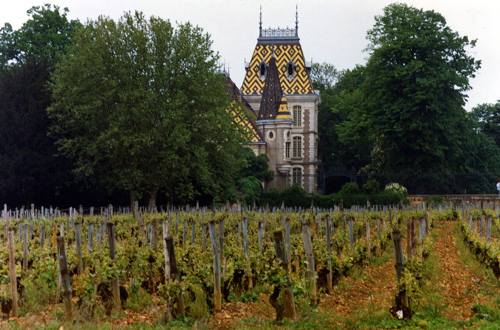

# Aloxe-Corton

Aloxe-Corton sits at the northern edge of the Côte de Beaune, [Burgundy](ref:burgundy), [France](ref:france), with its vineyards climbing straight out of the village onto a solitary hill. In 1862 the commune added the name of its most valuable lieu-dit to its own, producing the double name used today: a unusually literal case of a village borrowing prestige from a vineyard. Reds are made from [Pinot Noir](ref:pinot-noir), whites from [Chardonnay](ref:chardonnay); bottles are usually 750 mL at around 12.5%–13.5% [alcohol by volume](ref:abv).

Figure: Aloxe-Corton. Image: PhillipC, CC BY 2.0, via Wikimedia Commons ([source page](https://commons.wikimedia.org/wiki/File:Aloxe-corton-21.jpg)).

## Two appellations on one hill

Three things are easily confused: the village appellation, the grand cru appellations, and the administrative commune where the parcels lie. Aloxe-Corton village is a separate AOC; its grapes must come from the delimited parcels of Aloxe-Corton and Ladoix-Serrigny. Corton and Corton-Charlemagne are two further grand cru appellations shared across Aloxe-Corton, Ladoix-Serrigny and Pernand-Vergelesses. The same hill therefore carries three regulatory identities, and the name on the label decides whether the wine is a village wine or a grand cru.

The dates also differ: the village AOC dates from 1938, while Corton and Corton-Charlemagne were recognised on 31 July 1937. Below village level sit 14 premiers crus. Eight are in Aloxe and six in Ladoix. This is often missed: a bottle labelled Aloxe-Corton Premier Cru need not come from Aloxe at all.

## Gradient, aspect and marl on the Corton slope

The hill rises to roughly 250–330 m and forms a shallow amphitheatre, a shape rare in the Côte. Its mid-slope is gentle, with reddish, pebbly soil derived from brown limestone and potassium-rich marl. Higher up, younger Oxfordian limestone connects the site to the Ladoix–Meursault belt. Village-level vines mostly lie between 200 and 300 m, facing due east, which brings early ripeness.

The white grand cru parcels sit higher: 280–330 m, with slopes of 20%–23% and a predominantly south-west aspect, unusual in a region that otherwise looks east. The soil is yellow, ochre and brown marl, clay-rich, with limestone bands alternating beneath a thin rendzina. The red/white boundary is therefore a boundary of altitude, slope and marl proportion, not a simple north-versus-south story.

## The grand cru roster and its shared geography

In 2022 Corton had 87.04 ha of red and 3.95 ha of white, with AOC status dating from 31 July 1937. It is the only Côte de Beaune grand cru led by red wine. Reds may add a climat name; whites may not. Within Aloxe, the main white grand cru climat is Le Charlemagne.

Corton-Charlemagne covers 57.70 ha, also from 31 July 1937, shared by Aloxe, Ladoix and Pernand. Each commune contributes different climats: Le Charlemagne in Aloxe, En Charlemagne in Pernand, and Pougets, Corton and Languettes in Ladoix. One rule is especially unusual: the same parcel may be declared as Corton if planted to Pinot Noir, or as Corton-Charlemagne if planted to Chardonnay. The producer chooses according to the variety in the ground, which makes the red/white frontier reversible at parcel level.

## Le Charlemagne: an emperor's parcel

In 775 Charlemagne donated this vineyard to the collegiate church of Saint-Andoche at Saulieu, and it remained in church hands for roughly a millennium. The grand cru still gathers the Charlemagne and En Charlemagne climats, plus several neighbours, under one name. The popular story that the emperor's beard was stained red by wine and that he therefore switched to white grapes is legend, not documented history; what can be checked is the donation, the ecclesiastical tenure and the 1937 appellation date.

## The rulebook in numbers

BIVB figures for 2018 give 118.53 ha of village red (35.91 ha premier cru) and only 1.36 ha of village white (0.27 ha premier cru), with average annual production of 4,789 hl red and 49 hl white. Maximum yields are 50 hl/ha for village red and 57 hl/ha for village white; premier cru limits are 48 and 55, with butoir ceilings of 58/64 and 56/62. Minimum natural alcohol is 10.5% for village red and 11% for village white, rising to 11% and 11.5% for premier cru. Planting density must reach at least 9,000 vines per hectare, with rows no wider than 1.25 m.

The grand cru is tighter still: 42 hl/ha for Corton red and 48 hl/ha for Corton white, with minimum natural alcohol of 11.5% and 12% respectively. These figures can be adjusted when the cahier des charges is revised, so the latest regulatory text and BIVB data remain authoritative.

## Why village-level white is only 1.36 hectares

The cahier itself notes that in 2008 the commune had about 120 ha under vine and produced around 4,500 hl, 98% of it red. The scarcity of white is not a marketing choice but the result of geology and history: most of the high marl that suits Chardonnay has already been classified inside Corton-Charlemagne. The result is a paradox. Aloxe is famous for white wine, yet its village-level white is almost negligible.

## DRC's three parcels and Chandon de Briailles

Domaine de la Romanée-Conti has leased the Corton parcels of Domaine Prince Florent de Mérode since 11 November 2008: 2.2746 ha spread over Clos du Roi, Les Bressandes and Les Renardes, with the first harvest in 2009. Production is wildly variable, from under 3,000 bottles to more than 8,000, which helps explain the price.

Chandon de Briailles, based in Savigny, farms 12 crus across Savigny, Pernand and Aloxe and has been biodynamic since 2005. Its Aloxe wines tend to use whole clusters and light extraction, the opposite of the DRC approach, yet both show that the village's reds are not a single template.

## Style against Pernand and Savigny

Aloxe reds are usually deep in colour, firm in tannin and medium-plus in acidity, with black cherry, raspberry and earth when young, moving to leather, mushroom and leaf litter with age. Compared with Pernand to the west, they ripen earlier and feel weightier; compared with Savigny to the south, they have more skeleton and less immediate charm. The whites, almost all from grand cru parcels, show hazelnut, honey, flint and baked apple, with real texture and acidity wrapped inside it.

The difference is topographic rather than winemaking. A due-east aspect and reddish gravelly soil let Pinot Noir reach higher ripeness, while marl keeps the mid-palate fresh. Pernand's valley floor and higher altitude push ripening later, giving lighter, more floral wines.

## What the bottles cost

Typical European retail ranges in 2026 are roughly €30–45 for village red, €45–75 for premier cru and €90–180 for Corton grand cru; DRC's Corton usually exceeds €1,500. White grand cru, almost always Corton-Charlemagne, sits around €90–150, with top producers higher. Prices move with vintage, scores, merchant and exchange rate, so these are orders of magnitude rather than quotations.

## Pairing logic, not pairing lists

The reds' tannin and extraction need protein and fat: steak, braised beef, roast game, and washed-rind cheeses such as Époisses or Ami du Chambertin. The whites' texture suits lobster, langoustine, poultry in cream sauce and blue cheese. Conversely, steamed fish or raw oysters will be overwhelmed by a grand cru white's oak and body; the mismatch is in the pairing, not the wine.

## Correcting "Aloxe is red only"

The claim is half true. Village white really is only 1.36 ha, effectively negligible; but the commune's white grand cru parcels are not small, and a substantial part of Corton-Charlemagne lies in Le Charlemagne. The accurate statement is that Aloxe's village appellation is overwhelmingly red, while its white reputation comes from the grand cru, not the village. A second common error is to treat "Aloxe-Corton" as "Corton": the first is a village, the second a grand cru, with different rules and prices.

## A label checklist

Read the label in order: village or grand cru name, premier cru and climat if present, colour, vintage, bottler. Grand cru must show GRAND CRU; white Corton-Charlemagne does not carry a climat name. The village-to-premier-cru price gap is usually less than double, while grand cru can multiply it several times. If a bottle is advertised as grand cru at village price, check the bottler and importer before believing it.

## Cross-references

- [Red wine](ref:red-wine) and [white wine](ref:white-wine): the two broad categories.
- [Pinot Noir](ref:pinot-noir) and [Chardonnay](ref:chardonnay): the varieties behind them.
- [Grape](ref:grape), [fermentation](ref:fermentation) and [oak ageing](ref:oak-ageing): from raw material to process.
- [France](ref:france) and [Burgundy](ref:burgundy): the regional frame.
- [Alcohol by volume](ref:abv): the label term.
- [Corton](ref:corton): the grand cru sharing the hill.
- [Pernand-Vergelesses](ref:pernand-vergelesses): the appellation on the western side.

Start with the base and the stated strength. From there, consider the sweetness or bitterness, then how it is served. That is how a practical judgment about Aloxe-Corton is built.

The comparison with [Red wine](ref:red-wine) and [France](ref:france) runs through style and region and vintage. Each answers a different question.
