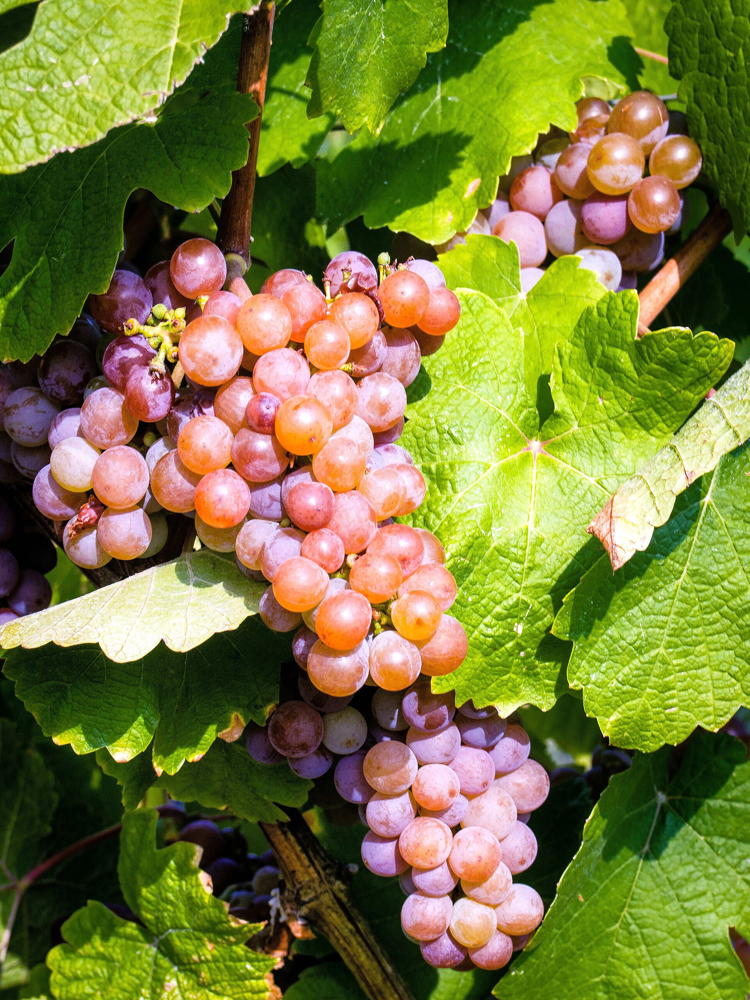

# Alsace Gewürztraminer

Alsace Gewürztraminer is a [Gewürztraminer](ref:gewurztraminer) white wine from the Alsace region of France. Alsace is known for single-variety labelling, and Gewürztraminer is usually bottled on its own rather than blended. Wines range from dry to late harvest (Vendanges Tardives, VT) and botrytised selection (Sélections de Grains Nobles, SGN), with lychee, rose, ginger and cinnamon aromas; commonly 750 mL, with dry styles at about 12.5%–14% [alcohol by volume](ref:abv).

Figure: Related photograph of Alsace Gewürztraminer. Image: Rolf Kranz, CC BY-SA 4.0, via Wikimedia Commons ([source page](https://commons.wikimedia.org/wiki/File:Gewurztraminer_(Andlau,_Alsace).jpg)).

## Definition and position

Start with the levels: [white wine](ref:white-wine) is the category, Gewürztraminer is the variety, Alsace is the region, and individual estates and wines are the producer level. Alsace labels often name the variety directly, which is a feature of the regional system and does not mean every bottle is the same style.

"Alsace Gewürztraminer" is not a synonym for sweet wine. One region and one variety can produce dry, late-harvest and botrytised grades with very different sweetness and concentration. When reading a label, check for a VT or SGN designation as well as alcohol and vintage.

## Producer and brand

Alsace is dominated by family estates, alongside négociants and cooperatives. Sizes vary greatly: some estates own parcels and bottle themselves, while others buy grapes or wine and blend. The bottler information on the label is the key to telling estate wine from merchant wine.

Producer, region and product are three levels: the region answers for rules and the variety system, the producer answers for who farms, who makes and who bottles, and the product answers for vintage, grade and specification. Styles differ markedly between estates, and one wine cannot stand for the whole region.

## Region and ingredients

Alsace lies in eastern [France](ref:france), next to the Rhine and the German Palatinate. The mountains shield the area, giving low rainfall and ample sun, and autumns are relatively dry, favouring late picking and noble rot. Soils are varied, with granite, limestone, schist and marl in different places.

The raw material is [grape](ref:grape), of the [Gewürztraminer](ref:gewurztraminer) variety. The Alsace variety system requires the official variety name when a wine is labelled by variety, while blends carry the Alsace name or a corresponding grade; the regulations govern the details.

## Winemaking

Dry Alsace Gewürztraminer usually completes [fermentation](ref:fermentation) in temperature-controlled vessels to preserve aroma and control alcohol; some estates use old oak for texture. Late-harvest and botrytised selections depend on higher ripeness at picking and noble rot, and where fermentation stops sets the final sweetness.

Gewürztraminer is naturally low in acidity, and a hot fermentation or over-extraction makes the wine loose and hot. Specific parameters are estate information, and this entry gives no universal figures; the estate's own material and the label govern.

## Specification and label

The common volume is 750 mL, with dry styles at about 12.5%–14% [alcohol by volume](ref:abv), and late-harvest and botrytised selections may be higher. The label should be checked for region, variety, vintage, grade (VT, SGN), alcohol, bottler and importer.

Alsace labels often use German-style place and site names, and Chinese back labels transliterate them. Label languages differ by market, so the bottle on hand governs; grade terms have regulated meanings and cannot be used as loose marketing words.

## Flavour and tasting

Typical aromas are lychee, rose petal, ginger, cinnamon and grapefruit peel, bold and highly recognisable. Dry styles have low acidity, a medium to full body and obvious alcohol, while late-harvest and botrytised selections add honey, apricot and dried fruit, with high sweetness that still needs acidity for balance.

For tasting, serve at about 8–10 degrees Celsius, slightly warmer for dry styles. Too warm a temperature pushes alcohol and sweetness forward and hides the aromatic layers. Quality rests on natural aroma and the balance of acidity and body more than on sheer intensity.

## Drinking and pairing

Dry styles suit Asian spiced dishes, Thai sour-hot food, ginger and scallion cooking and soft cheese, where the aroma meets the spice. Late-harvest and botrytised selections suit fruit desserts, blue cheese and foie gras, but avoid layering with food that is sweeter still.

Dry styles are for drinking within 3–8 years, while late-harvest and botrytised selections last longer; the window depends on vintage and grade. After opening, refrigerate and drink soon. Excessive drinking harms health and minors should not drink.

## Buying and storage

Buy from reputable channels and check region, variety, grade, vintage and bottler information. Prices vary widely with grade, vintage and estate reputation, so no figure is given here; grade designations are not a quality ranking, and style fit matters more.

For Alsace Gewürztraminer, unopened bottles should be kept away from light, lying flat in a cool place at an ideal 10–13 degrees Celsius, avoiding heat and sharp temperature swings. Cork-sealed bottles need humidity and can be stored lying down. After opening, refrigerate and drink soon; sweet wines oxidise slowly, but aroma still fades.

## Common misconceptions

First, treating Alsace Gewürztraminer as a sweet wine by definition. Dry styles are equally common.
Second, assuming stronger aroma means better quality. Acidity and balance matter too.
Third, treating VT and SGN as marketing terms. They are regulated grades.
Fourth, believing Gewürztraminer cannot pair with savoury food. Dry styles match spiced dishes and cheese well.
Fifth, judging authenticity by price or packaging. Channel, back label and bottler information are more reliable.

**In brief:** A Gewürztraminer white wine from the Alsace region of France, labelled by variety and available as dry, late-harvest (VT) and botrytised selection (SGN) styles. Known for lychee, rose, ginger and cinnamon aromas, with low acidity and bold aroma; commonly 750 mL, dry styles about 12.5%–14% vol.

Alsace Gewürztraminer is best read by starting with the base and the stated strength, moving to the sweetness or bitterness, and ending with how it is served.

[White wine](ref:white-wine)'s style and [Alsace](ref:alsace)'s region and vintage form a useful pair: the contrast shows where one ends and the other begins.

**Key facts.**

| Item | Detail |
| --- | --- |
| In one line | A Gewürztraminer white wine from the Alsace region of France, labelled by variety and available as dry, late-harvest (VT) and botrytised selection (SGN) styles. Known for lychee, rose, ginger and cinnamon aromas, with lo… |
| Style | White wine |
| Region | France |
| ABV | 12.5–14% vol |

## Further reading

- [White wine](ref:white-wine): the wider category to which this wine belongs.
- [Gewürztraminer](ref:gewurztraminer): the only variety in this wine.
- [France](ref:france): French wine law and appellations.
- [Alsace](ref:alsace): the region's geography, varieties and tier system.
- [Grape](ref:grape): the basic structure of wine grapes and ripeness measures.
- [Fermentation](ref:fermentation): the logic of cool fermentation and residual sugar.
- [Alcohol by volume](ref:abv): what 12.5%–14% vol means on a label.
