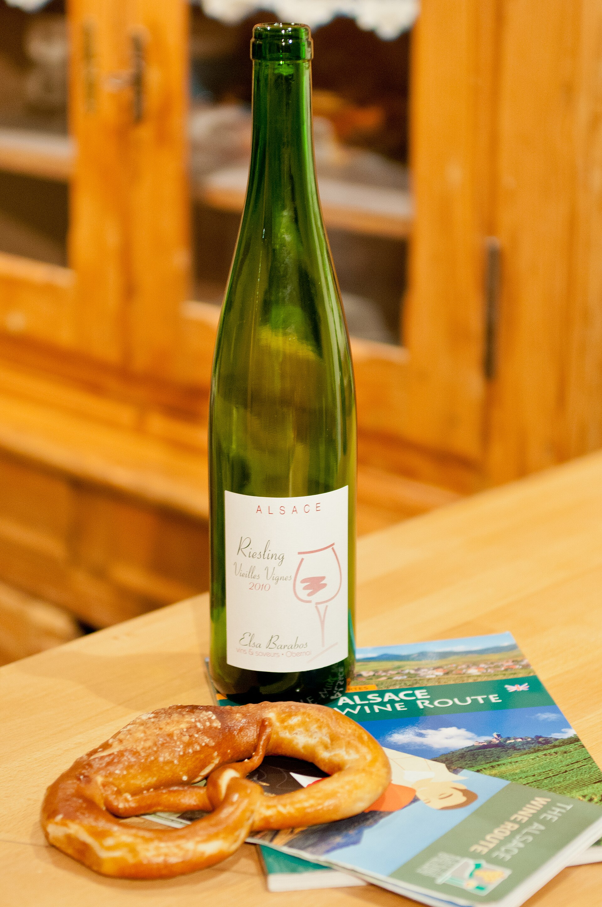

# Alsace Riesling

Alsace Riesling is a Riesling white wine from Alsace, France, mostly dry, with high acidity and clear aromatics of citrus, white flowers and flint, developing a petrol note with age. Alsace labels wines by variety and has Grand Cru, late-harvest and botrytised designations. It is commonly 750 mL at about 12%–13.5% vol.

Figure: Related photograph of Alsace Riesling. Image: Michal Osmenda from Brussels, Belgium, CC BY-SA 2.0, via Wikimedia Commons ([source page](https://commons.wikimedia.org/wiki/File:2010_Riesling_Vieilles_Vignes_from_Elsa_Barabos,_Obernai,_Alsace_(6711020535).jpg)).

## Definition and position

Start by separating the levels: [white wine](ref:white-wine) is the category, Riesling is the variety, Alsace is the region, Alsace Riesling is the "region plus variety" wine designation, and estates and sites are the producer level. It is not a brand, and not the proper name of a single appellation.

Alsace is unusual in labelling by variety, unlike most of France, which labels by place. Four "noble varieties" are often discussed separately, and Riesling is the most important and most widely planted of them, ranging from dry to sweet styles.

## Producer and brand

The area has many family estates, cooperatives and merchants of clearly different scale. The estate name, bottler and site name on the label are the basis for identity; Alsace has a simpler hierarchy than Burgundy, but Grand Cru and specific site names remain important style clues.

The Alsace AOC system took shape in the mid-20th century and was formally recognised in 1962, with Grand Cru and sweet-wine designations added later. Estates often use the tall, slender flute bottle as one of the region's identifying features.

## Region and ingredients

The appellation lies in north-eastern [France](ref:france), on the west bank of the Rhine, in a narrow strip between the Vosges and the river. The Vosges create a rain shadow, so the area is dry and sunny, and a dry autumn favours late harvest and botrytis.

Soils are very varied: granite, schist, limestone, volcanic rock and marl alternate across sites, directly affecting acidity, minerality and ripening. The raw material is [grape](ref:grape), of the [Riesling](ref:riesling) variety, which ripens late and has high acidity and clear aromatics.

## Winemaking

Riesling is usually harvested from late September to October. After pressing, it ferments cool, mostly in stainless steel to preserve aroma and acidity; some estates use old barrels and extended lees contact for texture. Malolactic conversion varies by estate, and most avoid it to keep acidity.

After [fermentation](ref:fermentation), dry wines are usually bottled early, while Vendanges Tardives and Sélection de Grains Nobles require stricter fruit selection and longer fermentation. The sweet designations correspond to different harvest standards and should not be confused with the dry wines.

## Specification and label

The common volume is 750 mL, with [alcohol by volume](ref:abv) at about 12%–13.5% vol, sometimes higher for sweet wines. The label should be checked for the region name Alsace, the variety name Riesling, vintage, estate name, bottler, net volume and importer information; Grand Cru wines also name the site.

The Chinese back label and importer information are the entry point for checking identity. Label languages differ by market, so the bottle on hand governs; products described as "Alsace style" outside the area are not appellation wine.

## Flavour and tasting

Typical aromas are lemon, grapefruit, white flowers, green apple and flint, with high acidity, a medium body and a clear finish. With age it often develops honey, dried fruit and the characteristic petrol note, which is a normal evolution of Riesling rather than a fault.

Compared with German Riesling such as [Egon Müller](ref:egon-muller), Alsace is mostly dry, higher in alcohol and lower in sweetness, while Germany traditionally makes more off-dry and sweet styles. Serve at about 8–11 degrees Celsius, slightly warmer for sweet wines.

## Drinking and pairing

Dry wines pair well with Alsace dishes, pork, poultry, river fish, sauerkraut and medium-strength cheese; high acidity balances fat and salt. Sweet wines suit foie gras, blue cheese or fruit desserts, and do not work with very sweet cakes.

After opening, refrigerate and finish within two or three days, a little longer for sweet wines. Most Alsace Riesling is for drinking young, while Grand Cru and good vintages can be kept short to medium term. Excessive drinking harms health and minors should not drink.

## Buying and storage

Buy from reputable channels and check vintage, variety name, Grand Cru designation, estate name and importer information. Prices move with vintage, site and estate reputation, so no figure is given here; ordinary wines, Grand Cru and botrytised sweet wines belong to different levels.

For Alsace Riesling, unopened bottles should be kept away from light, standing or lying in a cool place at an ideal 10–13 degrees Celsius, avoiding heat and sharp temperature swings. After opening, refrigerate and drink soon rather than warming and cooling repeatedly.

## Common misconceptions

First, assuming all Alsace Riesling is sweet. Most is dry, and sweet styles are clearly labelled.
Second, treating the petrol note as spoilage. It is a typical aroma of aged Riesling.
Third, treating Alsace and German Riesling as one style. Alcohol, sweetness and labelling systems differ.
Fourth, assuming Alsace only makes single-variety wines. Blends and other variety labels also exist.
Fifth, looking only at the variety name and ignoring Grand Cru and sweet-wine designations.

For Alsace Riesling, begin with the base and the stated strength. Then look at the sweetness or bitterness, and finally ask how it is served. The answers point to different choices, not to a single score.

[White wine](ref:white-wine) and [Alsace](ref:alsace) are the two useful reference points for Alsace Riesling. [White wine](ref:white-wine) sets out style; [Alsace](ref:alsace) brings in region and vintage. Read them together.

**Short definition:** A Riesling white wine from Alsace, France, mostly dry, with high acidity and clear aromatics of citrus, white flowers and flint, developing a petrol note with age. Alsace labels wines by variety and has Grand Cru, late-harvest and botrytised designations; commonly 750 mL at about 12%–13.5% vol.

**Key facts.**

| Item | Detail |
| --- | --- |
| In one line | A Riesling white wine from Alsace, France, mostly dry, with high acidity and clear aromatics of citrus, white flowers and flint, developing a petrol note with age. Alsace labels wines by variety and has Grand Cru, late-h… |
| Style | White wine |
| Region | France |
| ABV | 12–13.5% vol |

**Sources and limits.** The key claims about Alsace Riesling are checked against the following sources: Conseil Interprofessionnel des Vins d'Alsace (Used to check the Alsace AOC system, variety labelling and the Grand Cru framework), INAO (Used to check the production rules and labelling requirements of the Alsace appellations), Oxford University Press (Consulted for entries on Alsace, Riesling and Grand Cru). Prices, batches and status change; the body is project-written and does not reproduce source text.

## Further reading

- [White wine](ref:white-wine): white wine categories and basic winemaking.
- [France](ref:france): the French wine map and the AOC/AOP system.
- [Alsace](ref:alsace): the region's geography, varieties and tier system.
- [Riesling](ref:riesling): the botany and aromas of the core variety.
- [Egon Müller](ref:egon-muller): a German Riesling that contrasts with Alsace.
- [Grape](ref:grape): the basic structure of wine grapes and ripeness measures.
- [Fermentation](ref:fermentation): the role of cool fermentation and lees contact.
- [Alcohol by volume](ref:abv): what 12%–13.5% vol means on a label.
