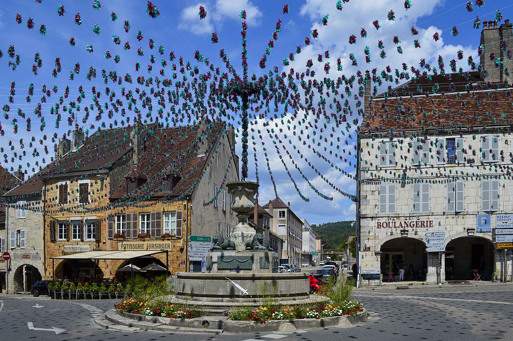

# Arbois

Arbois is the oldest appellation in the [Jura](ref:jura) and its largest by volume, in eastern [France](ref:france). It produces [red](ref:red-wine), [white](ref:white-wine) and [yellow](ref:yellow-wine) wines from all five local varieties, typically 750 mL at 12.5%–14.5% [alcohol](ref:abv).

Figure: Arbois. Image: Wikipedro, CC BY-SA 4.0, via Wikimedia Commons ([source page](https://commons.wikimedia.org/wiki/File:Arbois,_la_place_de_la_Libert%C3%A9.jpg)).

## 15 May 1936: the Jura's first protected name

The AOC was created by the decree of 15 May 1936, the earliest of the Jura's four founding appellations. The timing was not accidental. Phylloxera, mildew and two wars had devastated the region, and legal recognition was less about prestige than about fixing varieties, sites and methods before the vineyard was abandoned or replanted with whatever paid. Seen from today, that decree preserved the varietal skeleton on which the post-war revival was built.

## Twelve villages, 766 hectares and a red-dominant output

The appellation spreads over 12 villages and about 766 ha, with average production of roughly 29,100 hl. According to the trade body, it accounts for about 70% of Jura reds and 30% of Jura whites. That ratio is often misread as "Arbois is a red region". More precisely, red grapes dominate both area and volume, but white wines, vin jaune and vin de paille are what give the name its international identity. The villages include Arbois, Pupillin, Les Arsures, Montigny-lès-Arsures, Mesnay, Vadans and Villette-lès-Arbois. It is frequently compared with the broader [Côtes du Jura](ref:cotes-du-jura), and the difference is precisely the density of village identity.

## Five grapes, two hierarchies

The rules divide the five varieties into two groups. Whites are led by Savagnin and [Chardonnay](ref:chardonnay); reds by Poulsard (locally Ploussard), Trousseau and [Pinot Noir](ref:pinot-noir). In a blend, varieties from the other group may only play a supporting role. Poulsard is thin-skinned, pale and high in acid, used for light reds or blended with Pinot Noir; Trousseau ripens later, has firmer tannin and supplies structure. Among the whites, Savagnin's acidity and oxidative potential are the foundation of vin jaune, while Chardonnay carries the rounder ouillé style. In every case the [grapes](ref:grape) go through temperature-controlled [fermentation](ref:fermentation), and wines that need structure see [oak](ref:oak-ageing).

## Marnes irisées: vines on banded clay

The landscape is a torn slope of limestone scree, deep banded marl (marnes irisées) and clay-siliceous soil. The marl takes its name from iron staining that runs red, purple and grey-green; it is compact and retains water, which helps vines in dry years. Limestone scree improves drainage and root penetration. Aspects are mostly south or south-west, at roughly 200–400 m, and the diurnal range preserves acidity. That is why one variety can produce both a light and a dense wine here.

## Vin Jaune and the six years and three months

Vin jaune is the strictest wine of the region, made only from Savagnin. After fermentation it goes into oak casks that are deliberately never topped up, so a film of yeast forms on the surface. The wine must spend at least 60 months under that veil and remain in cask until 15 December of the sixth year after harvest — the "six years and three months" of convention. It may not be sold before 1 January of the seventh year. It is bottled only in the 62 cl clavelin, a format reserved by law for vin jaune. The Jura's other appellations follow the same model, while [Château-Chalon](ref:chateau-chalon) makes nothing else.

## Ouillé versus sous voile: two whites from one slope

The same vineyard can produce two opposite whites. Ouillé means "topped up": the cask is kept full, oxygen is excluded, and the wine stays pale, fruity and sharp, for drinking young. Sous voile means "under the veil": the cask is left ullaged, yeast grows on the surface, and acetaldehyde and sotolon bring walnut, curry, beeswax and savoury notes. Ouillé Chardonnay tends towards hazelnut and yellow apple; sous-voile Savagnin is unmistakably "yellow". When choosing an Arbois white, asking whether it is ouillé or sous voile is more useful than asking the vintage.

## Vin de Paille at 20 hl/ha

Vin de paille is neither fortified nor botrytised. Grapes are dried on straw or racks for at least six weeks so that water evaporates and sugar concentrates, then pressed and fermented. Because the juice yield is tiny, the law caps production at 20 hl/ha. The result is amber, with dried apricot, honey and orange peel, high in alcohol but held together by acidity. It is a small part of Arbois output, yet it is often mistaken for a sweet vin jaune; the processes and the flavours are different.

## Pupillin: a village name inside the AOC

Pupillin is a complementary geographical denomination within Arbois, so a label may read "Arbois-Pupillin". The village is known for Poulsard and Trousseau reds, whose soils and aspect make them finer and more aromatic than the Arbois mainstream. It is not a separate AOC: the rules set specific parcels, variety proportions and yields. Seeing Pupillin means a more specific village inside the same appellation, not another appellation.

## Henri Maire and the reinvention of post-war Arbois

Henri Maire (1917–2004) is unavoidable in modern Jura history. After the Second World War he consolidated scattered parcels, expanded the estate beyond 300 ha and used the "Vin Fou" brand to take Jura wine to Paris and export markets. His approach is contested today — large-scale, marketing-led, sometimes far from tradition — but without the volume and cash flow he rebuilt, Arbois would have struggled to keep so many sites in production in the second half of the twentieth century. That history explains the tension between "traditionalist" and "market" camps today.

## Estates and bottles worth knowing

Domaine André et Mireille Tissot, run by Stéphane Tissot, is a biodynamic, low-yield reference with strong Chardonnay, Savagnin and red blends; Domaine Rolet has a long history and a complete range; Domaine de la Pinte in Pupillin is known for Poulsard and Savagnin; Maison Henri Maire remains one of the largest names. Cooperatives and négociants matter here too, and the bottler and parcel information on the back label usually says more about style than the name on the front.

## What Arbois bottles cost

In French retail in 2026, allowing for vintage and channel, ordinary reds and whites sit around €15–22, village or single-site wines €25–40, vin jaune mostly €35–60, and older bottles from leading names €80 and above. Vin jaune is expensive because of time: more than six years of stock, evaporation losses and low yields. Vin de paille is even scarcer and usually costs at least as much. A "Vin Jaune" at €12 deserves suspicion.

## The myth that Vin Jaune is sweet

Vin jaune is most often mistaken for a sweet wine because it is golden and smells of honey and apricot. It is in fact dry: fermentation is complete, residual sugar is low, and the flavours come from the veil and long oxidative ageing, not from sugar. A second myth is that older is always better; it ages well, but once opened it oxidises quickly and is best finished within two days. A third is to read "jaune" as botrytis or late harvest; it has nothing to do with noble rot.

## Pairing: Comté, walnuts and girolles

Vin jaune with aged Comté, 24 months or more, is close to a textbook match: the cheese's nuttiness and salt pick up the walnut and curry notes in the wine. At home, cream-of-mushroom chicken, girolle omelette and walnut salad all work; the reds suit roast pork, sausage and braised beef. Ouillé whites are more versatile, with river fish, snails and soft cheese. Serve vin jaune at 13–15 °C; too cold and the aroma shuts down.

Arbois is complicated not because it has five grapes, but because it allows fresh and oxidative time to coexist on the same slope. Understand ouillé and sous voile, and you understand the other half of the appellation.

To read Arbois, start with the base and the stated strength, then the sweetness or bitterness, then how it is served; no single check settles it.
