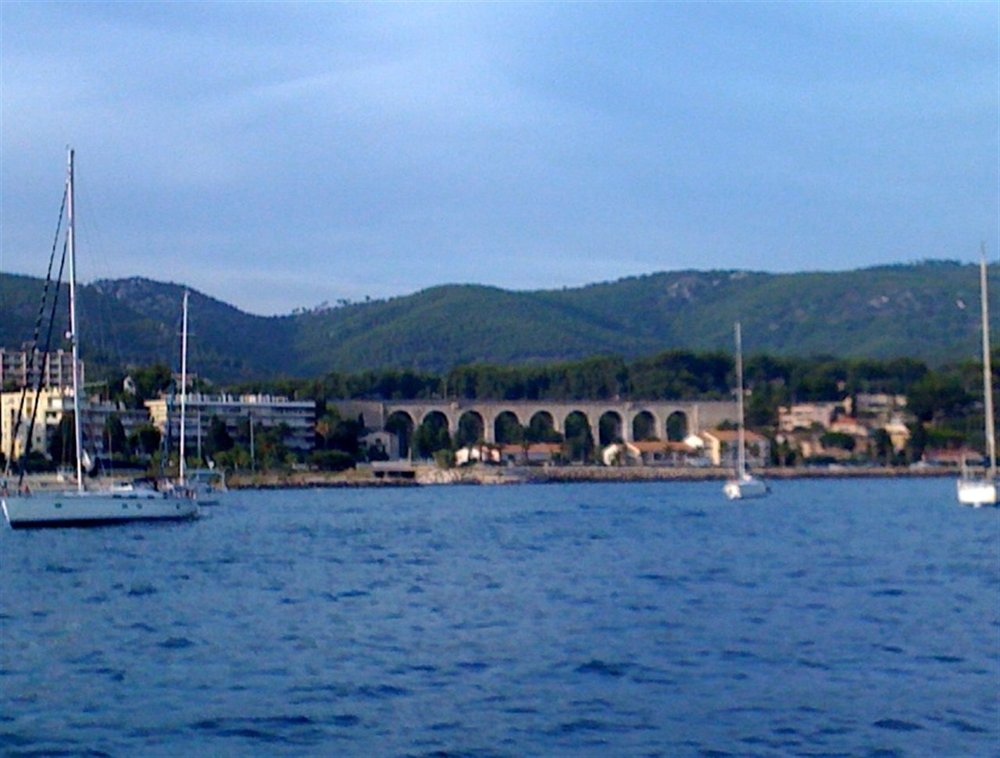

# Bandol

Bandol is an appellation on the Mediterranean coast of [Provence](ref:provence) in [France](ref:france), best known for red wines based on Mourvèdre. The appellation requires [red wine](ref:red-wine) to contain at least 50% Mourvèdre and to spend at least 18 months in oak. It also makes [rosé](ref:rose-wine) and a small amount of [white wine](ref:white-wine). It is commonly 750 mL at about 12.5%–14.5% [alcohol by volume](ref:abv).

Figure: Bandol. Image: A.Schneider83, CC BY-SA 3.0, via Wikimedia Commons ([source page](https://commons.wikimedia.org/wiki/File:Viaduc_de_Bandol.jpeg)).

## Definition and position

Start with the levels: [red wine](ref:red-wine) is the category, Mourvèdre is the main variety, Bandol is the appellation, and individual estates and wines are the producer level. Bandol is both a town name and an appellation name that may appear on the label alone.

Bandol has a special position within Provence: its reputation rests on long-lived reds rather than rosé. The reds carry explicit variety proportions and a minimum oak ageing requirement, so they are more structured and more ageworthy than most Provence reds.

## Producer and brand

Family estates dominate, with cooperatives and merchants also present. Bandol reds need long ageing before release, which ties up capital, so the number of producers is limited and their scale is modest.

Producer, appellation and product are three levels: the appellation answers for rules and parcel range, the producer answers for farming, making and bottling, and the product answers for vintage, colour and specification. The same Bandol can differ between estates in Mourvèdre proportion and ageing length.

## Region and ingredients

Bandol lies on the Mediterranean coast of Provence, with vineyards on coastal hills and slopes around the town in a half-circle facing the sea. The climate is Mediterranean, with hot dry summers, mild winters and a clear mistral influence. Soils are mainly limestone, clay and gravel, well drained and low in fertility.

Aspect and sea breeze affect ripeness: south-facing slopes are warmer, while coastal parcels are moderated by the wind. The raw material is [grape](ref:grape). Reds are based on Mourvèdre with [Grenache](ref:grenache), Cinsault and [Syrah](ref:syrah); Mourvèdre ripens late, has thick skins and strong tannin, and is the main source of structure.

## Winemaking

Reds are usually destemmed and given a fairly long maceration to extract colour, tannin and spice; fermentation temperature and maceration time decide the strength of the structure. The appellation requires at least 18 months in oak, and some estates extend it. The mix of large and small barrels and of new and old wood shapes aroma and tannin feel.

Rosé sees only short skin contact for pale colour and freshness; white wine is small in volume and made in a fresh style. See [fermentation](ref:fermentation) for the basic process and [oak ageing](ref:oak-ageing) for the barrel stage.

## Specification and label

The common volume is 750 mL, with [alcohol by volume](ref:abv) at about 12.5%–14.5% vol, varying by vintage and estate. The label should be checked for appellation, colour, vintage, bottler and importer.

Bandol red, rosé and white share the same appellation name, and the colour is usually shown on the label or visible in the wine. The Chinese back label and importer information are the basis for checking identity, and the bottle on hand governs.

## Flavour and tasting

Reds show black cherry, blackberry, leather, liquorice and spice, with strong tannin, moderate acidity, a full body and a long finish. Wines with a high Mourvèdre proportion are more structured; while young they show firm tannin, and with age they move towards leather, truffle and dried fruit.

Rosé shows red fruit, citrus and white flowers with a light body and clear acidity; white shows citrus, white flowers and mineral notes. Serve reds at about 16–18 degrees Celsius, using a decanter to help open the aroma.

## Drinking and pairing

Reds suit grilled meat, braised meat, game, mushrooms and hard cheese; the stronger structure stands up to full-flavoured dishes. Rosé suits seafood, salads and Mediterranean dishes and is served chilled; white suits seafood and soft cheese.

Reds are usually for drinking within 5–15 years, and top vintages can go longer, depending on vintage and estate. After opening, refrigerate and finish within a few days; excessive drinking harms health and minors should not drink.

## Buying and storage

For Bandol, begin with the base and the stated strength. Then look at the sweetness or bitterness, and finally ask how it is served. The answers point to different choices, not to a single score.

For Bandol, unopened bottles should be kept away from light, lying flat in a cool place at an ideal 12–15 degrees Celsius, avoiding heat and sharp temperature swings. Cork-sealed bottles need humidity and can be stored lying down. After opening, use a vacuum or inert gas and refrigerate rather than warming and cooling repeatedly.

## Common misconceptions

First, treating Bandol as the emblem of Provence rosé. Its reputation rests mainly on red wine.
Second, assuming all Bandol reds are rustic. Vintage, Mourvèdre proportion and ageing method make a clear difference.
Third, conflating Bandol with Côtes de Provence. They are neighbours, but their appellations and rules differ.
Fourth, thinking rosé cannot age. A few structured Bandol rosés can be kept short term, but most are best drunk early.
Fifth, judging quality by price alone. Appellation, vintage and bottler information is more specific.

**Short definition:** An appellation on the Mediterranean coast of Provence in France, best known for red wines based on Mourvèdre, with a legal minimum of 50% Mourvèdre and at least 18 months in oak; the reds are structured with dark fruit and spice and also age well, and the appellation makes rosé and a little white wine, commonly 750 mL at about 12.5%–14.5% vol. 

[Red wine](ref:red-wine) explains style; [White wine](ref:white-wine) adds region and vintage. Put Bandol between them before deciding what it is.

**Key facts.**

| Item | Detail |
| --- | --- |
| In one line | An appellation on the Mediterranean coast of Provence in France, best known for red wines based on Mourvèdre, with a legal minimum of 50% Mourvèdre and at least 18 months in oak; the reds are structured with dark fruit a… |
| Style | Red wine、Rosé Wine、White wine |
| Region | France、Provence |
| ABV | 12.5–14.5% vol |

**Sources and limits.** The key claims about Bandol are checked against the following sources: INAO (the area, variety proportions and ageing rules of the Bandol appellation), European Union (EU wine categories, geographical indications and labelling rules), Oxford University Press (Consulted for entries on Bandol and Mourvèdre; Migrated from the former reference list at the end of the article; access date not re-verified). Prices, batches and status change; the body is project-written and does not reproduce source text.

## Further reading

- [Provence](ref:provence): the region and its framework of wine types.
- [Red wine](ref:red-wine): the most representative category of Bandol.
- [Rosé](ref:rose-wine) and [white wine](ref:white-wine): the region's other two categories.
- [Grenache](ref:grenache) and [Syrah](ref:syrah): the main companion varieties in Bandol reds.
- [Grape](ref:grape): the basic structure of wine grapes and ripeness measures.
- [Fermentation](ref:fermentation) and [oak ageing](ref:oak-ageing): the basic process steps for reds.
- [Alcohol by volume](ref:abv): what 12.5%–14.5% vol means on a label.
