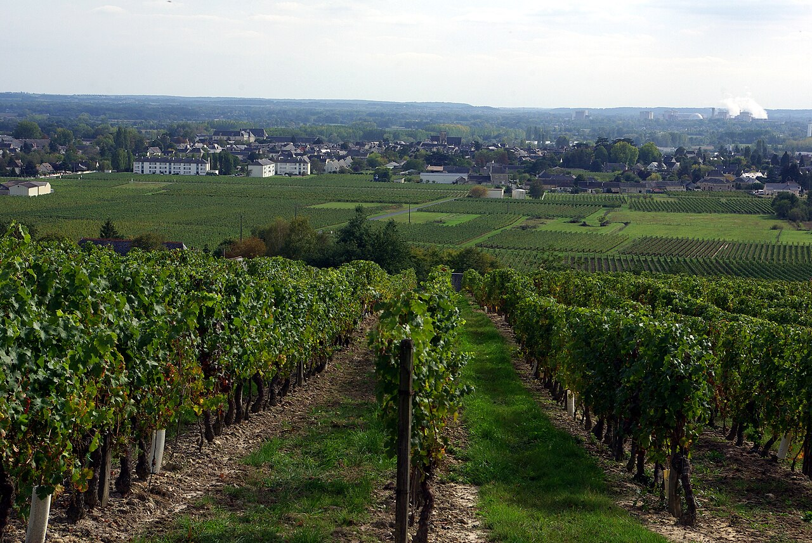

# Bourgueil

Bourgueil is a [red wine](ref:red-wine) appellation in the Touraine area of France's [Loire Valley](ref:loire), on the right bank of the Loire west of Tours. It is based overwhelmingly on [Cabernet Franc](ref:cabernet-franc) and was recognised as an AOC on 31 July 1937. The normal bottle is 750 mL at 12%–13.5% [alcohol](ref:abv), and the style runs from bright, supple fruit on the gravel terraces to firm, ageworthy wine on the limestone slopes.

Figure: Bourgueil. Image: Duch.seb, CC BY-SA 3.0, via Wikimedia Commons ([source page](https://commons.wikimedia.org/wiki/File:Bourgueil.jpg)).

## Two terraces, two wines: gravel and limestone slope

The vineyards fall into two broad families. Near the Loire, sand and gravel terraces drain extremely fast and send roots deep; the wines are lighter, fruit-forward and ready early. Higher up, clay-limestone soils over Touraine tuffeau — the slope soils are locally called *tufs* — give thicker wines with more tannin and a longer life. These are not "good" and "bad" soils but two rhythms: the first is for drinking young, the second needs time. A single estate can bottle both, which is why tasting one Bourgueil tells you little about the next.

## 31 July 1937: an early Touraine AOC

Bourgueil obtained its AOC by decree on 31 July 1937, among the first protected appellations in Touraine. The date explains the layered paperwork: a 1937 framework, a 2009 national decree, and a 2019 European single-document amendment. Figures and wording change with each version, so an old text quoting 55 hl/ha is not necessarily wrong — it is simply quoting an older rule. Reading appellation material without checking the date is one of the easiest ways to create a false contradiction.

## Cabernet Franc on gravel: supple does not mean thin

Gravel-terrace wines are often called "light", but the more accurate words are supple, early and round-tannined. The stones warm quickly, the grapes reach physiological ripeness easily, and the green-pepper and herbal side of Cabernet Franc is suppressed; redcurrant, raspberry and violet come forward. The gravel layer is thin and sandy, so the roots often have to reach the limestone below for water, which also limits yields. These wines do not fight heavy sauces, but they are excellent slightly chilled at 14–16 °C with charcuterie, white meat and soft cheese. Reading "light" as "watery" is the most common misreading of Bourgueil.

## The limestone slope and wines that can outlast their buyers

On the slopes, clay-limestone gives Cabernet Franc a longer ripening window and a firmer frame. South-facing parcels catch more direct light, while the Gâtine forest to the north blocks cold wind, so ripening is more even and picking order differs from the plain. Young wines can seem tight, even closed, but after five to ten years they open into graphite, cedar, tobacco and dried flowers. The syndicate says the best vintages can last "a century", an extreme claim intended to make a point: Bourgueil's ceiling is structural red wine, not a fruity little wine. [Oak](ref:oak-ageing) is usually a vessel rather than a flavour: old barrels and large casks are common, so the herbal line of the variety stays visible.

## Seven communes and the Saint-Nicolas clause

The syndicate lists seven communes under the current administrative reading: Bourgueil, Benais, La Chapelle-sur-Loire, Chouzé-sur-Loire, Ingrandes-de-Touraine, Restigné and Saint-Patrice. The 2019 European single document also includes Saint-Nicolas-de-Bourgueil in the geographical area, which makes eight when combined. Hence an easily missed rule: wine from Saint-Nicolas-de-Bourgueil may be sold as Bourgueil, but not the other way round. A label reading Bourgueil does not guarantee that every grape came from Bourgueil itself.

## From 55 to 65 hl/ha: reading an old figure correctly

The older national decree set Bourgueil's basic yield at 55 hl/ha, with a ceiling of 67 hl/ha; after the 2019 European single-document amendment the target became 65 hl/ha. The minimum natural alcohol is 10.5%, Cabernet Franc is the main variety, and Cabernet Sauvignon is allowed up to 10%. Put together, these numbers describe an appellation that does not rely on very low yields for concentration but on site and selection. Judging quality from a yield figure alone distorts the picture, and the current cahier des charges should always be the reference.

## Chevalerie, Amirault and Chesnaies: three scales

Domaine de la Chevalerie in Restigné has been run by the same family on the same site for nearly 400 years. Its Cabernet Franc vines are 30–70 years old, and the estate was certified organic in 2008 and biodynamic in 2012; Laurie, Emmanuel and Stéphanie Caslot now run it. Its wines are the "slope" school: deep, structured and slow to unfold. Domaine Yannick Amirault farms about 20 hectares, two-thirds in Bourgueil and one-third in Saint-Nicolas, having started in 1977 with 3.4 hectares. The grandfather, Eugène, was already bottling Les Malgagnes in 1947, and today Le Grand Clos is the window onto the house style. Domaine des Chesnaies (Lamé Delisle Boucard) offers a more everyday entry point, with Cuvée Prestige at about €12.90. [Fermentation](ref:fermentation) varies by estate, but whole-cluster work and gentle extraction are common.

## A firmer northern accent than Chinon

Set Bourgueil beside [Chinon](ref:chinon) and the safest difference is not "which is lighter" but "which is straighter". Bourgueil's vineyards are concentrated on a mainly south-facing slope on the right bank, with the Gâtine forest sheltering them from the north; ripening is more even and the wines have a straighter line and a stronger graphite note. Chinon spreads across 26 communes on both banks of the Vienne, with soils from gravel to limestone plateau, so its stylistic range is wider. Compared with [Saumur-Champigny](ref:saumur-champigny), Bourgueil has less of the powdery tuffeau feel and more gravel and clay in the frame. Writing all three as "Loire Cabernet Franc" loses exactly these differences.

## Pairings from rillettes to wild boar

Gravel-style Bourgueil suits rillettes de Tours, roast chicken, white meat and goat cheese. Slope-style wines suit duck breast, civet de sanglier, beef bourguignon and hard cheese. Serve light-bodied bottles at 14–16 °C and structured ones at 16–18 °C; over-chilling flattens the herbal and graphite notes into a monotonous acidity. The logic is not "red wine with red meat" but tannin against fat and acidity against richness. The raw material is [grape](ref:grape), and the appellation sits within the wider [France](ref:france) appellation system.

## Price bands and two misconceptions

Retail samples put entry and mid-range Bourgueil at roughly €9–22, with leading estates and old-vine cuvées at €22–35; these figures move with vintage, channel and exchange rate. Two misconceptions are worth correcting. First, "Bourgueil is just a lighter Chinon": its slope wines can be tighter and longer-lived than many Chinons, so the parcel matters more than the appellation name. Second, "Bourgueil must be 100% Cabernet Franc": the rules allow up to 10% Cabernet Sauvignon, even though most estates choose not to use it. Treating variety purity as a guarantee of quality is another simplification.

## Sources and price caveats

The figures here come from InterLoire's appellation and terroir pages, the Bourgueil syndicate's soil note, the 2019 European single-document amendment, and the official material of Domaine de la Chevalerie and Domaine Yannick Amirault. Prices come only from a Vinatis sample. All sources were opened and checked on 8 November 2026.

**Short definition:** A Cabernet Franc red wine appellation in the Touraine area of the Loire Valley, France, on the right bank of the Loire west of Tours; recognised on 31 July 1937, with roughly 1,200–1,400 hectares divided between gravel terraces and clay-limestone slopes, the former supple and early-drinking, the latter firm and long-lived, plus about 4% rosé, commonly 750 mL at about 12%–13.5% vol.

For Bourgueil, begin with the base and the stated strength, then the sweetness or bitterness, and finish with how it is served; that order keeps the account grounded.

**Key facts.**

| Item | Detail |
| --- | --- |
| In one line | A Cabernet Franc red wine appellation in the Touraine area of the Loire Valley, France, on the right bank of the Loire west of Tours; recognised on 31 July 1937, with roughly 1,200–1,400 hectares divided between gravel t… |
| Style | Red wine |
| Region | France、Loire Valley |
| ABV | 12–13.5% vol |

**Sources and limits.** The key claims about Bourgueil are checked against the following sources: InterLoire (Used to check the 1937 AOC, the seven communes, the two soil families and the rosé share), Syndicat viticole de Bourgueil, European Union and 6 sources in total. Prices, batches and status change; the body is project-written and does not reproduce source text.
