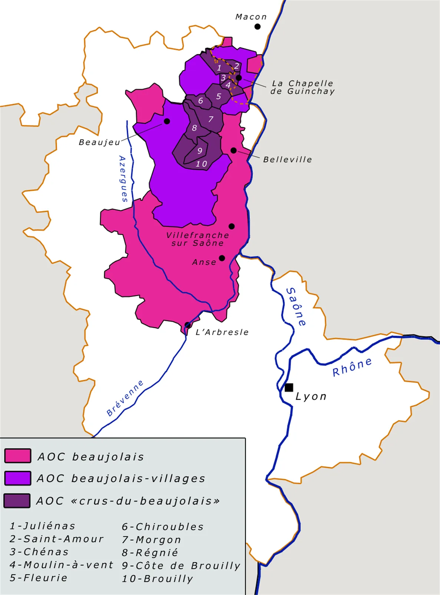

# Brouilly

On a Beaujolais wine list, Brouilly often appears near the front: volumes are large, the name is easy to remember and the price is often among the friendliest of the crus. That "entry-level" impression hides another side of it. It is also the largest of the ten crus, spread over six villages, and the differences between those villages are far more complex than a label of light, easy drinking suggests. The usual bottle is 750 mL, at about 12.5%–13.5% [alcohol by volume](ref:abv).

Figure: Brouilly. Image: Cyril5555, CC BY-SA 3.0, via Wikimedia Commons ([source page](https://commons.wikimedia.org/wiki/File:Carte_vignoble_beaujolais.png)).

## The entry-level impression on wine lists

Restaurants and merchants push Brouilly for practical reasons: the largest volume among the crus, stable supply, an appealing style and little need for explanation. It therefore becomes the first lesson in Beaujolais crus, listed alongside Beaujolais Nouveau as an introduction.

That position is useful and costly at once. Beginners easily read Brouilly as light, simple and casual, and miss the differences inside the appellation; experienced drinkers may skip it because it is so common. A better view is that Brouilly is the doorway to the cru system, not the end of its styles: the foot and the slope, the north and the south, do not make the same wine.

## Six villages around Mont Brouilly

Brouilly's vineyards circle Mont Brouilly, and the appellation covers six villages. The hill sits in the middle, with villages and slopes on the outside, forming a roughly ring-shaped area; this is the geography behind its size.

The six villages sit in different positions, on different soils and gradients, so the wines fall into several lines. Parcels near the foot and in the north are sandier and drain well, giving a lighter body; the south and the gentle ground hold more clay and limestone, ripen more fully and produce a rounder wine. The official delimitation governs the exact boundaries and village assignments.

## Granite at the foot and clay-limestone in the south

The north and the slopes are mostly weathered granite sand: thin, fast-draining and low in fertility, where Gamay shows red cherry, raspberry and clear floral notes in a body usually lighter than the northern crus. The sandy granite structure sends roots deep and limits yields.

The south and the flat ground at the foot hold more clay and limestone. The soil is more fertile and retains water better, ripening follows a different rhythm, and the body is rounder. One cru therefore contains two directions, light and round, and the village name on the label often tells you more about which one you have than the word Brouilly alone.

## What the largest area means for volume and merchants

The largest area means top-ranked total volume among the crus, and a relatively high share for merchants and cooperatives. Large merchants need a stable, uniform style and readily blend grapes from different villages; family estates prefer to stress the character of their own parcels.

Bottler information is therefore critical. Estate-bottled Brouilly usually has a clearer parcel origin and a more recognisable style; merchant bottling may be cheaper and steadier but flattens the differences between villages. Decide first whether you want stability or character, then choose which kind of bottler to look for.

## Short maceration and an early-drinking aim

Brouilly often uses whole clusters, and some estates practise semi-carbonic maceration: whole grapes start intracellular fermentation in a carbon-dioxide-filled vessel, then are pressed and finish a conventional [fermentation](ref:fermentation). This brings direct fruit and lighter tannin, exactly in line with the early-drinking aim.

Maceration is usually short and extraction light, to keep the fruit and the supple texture. Some estates age a small part of the wine in used [oak](ref:oak-ageing) to round out the structure, but new barrels are generally a very low proportion. The goal is not a heavy wine but one that can be drunk soon after bottling.

## Differences from Côte de Brouilly and Régnié

Typical aromas are red cherry, raspberry, strawberry and violet, with some wines showing minerality. The palate has clear acidity, fine tannin, a light-to-medium body and a supple finish, and it drinks earlier than [Côte de Brouilly](ref:cote-de-brouilly) on the slope.

The differences can be summed up simply. On weight and backbone, Côte de Brouilly is tighter, more mineral and later ripening, while Brouilly is lighter and more direct. On aroma, Fleurie is more outgoing and Brouilly leans to red fruit. Against Régnié to the south-west, Régnié is usually lighter and softer, while Brouilly has a little more concentrated fruit. The four divide the work; none is above the others.

## How vintage changes the ring of villages

In warm years ripening is high, fruit is sweeter and riper, alcohol sits near the upper end of the range, the body is rounder than in an average year and acidity is less sharp than in a cool year. In cool years acidity is clear, the body lighter and red fruit and flowers more prominent, though under-ripe vintages show green stalk and unripe notes.

Begin with the base and the stated strength, move on to the sweetness or bitterness, and finish with how it is served. That order keeps the reading of Brouilly practical.

## Choosing within the friendliest price tier

Brouilly sits in the entry to mid band of the crus, usually above regional Beaujolais and below regular Côte de Brouilly and Moulin-à-Vent; bottles with only the village name tend to be entry level, while versions that name a specific village and are estate-bottled move up a step. Only relative bands are described here; no figures are given.

Three checks help. First, the village name: the six villages do not make the same style. Second, the bottler: estate bottling reflects parcel differences better. Third, vintage and alcohol: warm years run higher and cool years lower, a choice of style rather than rank. A proper channel and a complete back label explain more than packaging. Unopened bottles should be kept out of light, lying flat, at an ideal 12–15 degrees Celsius.

## Misunderstandings about "largest means most ordinary"

First, assuming the largest area means the most ordinary quality. Brouilly also has distinctive villages and estates, and scale is not quality.
Second, confusing Brouilly with Côte de Brouilly. They are neighbouring but separate crus, with different altitude, soils and styles.
Third, thinking Brouilly is only for early drinking. Some villages and parcels can keep for several years.
Fourth, treating Brouilly as Beaujolais Nouveau. It is a separate cru: easy to drink, but its winemaking logic and commercial position are different.
Fifth, judging authenticity by price or packaging. The village name, the bottler and the back label are more reliable.

[Red wine](ref:red-wine) explains style; [Beaujolais](ref:beaujolais) adds region and vintage. Put Brouilly between them before deciding what it is.

## Further reading

- [Red wine](ref:red-wine): the wider category to which this entry belongs.
- [Gamay](ref:gamay): the only grape variety in Brouilly.
- [France](ref:france): French wine law and appellations.
- [Beaujolais](ref:beaujolais): the ten-cru framework and the southern zone.
- [Grape](ref:grape): the structure of wine grapes and ripeness measures.
- [Fermentation](ref:fermentation): whole-cluster fermentation and semi-carbonic maceration.
- [Oak ageing](ref:oak-ageing): used-barrel ageing and aroma integration.
- [Alcohol by volume](ref:abv): what 12.5%–13.5% vol means on a label.
- [Côte de Brouilly](ref:cote-de-brouilly): the neighbouring cru that takes only the slope of the same hill.
