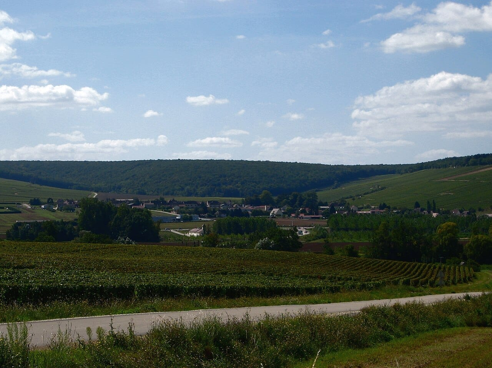

# Chablis

Chablis is a dry white wine from the appellation of the same name in northern Burgundy, France, made only from Chardonnay and known for Kimmeridgian limestone soils and a lean, mineral style. It is commonly 750 mL at about 12%–13% vol, and the appellation is divided into Petit Chablis, Chablis, Premier Cru and Grand Cru.

Figure: Chablis. Image: CocktailSteward, CC BY 3.0, via Wikimedia Commons ([source page](https://commons.wikimedia.org/wiki/File:Chablis_and_Premier_Cru_Vaulorent.jpg)).

## Definition and position

Start by separating the levels: [white wine](ref:white-wine) is the category, Chardonnay is the variety, Chablis is the appellation (AOC), and individual estates and wines are the producer level. Keeping these four apart is what stops "Chablis" from being read as a brand or as a grape.

Chablis is a place name and an appellation marker, not a trademark. Only wine grown and made inside the delimited area under the appellation rules may be labelled Chablis; other products described as "Chablis style" are not appellation wine. The tiers inside the appellation are defined by parcels, as in other parts of Burgundy.

## Producer and brand

The Chablis area has many independent estates, cooperatives and négociants, from small family domaines to large merchants. The producer name usually appears on the front or back label, and the roles must be kept apart: a négociant may buy grapes or wine, while an estate owns its parcels.

Producer, appellation and product are three levels: the appellation answers for rules and site range, the producer answers for who farms, who makes and who bottles, and the product answers for vintage, tier and specification. Check the bottler information when buying, and do not infer estate identity from the word "Chablis" alone.

## Region and ingredients

The appellation lies in the Yonne department of northern [Burgundy](ref:burgundy) in [France](ref:france), and is one of the northernmost white wine areas of Burgundy. The climate is cool and the season long; Kimmeridgian limestone and marl soils are rich in fossils and drain well, and are held to give the wine a mineral, taut quality.

The raw material is [grape](ref:grape), of the [Chardonnay](ref:chardonnay) variety, and the appellation rules require white wine to be made from Chardonnay. [Water](ref:water) does not enter the finished wine, but rainfall and irrigation conditions affect ripening and dilution. Soil and aspect shape the pace of ripening, yet differences between parcels within the appellation remain significant.

## Winemaking

After harvest the grapes are pressed, the juice is settled at low temperature and then fermented by yeast. Traditional practice ferments mostly in stainless steel to preserve citrus and mineral aromas; some producers use old oak or lees contact to add texture and complexity.

Malolactic fermentation lowers acidity and adds a creamy feel, and whether it is allowed depends on the producer's style. Fermentation temperature, yeast choice and barrel type all change the final flavour; these are producer details, and this entry gives no universal parameters.

## Specification and label

The common volume is 750 mL, with [alcohol by volume](ref:abv) at about 12%–13% vol, varying slightly with vintage and tier. The label should be checked for appellation name, tier (Petit Chablis, Chablis, Premier Cru, Grand Cru), vintage, alcohol, net volume, bottler and importer.

Premier Cru and Grand Cru wines usually name the specific climat, and Grand Cru has a defined list of site names. The Chinese back label, importer and anti-counterfeit information are the basis for checking identity; label languages differ by market, so the bottle on hand governs.

## Flavour and tasting

Typical aromas are green apple, lemon, white flowers and wet-stone minerality, with a light flint and honey note in some wines; the palate has clear acidity, a light to medium body and a clean finish with a saline mineral edge. Compared with Chardonnay from warmer regions, Chablis is usually leaner and less tropical.

For tasting, chill well to about 8–10 degrees Celsius and use a tulip-shaped or dedicated white wine glass. Too cold suppresses aroma, while too warm pushes alcohol forward. When smelling, watch for heavy oak or oxidation, the latter possibly linked to storage conditions.

## Drinking and pairing

It pairs well with oysters, shellfish, steamed fish, white meat and goat cheese; high acidity and minerality cut through fat and lift the savoury note of seafood. Avoid heavy red-meat sauces and very hot dishes, which can mask aroma or amplify alcohol.

After opening, refrigerate and finish within a few days, as aroma fades with air. Most Chablis is for drinking within a few years, while some Premier Cru and Grand Cru wines can be kept for the medium term; the drinking window depends on vintage and producer. Excessive drinking harms health and minors should not drink.

## Buying and storage

Buy from reputable channels and check tier, vintage, site name, bottler and importer information. Prices move with tier, vintage and channel, so no figure is given here; Petit Chablis and Grand Cru belong to different levels, and one wine cannot stand for the whole appellation.

For Chablis, unopened bottles should be kept away from light, lying flat or standing, in a cool place at an ideal 10–13 degrees Celsius, avoiding heat and sharp temperature swings. Cork-sealed bottles need humidity and can be stored lying down; after opening, refrigerate and drink soon rather than warming and cooling repeatedly.

## Common misconceptions

First, treating Chablis as a brand. It is an appellation name.
Second, assuming Chablis is always "unoaked". Some producers use old barrels or lees contact.
Third, confusing Petit Chablis with Grand Cru. They are different tiers within the appellation.
Fourth, treating minerality as soil entering the wine. It is more a combined perception of acidity, ripeness and overall structure.
Fifth, judging authenticity by price or packaging. Channel, label and anti-counterfeit information are more reliable.

**In brief:** A dry white wine from the Chablis appellation in northern Burgundy, France, made only from Chardonnay and known for Kimmeridgian limestone soils and a lean, mineral style. Commonly 750 mL at about 12%–13% vol, with Petit Chablis, Chablis, Premier Cru and Grand Cru tiers.

Read Chablis through the base and the stated strength, then the sweetness or bitterness, and finally how it is served. The sequence matters.

**Key facts.**

| Item | Detail |
| --- | --- |
| In one line | A dry white wine from the Chablis appellation in northern Burgundy, France, made only from Chardonnay and known for Kimmeridgian limestone soils and a lean, mineral style. Commonly 750 mL at about 12%–13% vol, with Petit… |
| Style | White wine |
| Region | France、Burgundy |
| ABV | 12–13% vol |

## Further reading

- [White wine](ref:white-wine): white wine categories and basic winemaking.
- [Chardonnay](ref:chardonnay): variety character and stylistic range.
- [France](ref:france): the French wine map and where Burgundy sits.
- [Burgundy](ref:burgundy): the tiers and sub-regions of the region Chablis belongs to.
- [Grape](ref:grape): the basic structure of wine grapes and ripeness measures.
- [Water](ref:water): how rainfall and soil moisture affect ripening.
- [Fermentation](ref:fermentation): cool fermentation and malolactic conversion.
- [Alcohol by volume](ref:abv): what 12%–13% vol means on a label.
