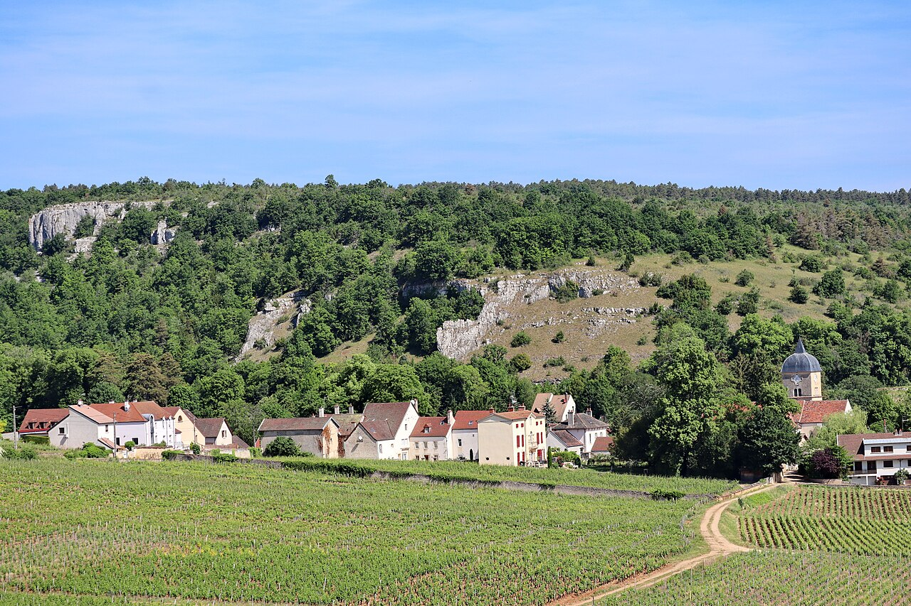

# Chambolle-Musigny

Turn a bottle of Chambolle-Musigny around and many eyes land first on the small print after "Premier Cru": Les Amoureuses. That is the temperament of this village: the name on the front is only the entrance, and what people keep discussing is the site. A village-level [red wine](ref:red-wine) appellation in the Côte de Nuits of Burgundy, Chambolle-Musigny is made entirely from [Pinot Noir](ref:pinot-noir) and holds two grands crus, Musigny and Bonnes-Mares. The usual bottle is 750 mL at about 12.5%–13.5% vol.

Figure: Chambolle-Musigny. Image: Jean de l'Auxois, CC BY-SA 4.0, via Wikimedia Commons ([source page](https://commons.wikimedia.org/wiki/File:Village_et_vignes_de_Chambolle-Musigny_(C%C3%B4te-d%27Or)_07.jpg)).

## Musigny and Bonnes-Mares: a boundary between two grands crus

Musigny and Bonnes-Mares are often named together, yet they do not touch. Musigny sits above the village on an east-southeast slope with thin topsoil, plenty of limestone debris and rapid drainage. Bonnes-Mares lies at the northern end, borders Morey-Saint-Denis and carries more clay, which gives a heavier body. The legal area of Bonnes-Mares crosses the two communes of Chambolle-Musigny and Morey-Saint-Denis, as the site maps of [Burgundy](ref:burgundy) make clear.

Musigny itself is divided into two climats, Les Musigny and Les Petits Musigny, held by several estates, so two wines both labelled Musigny can still differ. When buying at this level, read the estate name and the site name together; those three words alone are not enough.

## Les Amoureuses and a reputation above its tier

Les Amoureuses is a premier cru, not a grand cru, yet the market often treats it as one. It sits directly below Musigny on gentler ground with deeper topsoil; the wine opens earlier, with more outgoing floral and red-fruit notes and softer tannin. Set beside Musigny, it shows how fineness and weight trade places inside one village.

The other premier cru regularly used for comparison is Les Charmes, larger and further south, usually firmer in body and less ethereal in aroma. Other premiers crus such as Les Fuées lie between the two in style. The list is long, and what decides quality is the position on the slope, the depth of soil and the estate's extraction, not the tier alone.

## Limestone slopes and the word "delicacy"

Most vineyards sit on mid-slope, east-facing ground that is not especially steep but drains well. Topsoil is thin over Jurassic limestone and marl, with plenty of stones, and roots reach into the cracks. On this [French](ref:france) slope the [grape](ref:grape) ripens slowly, keeping acidity and producing fine-grained tannin.

"Delicacy" is not mystique. Thin soil, low yields and restrained extraction keep Pinot Noir's aroma floral and red-fruited, with a light to medium body. Plots with deeper soil to the south give firmer wines, so "Chambolle is always light" is an average impression, not a rule for every site.

## Structure against Morey-Saint-Denis and Vougeot

To the north, Morey-Saint-Denis is generally fuller, with darker fruit, earth and gamey notes and a stronger tannin grip; [Gevrey-Chambertin](ref:gevrey) further north is firmer still, with a bigger frame. Vougeot, around Clos de Vougeot, shows another kind of structure, with body and tannin more openly displayed. Chambolle's advantage is aromatic layering and a silky middle.

Set beside [Volnay](ref:volnay) in the Côte de Beaune, the comparison is also useful: both are floral villages, but Volnay is lighter with acidity further forward, while Chambolle has more concentrated fruit, clearer mineral notes and a longer finish. Against its northern neighbour Gevrey-Chambertin, Chambolle gives up some power and gains finesse.

## Whole clusters and oak: where the aroma comes from

Reds are built on [fermentation](ref:fermentation), where temperature, maceration length and extraction decide whether the wine leans floral or jammy. Some estates use a high share of whole clusters to add spice, stems and a cool note; the practice is common in Chambolle but must match ripeness, or it brings green flavours. [Oak ageing](ref:oak-ageing) follows, with the share of new barrels varying by estate and tier.

Chambolle's aroma is easily buried by over-extraction or heavy oak. To judge restraint, look for clear floral notes through the middle rather than vanilla and smoke alone. Specific parameters belong to estates, so no uniform figures are given here; refer to estate material and the bottle.

## Labels, sites and bottlers

The usual bottle is 750 mL at about 12.5%–13.5% vol, measured as [alcohol by volume](ref:abv). Village wine is labelled Chambolle-Musigny; a premier cru adds Premier Cru plus the site name; a grand cru usually shows only Musigny or Bonnes-Mares and omits the village name. That omission often makes newcomers think a grand cru has no village.

Read the bottler as well. Estate bottling, négociant bottling and bottling of purchased wine are three different chains of responsibility. The same site can give different styles and consistency under different bottlers. An importer's back label describes distribution only and cannot replace knowing the estate.

## Warm and cool years: how Chambolle's flowers shift

Warm years, with a hot growing season and earlier picking, usually bring riper fruit, lower acidity and a fuller body; Chambolle's florals drift towards cooked fruit and spice, and delicacy can be covered by weight. Cool years, with a longer ripening period, keep higher acidity and clearer flowers, with more visible tannin, but the middle may feel hollow and need time to knit.

In rainy or hail-hit years, yields fall and ripening is uneven, and the wines can be tighter and thinner; choosing the estate and site matters more than choosing the village. This is direction only, with no vintage ratings, and different sites in one village react differently to the same year.

## From tier to bottle condition: buying Chambolle

Think in relative tiers: village wine is the entry, premier cru sits in the middle and grand cru at the top; a famous premier cru such as Les Amoureuses can cost as much as, or more than, some grands crus. Within Musigny and Bonnes-Mares, site and estate matter again, and the words "grand cru" are not a ranking by themselves.

A method helps more than memorising prices: confirm the appellation and tier wording, then the site name and bottler, then bottle condition, labels, fill level and provenance. Cheap bottles at auction or in the secondary market need a storage history; the spread between two bottles of the same wine usually comes from the channel, not the wine. No specific prices are given here.

## Misunderstandings about Chambolle and its two grands crus

First, believing Chambolle-Musigny makes only light wines. Musigny and Bonnes-Mares both have structure and ageing potential, and Bonnes-Mares is the heavier of the two.
Second, treating Les Amoureuses as a grand cru. It is a famous premier cru, a different tier from grand cru.
Third, assuming all of Bonnes-Mares lies inside Chambolle-Musigny. Its area crosses Chambolle and Morey-Saint-Denis.
Fourth, assuming Musigny is a single wine. It contains two climats, Les Musigny and Les Petits Musigny, held by several estates.
Fifth, thinking pale colour means a thin wine. Pinot Noir is naturally pale, and texture, aroma and length say more.

[Red wine](ref:red-wine)'s style and [Burgundy](ref:burgundy)'s region and vintage form a useful pair: the contrast shows where one ends and the other begins.
