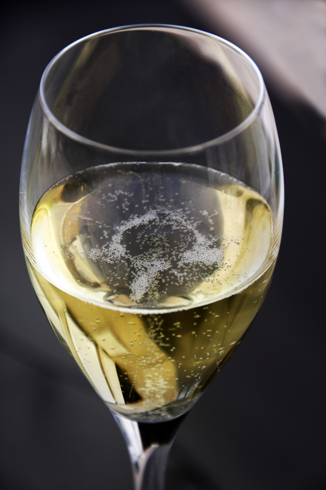

# Champagne

Champagne is a [sparkling wine](ref:sparkling-wine) appellation in the Champagne region of northern France, centred on Reims and Épernay. It is made from [Chardonnay](ref:chardonnay), [Pinot Noir](ref:pinot-noir) and Pinot Meunier by the traditional method of in-bottle second fermentation; commonly 750 mL at about 12%–12.5% vol.

Figure: Champagne. Image: bgvjpe, CC BY 2.0, via Wikimedia Commons ([source page](https://commons.wikimedia.org/wiki/File:Glass_of_champagne.jpg)).

## Definition and positioning

Start with the layers: [sparkling wine](ref:sparkling-wine) is the category, Chardonnay and Pinot Noir are varieties, Champagne is the appellation (AOC), and individual estates and wines are the producer level. Champagne is both a place name and a protected appellation name, and must not be confused with ordinary sparkling wine or a brand. The sub-regions, village classification and rule framework are covered on the [Champagne region](ref:champagne) page.

Champagne lies in northern France, where a cool climate makes the balance of ripeness and acidity the basis of the style. Estates, cooperatives and négociants coexist, and the producer abbreviation on the label distinguishes the type of producer.

## Producers and brands

There are three broad types of producer: large négociants, cooperatives and independent estates. Large négociants often buy grapes or base wine to blend, independent estates mostly own their plots and bottle their own wine, and cooperatives are run by groups of growers.

Appellation, producer and product are three levels: the appellation answers the rules and geography, the producer answers who farms, ferments and bottles, and the product answers vintage, sweetness and format. Well-known houses such as [Moët & Chandon](ref:moet) and [Veuve Clicquot](ref:veuve) sit at the producer level and cannot stand for the whole appellation.

## Region and raw materials

Champagne lies in northern [France](ref:france), centred on Reims and Épernay. The climate is cool with a short growing season, and autumn conditions shape ripeness and acidity; chalk and limestone soils drain well and encourage deep rooting.

The raw material is [grape](ref:grape), with the main varieties [Chardonnay](ref:chardonnay), [Pinot Noir](ref:pinot-noir) and Pinot Meunier. The combination of varieties and sites determines body, aroma and ageing potential, and blend proportions belong to the producer.

## Winemaking

Champagne uses the traditional method: a first [fermentation](ref:fermentation) makes base wine, then yeast and sugar are added in bottle for a second fermentation that creates the bubbles; the wine then ages on its lees, making the bubbles finer and developing brioche notes. After disgorging, a dosage adjusts sweetness.

Some wines use [oak ageing](ref:oak-ageing) for fermentation or maturation of base wine, adding texture and spice, but this is not the mainstream. Specific ageing times and blend proportions belong to the producer, so no uniform figures are given here; refer to producer material and the bottle.

## Format and labelling

The usual bottle is 750 mL at about 12%–12.5% vol. Check the appellation, producer type, vintage (or absence of one), sweetness level (brut, extra brut and so on), producer abbreviation and importer on the label.

For Champagne, label language varies by market, so the bottle itself is the reference. The sweetness label describes sugar content, not quality; non-vintage wines are usually blended from base wines of several years.

## Flavour and tasting

Champagne shows green apple, citrus, white flower and brioche, with high acidity, fine bubbles and a light to medium body. Lees ageing adds nut, cream and honey notes, and sweeter styles feel rounder.

Serve at about 8–10 °C, in a tulip or flute glass. Look for layers of fruit, yeast and minerality; the fineness and persistence of the bubbles are also useful quality references.

## Drinking and pairing

Champagne works as an aperitif and with seafood, white meat, fried food and salty snacks; sweeter styles suit fruit desserts. Pair by acidity and sweetness rather than a fixed list.

Most non-vintage wines suit drinking within 2–5 years, and quality vintage wines can go longer; the window varies by producer and vintage. Bubbles fade after opening, so refrigerate and drink soon. Excessive drinking is harmful to health, and minors should not drink.

## Buying and storage

Buy from reputable channels and check the appellation, producer abbreviation, sweetness label and bottler. Prices vary widely with house, vintage and time on lees, so no figures are given here. An appellation name and packaging cannot replace knowing the producer and vintage.

For Champagne, store unopened bottles away from light, lying down in a cool place at about 10–13 °C, avoiding heat and sharp temperature swings. For long storage keep a steady temperature and avoid frequent movement. After opening, refrigerate and drink soon.

## Common misconceptions

First, calling all sparkling wine Champagne. Champagne is a protected French appellation name.
Second, assuming sweeter Champagne is better. The sweetness label describes sugar content, and style match matters more.
Third, treating bubble size as the only quality measure. Aroma, acidity and balance matter equally.
Fourth, assuming only Chardonnay can make Champagne. Pinot Noir and Pinot Meunier are also main varieties.
Fifth, judging authenticity by price or packaging. Channel, back label and producer abbreviation are more reliable.

Start with the base and the stated strength. From there, consider the sweetness or bitterness, then how it is served. That is how a practical judgment about Champagne is built.

[Sparkling wine](ref:sparkling-wine) and [Champagne](ref:champagne) are the two useful reference points for Champagne. [Sparkling wine](ref:sparkling-wine) sets out style; [Champagne](ref:champagne) brings in region and vintage. Read them together.

**At a glance:** A sparkling wine appellation in the Champagne region of northern France, centred on Reims and Épernay; made from Chardonnay, Pinot Noir and Pinot Meunier by the traditional method of in-bottle second fermentation, known for high acidity, fine bubbles and citrus, apple and brioche notes, commonly 750 mL at about 12%–12.5% vol.

**Key facts.**

| Item | Detail |
| --- | --- |
| In one line | A sparkling wine appellation in the Champagne region of northern France, centred on Reims and Épernay; made from Chardonnay, Pinot Noir and Pinot Meunier by the traditional method of in-bottle second fermentation, known … |
| Style | Sparkling wine |
| Region | France、Champagne |
| ABV | 12–12.5% vol |

**Sources and limits.** The key claims about Champagne are checked against the following sources: INAO (Used to check the appellation area, varieties and winemaking rules), Comité Interprofessionnel du Vin de Champagne (Used to check the traditional method, ageing requirements and styles of Champagne), Oxford University Press (Consulted for entries on Champagne and sparkling wine). Prices, batches and status change; the body is project-written and does not reproduce source text.

## Further reading

- [Sparkling wine](ref:sparkling-wine): the category Champagne belongs to.
- [Chardonnay](ref:chardonnay): one of the main Champagne varieties.
- [Pinot Noir](ref:pinot-noir): one of the main Champagne varieties.
- [Moët & Chandon](ref:moet): a large Champagne house, a wine page rather than an appellation page.
- [Veuve Clicquot](ref:veuve): a large Champagne house, a wine page rather than an appellation page.
- [France](ref:france): French wine law and appellations.
- [Champagne region](ref:champagne): the sub-regions, village classification and rule framework of the appellation.
- [Grape](ref:grape): the basic structure of wine grapes and ripeness measures.
- [Fermentation](ref:fermentation): the logic of in-bottle second fermentation.
- [Oak ageing](ref:oak-ageing): a texture source used in some wines.
- [Alcohol by volume](ref:abv): what 12%–12.5% vol means on a label.
