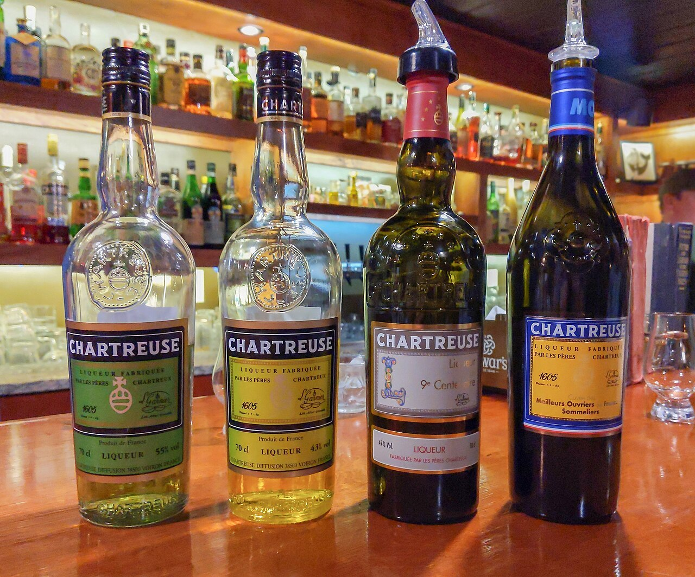

# Chartreuse

Chartreuse is a herbal liqueur produced within the Carthusian tradition in France. The recipe is said to contain about 130 plants, flowers, roots, berries and barks. Green Chartreuse is 55% ABV and yellow Chartreuse is 40% ABV. It belongs to the wider category of [liqueurs](ref:liqueur), not to wine or plain brandy.

Figure: Chartreuse. Photograph: Chartreuse bottles. Credit: Ɱ, CC BY-SA 4.0, via Wikimedia Commons ([source](https://commons.wikimedia.org/w/index.php?curid=132058135)).

## Definition and identity

A liqueur is broadly "alcohol plus sugar plus flavouring". Chartreuse fits that frame: a neutral spirit or distilled base is flavoured with plants through maceration, distillation or both, and sugar or honey is added to shape the texture. It is not a medicine and not a legally defined "medicinal wine". Monastic history, herbal tradition and the "elixir of long life" story are brand narrative; they do not replace the ABV, volume and ingredient information on the label.

Geographically, Chartreuse is a French product made and aged mainly around Voiron in the Isère department, near the Grande Chartreuse monastery. France is its historical and legal home, but that does not make every French herbal liqueur a Chartreuse. Products with similar names must be checked against their producer and trademark.

## History

According to the timeline published by the producer and local tourism authorities, the Carthusian order settled in the Chartreuse mountains in 1084. In 1605, Marshal François Hannibal d'Estrées gave the monks of the Vauvert monastery in Paris a manuscript describing an "elixir of long life". The manuscript listed about 130 plants, but the full formula was never made public. The monks spent more than a century refining the process, and in 1764 the product later known as Elixir Végétal de la Grande Chartreuse took shape.

In the nineteenth century, the monastery built on its apothecary and distilling traditions to develop the liqueur form sold today and gradually established a brand. In 1903 the monks were expelled from France and production moved temporarily to Tarragona in Spain before returning to France. Today only a very small number of monks are said to know the complete formula. That "secret recipe" is both a brand asset and a part of the product that outsiders cannot independently verify. Claims that it cures every illness should be read as historical marketing, not modern medical evidence.

## Recipe and production

The public outline of the process is simple: plants are macerated and [distilled](ref:distillation) to obtain an aromatic concentrate, which is then blended with a base spirit, sugar or honey and left to rest in cellars so that the flavours integrate. What cannot be reproduced is the identity, proportion, temperature, timing and order of the botanicals. Green and yellow Chartreuse are not one recipe with different colouring; they are separate products. Green is stronger and more herbal and minty; yellow is sweeter, softer and lower in alcohol.

From a food-chemistry perspective, the aroma of a herbal liqueur comes from terpenes, aromatic aldehydes, phenols and lactones, among other compounds. Sugar and alcohol affect how those compounds volatilise and are perceived. High alcohol helps preserve aroma but also creates more oral pungency; sugar rounds the body and masks some bitterness. "Green is stronger, yellow is sweeter" can therefore be explained by specification and recipe direction without invoking mystery.

## Products and specifications

| Item | Green Chartreuse | Yellow Chartreuse |
| --- | --- | --- |
| Type | Herbal liqueur | Herbal liqueur |
| ABV | 55% ABV | 40% ABV |
| Flavour direction | Herbal, anise, mint, pine | Honey, herbs, citrus, spice |
| Common use | Neat, on ice, classic cocktails | Neat, on ice, softer mixing |
| Production | Around Voiron, France | Around Voiron, France |

The table describes the two main lines, not limited editions, aged versions or special packaging. Buyers should rely on the bottle label and batch information; the same product may differ in volume and labelling between markets.

## Flavour and tasting

Green Chartreuse is intensely aromatic, with mint, anise, pine and a complex herbal profile. Its sweetness is held back by the high alcohol, and the finish is long with a bitter edge. Yellow Chartreuse is closer to a sweet herbal tea, with more honey and floral notes and lower alcohol, which makes it easier to approach neat. Neither is a wine-like product that improves indefinitely with age; after opening, avoid prolonged heat and strong light so that the aroma does not fade.

A simple tasting sequence helps: first smell the static aroma and judge the balance of herbs, sweetness and alcohol; then add a little water or ice and see whether the aroma opens; finally take a small sip and follow the bitterness, sweetness and length of finish. Do not treat a high-strength liqueur as a drink for large mouthfuls, because oral pungency will hide the detail.

## Drinking and pairing

The most common serve is chilled and neat, or over one large ice cube that dilutes the drink slowly. In cocktails, green Chartreuse appears in classics such as the Last Word and the Champs-Élysées, usually in small amounts so that it does not overwhelm the other ingredients. Yellow Chartreuse suits softer cocktails and can be mixed with soda or tonic, though that changes the sweet-bitter balance. As an after-dinner drink it pairs well with dark chocolate, nuts or spice-based desserts; it is less suitable with delicate seafood, where the herbal intensity and alcohol can mask the food.

## Common misconceptions

First, treating the "monastic formula" as a verifiable recipe. Public sources confirm only that the recipe uses about 130 plants; the full formula is not public.
Second, treating green as the "superior" version. Green and yellow differ in style and specification, not in quality grade.
Third, treating it as a medicine or health supplement. It is an alcoholic food, and any "curative" claim should not replace medical advice.
Fourth, assuming every product called Chartreuse is the same. Chartreuse is also a mountain range, a monastery and a place name in France; check the producer and label.
Fifth, ignoring storage after opening. High alcohol does not mean the aroma cannot fade; light, temperature and headspace all matter.

Begin with the base and the stated strength, move on to the sweetness or bitterness, and finish with how it is served. That order keeps the reading of Chartreuse practical.

**Short definition:** A herbal liqueur made by the Carthusian order in Voiron, France, based on a recipe said to contain about 130 plants; green is 55% ABV and yellow 40% ABV.

**Key facts.**

| Item | Detail |
| --- | --- |
| In one line | A herbal liqueur made by the Carthusian order in Voiron, France, based on a recipe said to contain about 130 plants; green is 55% ABV and yellow 40% ABV. |
| Style | Liqueur |
| Region | France |

**Sources and limits.** The key claims about Chartreuse are checked against the following sources: Pères Chartreux / Chartreuse Diffusion (the 1605 manuscript, the 130-plant recipe, the 1764 elixir and the brand timeline), Agence départementale du tourisme de la Savoie / Isère (Used to cross-check the monastic origin, the manuscript and the production location), Oxford University Press (Consulted for entries on Chartreuse, monastic liqueurs and cocktail use) and 4 sources in total. Prices, batches and status change; the body is project-written and does not reproduce source text.

## Further reading

- [Liqueur](ref:liqueur): the wider category to which Chartreuse belongs.
- [Distillation](ref:distillation): the basic process behind aromatic concentrates and spirit bases.
- [France](ref:france): an overview of the region, its rules and its drinks.
