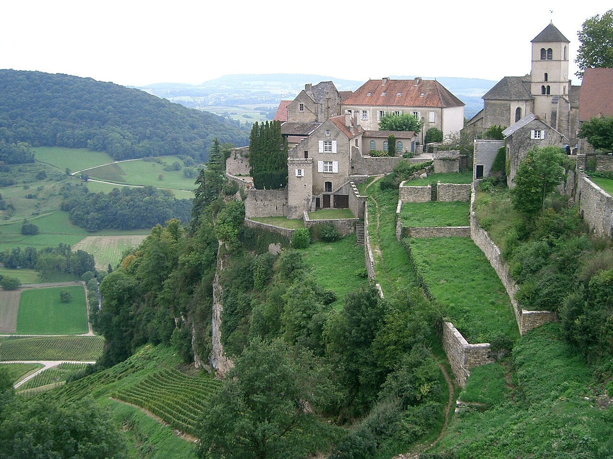

# Château-Chalon

Château-Chalon is an appellation in the [Jura](ref:jura) region of [France](ref:france) that makes only [vin jaune](ref:yellow-wine), exclusively from Savagnin. The wine ages oxidatively sous voile in old barrels for a legal minimum of 6 years 3 months. It commonly comes in a 620 mL narrow-necked bottle at about 13.5%–15% [alcohol by volume](ref:abv).

Figure: Château-Chalon. Image: PRA, CC BY 3.0, via Wikimedia Commons ([source page](https://commons.wikimedia.org/wiki/File:Ch%C3%A2teau-Chalon_-_site.JPG)).

## Definition and position

Start with the levels: [white wine](ref:white-wine) is the category, vin jaune is an oxidative white wine, Château-Chalon is an appellation making only vin jaune, and individual estates and wines are the producer level. Château-Chalon is both a village name and an appellation name, and the label usually reads "Château-Chalon" directly.

Château-Chalon has a special position: within its area only vin jaune is permitted, with no standard dry white, red or sparkling wine. Its style differences therefore come mainly from parcel, vintage and each estate's oxidative management rather than from the choice of wine type.

## Producer and brand

The appellation is small and producers are mostly family estates, with a few merchants. Vin jaune ties up stock for years and volumes are low, so producer scale is generally limited.

Producer, appellation and product are three levels: the appellation answers for rules and area, the producer answers for farming, making and bottling, and the product answers for vintage and bottle format. The same Château-Chalon can differ between estates in yeast-veil management and ageing length.

## Region and ingredients

Château-Chalon lies in western Jura, with vineyards on slopes and terraces around the village at about 250–450 metres. Soils are mainly limestone and marl, well drained and low in fertility, with aspects mostly south or south-east.

The raw material is [grape](ref:grape), and the only variety is Savagnin. Savagnin ripens late with high acidity and thin skins; it can make a fresh dry white under the ouillé route or develop nut and spice notes under the sous voile route. Château-Chalon uses only the latter.

## Winemaking

The key is the difference between "sous voile" and "ouillé". Ouillé means topped up: the barrel is regularly filled to replace evaporating wine, reducing oxygen contact and giving a pure citrus, white-flower and mineral style. Sous voile means under a veil: the barrel is not topped up, a yeast film forms on the surface, and the wine evolves slowly in an oxidative environment. Château-Chalon follows sous voile.

After fermentation the wine goes into old barrels for long ageing, with a legal minimum of 6 years 3 months. The yeast veil consumes oxygen and produces nut, curry and saline compounds; barrel material and age affect the rate of oxygen transfer. Bottling uses a 620 mL narrow-necked bottle, a capacity that corresponds to the natural losses during ageing. For the basics of [fermentation](ref:fermentation) and [oak ageing](ref:oak-ageing), see the linked pages.

## Specification and label

The standard volume is a 620 mL narrow-necked bottle, with [alcohol by volume](ref:abv) at about 13.5%–15% vol, varying by vintage and estate. The label should be checked for the Château-Chalon appellation, vintage, bottler and importer.

Château-Chalon does not use "vin jaune" as its sole name, but the wine type is vin jaune, and some labels also state the ageing method. The Chinese back label and importer information are the basis for checking identity, and the bottle on hand governs.

## Flavour and tasting

Typical aromas are walnut, almond, beeswax, curry, dried fruit and saline notes, with some wines showing honey and yeast. The palate has high acidity and concentration, with a very long finish. Compared with the fresh citrus style of ouillé whites, Château-Chalon is heavier and more oxidative.

Serve at about 12–14 degrees Celsius in a small glass and in modest quantities. The aroma keeps changing after opening, so smell before tasting and watch the layers of nuts, spice and salt; avoid heavy-flavoured dishes that mask the detail.

## Drinking and pairing

It suits nuts, mushrooms, foie gras, hard cheese and savoury dishes, and can also be drunk on its own as an after-dinner wine. Avoid dishes that are too sweet or too hot, which overwhelm the oxidative aroma.

Vin jaune oxidises quickly after opening, so refrigerate it and finish it within a few weeks, depending on the wine. Excessive drinking harms health and minors should not drink.

## Buying and storage

Château-Chalon is best read by starting with the base and the stated strength, moving to the sweetness or bitterness, and ending with how it is served.

For Château-Chalon, unopened bottles should be kept away from light, lying flat in a cool place at an ideal 12–15 degrees Celsius, avoiding heat and sharp temperature swings. Long storage needs stable temperature; after opening, use a vacuum or inert gas and refrigerate rather than warming and cooling repeatedly.

## Common misconceptions

First, treating Château-Chalon as an ordinary dry white. It is a vin jaune aged sous voile.
Second, reading "jaune" as sweet. Jaune refers to colour and oxidative style, not high sugar.
Third, thinking sous voile and ouillé differ only in ageing time. They are two routes defined by how oxygen takes part.
Fourth, thinking Château-Chalon also makes reds or sparkling wine. The appellation permits only vin jaune.
Fifth, thinking longer ageing is always better. Oxidation accelerates decline after opening, so the wine should be drunk soon.

**At a glance:** The vin jaune of the Château-Chalon appellation in the Jura region of France, made only from Savagnin and aged oxidatively sous voile in old barrels for at least 6 years 3 months; it shows walnut, beeswax, curry and saline notes in contrast with ouillé topped-up Jura whites, commonly in a 620 mL narrow-necked bottle at about 13.5%–15% vol.

**Key facts.**

| Item | Detail |
| --- | --- |
| In one line | The vin jaune of the Château-Chalon appellation in the Jura region of France, made only from Savagnin and aged oxidatively sous voile in old barrels for at least 6 years 3 months; it shows walnut, beeswax, curry and sali… |
| Style | Yellow wine、White wine |
| Region | France、Jura |
| ABV | 13.5–15% vol |

**Sources and limits.** The key claims about Château-Chalon are checked against the following sources: INAO (the area, varieties and vin jaune ageing rules of the Château-Chalon appellation), European Union (EU wine categories, geographical indications and labelling rules), Oxford University Press (Consulted for entries on Château-Chalon, vin jaune and sous voile; Migrated from the former reference list at the end of the article; access date not re-verified). Prices, batches and status change; the body is project-written and does not reproduce source text.

## Further reading

- [Vin jaune](ref:yellow-wine): the oxidative white category to which Château-Chalon belongs.
- [White wine](ref:white-wine): the wider colour category of vin jaune.
- [Jura](ref:jura): the region and its framework of wine types.
- [Arbois](ref:arbois): a Jura appellation making red, white and vin jaune.
- [Grape](ref:grape): the basic structure of wine grapes and ripeness measures.
- [Fermentation](ref:fermentation) and [oak ageing](ref:oak-ageing): the two basic process steps for vin jaune.
- [Alcohol by volume](ref:abv): what 13.5%–15% vol means on a label.
