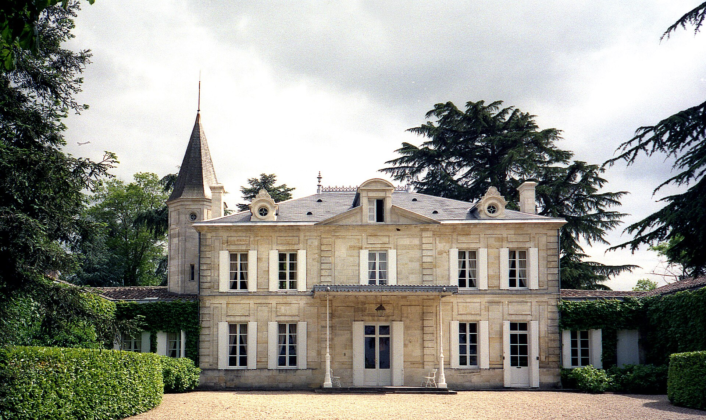

# Château Cheval Blanc

Château Cheval Blanc is in the Saint-Émilion appellation of Bordeaux, France, close to the Pomerol boundary. The vineyard is about 39 hectares, planted mainly to [Cabernet Franc](ref:cabernet-franc) and [Merlot](ref:merlot), and the style is known for aromatic complexity, supple texture and ageing potential. It is commonly 750 mL at about 13%–14% [alcohol by volume](ref:abv).

Figure: Related photograph of Château Cheval Blanc. Image: Benjamin Zingg, Switzerland, CC BY-SA 2.5, via Wikimedia Commons ([source page](https://commons.wikimedia.org/wiki/File:Ch%C3%A2teau_Cheval-Blanc.jpg)).

## Definition and position

Start with the levels: [red wine](ref:red-wine) is the category, Cabernet Franc and Merlot are the varieties, Saint-Émilion is the region, and Cheval Blanc is a specific estate and its grand vin. Keeping the four apart stops a brand name from being read as a variety or as a grading title.

Saint-Émilion has its own classification, separate from the left-bank 1855 list. Cheval Blanc was ranked Premier Grand Cru Classé A in the first Saint-Émilion classification of 1955; in 2021 the estate announced its withdrawal from that classification, and later official lists no longer include it. Discussing its "rank" requires the date and the system, and an old title cannot simply be carried forward.

## Producer and brand

The estate sits on high ground on the border between Saint-Émilion and Pomerol, with parcels spanning the soil types of both areas. Since 1998 it has been jointly owned by the LVMH group and the family of Belgian businessman Albert Frère, and has since been run by a professional team.

Estate, brand and product are three levels: the estate answers for the vineyard, team and technique, the brand answers for market position, and the product answers for vintage and specification. Cheval Blanc has a grand vin and a second wine (Le Petit Cheval), with different parcel sources and selection standards, and they must not be confused.

## Region and ingredients

Saint-Émilion lies on the right bank of [Bordeaux](ref:bordeaux) in [France](ref:france), with an Atlantic-influenced climate and interleaved clay and limestone soils. Cheval Blanc's parcels sit towards Pomerol, with gravel, clay and sand, and the balance of drainage and water retention shapes how Cabernet Franc and Merlot ripen.

The raw material is [grape](ref:grape), mainly [Cabernet Franc](ref:cabernet-franc) and [Merlot](ref:merlot) with a little of other varieties, the proportions varying by parcel and vintage. Cabernet Franc supplies aroma and structure, Merlot suppleness and fruit, and the ratio between them is a key variable in the estate's style.

## Winemaking

After harvest the fruit is fermented in parcels by variety, with temperature-controlled maceration to extract colour and tannin without over-extraction. The wine then ages in [oak](ref:oak-ageing), with a high proportion of new barrels whose exact share changes by vintage.

Oak serves to integrate aroma and soften tannin rather than mask fruit. Clarification and filtration before bottling vary by year, and the estate decides the blend from parcel ripeness and body; specific parameters follow the estate's published information.

## Specification and label

The common volume is 750 mL, with [alcohol by volume](ref:abv) at about 13%–14% vol, varying by vintage. The label should be checked for estate name, vintage, region, net volume, bottler and importer; the second wine carries a different name, so the name must be confirmed when buying.

The Chinese back label, importer and anti-counterfeit information are the basis for checking identity; label languages differ by market, so the bottle on hand governs. High-value wines traded on the secondary market should come with provenance and storage records.

## Flavour and tasting

Typical aromas are blackcurrant, black cherry, violet, graphite and tobacco, developing leather, truffle and cedar with age; the palate has fine tannin, moderate acidity, a medium to full body, a supple texture and a long finish. In years with a higher share of Cabernet Franc, the aroma leans more towards flowers and graphite.

For tasting, serve at about 16–18 degrees Celsius in a larger glass. Young wines can be decanted for 1–2 hours, while older wines should be decanted briefly after a small first taste. Too warm a temperature pushes alcohol forward and hides the aromatic layers.

## Drinking and pairing

It suits red meat, roasted dishes, mushroom dishes and hard cheese; fat and protein buffer the tannin and round the wine. Avoid very sweet or sharply acidic dishes, which upset the balance.

For Château Cheval Blanc, most vintages are for drinking after 10 years or more, and good years can last longer; the window depends on vintage and storage. After opening, refrigerate and drink soon. Excessive drinking harms health and minors should not drink.

## Buying and storage

Buy from reputable channels and check vintage, label, back label, importer and anti-counterfeit information. Prices fluctuate widely with vintage and market, so no figure is given here; grand vin and second wine differ greatly in price, so the name must be confirmed.

For Château Cheval Blanc, unopened bottles should be kept away from light, lying flat in a cool place at an ideal 12–15 degrees Celsius, avoiding heat and sharp temperature swings. Cork-sealed bottles need humidity and can be stored lying down. After opening, use a vacuum or inert gas and refrigerate rather than warming and cooling repeatedly.

## Common misconceptions

First, treating Cheval Blanc as a grape variety. It is an estate and a wine, and the varieties are Cabernet Franc and Merlot.
Second, treating the 1955 ranking as a permanent identity. The estate withdrew from the classification in 2021.
Third, confusing the grand vin with the second wine. Their selection standards and prices differ.
Fourth, believing right-bank wine relies on Merlot alone. Cheval Blanc uses a high share of Cabernet Franc.
Fifth, judging authenticity by price or packaging. Channel, back label and provenance records are more reliable.

**Short definition:** A red wine from Saint-Émilion in Bordeaux, France, on the border with Pomerol, with about 39 hectares planted mainly to Cabernet Franc and Merlot. It was ranked Premier Grand Cru Classé A in the 1955 Saint-Émilion classification and withdrew from that classification in 2021; commonly 750 mL at about 13%–14% vol. 

Château Cheval Blanc is best read by starting with the base and the stated strength, moving to the sweetness or bitterness, and ending with how it is served.

[Red wine](ref:red-wine) and [France](ref:france) answer different questions about Château Cheval Blanc: style and region and vintage. Read them as a pair, not as alternatives.

## Further reading

- [Red wine](ref:red-wine): the wider category to which Cheval Blanc belongs.
- [Cabernet Franc](ref:cabernet-franc): one of the estate's core varieties.
- [Merlot](ref:merlot): the other main component of the blend.
- [France](ref:france): French wine law and appellations.
- [Bordeaux](ref:bordeaux): where Saint-Émilion sits in the Bordeaux map.
- [Grape](ref:grape): the basic structure of wine grapes and ripeness measures.
- [Fermentation](ref:fermentation): the logic of parcel fermentation and maceration.
- [Oak ageing](ref:oak-ageing): the stage that integrates aroma and softens structure.
- [Alcohol by volume](ref:abv): what 13%–14% vol means on a label.
