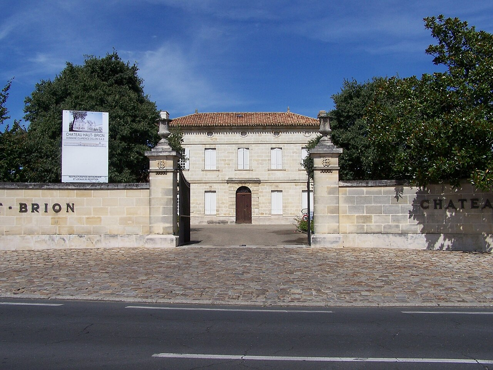

# Château Haut-Brion

Château Haut-Brion is a classified estate in Pessac-Léognan, Bordeaux, France, ranked first growth in the 1855 classification and the only estate on that list outside the Médoc. The wine belongs to [red wine](ref:red-wine), a blend led by [Cabernet Sauvignon](ref:cabernet) and [Merlot](ref:merlot), often described as carrying smoke, cigar-box and mineral notes. The common format is 750 mL at about 13% ABV; vintage, bottling batch and label details should be checked on the bottle.

Figure: Château Haut-Brion. Image: Henry Salomé, CC BY-SA 4.0, via Wikimedia Commons ([source page](https://commons.wikimedia.org/wiki/File:Pessac_Ch%C3%A2teau_Haut-Brion.jpg)).

## Definition and position

Château Haut-Brion is both the name of the estate and the name of its grand vin. The estate lies in Pessac-Léognan on the southern left bank of [Bordeaux](ref:bordeaux), part of the Graves, and sells its wine under the Pessac-Léognan appellation within the French AOC/AOP system. Besides the grand vin there is a second wine and a white wine, all from different selection standards and not to be confused with one another.

Within the classification of [wine](ref:wine), it is a still red wine. First growth is the historical status given by the 1855 classification, not a modern evaluation; vintage, parcel and bottling batch remain the basis for judging a specific wine. Graves red wines have historically been discussed separately, and understanding them means looking at both the shared features of the left bank and the differences here.

## Origin and classification

Pessac-Léognan lies south of the city of Bordeaux, in the northern Graves, with soils mixing gravel, sand and clay. Compared with the deep gravel of the Médoc, the soil types here are more varied: some parcels drain and warm in a way suited to Cabernet Sauvignon, while others suit Merlot better.

The 1855 classification was drawn up by the Bordeaux Chamber of Commerce, mainly covering estates in the Médoc, with only a few from the Graves included. Château Haut-Brion was ranked first growth on that list, at the same level as [Château Margaux](ref:margaux), and is the only estate on the list outside the Médoc. This exception makes it a common example when discussing the geographical scope of the classification.

## Varieties and blend

The grand vin is based on Cabernet Sauvignon and Merlot, often with Cabernet Franc and Petit Verdot. Cabernet Sauvignon provides the skeleton, colour and ageing potential, Merlot adds roundness and fruit, Cabernet Franc brings aromatic layers, and Petit Verdot adds colour and spice.

The proportions shift with the vintage, and different parcels are handled separately. The proportion is not itself a quality marker; balance is what matters. Blending is the estate's process decision, and the exact percentages are usually not fully declared on the label; the vintage and appellation on the label are the basics for identifying a wine.

## Production

Harvesting is usually done by hand, and after sorting, destemming and crushing the fruit undergoes temperature-controlled [fermentation](ref:fermentation). Maceration time and fermentation temperature affect the extraction of colour, tannin and aroma; different parcels and varieties are often handled in separate tanks before [blending](ref:blending).

After fermentation the wine goes into [oak ageing](ref:oak-ageing). The share of new barrels, the ageing period and the frequency of racking are estate process decisions that public material may not disclose year by year. Oak softens tannin and adds aromatic layers, but it cannot replace the ripeness of the fruit itself.

## Specification and label

The common format is a 750 mL bottle at about 13% ABV, as a dry red wine. The label usually carries the estate name, vintage, appellation, strength, net volume and production information; French AOC wines also declare the controlled appellation.

The second wine has its own name and packaging, and its price differs markedly from the grand vin. Buyers should distinguish the grand vin, the second wine and the estate's white wine, and should not treat the second wine as a cheaper version of the grand vin or infer its performance from the grand vin's vintage.

## Flavour and tasting

When young the wine often shows blackcurrant, plum, smoke and mineral notes, with fine but supportive tannin. With age it develops cigar box, tobacco, leather and truffle notes, and the body moves from firm to supple with a fairly long finish.

Serve at about 16-18°C. Too warm accentuates alcohol, too cold suppresses aroma. Young wines can be left to breathe

## Drinking and pairing

Château Haut-Brion suits steak, roasted lamb, duck breast and hard cheese. Tannin binds with protein to soften astringency, while acidity cuts through fat. Dishes with mushroom and truffle, carrying earthy notes, also echo the aromas of an aged wine.

For Château Haut-Brion, if a bottle is not finished, cork it tightly, refrigerate and drink within a few days. Red wine oxidises with prolonged air contact, and fruit aroma turns to sour and nutty notes; decanting into a smaller bottle or using a vacuum stopper slows the process.

## Buying and storage

First-growth Bordeaux circulates mainly through the négociant system and the en primeur market, with prices shaped by vintage, yield and market expectations. Buyers should check the estate name, vintage, appellation, strength and anti-counterfeit information, and consider whether the channel is reliable.

For Château Haut-Brion, unopened wine should be stored on its side, away from light, at a steady temperature, ideally 12-16°C, avoiding sharp temperature swings and strong odours. Home storage cannot replicate cellar conditions, and long ageing needs stable temperature and humidity, so the year of purchase should not be equated simply with an improvement in quality.

## Common misconceptions

First, treating first growth as a fixed quality guarantee for every year. The classification is historical status, and vintage differences remain obvious.

Second, assuming all first growths are in the Médoc. Haut-Brion is in Pessac-Léognan, in the Graves.

Third, treating the second wine as a cheap version of the grand vin. It comes from different parcels and different selection standards.

Fourth, judging quality by price alone. Channel, vintage and storage condition matter equally.

For Château Haut-Brion, a common mistake is treating ageing potential as indefinite storage. Past its drinking window, aroma and structure decline.

**At a glance:** A classified growth in Pessac-Léognan, Bordeaux, ranked first growth in the 1855 classification and the only estate on that list outside the Médoc; a Cabernet Sauvignon and Merlot-led blend, commonly 750 mL at about 13% ABV, with vintage and batch to be checked on the label. 

Château Haut-Brion is best read by starting with the base and the stated strength, moving to the sweetness or bitterness, and ending with how it is served.

## Further reading

- [Red wine](ref:red-wine): category and basic process.
- [Wine](ref:wine): the broad category and classification system.
- [France](ref:france): the overall landscape of French wine.
- [Bordeaux](ref:bordeaux): left bank and right bank, classification and market.
- [Cabernet Sauvignon](ref:cabernet): variety characteristics and style.
- [Merlot](ref:merlot): the source of roundness and fruit.
- [Fermentation](ref:fermentation): skin fermentation and maceration.
- [Oak ageing](ref:oak-ageing): shaping aroma and tannin.
- [Blending](ref:blending): balancing varieties and parcels.
- [Château Margaux](ref:margaux): another 1855 first growth.
