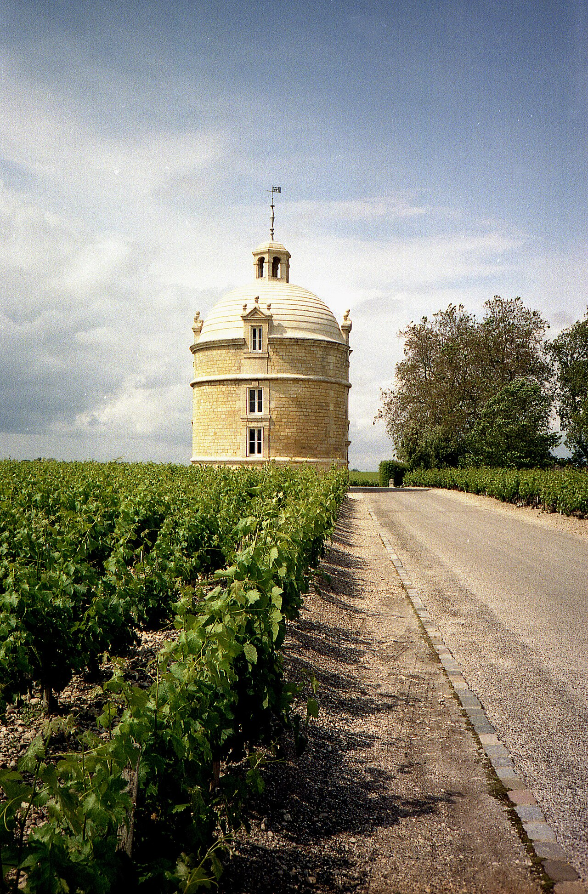

# Château Latour

Château Latour stands at the southern end of [Pauillac](ref:pauillac), in [Bordeaux](ref:bordeaux), [France](ref:france), with its vines about 300 metres from the Gironde estuary. The grand vin is not a generic estate bottling: it comes from the 47-hectare walled Enclos and from vines averaging roughly 60 years old. It is a still [red wine](ref:red-wine), with no fortification or secondary sparkle in the [wine](ref:wine) sense. To understand Latour, start with the wall.

Figure: Château Latour. Image: Benjamin Zingg, Switzerland, CC BY-SA 2.5, via Wikimedia Commons ([source page](https://commons.wikimedia.org/wiki/File:Ch%C3%A2teau_La_Tour.jpg)).

## A tower documented in 1331

The earliest surviving document mentioning Latour is dated 1331: Lord Pons authorised Gaucelme de Castillon to build a fortified tower in the parish of Saint-Maubert. In 1378 the Tour de Saint-Maubert appears in Froissart's *Chronicles*, serving as a fortress above the estuary during the Hundred Years' War. The original tower is gone; a dovecote now stands near the château, but the name survived.

Through marriage and inheritance the estate passed to the Ségur family in the early 18th century. In 1714 a barrel of Latour fetched four to five times the price of ordinary Bordeaux; by 1767 the multiple had reached twenty. The vineyard measured 38 hectares in 1759 and 47 hectares in 1794, exactly the size of today's Enclos. The estate now tends about 900,000 vines, replants roughly 3% each year, brought horses back in 2008, has farmed the whole vineyard organically since August 2015, and received Ecocert certification in August 2018, which also covers the winery and vinification.

## The 47 hectares inside the Enclos

Latour now has 96.5 hectares of vines. The 47 hectares around the château form the Enclos and are the only source of the grand vin. The remaining 50 hectares are outlying parcels acquired over centuries, including Piñada, Petit Batailley and St. Anne, plus seven hectares at Artigues bought in 2005 and about five more hectares added in 2012.

The Enclos is a hilltop rising 12–16 metres above the Gironde, bounded by two streams to the north and south and by marshland to the east. Its core is clayey gravel, with gravel content ranging from 50% to 80% by altitude; the edges are younger gravelly sand, better suited to [Merlot](ref:merlot). Below the gravel lies marly clay that holds water, allowing old vines with roots up to three metres deep to stay active in drought years such as 2003 and 2010. A drainage system installed in the 19th century still functions.

## Old vines, one grand vin

The grand vin is made only from old vines inside the Enclos, averaging about 60 years, with plots named Gravettes, Sarmentier and Pièce du Château. [Cabernet Sauvignon](ref:cabernet) usually accounts for more than 90% of the blend, providing colour, concentration and tannic structure. The vineyard as a whole is planted to about 76% Cabernet Sauvignon, 22% Merlot and 2% Petit Verdot.

Latour does not publish a fixed bottle count. Third-party estimates put the grand vin at 10,000–12,000 cases, or 120,000–144,000 bottles, roughly 37% of the harvest (recent typical figures; consult the estate's technical data for any given year). The number swings widely: about 15,000 cases in 2000, only about 8,000 in 2009.

## Les Forts, Pauillac and the three-tier selection

Les Forts de Latour takes its name from a historic plot inside the Enclos and was first labelled under that name in 1966. It draws on three sources: the edge of the Enclos, parcels that fail the grand vin blend, and classified plots outside the wall. Piñada, Petit Batailley and St. Anne have vines averaging about 40 years; the seven-hectare gravel terrace at Artigues arrived in 2005, followed by about five hectares in 2012. Merlot typically makes up 25%–30% of Les Forts, and new oak 50–60%.

Pauillac de Château Latour has been made every year since 1989, originally for the restaurant trade, from younger vines and wine that did not meet the Les Forts criteria. It usually contains close to 45% Merlot, sees about 20% new oak and drinks earlier.

## New oak, 22–25 months, late release

The grand vin is aged only in French oak from central France, and the barrels are renewed every year: 100% new oak, a deliberate [oak-ageing](ref:oak-ageing) choice. The wine spends its first year in the first-year cellar, with bungs left loose for the first months to allow a slow exchange of gases. It is then moved to the second-year cellar for a further 10–13 months, for a total of about 22–25 months. Racking takes place every 45 days, and fining uses one to six egg whites per barrel according to tannin levels. [Fermentation](ref:fermentation) is parcel by parcel in more than 80 stainless-steel vats ranging from 12 to 164 hectolitres, which makes the final [blending](ref:blending) unusually precise.

## Why Latour left en primeur in 2012

From 2012 Latour stopped selling its wines en primeur and instead releases them when the estate considers them ready. The same period saw the ageing cellar enlarged. The release lag differs by wine: Pauillac after four to six years, Les Forts after six to eight, and the grand vin after eight to ten. Since 2012 the estate has also kept bottle-level traceability, with records available from the 2007 vintage.

The decision shifted the cost of storage and market timing from the négociants to the estate. Buyers no longer pay for wine two years before bottling; they buy a wine that has already spent years in bottle.

## Tannin, acid and the ten-year threshold

Young Latour offers blackcurrant, black cherry, cedar and graphite, with a large but fine-grained tannic frame and an acidity that keeps the wine straight. The estate itself says the grand vin often needs a decade before it begins to drink well; great vintages can develop for decades. With age, fruit moves to the background and tobacco, leather, pencil lead and dried flowers emerge, while the tannin turns powdery.

That structure comes from several overlapping factors: the deep gravel over clay in the Enclos, more than 90% Cabernet Sauvignon, a relatively late harvest, and slow oxidation under 100% new oak. They push Latour towards longevity rather than early charm.

## Latour against Margaux and Mouton

Latour, [Margaux](ref:margaux) and [Mouton](ref:mouton) sit in the same small corner of the Médoc, but they choose different structures. Latour is built on tannin and acid, with cedar, graphite and tobacco aromas, and it often closes down in youth. Margaux opens earlier, with finer tannin and a perfume of violet and raspberry. Mouton is richer, more spice-driven, and carries the added dimension of its artist labels.

The causes are concrete. Latour's grand vin comes almost exclusively from old Enclos vines, has the highest Cabernet share, sees 100% new oak and is released last. Margaux farms 126 plots over more varied soils and selects about 40% of the harvest. Mouton's vineyard lies further north, with deeper gravel and higher ripeness, which produces a more extroverted wine. Prices are close; the styles are rarely confused.

## What the wines cost

Decanter's 2016 UK reference put the grand vin at about £300–900 per bottle, depending on vintage. Recent retail levels remain broadly in that band, with rare vintages higher; Les Forts de Latour commonly trades at about £100–350, roughly one-third to one-half of the grand vin, and Pauillac de Château Latour at about £50–120. These are recent typical retail ranges, not quotations: auction results and rare vintages can move far outside them.

## Misreadings worth correcting

First, 96.5 hectares is the whole vineyard, not the grand vin; only 47 hectares of Enclos feed the top wine. Second, Les Forts is not a declassified afterthought: it has its own plots and blending logic. Third, leaving en primeur did not mean stopping sales, only changing the timing. Fourth, first-growth status comes from the 1855 list and does not guarantee equal quality in every vintage. Fifth, old vines are not immortal, and storage matters as much as age.

## Serving, decanting and food

Serve at 16–18°C. A young grand vin can take one to two hours in a decanter; old bottles need only a short transfer to avoid losing perfume. Steak, roast lamb, game and hard cheese work with the tannin, while mushroom and truffle dishes echo the aged aromas.

After opening, stopper the bottle, refrigerate it and finish it within a few days; decanting into a smaller bottle or using a vacuum stopper slows oxidation. Store unopened bottles lying down, away from light, at a steady 12–16°C.

## Sources

1. Château Latour, *The land of Pauillac*: https://www.chateau-latour.com/en/in-the-beginning/the-land-of-pauillac
2. Château Latour, *Since 1331*: https://www.chateau-latour.com/en/in-the-beginning/since-1331
3. Château Latour, *Le Grand Vin*: https://www.chateau-latour.com/en/a-time-for-sharing/le-grand-vin-de-chateau-latour
4. Château Latour, *Les Forts de Latour*: https://www.chateau-latour.com/en/a-time-for-sharing/les-forts-de-latour
5. Decanter China, *Château Latour* (Jane Anson): https://www.decanterchina.com/zh/%E8%91%A1%E8%90%84%E9%85%92%E5%AD%A6%E4%B9%A0/%E5%90%8D%E5%BA%84%E6%A1%A3%E6%A1%88/%E6%8B%89%E5%9B%BE%E9%85%92%E5%BA%84
6. The Wine Cellar Insider, *Château Latour, Pauillac, Complete Guide*: https://www.thewinecellarinsider.com/bordeaux-wine-producer-profiles/bordeaux/pauillac/latour/
