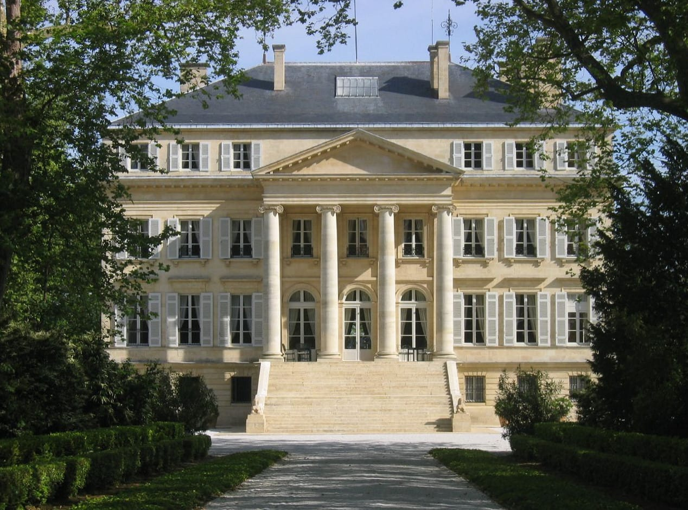

# Château Margaux

Château Margaux sits just north of the village of [Margaux](ref:margaux-village), in [Bordeaux](ref:bordeaux), [France](ref:france), and was the only estate to receive 20/20 in the 1855 classification. Its grand vin is often described as arriving aroma first and tannin second. That is not a literary flourish: it is the result of 126 plots, vines averaging 35 years and 21 months in new oak. It is a still [red wine](ref:red-wine) in the ordinary [wine](ref:wine) sense, with no fortification or sparkle.

Figure: Château Margaux. Image: BillBl, CC BY 2.0, via Wikimedia Commons ([source page](https://commons.wikimedia.org/wiki/File:Margaux_exterior.jpg)).

> **Quick verdict**
> **In one line:** This entry helps you decide whether Château Margaux suits you, and how to serve and pair it.
>
> - **Best for:** Anyone trying to understand what Château Margaux is, how it is served and when it fits.
> - **Not for:** If you want only want the cheapest buying link and do not care about flavour or context.
> - **Check first:**
>   - Decanter's 2016 UK reference put the grand vin at about £150–700 per bottle, depending on vintage.
>   - The grand vin suits roast lamb, duck breast, beef and truffle dishes.

## From La Mothe to a neo-Palladian château

The estate appears in the 12th century as La Mothe de Margaux, a name that refers to a slight rise in the Médoc, valued because it drains well. Between 1572 and 1582 Pierre de Lestonnac restructured the property and its vineyards, at the moment when the Médoc was abandoning grain for vines. By the end of the 17th century the estate covered 265 hectares, the same area it has today. Its steward Berlon was among the first in the region to ferment white and red grapes separately.

The La Colonilla family acquired the estate in 1801. In 1810 its head commissioned the Bordeaux architect Louis Combes to build the neo-Palladian château that still defines the image of Margaux; work continued until 1816. Alejandro Aguado bought it in 1830, the Pillet-Will family in 1879, and a syndicate of Bordeaux merchants in 1908. Château bottling began in 1925, the building was listed as a historic monument in 1946, and the Ginestet family took full control around 1950. André Mentzelopoulos bought the estate in 1977; after his death in 1980 his daughter Corinne took over.

## The only 20/20 in 1855

The 1855 classification was drawn up by the Bordeaux Chamber of Commerce for the Paris Exhibition, ranking the red wines of the Médoc and Graves by market price. Margaux, Lafite, Latour and Haut-Brion became first growths. Margaux was the only one to score 20/20; Lafite and Latour scored 19/20. That detail is often used to explain why Margaux is placed at the elegant end of the Médoc spectrum.

The list judged price and reputation in 1855, not the results of modern blind tastings. It has barely changed since: the promotion of Mouton from second to first growth in 1973 is the only upgrade. First-growth status is therefore a historical identity, not a guarantee of equal quality in every vintage.

## 126 plots inside 265 hectares

The estate covers 265 hectares, of which about 87 are planted to red grapes and 12 to white; the rest is woodland, meadow, buildings and roads. The red vineyard is divided into 126 plots, 72 of them planted to [Cabernet Sauvignon](ref:cabernet) and the remainder to [Merlot](ref:merlot), [Cabernet Franc](ref:cabernet-franc) and Petit Verdot. Working plot by plot, rather than variety by variety, is central to the estate's precision.

Two geological formations overlap: Tertiary limestone and clay, and Quaternary gravel, sand and clay left by the Garonne terraces. The deep gravel of the so-called Type 4 terrace is the signature of Margaux, draining quickly and allowing deep rooting; the clay below retains water. Red vines average 35 years, with the oldest plot, The Cuvier, planted in 1951. White vines average 50 years, the oldest planted in 1970. Density runs from 6,666 to 10,000 vines per hectare. The estate is completing its conversion to organic farming and is replanting rows at 45°–60° north-east/south-west to reduce sunburn.

## The grand vin: 89% Cabernet, 40% selection

The grand vin's blend shifts slightly by year: the 2023 was 89% Cabernet Sauvignon, 5% Merlot, 4% Cabernet Franc and 2% Petit Verdot; the 2025 was 89%, 6%, 4% and 1%. Cabernet supplies the frame and black fruit, Merlot rounds it out, Cabernet Franc adds perfume and Petit Verdot colour and spice.

Selection is severe. Only 41% of the 2023 harvest entered the grand vin and only 37% in 2025, against a long-run average of about 40%. [Fermentation](ref:fermentation) is parcel by parcel, [blending](ref:blending) follows repeated tastings, and [oak-ageing](ref:oak-ageing) runs for an average of 21 months in new French oak, producing about 120,000 bottles a year. In 2025 drought cut yields to 22 hl/ha, roughly half a normal crop (recent typical figures; consult the estate's technical data).

## Pavillon Rouge, the Médoc's oldest second wine

Pavillon Rouge du Château Margaux calls itself the oldest second wine in the Médoc: the estate has produced a second wine since the 17th century, and the name Pavillon Rouge has been used since the 1906 vintage. It is not a leftovers wine. It comes from the estate's most emblematic plots, from vines of similar age to those of the grand vin, and is made by the same teams.

The blend is about 75%–80% Cabernet Sauvignon, 15%–20% Merlot and a touch of Cabernet Franc and Petit Verdot. It is aged for about 20 months, nearly 60% in new French oak, and averages about 100,000 bottles; in 2025 only 28% of the harvest was selected. It drinks earlier than the grand vin but can still age for 30–40 years in strong vintages. A third wine, Margaux du Château Margaux, uses younger vines and a broader selection.

## Why Pavillon Blanc is Bordeaux AOC

White wine at Margaux goes back to the late 17th century, when the cellar master began fermenting white grapes separately. In the 19th century it was sold as "Château Margaux vin de sauvignon"; the name Pavillon Blanc du Château Margaux has been used since 1920, with a label that has barely changed.

The most overlooked detail is the appellation. Margaux AOC covers red wine only, so Pavillon Blanc is sold as Bordeaux AOC, not Margaux AOC. The vineyard is about 11–12 hectares, planted entirely to [Sauvignon Blanc](ref:sauvignon-blanc) on a site that had once been pulled up because of spring frost risk. Only about one third of the crop is bottled, no more than roughly 1,000 cases; the rest is sold in bulk. From the 2022 vintage the estate has also made a second white wine, Pavillon Blanc Second Vin.

## The Foster cellar of 2015

In 2015 the estate inaugurated a cellar designed by the British architect Norman Foster. It extends the east wing of the 19th-century complex, with tiled roofs and slender columns that echo the surrounding trees, and brings fermentation, ageing, research and tasting under one roof. It is the most important architectural change since Louis Combes built the château in 1810, and it had to respect a building listed as a historic monument in 1946.

The gain is precision rather than a change of style. More small fermentation vats allow plot-by-plot and even vine-age-by-vine-age work, and the white wine returned to the main cellar. Margaux's fine aroma depends more on selection than on any later adjustment.

## Aroma first, tannin like silk

Young Margaux offers violet, blackcurrant, raspberry and graphite. The tannin is fine and dense, the acidity is moderate but straight, and the body is medium to full. Compared with Latour, the tannin softens earlier and the aroma moves from fruit to flowers sooner; with age come cedar, tobacco, leather, dried flowers and truffle.

Opening early does not mean a short life. Great vintages can age for decades; they simply offer perfume while young, where Latour closes down for a decade. Serve at 16–18°C. Decant a young wine for one to two hours; old bottles need only a short transfer.

## Margaux against Latour and Mouton

Set the three estates side by side and the differences look like three structural choices. [Latour](ref:latour) is built on tannin and acid, with cedar and graphite aromas and a closed youth. Margaux leads with perfume, has finer tannin and a more moderate body. [Mouton](ref:mouton) is richer, more spice-driven, and adds the collector's dimension of its artist labels.

The reasons lie in the plots and the winemaking. Margaux's 126 plots cover more varied soils, its Cabernet share is slightly lower than Latour's, it selects about 40% of the harvest, and although it uses 100% new oak it ages for 21 months with gentler extraction. Latour takes only old Enclos vines, with more than 90% Cabernet and 22–25 months in barrel. Mouton's deeper gravel and higher ripeness produce a more extroverted wine. Prices are close; the styles are not.

## Price bands: red, white and third wine

Decanter's 2016 UK reference put the grand vin at about £150–700 per bottle, depending on vintage. Recent retail levels are broadly £150–800, with rare vintages higher. Pavillon Rouge commonly trades at about £80–200, Pavillon Blanc at about £100–200, and Margaux du Château Margaux at about £40–80. These are recent typical retail ranges, not quotations; auction results and rare vintages can move far outside them.

## Common confusions

First, Château Margaux is not the same thing as the Margaux appellation: the village has many estates, and only this one is the first growth. Second, Pavillon Rouge is not a cheap version of the grand vin; it has its own selection and ageing. Third, Pavillon Blanc is Bordeaux AOC, not Margaux AOC. Fourth, the 1855 score of 20/20 is a historical judgement, not a score for every vintage. Fifth, the "one third bottled" figure refers to the crop, not to the contents of each bottle.

## Drinking and pairing

The grand vin suits roast lamb, duck breast, beef and truffle dishes. Pavillon Rouge is more of an everyday table wine, with roast meat, poultry and medium-hard cheese. Pavillon Blanc works with seafood, white meat and fish in cream sauces. Serve reds at 16–18°C and whites at 10–12°C.

After opening, stopper and refrigerate the bottle and finish it within a few days; whites suffer especially from warming up. Store unopened bottles lying down, away from light, at a steady 12–16°C, with stable humidity for long ageing.

## Sources

1. Château Margaux, *Our history*: https://chateau-margaux.com/en/le-domaine/histoire
2. Château Margaux, *Our terroir*: https://chateau-margaux.com/en/le-domaine/le-terroir
3. Château Margaux, *Grand Vin du Château Margaux*: https://chateau-margaux.com/en/vins/grand-vin-du-chateau-margaux
4. Château Margaux, *Pavillon Rouge du Château Margaux*: https://chateau-margaux.com/en/vins/pavillon-rouge-du-chateau-margaux
5. Château Margaux, *Pavillon Blanc du Château Margaux*: https://chateau-margaux.com/en/vins/pavillon-blanc-du-chateau-margaux
6. Decanter China, *Chateau Margaux* (Jane Anson): https://www.decanterchina.com/en/knowledge/producers/chateau-margaux
