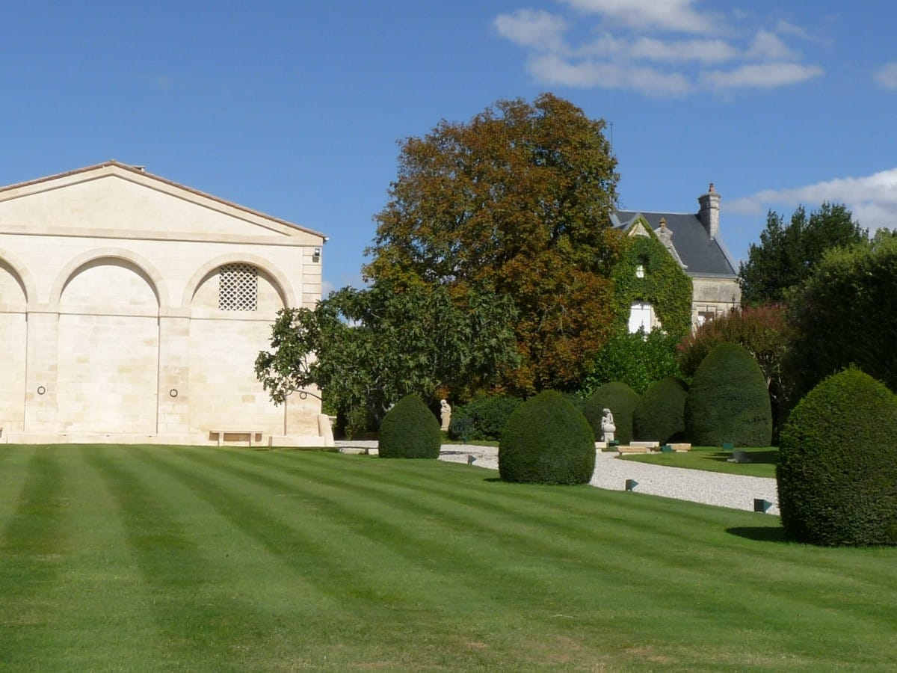

# Château Mouton Rothschild

Château Mouton Rothschild lies at the northern edge of [Pauillac](ref:pauillac), in [Bordeaux](ref:bordeaux), [France](ref:france), separated from Lafite by a narrow track. Its artist labels are what most people remember, but what makes the estate unusual is the 1973 promotion: the only time the 1855 list raised a second growth to first. It is a still [red wine](ref:red-wine) in the ordinary [wine](ref:wine) sense.

Figure: Château Mouton Rothschild. Image: Jack ma, CC BY-SA 3.0, via Wikimedia Commons ([source page](https://commons.wikimedia.org/wiki/File:Jardin_de_Ch%C3%A2teau_de_Mouton-Rothschild,_Pauillac._2012.jpg)).

> **Quick verdict**
> **In one line:** This entry helps you decide whether Château Mouton Rothschild suits you, and how to serve and pair it.
>
> - **Best for:** Anyone trying to understand what Château Mouton Rothschild is, how it is served and when it fits.
> - **Not for:** If you want only want the cheapest buying link and do not care about flavour or context.
> - **Check first:**
>   - Wine-Searcher showed an average retail price of about US$794 per 750 mL for the grand vin in November 2026; actual prices run from roughly US$400 to US$1,200 depending on vintage.
>   - In 1853 Baron Nathaniel de Rothschild bought Brane-Mouton at auction so that he could serve his own wine to his guests.

## Brane-Mouton sold at auction in 1853

In 1853 Baron Nathaniel de Rothschild bought Brane-Mouton at auction so that he could serve his own wine to his guests. The estate had taken its name from Joseph de Brane; after the purchase it became Château Mouton Rothschild. The sale was part of the Rothschild family's expansion in Bordeaux and explains why Mouton, Lafite and Latour sit in the same commune but belong to different branches of the family.

Baron Philippe de Rothschild took over in 1922, at the age of 22. He pushed the estate in two directions that still define it: bottling and pricing its own wine instead of selling to merchants, and inviting artists into the label.

## Château bottling in 1924, the Grand Chai in 1926

In 1924 Baron Philippe decided that the entire crop should be bottled at the château rather than sold in barrel to the trade. This was radical in Bordeaux, where merchants traditionally controlled ageing and bottling. To house the bottled wine he built the Grand Chai in 1926, designed by the architect Charles Siclis; about 100 metres long, it became the estate's architectural signature.

The same logic of control extended to brands and holdings. Mouton Cadet was created in 1930; Château Mouton d'Armailhacq was bought in 1933 and renamed Château d'Armailhac in 1989; Château Clerc Milon was acquired in 1970; and Opus One was launched in 1979 with Robert Mondavi. Mouton Cadet is a commercial brand, not the estate's second wine, a point that is often misunderstood.

## The only promotion in 1973

Mouton was a second growth in 1855. Baron Philippe campaigned for two decades on a simple argument: Mouton's market price already matched the first growths, while the list was frozen in 1855. In 1973 the French Minister of Agriculture, Jacques Chirac, signed the decree raising Mouton to first growth. It remains the only change of rank in the history of the classification.

Baron Philippe summed up the position in Latin: "Premier ne puis, second ne daigne, Mouton suis" — first I cannot be, second I disdain, Mouton I am. After the promotion the motto changed: "Premier je suis, second je fus, Mouton ne change" — first I am, second I was, Mouton does not change.

## Artist labels since 1945

In 1945, to mark the Allied victory, Baron Philippe asked the painter Philippe Jullian to design the label; the image is a large "V". Since then, apart from a few special years, a different artist has designed the top of each vintage's label: Picasso in 1973, Andy Warhol in 1975, the Prince of Wales in 2004. From 1981 the original artworks have toured as an exhibition shown in more than forty museums.

The labels are a collecting dimension, not a quality index. The differences between vintages come from ripeness, selection and ageing, not from the picture. Auction premiums for artist labels are real, but they are a separate market from what is in the bottle.

## The 84–90 hectares of the Plateau de Mouton

The vineyard lies mostly on a hillock called the Plateau de Mouton, rising about 27 metres above sea level. Two official pages give 84 hectares and 90 hectares respectively, probably reflecting different dates or whether newly planted parcels are counted; the range should be preserved rather than resolved by guesswork.

The soil is several metres of gravel mixed with sand and a little clay, over a clay-limestone base. The gravel stores heat by day and releases it at night, helping Cabernet Sauvignon ripen, while rapid drainage forces roots downwards. Lafite lies to the north, the estuary to the east, and the site is classic Pauillac gravel. Planting density is about 10,000 vines per hectare, high by Médoc standards.

## 81% Cabernet Sauvignon, 44-year-old vines

The vineyard is planted to 81% [Cabernet Sauvignon](ref:cabernet), 15% [Merlot](ref:merlot), 3% [Cabernet Franc](ref:cabernet-franc) and 1% Petit Verdot. These are planting proportions, not the final blend, which varies by year and usually contains more Cabernet Sauvignon. Cabernet gives tannin, black fruit and longevity; Merlot adds suppleness and length; Cabernet Franc perfume; Petit Verdot colour and spice.

The vines average about 44 years old. Harvest is by hand into open baskets to keep the fruit intact, followed by destemming, hand sorting on vibrating tables and gravity transfer into the vats, avoiding pumps that would crush the berries. That gravity flow is the most visible change brought by the new vat room of 2012.

## Mouton, Le Petit Mouton and Aile d'Argent

The grand vin, Château Mouton Rothschild, takes only the best plots, the oldest vines and the best vats; it represents more than half of total production, with third-party estimates around 20,000 cases, or roughly 240,000 bottles a year (recent typical figures; consult the estate's technical data).

Le Petit Mouton de Mouton Rothschild was launched in 1993 from younger vines, picked earlier and vinified separately, with the same selection standards as the grand vin. The remaining wine goes into Baron Nathaniel, a Pauillac appellation wine. Aile d'Argent, the dry white, was first bottled in 1991 from about seven hectares of white varieties, mainly [Sauvignon Blanc](ref:sauvignon-blanc) with Sémillon and a little Muscadelle, and sees about 50% new oak.

## Gravity, oak vats and twenty months

The vat room that opened in 2012 was designed by the stage designer Richard Peduzzi and the Bordeaux architect Bernard Mazières. About 70 metres long and built on two levels linked by metal columns, it keeps the wood-and-steel vocabulary of the Médoc. Inside are 44 oak fermentation vats and 20 stainless-steel tanks, sized to individual parcels, which allows parcel-by-parcel [fermentation](ref:fermentation) and a more precise final [blending](ref:blending).

After fermentation the wine is aged for about 20 months in new oak; the grand vin uses new barrels throughout. This [oak-ageing](ref:oak-ageing) is slightly shorter than at Latour. During ageing the team tops up, racks and fines with egg white, then moves the wine from the Grand Chai to the second-year cellar. New oak adds vanilla, toast and spice, and a small amount of oxygen that rounds the tannin earlier.

## Where the exotic spice comes from

Young Mouton shows blackcurrant, black cherry, violet and graphite. On the palate it is broader and denser than Latour, with large but softer tannin. With age come cedar, tobacco, leather, cocoa and the sweet spice often described as exotic; it comes from ripe Cabernet Sauvignon, toasted new oak and long bottle age, not from any additive.

That is also the divide with Margaux. Margaux leads with flowers and silk; Mouton leads with concentration and spice; Latour leads with structure and reserve. All three can age for decades, but they behave differently when young.

## Mouton against Latour and Margaux

[Latour](ref:latour) takes only old vines from the 47-hectare Enclos, with more than 90% Cabernet Sauvignon and a tannin-acid frame that often needs a decade to open. [Margaux](ref:margaux) farms 126 plots over more varied soils, opens earlier and has finer tannin. Mouton lies further north, with deeper gravel, vines averaging about 44 years and a denser, more spice-driven build.

The winemaking differs too: Mouton ages the grand vin about 20 months in new oak, Latour 22–25 months, Margaux 21 months. Mouton's grand vin represents more than half of production, Margaux about 40% and Latour about 37%. Those ratios shape availability and price structure, and help explain why Mouton feels more commercial.

## Art, price and the collector's premium

Wine-Searcher showed an average retail price of about US$794 per 750 mL for the grand vin in November 2026; actual prices run from roughly US$400 to US$1,200 depending on vintage, with rare years higher. Le Petit Mouton commonly trades at about US$120–250, and Aile d'Argent at about US$80–150. These are recent typical retail ranges, not quotations; auctions and rare vintages can move far outside them.

Artist-label vintages carry an additional collector premium, but its size depends on the artist, the year and condition. Buyers should confirm the wine's identity, vintage and anti-counterfeit features before paying for a label version.

## Misconceptions

First, Mouton was a second growth in 1855 and became a first growth only in 1973; it was not a first growth from the start. Second, an artist label does not mean better wine, and not every vintage has one. Third, Le Petit Mouton is a second wine, while Mouton Cadet is a commercial brand; they are not the same thing. Fourth, the 84 and 90 hectare figures are two official measuring conventions, not a typo. Fifth, Mouton is not immortal, and storage matters as much as age.

## Sources

1. Château Mouton Rothschild, *Key date 1853*: https://www.chateau-mouton-rothschild.com/the-history/key-dates/key-date-1853
2. Château Mouton Rothschild, *From Baron Philippe*: https://www.chateau-mouton-rothschild.com/the-history/the-history-of-mouton/from-baron-philippe
3. Château Mouton Rothschild, *To Baroness Philippine*: https://www.chateau-mouton-rothschild.com/the-history/the-history-of-mouton/to-baroness-philippine
4. Château Mouton Rothschild, *The terroir*: https://www.chateau-mouton-rothschild.com/the-vineyard/the-terroir
5. Château Mouton Rothschild, *From vine to wine*: https://www.chateau-mouton-rothschild.com/the-vineyard/from-vine-to-wine
6. Wine-Searcher, *Chateau Mouton Rothschild, Pauillac*: https://www.wine-searcher.com/find/mouton+rothschild+pauillac+medoc+bordeaux+france

**At a glance:** A Pauillac estate ranked second growth in 1855 and raised to first growth in 1973, the only promotion in the list's history; its grand vin is about 81% Cabernet Sauvignon, averages 44-year-old vines and is aged around 20 months in new oak, with artist-designed labels since 1945. 
