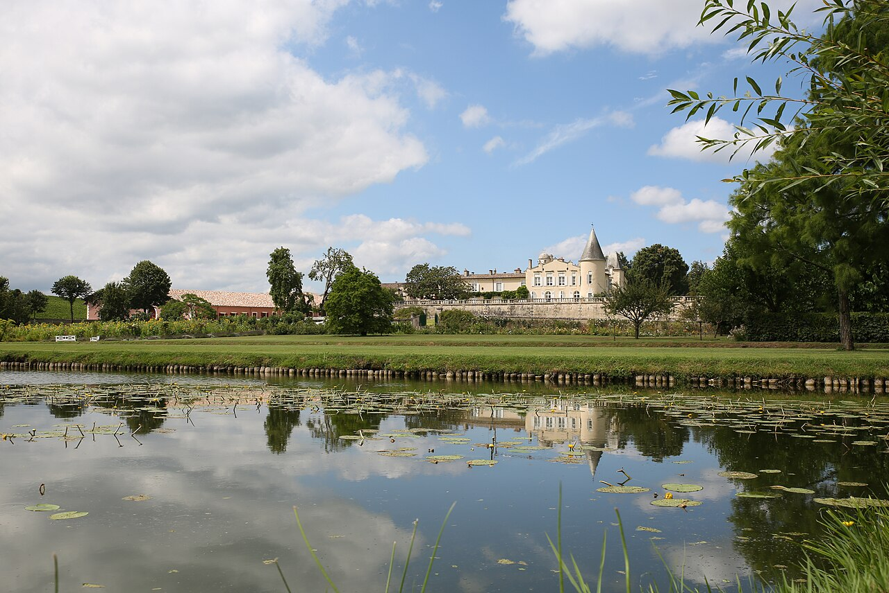

# Château Lafite Rothschild

Château Lafite Rothschild is in the Pauillac commune on the left bank of Bordeaux, France, and is one of the first growths (Premiers Grands Cru Classés) in the 1855 Bordeaux classification. The grand vin is based on [Cabernet Sauvignon](ref:cabernet), blended with Merlot, Cabernet Franc and Petit Verdot, and is typically firm in structure with a long ageing potential. In Chinese, "Lafite" is often used loosely, but strictly it refers to the grand vin of this one estate.

Figure: Château Lafite Rothschild. Image: PA, CC BY-SA 4.0, via Wikimedia Commons ([source page](https://commons.wikimedia.org/wiki/File:Ch%C3%A2teau_Lafite-Rothschild.jpg)).

## Definition and identity

Château Lafite Rothschild is an estate and a grand vin, not a grape variety or a region. Its identity has three parts: vineyards in Pauillac, a Cabernet-dominant blend, and first-growth status in the 1855 classification. That classification was drawn up under Napoleon III for the Paris Universal Exhibition; left-bank red estates were divided into five levels, and the first level originally contained only four estates, Lafite among them.

A distinction must be kept between the estate, the grand vin, the second wine and the wider portfolio. The grand vin is normally labelled Château Lafite Rothschild; the second wine is Carruades de Lafite; Domaines Barons de Rothschild (Lafite) also owns other estates and labels. They share some teams and ideas, but they are not the same wine and cannot be compared as if they were.

## History

Lafite's viticultural and winemaking history reaches back to the Middle Ages; the estate's official history notes that it was already recorded as a wine producer in the thirteenth century. From the eighteenth century it reached European and British markets through Bordeaux, gradually building a reputation as a top Bordeaux. The 1855 classification fixed that position by placing it in the first growth.

In 1868, Baron James de Rothschild, founder of the Paris Rothschild bank, bought Lafite at auction for 4,140,000 francs, plus 300,000 francs for the Carruades parcels. The estate has remained in Rothschild ownership and management for generations since. Around 2018 the estate also became linked to partnership projects in China, Chile and elsewhere; those projects are related ventures, not the Pauillac estate itself.

## Region and terroir

Pauillac lies on the left bank of the Gironde estuary. Its climate is moderated by the Atlantic and the river, and its soils mix gravel, clay and sand. Lafite's vineyards are dominated by deep gravel, which drains well and helps Cabernet Sauvignon ripen while keeping structure. Gravel warms in the day and releases heat at night, helping ripening in cool years; clay holds water and influences water stress and rooting depth.

Left-bank blends are Cabernet-dominant because Cabernet Sauvignon readily achieves tannin, colour and blackcurrant flavour here; Merlot adds softness and fruit, Cabernet Franc adds aromatic complexity, and Petit Verdot adds colour and spice. Proportions change with the vintage; the estate does not treat a single formula as fixed. Understanding terroir is not a matter of memorising the word "gravel", but of seeing how it shapes ripeness, acidity and tannin.

## Process and ageing

The grand vin is typically aged for an extended period in [oak](ref:oak-ageing), with a high proportion of new barrels; the exact barrel age and proportion change by vintage. Oak adds vanilla, toast and spice, and slow oxygen exposure softens tannin. After ageing the wine is clarified and lightly filtered, with the exact treatment varying by year, and then bottled.

New-oak proportion is not "the higher the better". Too much can mask fruit; too little can leave the structure thin. The estate decides according to the concentration, tannin and acidity of the year. Ageing in bottle matters as well: the firmness of youth gradually becomes cedar, leather, mushroom and tobacco complexity.

## Flavour and tasting

Young Lafite often shows blackcurrant, black cherry, cedar, pencil lead, graphite and tobacco, with fine but powerful tannin and an acidic backbone. With age, fruit moves towards dried fruit, leather, leaf litter and mushroom, while cedar and mineral notes become more prominent. Vintages differ greatly: cool years are more acidic and firm, warm years fuller and higher in alcohol.

Serve at about 16–18°C. Young wines can be decanted for 1–2 hours to open the tannin and aroma; old wines should be decanted briefly, with a small taste first to avoid losing fragile aromas. Use a large glass and fill no more than a third of the bowl. If there is sediment, stand the bottle upright and decant carefully.

## Drinking and pairing

Lafite suits red meat, game, roasted dishes and hard cheese; fat and protein buffer the tannin and make the wine feel rounder. Very sweet, very spicy or sharply acidic dishes can upset the balance. For a high-value wine, check the vintage, provenance and storage before opening; the cork, the fill level and the label are all clues to its history.

Store away from sharp temperature swings, strong light and vibration; a constant, humid, dark environment is ideal. After opening, use a vacuum or inert gas and refrigerate, and finish within a few days. Old wines change quickly once open and are not suited to being kept over many days.

## Common misconceptions

First, treating every "Lafite" as the grand vin. Only the wine labelled Château Lafite Rothschild is the subject of this page; the second wine and other portfolio wines are different.
Second, treating the 1855 classification as a permanent quality guarantee. It is a historical classification, and a given vintage still depends on climate and winemaking.
Third, assuming more new oak means a better wine. Oak serves balance and is not a standalone quality marker.
Fourth, generalising the estate from one vintage. Lafite spans centuries, and vintages vary enormously.
Fifth, ignoring authenticity and provenance. Fame invites counterfeit risk, so the sales channel and label details need checking.

**At a glance:** A Pauillac first growth in Bordeaux, based on Cabernet Sauvignon; classified as a first growth in 1855 and purchased by the Rothschild family in 1868. 

Read Château Lafite Rothschild through the base and the stated strength, then the sweetness or bitterness, and finally how it is served. The sequence matters.

[Red wine](ref:red-wine) and [France](ref:france) are the two useful reference points for Château Lafite Rothschild. [Red wine](ref:red-wine) sets out style; [France](ref:france) brings in region and vintage. Read them together.

**Key facts.**

| Item | Detail |
| --- | --- |
| In one line | A Pauillac first growth in Bordeaux, based on Cabernet Sauvignon; classified as a first growth in 1855 and purchased by the Rothschild family in 1868. |
| Style | Red wine |
| Region | Bordeaux、France |

## Further reading

- [Red wine](ref:red-wine): the wider category to which Lafite belongs.
- [Cabernet Sauvignon](ref:cabernet): the dominant variety in the left-bank blend.
- [Oak ageing](ref:oak-ageing): the key process shaping structure and aroma.
- [Bordeaux](ref:bordeaux): the wider framework of Pauillac and the left bank.
- [France](ref:france): French wine law and appellations.
