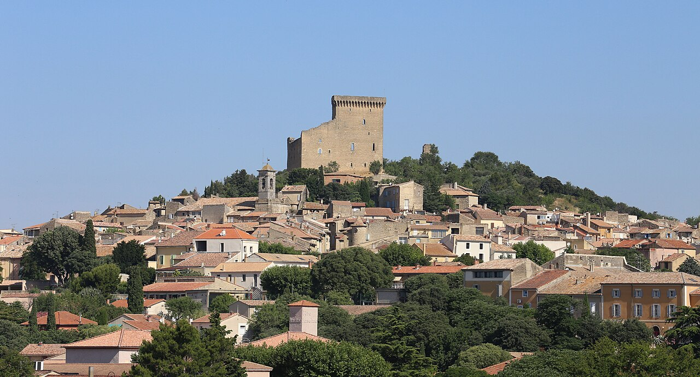

# Châteauneuf-du-Pape

Châteauneuf-du-Pape is a red wine from the Châteauneuf-du-Pape appellation in the southern Rhône, France, based on Grenache and often blended with Syrah and other varieties. It is full-bodied and high in alcohol, known for ripe black fruit, Provençal herbs and leather. It is commonly 750 mL at about 14%–15.5% vol; the rules set a minimum of 12.5% vol and allow more than ten varieties.

Figure: Châteauneuf-du-Pape. Image: Aa77zz, CC0, via Wikimedia Commons ([source page](https://commons.wikimedia.org/wiki/File:Village_of_Chateauneuf-du-Pape.JPG)).

## Definition and position

Start by separating the levels: [red wine](ref:red-wine) is the category, varieties such as Grenache are the raw material, the southern Rhône is the region, Châteauneuf-du-Pape is the appellation (AOC), and estates and individual wines are the producer level. Châteauneuf-du-Pape is a place name and an appellation marker, not a brand, and not a single-variety name.

In 1936 Châteauneuf-du-Pape became one of the first French appellations to obtain controlled origin status. It is both a village-level appellation and a distinct geographical designation; compared with the regional Rhône or other village appellations, its rules are stricter and its yield ceiling lower.

## Producer and brand

The appellation has many family estates, cooperatives and merchants, from a few hectares to several dozen. Estates often appear on the label with words such as Domaine or Château, and the bottler information, including whether the wine was bottled at the estate, is the basis for identity.

The name is tied to the history of the Avignon papacy: after the papal court moved to Avignon in the 14th century, Pope John XXII built a castle here in 1317, and the name "new castle" comes from it; the castle now stands in ruins. Bottles often carry an embossed emblem, but the emblem is an appellation device and cannot by itself prove authenticity or quality.

## Region and ingredients

The appellation lies in the Vaucluse department of south-eastern [France](ref:france), north of Avignon on the left bank of the Rhône. The climate is Mediterranean, with ample sun and concentrated rainfall; the Mistral blows for much of the year, lowering humidity, reducing disease pressure and keeping the vineyards dry.

The surface is covered with large rounded quartz stones (galets roulés) that absorb heat by day and release it at night, helping the fruit ripen; the subsoil is clay and limestone, and its water holding capacity shapes performance in dry seasons. The raw material is [grape](ref:grape), mainly [Grenache](ref:grenache) and [Syrah](ref:syrah), alongside permitted varieties such as Mourvèdre, Cinsault and Clairette; the appellation also makes a small amount of white wine.

## Winemaking

Harvest usually takes place in September. After destemming, maceration time and temperature set the extraction; Grenache has thin skins and moderate colour and tannin, Syrah adds colour, structure and dark fruit, and the blend proportion shapes the final style. Malolactic conversion follows to soften acidity.

The wine then goes into [oak ageing](ref:oak-ageing). Traditional practice uses large old casks or concrete, emphasising fruit and slow oxidation, while modern practice uses some small barrels for vanilla and spice. The rules set limits on minimum alcohol, yields and permitted varieties; the exact ageing requirements should be checked against the current rules.

## Specification and label

The common volume is 750 mL, with [alcohol by volume](ref:abv) at about 14%–15.5% vol and higher in some vintages. The label should be checked for the name Châteauneuf-du-Pape, vintage, estate name, bottler, net volume, alcohol content and importer information; some wines also name a Clos, a Domaine or a specific site.

The Chinese back label and importer information are the entry point for checking identity. Label language and rules differ by market, so the same wine may be labelled differently in different countries; the bottle on hand governs. Other products described as "Châteauneuf-du-Pape style" are not appellation wine.

## Flavour and tasting

Typical aromas are blackberry, black cherry, plum, Provençal herbs, liquorice, pepper and leather, developing truffle, dried fruit and earth with age. The palate is full-bodied with a clear sense of alcohol, round tannin, medium acidity and a long warm finish.

Serve at about 16–18 degrees Celsius in a fairly large glass so the aromas can open; younger wines can be decanted for one to two hours, older bottles for less. High alcohol makes the fruit read as sweeter and riper, and the balance improves with food.

## Drinking and pairing

It pairs well with braised lamb, roast beef, game, herb-roasted chicken, stews and hard cheese; herbs in the food echo the garrigue notes of the appellation. It does not suit steamed seafood, light vegetables or very sweet desserts, where the alcohol and concentrated fruit can overwhelm the food.

After opening, refrigerate and finish within a few days. Most wines integrate with short bottle rest, but the drinking window depends on vintage, estate and blend. Excessive drinking harms health and minors should not drink.

## Buying and storage

Buy from reputable channels and check vintage, estate name, bottler and importer information. Prices move with vintage, estate reputation and channel, so no figure is given here; a cooperative wine and a famous estate belong to different levels, and one wine cannot stand for the whole appellation.

For Châteauneuf-du-Pape, unopened bottles should be kept away from light, lying flat, in a cool place at 13–16 degrees Celsius, avoiding heat and sharp temperature swings. Cork-sealed bottles need humidity; after opening, refrigerate and drink soon, as high-alcohol wines suffer from repeated warming and cooling.

## Common misconceptions

First, treating Châteauneuf-du-Pape as a single-variety wine. It permits more than ten varieties, with Grenache usually only the main one.
Second, treating the place name as a brand. It is a geographical designation with many estates and cooperatives inside it.
Third, assuming higher alcohol means better quality. Ripeness and balance are the measures.
Fourth, treating the embossed bottle emblem as proof of authenticity. Channel and label information are more reliable.
Fifth, assuming every Châteauneuf-du-Pape needs long cellaring. Drinking windows vary greatly by estate and vintage.

Châteauneuf-du-Pape is best read by starting with the base and the stated strength, moving to the sweetness or bitterness, and ending with how it is served.

Read [Red wine](ref:red-wine) for the style side of Châteauneuf-du-Pape, and [Grenache](ref:grenache) for the region and vintage side. Together they locate it.

## Further reading

- [Red wine](ref:red-wine): red wine categories and basic winemaking.
- [France](ref:france): the French wine map and the AOC/AOP system.
- [Grenache](ref:grenache): the character and aromas of the southern Rhône's main variety.
- [Syrah](ref:syrah): the blending variety that adds structure and dark fruit.
- [Grape](ref:grape): the basic structure of wine grapes and ripeness measures.
- [Fermentation](ref:fermentation): the role of maceration and malolactic conversion.
- [Oak ageing](ref:oak-ageing): how large and small barrels shape style.
- [Alcohol by volume](ref:abv): what 14%–15.5% vol and the 12.5% vol minimum mean.
