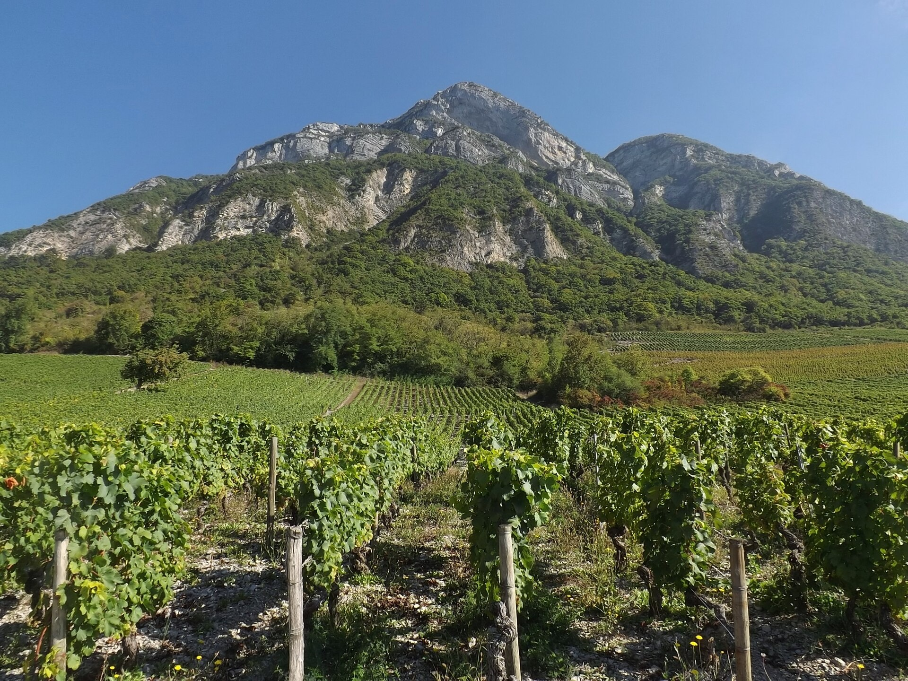

# Chignin-Bergeron

Chignin-Bergeron is a white-wine geographical name in the [Savoie](ref:savoie) region of [France](ref:france), made only from Roussanne, known locally as Bergeron. The vineyards lie on south or south-east facing limestone slopes around Chignin. It is commonly 750 mL at about 12.5%–13.5% [alcohol by volume](ref:abv).

Figure: Related photograph of Chignin-Bergeron. Image: Florian Pépellin, CC BY-SA 3.0, via Wikimedia Commons ([source page](https://commons.wikimedia.org/wiki/File:Vignobles_chignin-bergeron.JPG)).

## Definition and position

Start with the levels: [white wine](ref:white-wine) is the type, Roussanne is the variety, Chignin-Bergeron is the geographical name, and individual estates and wines are the producer level. It belongs to the [Vin de Savoie](ref:vin-de-savoie) appellation framework but may carry its own name on the label.

Bergeron is not a separate variety but the local Savoie name for Roussanne. Chignin-Bergeron allows only white wine and requires Roussanne, making it one of the clearest variety-and-style names in Savoie.

## Producer and brand

Family estates dominate within the name, with cooperatives and merchants also involved. Slope land around Chignin is limited, and many estates also make Jacquère, Altesse and Roussanne lines.

Producer, appellation and product are three levels: the appellation answers for rules and area, the producer answers for farming, making and bottling, and the product answers for vintage and specification. The same Chignin-Bergeron can differ between estates in ripeness management and barrel use.

## Region and ingredients

The vineyards lie around Chignin in Savoie, on south or south-east facing slopes at about 250–500 metres. Soils are mainly limestone and scree, well drained and low in fertility, with good sunshine.

The raw material is [grape](ref:grape), and the only variety is Roussanne. Roussanne ripens late and has thin skins; it accumulates sugar and aroma while keeping some acidity. In the cool Savoie climate it is fresher than in the Rhône Valley yet fuller than Jacquère.

## Winemaking

Whites usually ferment in stainless steel or old barrels, with temperature control to preserve aroma. Whether [oak](ref:oak-ageing) is used decides the direction: without oak the fruit and minerality dominate, with old barrels or lees stirring the wine is rounder.

Roussanne has relatively low acidity, so malolactic fermentation is handled cautiously; some estates keep malic acid to preserve the skeleton. See [fermentation](ref:fermentation) for the basic process.

## Specification and label

The common volume is 750 mL, with [alcohol by volume](ref:abv) at about 12.5%–13.5% vol, varying by vintage and estate. The label should be checked for the Chignin-Bergeron name, vintage, bottler and importer.

Some labels also state "Vin de Savoie", but the geographical name alone is enough to identify the wine. The Chinese back label and importer information are the basis for checking identity, and the bottle on hand governs.

## Flavour and tasting

Typical aromas are white flowers, apricot, yellow peach, honey and almond, with some wines showing citrus and mineral notes; the palate has moderate acidity and a medium-to-full body, with a finish of nuts and beeswax. Compared with the lean, high-acid Jacquère, Chignin-Bergeron is rounder and riper.

Serve at about 8–10 degrees Celsius in a tulip-shaped or Burgundy glass. Too cold masks the aroma and too warm makes the wine feel loose; distinguish fruit from vanilla and nut notes brought by oak.

## Drinking and pairing

It suits seafood, poultry, creamy dishes, soft cheese and dishes with apricot or nuts. Moderate acidity means it does not pair well with very hot or very acidic food.

Most wines are for drinking within 5–10 years, depending on vintage and estate. Refrigerate after opening and finish within a few days; excessive drinking harms health and minors should not drink.

## Buying and storage

Chignin-Bergeron is best approached through the base and the stated strength, then the sweetness or bitterness, and then how it is served. One check alone will not settle it.

For Chignin-Bergeron, unopened bottles should be kept away from light, lying flat in a cool place at an ideal 12–15 degrees Celsius. After opening, use a vacuum or inert gas and refrigerate rather than warming and cooling repeatedly.

## Common misconceptions

First, treating Bergeron as a separate variety. It is the local Savoie name for Roussanne.
Second, equating Chignin-Bergeron with the Chignin name. The latter can include other varieties and styles.
Third, thinking Roussanne only makes sweet wine. Here it makes a dry white.
Fourth, assuming all Savoie whites are lean. Roussanne brings a fuller body.
Fifth, judging quality by price alone. Vintage, estate and bottling information is more specific.

Chignin-Bergeron is easily confused with Chignin or with Roussanne. It is a separate geographical designation within Savoie and may use only the local name Bergeron for Roussanne. South- and southeast-facing limestone slopes give white flowers, apricot and almond notes. It is fuller than Jacquère, but “Bergeron” is a local variety name, not a separate grape that can be planted anywhere.

**At a glance:** A white-wine geographical name in the Savoie region of France, made only from Roussanne, known locally as Bergeron; the vineyards lie on south or south-east facing limestone slopes around Chignin, and the style shows white flowers, apricot, honey and almond with lower acidity than Jacquère, commonly 750 mL at about 12.5%–13.5% vol. 

[France](ref:france) explains style; [White wine](ref:white-wine) adds region and vintage. Put Chignin-Bergeron between them before deciding what it is.

The appellation lies in the Savoie near Chambéry, on limestone slopes around Chignin; Roussanne is called Bergeron locally and must make up all the white wine. The wines are fuller than Jacquère, with white flowers, apricot, honey and almond, and usually 12.5–13.5% ABV. They can be drunk young or aged briefly in oak; the best sites face south or south-east. A label may say Chignin-Bergeron or simply Bergeron, but the latter is a local synonym, not a separate variety. Vin de Savoie is the broader appellation; Chignin-Bergeron is the narrower one.

**Key facts.**

| Item | Detail |
| --- | --- |
| In one line | A white-wine geographical name in the Savoie region of France, made only from Roussanne, known locally as Bergeron; the vineyards lie on south or south-east facing limestone slopes around Chignin, and the style shows whi… |
| Style | White wine |
| Region | France、Savoie |
| ABV | 12.5–13.5% vol |

**Sources and limits.** The key claims about Chignin-Bergeron are checked against the following sources: INAO (the area, varieties and rules of the Chignin-Bergeron geographical name), European Union (EU wine categories, geographical indications and labelling rules), Oxford University Press (Consulted for entries on Chignin, Bergeron and Roussanne; Migrated from the former reference list at the end of the article; access date not re-verified). Prices, batches and status change; the body is project-written and does not reproduce source text.

## Further reading

- [Savoie](ref:savoie): the overall framework of the region to which Chignin-Bergeron belongs.
- [Vin de Savoie](ref:vin-de-savoie): the broader Savoie regional appellation.
- [Roussette de Savoie](ref:roussette): a Savoie white appellation made from Altesse.
- [White wine](ref:white-wine): the category to which Chignin-Bergeron belongs.
- [Grape](ref:grape): the basic structure of wine grapes and ripeness measures.
- [Fermentation](ref:fermentation) and [oak ageing](ref:oak-ageing): the basic process steps for whites.
- [Alcohol by volume](ref:abv): what 12.5%–13.5% vol means on a label.
