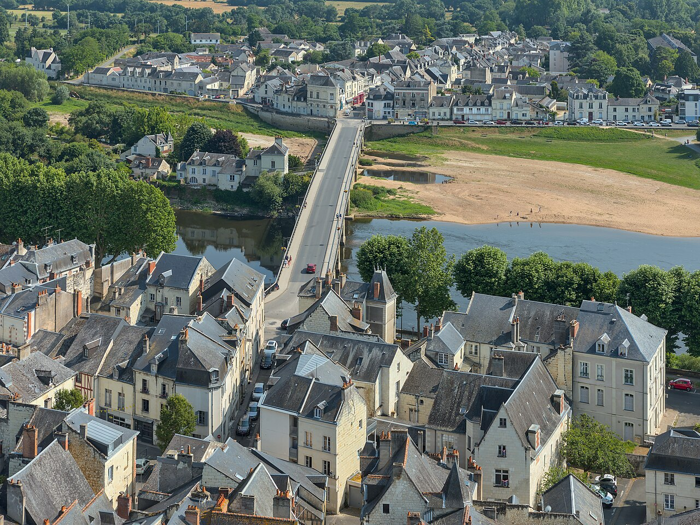

# Chinon

Chinon is one of the most important [red wine](ref:red-wine) appellations in the Touraine area of France's [Loire Valley](ref:loire): about 2,400 hectares across 26 communes, spread along both banks of the Vienne. It is based on [Cabernet Franc](ref:cabernet-franc), allows up to 10% Cabernet Sauvignon, and also makes rosé and a small amount of Chenin white. The normal bottle is 750 mL at 12%–13.5% [alcohol](ref:abv).

Figure: Chinon. Image: Benjamin Smith, CC BY-SA 4.0, via Wikimedia Commons ([source page](https://commons.wikimedia.org/wiki/File:Chinon_-_View_from_the_castle_-_07.jpg)).

## Twenty-six communes on both banks of the Vienne

Chinon's boundary is not a town but a river. The 26 communes lie on both banks of the Vienne, from Candes-Saint-Martin at the Loire confluence upstream towards Rivière, with the Indre marking the northern edge and 5,140 hectares of forest behind. The forest blocks the north wind, and the two rivers create cold-air drainage channels on frost nights, which is why the appellation has brought 610 hectares — more than a quarter of the planted area — into frost protection. Sunshine averages about 2,100 hours a year and rainfall 500–600 mm, warmer and drier than the rest of Touraine. These numbers describe a mosaic of river, forest and aspect, not a single homogeneous terroir.

## A 1937 decree, and the boundaries added later

Chinon was recognised as an AOC on 31 July 1937, among the earliest in Touraine. But "legal" did not mean the map was finished. In the current cahier des charges, parcel boundaries are those approved by INAO in May 1996 and February 2016, while the text itself was homologated by the decree of 15 November 2011 and amended in 2016 and 2018. The 26 communes and 2,400 hectares seen today were assembled layer by layer over more than eighty years. An older book with a smaller area or a wider variety list is not necessarily wrong; check its date first.

## Three soil families, three ripening rhythms

The soils fall into three broad groups, each with its own rhythm. In the valleys, sandy-gravel terraces drain fast and warm quickly, so Cabernet Franc ripens easily, the green-pepper note is suppressed, and the wine is light and fruit-forward. On the slopes, clay-limestone over tuffeau holds water and heat better, ripens more slowly and gives firmer tannin suited to ageing. On the plateau, Late Cretaceous and Eocene sandy clays and clay-with-flint drain poorly and crop low, but often give the tightest frame. When one estate ferments the three separately, the difference between them can exceed the difference between vintages. The raw material is [grape](ref:grape), and reds and rosés use Cabernet Franc with Cabernet Sauvignon as an accessory; whites use Chenin only.

## The Puys: eight limestone knolls, the highest at 88 metres

*Puy* comes from the Latin for a podium or mound. The confluence area has eight limestone knolls rising about 30 metres above the surrounding land, the highest at 88 metres, spread over Chinon, Beaumont-en-Véron and Huismes and classed as Natura 2000. The porous limestone stores heat by day and releases it at night, creating a very mild, sheltered microclimate; juniper, almond, maritime pine and wild thyme grow on the slopes, a small Mediterranean island. The wines from here are firmer and longer-lived, the opposite pole to the "light Chinon" story.

## Why Chinon's tuffeau is warmer than Saumur's

Tuffeau is a limestone formed about 90 million years ago, around 100 metres thick under Chinon. Even within the same rock, Chinon's tuffeau is more ochre and yellow, warmer and less austere, and less white than its neighbour in Saumur. The difference is not merely decorative: it affects light reflection and warming, and therefore the direction of the wine. The caves left by quarrying tuffeau have been converted into cellars with constant temperature, stable humidity and low light, a natural warehouse for ageing. Describing Chinon, [Bourgueil](ref:bourgueil) and [Saumur-Champigny](ref:saumur-champigny) all as "Loire Cabernet Franc" erases this geological layer.

## Before Cabernet Franc: the Dutch century of Chenin

Chinon is famous for reds today, but its white wine entered the export books earlier. From the 16th to the 18th century, Dutch merchants in Nantes shipped Chinon north; white was easier to make and to transport and was preferred by English and Dutch buyers, so Chenin was probably the dominant variety at the time. Today Chenin is only about 5% of the vineyard and is made as a dry still white; it remains a permitted AOC variety, simply overshadowed by red. Knowing this history makes "Chinon has a white wine" look less like a novelty.

## The rulebook: 55 hl/ha, 10.5% and the 10% cap

The current text sets a basic yield of 55 hl/ha, a ceiling of 67 hl/ha for red and rosé and 69 hl/ha for white. Minimum natural alcohol is 10.5% for red and rosé and 10.0% for white. Planting density must be at least 4,500 vines per hectare, with a maximum of 11 fruiting branches per vine and a maximum load of 9,500 kg per hectare. Cabernet Franc is the main variety, Cabernet Sauvignon is accessory and may not exceed 10% of the planting, and white wine uses Chenin only. Figures change with each revision of the cahier des charges, so check the latest version when buying.

## Joguet, Baudry, Raffault: three ideas of place

Charles Joguet founded his estate in 1957; it has belonged to the Genet family since 1985 and now has 30 hectares of Cabernet Franc and 2 hectares of Chenin. It began moving to organic farming in 2008 and was certified in 2016, and it was among the first to ferment and age parcel by parcel; Silènes sells at about €16 and Les Charmes at about €32. Bernard Baudry started with 2 hectares in 1975 and now farms 32 hectares, 90% Cabernet Franc and 10% Chenin, on valley gravel, clay-limestone slopes and sandy limestone plateau; the estate has been fully organic since 2006, and his son Matthieu joined in 2000. Olga Raffault is in its fifth generation, with 24 hectares — 23 of Cabernet Franc for red and rosé and 1 of Chenin — an average vine age of 30 years, and three terroirs producing three reds; Les Barnabés and Les 2 Roches are familiar cuvées. The three estates differ in scale but share a belief that the parcel is a smaller unit than the brand, and [oak](ref:oak-ageing) is usually a vessel rather than the main flavour.

## Light, firm and everything between

Chinon covers a wide range. Gravel-terrace wines can be drunk young, with red fruit, round tannin and clear acidity; slope and Puy wines are tight in youth and need five to ten years to unfold into graphite, cedar, tobacco and dried flowers. "Chinon is only light-bodied" usually means the drinker has only tried the gravel style. The other misreading is "Chinon is always green": a moderate green-pepper note is a variety signature, and only excess suggests early picking. What actually decides weight is parcel, vine age and extraction, not the appellation name. Compared with Bourgueil across the river, Chinon is larger, more varied in soil and wider in style; compared with Saumur-Champigny, it has less powdery tuffeau and more gravel and plateau clay.

## Buying, serving and two corrections

Light Chinon suits rillettes, roast chicken, white meat and goat cheese, served at 14–16 °C; structured wines suit lamb, wild boar stew, beef bourguignon and hard cheese at 16–18 °C. Estate-direct samples run from about €16 for an entry wine to about €32 for a mid-range parcel wine, with old-vine flagship cuvées higher; these figures move with vintage, channel and exchange rate and are only an order of magnitude. Two misconceptions are worth correcting. First, "Chinon is a copy of Bourgueil": the two face each other across the river, with different soils and legal boundaries. Second, "Chinon is red only": it legally makes rosé and white, and the Chenin white, though only about 5% of the vineyard, is the key to the appellation's history. [Fermentation](ref:fermentation) and extraction remain the tools that turn these differences into style, and the appellation belongs to the wider French system described under [France](ref:france).

## Verification and source notes

The figures here come from the Chinon appellation's history page, its 2024 English press kit, the cahier des charges published by the Touraine growers' federation, and the official websites of Charles Joguet, Bernard Baudry and Olga Raffault. Prices come only from Joguet's own shop sample. All sources were opened and checked on 8 November 2026.
