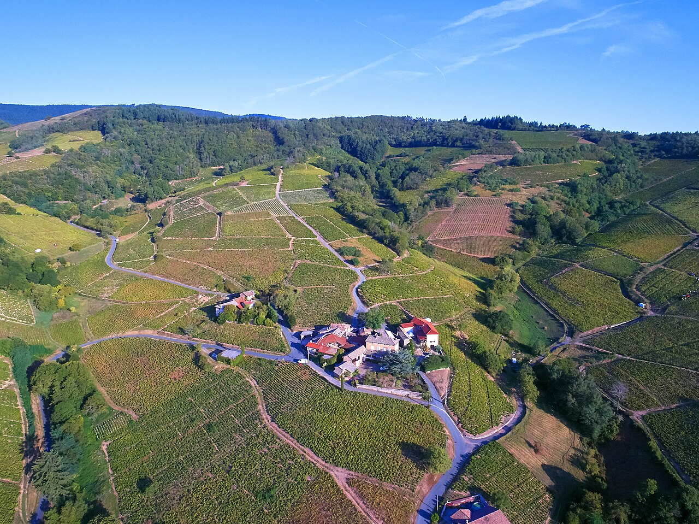

# Chiroubles

Before pouring a Chiroubles, look at how high its vineyards sit. The Beaujolais cru belt spreads mainly along the foot of the hills, but the slopes of Chiroubles climb steadily, and among the ten crus it belongs to the highest tier, with hillside parcels reaching about 400 metres. That difference in height explains why it is often taken as the reference for Beaujolais in its light, airy mode.

Figure: Chiroubles. Image: Cruchiroubles, CC BY-SA 4.0, via Wikimedia Commons ([source page](https://commons.wikimedia.org/wiki/File:Chiroubles_0259.jpg)).

## The highest cru

Chiroubles is one of the ten village crus of [Beaujolais](ref:beaujolais), and the village has no premier or grand cru tiers: every parcel sits inside one village-level AOC framework. Its distinction is not a classification but height. While other villages remain on the low slopes, Chiroubles vines are planted higher, where the air is cooler and the day-to-night temperature difference is wider.

Height does not simply mean acidity; it means a slower ripening curve. Picking usually comes late, and the gap between sugar accumulation and acid retention is easier to open, which is also the source of style variation inside one village name. The official delimitation governs the boundaries.

## Granite sand and the parcels near the top

Chiroubles lies in northern Beaujolais in [France](ref:france), with vineyards on the high slopes around the village. The soils are mostly pale weathered granite sand, thin, fast-draining and low in fertility, so the roots must work into cracks in the rock; that poverty checks excessive vigour and gives smaller bunches with more concentrated flavour.

The difference between parcels near the top and those at mid-slope is clear: the top is windier with thinner soil, ripens slowly and makes a fresher wine; mid-slope is sheltered with more sun, and the fruit is rounder. The raw material is [grape](ref:grape), of the Gamay variety, thin-skinned and high in acidity, showing red cherry, raspberry and very prominent flowers on such soils.

## Ripening on south-facing slopes

The south-facing slope matters especially at Chiroubles. High altitude would delay ripening, but a southern aspect returns part of the sunshine, so the grapes can still reach enough ripeness in a cool base climate; parcels facing north or shaded depend more on how warm the vintage is.

That also means the idea that the highest cru must be the most acidic does not hold. In cool years the high parcels can seem lean; in warm years they keep freshness precisely because the nights are cool. Reading a Chiroubles means reading the warmth of the vintage first and the slope behind the label second, rather than the village name alone.

## The floral difference from Fleurie

Chiroubles borders [Fleurie](ref:fleurie), and both are known for flowers, but they take different routes. Fleurie is more concentrated and rounder in its floral scent, usually with a fuller body; Chiroubles is thinner and airier, its aroma more "floating", its tannin finer, its presence in the mouth lighter.

If Fleurie is like a whole bunch of flowers, Chiroubles is more like wind passing through them. Compared with other expressions of [Gamay](ref:gamay), it magnifies the lightest side of the variety: bright red fruit, upright acidity and a clean finish, with almost no heavy oak or alcoholic pressure.

## How the light body is made

Chiroubles often uses whole clusters, and some estates use semi-carbonic maceration: whole grapes first ferment inside the berry in a carbon-dioxide-filled vessel before pressing and a conventional [fermentation](ref:fermentation). This naturally brings direct fruit and very light tannin, exactly matching the village's own frame.

Estates that want more weight extend maceration and extract more; most wines, however, still follow short maceration and light extraction. Some go into [oak](ref:oak-ageing) with a very low share of new barrels, because once oak dominates, the flowers that make Chiroubles valuable are covered. The bottler line still needs checking: merchant wine and estate wine under the same village name can differ a lot in concentration.

## Iris, peony and red fruit in the aroma

Typical aromas are red cherry, raspberry and strawberry, together with flowers such as violet, iris and peony, and some wines show a light minerality. The palate has clear acidity, very fine tannin, a light body and a supple texture; the finish is led by fruit and flowers, and the sense of alcohol is usually modest.

The whole frame of [red wine](ref:red-wine) is pressed to its lightest here: the colour is bright and the structure rests on acidity rather than tannin. Serve at about 14–16 degrees Celsius, and young wines can be lightly chilled without long decanting; when smelling, look for flowers first and red fruit second, since the reverse order lets acidity take the attention.

## Cool years and warm years: how altitude rewrites the wine

In cool years, Chiroubles acidity is sharper, the red fruit leans towards sour cherry and cranberry, the flowers feel cooler, the body thinner and better for early drinking. In warm years, the fruit turns towards strawberry and raspberry jam, the flowers sweeter and the alcohol a little higher, yet the cool nights at altitude still preserve some freshness.

Vintage judgement needs no scores: check whether alcohol rises clearly, whether the fruit is bright or ripe, and whether the finish is still clean. The same village name can show two different temperaments in a cool and a warm year, which is why one template cannot explain it.

## Temperature, pairing and drinking window

Serve at about 14–16 degrees Celsius in a tulip-shaped or Burgundy glass. It suits poultry, roast pork, charcuterie, mushrooms and soft cheese; the light body also works with salads and light seafood. Avoid very hot or sharply acidic dishes, which press down the flowers.

Most wines are for drinking within 3–7 years, and core parcels can keep a little longer, though the cru is generally for early drinking. After opening, refrigerate and finish within a few days. Excessive drinking harms health and minors should not drink.

## Price band and buying: the price of a light body

In the price order of the Beaujolais crus, Chiroubles usually sits in the middle or lower-middle band: small in volume and light in body, often used as an everyday entry into the crus, while core slope positions and old-vine wines are clearly dearer. Price varies with parcel, estate and vintage, and no figure is given here. The common volume is 750 mL, with [alcohol by volume](ref:abv) at about 12.5%–13% vol, varying by vintage and estate.

When buying, first confirm that the cru name stands alone on the label, then check the bottler and the vintage; consistently low alcohol and bright fruit are clues to its style. Keep unopened bottles away from light, lying flat at 12–15 degrees Celsius and away from heat and sharp swings; after opening, use a vacuum or inert gas and refrigerate.

## Common misconceptions about Chiroubles

First, treating Chiroubles as Beaujolais Nouveau. It is a separate village cru built on flowers and delicacy, not an easy wine of the current year's fruit.

Second, thinking a light body cannot age. Core parcels can keep for several years, but the cru is still mostly for early drinking, and it should not be expected to turn heavy.

Third, assuming the highest altitude must mean the most acidity. Vintage and aspect vary greatly, and in warm years the high parcels can be better balanced.

Fourth, confusing Chiroubles with Fleurie. They are neighbours, both floral, but Chiroubles is thinner and airier, while Fleurie is rounder and fuller.

For Chiroubles, a common mistake is judging authenticity by price or packaging alone. Channel, cru name, bottler and importer information are more reliable.

Start with the base and the stated strength. From there, consider the sweetness or bitterness, then how it is served. That is how a practical judgment about Chiroubles is built.
