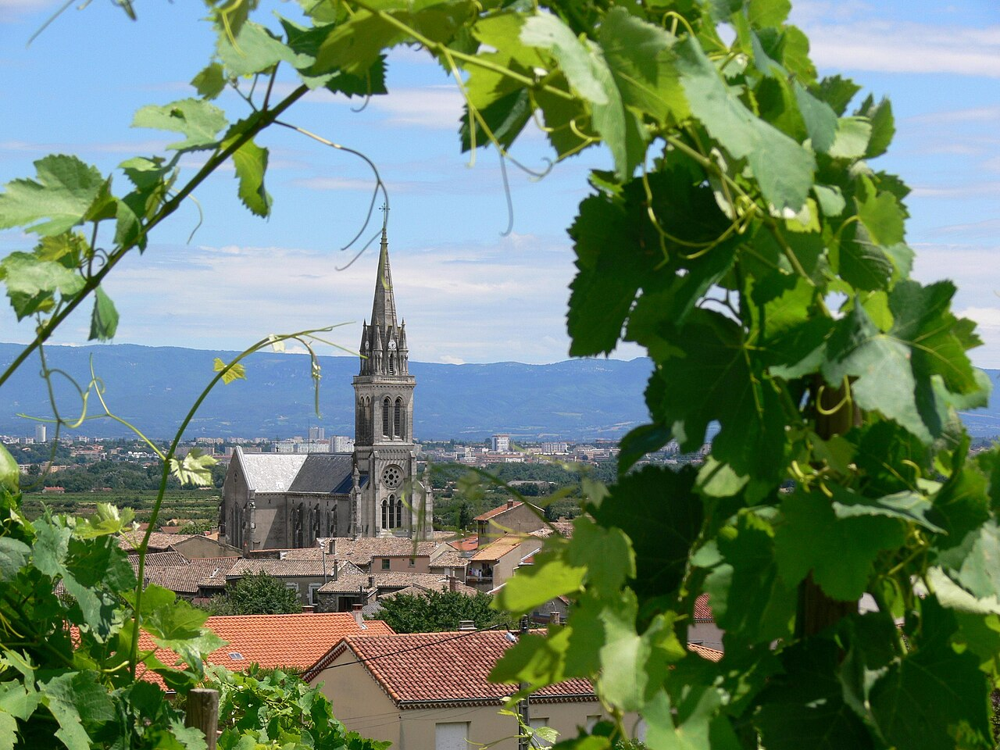

# Cornas

Cornas is a [red wine](ref:red-wine) appellation in the Northern Rhône Valley, France, on steep slopes on the west bank of the Rhône north of Valence, made solely from [Syrah](ref:syrah). The appellation is small and output is limited, with a firm style; commonly 750 mL at about 12.5%–14% vol.

Figure: Cornas. Image: Jacques Forêt, CC BY-SA 4.0, via Wikimedia Commons ([source page](https://commons.wikimedia.org/wiki/File:Cornas_2007-06-16_018.jpg)).

## Definition and positioning

Start with the layers: [red wine](ref:red-wine) is the category, Syrah is the variety, Cornas is the appellation (AOC), and individual estates and wines are the producer level. Cornas is both a place name and an appellation name on the label, and must not be confused with a brand.

In the Northern Rhône, Cornas sits alongside Côte-Rôtie, Hermitage and Saint-Joseph, but has the smallest area. It makes only red wine, from Syrah alone, and is more concentrated and firmer than Saint-Joseph.

## Producers and brands

The appellation is dominated by small family estates on scattered steep terraces, with little mechanisation. Estates mostly own their plots and bottle their own wine, and négociants and cooperatives are relatively limited.

For Cornas, appellation, producer and product are three levels: the appellation answers the rules and geography, the producer answers who farms, ferments and bottles, and the product answers vintage and format. Estates within one appellation differ markedly, so one wine cannot stand for the whole area.

## Region and raw materials

Cornas lies in the Northern Rhône Valley of [France](ref:france), on the west bank of the Rhône north of Valence. The climate is continental, with hot summers and a fairly stable autumn, and slope aspect and sunlight shape ripeness.

Soils are mainly granite, with limestone and sand in some plots; gravel and weathered granite drain well and force deep rooting. The raw material is [grape](ref:grape), and red wine is made from [Syrah](ref:syrah) alone.

The appellation's place in the northern or southern Rhone framework is covered on the [Rhone Valley](ref:rhone) page.

## Winemaking

Cornas reds are built on [fermentation](ref:fermentation), often with a longer maceration to gain colour and tannin; some estates ferment with stems for extra spice and herbal layers. [Oak ageing](ref:oak-ageing) follows, sometimes with a share of new barrels, adding vanilla, smoke and texture.

Specific parameters belong to individual estates, so no uniform figures are given here; refer to estate material and the bottle. Syrah has both high tannin and high acidity, and picking date and maceration strength decide whether the body is firm or simply heavy.

## Format and labelling

The usual bottle is 750 mL at about 12.5%–14% vol. Check the appellation, vintage, bottler and importer on the label; some wines also name a plot or an estate-owned site.

For Cornas, label language varies by market, so the bottle itself is the reference. An appellation name is not a quality grade, and estates and vintages within one appellation differ widely, so buy on specific information.

## Flavour and tasting

Young Cornas shows black olive, black pepper, violet and smoke, with strong tannin and high acidity; with age it moves towards black fruit, leather and truffle. Compared with Saint-Joseph, Cornas often shows deeper colour and stronger structure.

Serve at about 16–18 °C. Look for clear fruit and pepper notes; excess oak or overripe fruit makes the wine heavy. Firmly structured wines can be decanted in advance.

## Drinking and pairing

Cornas suits red meat, grilled meat, game and hard cheese; strong tannin and high acidity suit dishes with some fat. Pair by tannin strength rather than a fixed list.

Most wines suit drinking within 5–12 years, and firm vintages can go longer; the window varies by vintage and estate. Decanting can help; reseal and refrigerate leftovers and drink soon. Excessive drinking is harmful to health, and minors should not drink.

## Buying and storage

Buy from reputable channels and check the appellation, vintage and bottler. Because output is small, prices are usually above those of the larger appellations in the same valley, so no figures are given here. An appellation name and packaging cannot replace knowing the estate and vintage.

For Cornas, store unopened bottles away from light, lying down in a cool place at about 12–15 °C, avoiding heat and sharp temperature swings. Keep the cork moist; lie bottles down for long storage. After opening, reseal, refrigerate and drink within a few days.

## Common misconceptions

First, treating Cornas and Saint-Joseph as the same style. Both are Northern Rhône Syrah appellations, but Cornas is smaller and more concentrated.
Second, assuming Cornas may blend other varieties. The red wine is made from Syrah alone.
Third, treating black pepper as a fault. It is a typical feature of Syrah and the Northern Rhône.
Fourth, assuming every Cornas needs long ageing. Drinking windows vary markedly by estate and vintage.
Fifth, judging authenticity by price or packaging. Channel, back label and bottler information are more reliable.

For Cornas, begin with the base and the stated strength. Then look at the sweetness or bitterness, and finally ask how it is served. The answers point to different choices, not to a single score.

**Short definition:** A Syrah red wine appellation in the Northern Rhône Valley, France, on steep slopes on the west bank of the Rhône north of Valence; small in output and firm in style, with black olive, black pepper, violet and smoky notes, commonly 750 mL at about 12.5%–14% vol.

Cornas is a small Northern Rhône appellation on steep granite slopes; it must be 100% Syrah, and the wines are firmer and more rustic than Côte-Rôtie, with black olive, pepper and smoke. The appellation covers only the commune of Cornas, and its best sites face south. Unlike Hermitage, it has no white wine; all Cornas is red. Ageing in oak is common but not required, and the wines can be drunk young or held for a decade.

**Key facts.**

| Item | Detail |
| --- | --- |
| In one line | A Syrah red wine appellation in the Northern Rhône Valley, France, on steep slopes on the west bank of the Rhône north of Valence; small in output and firm in style, with black olive, black pepper, violet and smoky notes… |
| Style | Red wine |
| Region | France、Rhône Valley |
| ABV | 12.5–14% vol |

**Sources and limits.** The key claims about Cornas are checked against the following sources: INAO (Used to check the appellation area and variety rules), Inter Rhône (Used to check the steep terrain, soils and style of Cornas), Oxford University Press (Consulted for entries on Cornas and Syrah). Prices, batches and status change; the body is project-written and does not reproduce source text.

## Further reading

- [Red wine](ref:red-wine): the category Cornas belongs to.
- [Syrah](ref:syrah): the only variety in Cornas reds.
- [France](ref:france): French wine law and appellations.
- [Rhone Valley](ref:rhone): the northern and southern framework, varieties and rules.
- [Grape](ref:grape): the basic structure of wine grapes and ripeness measures.
- [Fermentation](ref:fermentation): the logic of maceration and extraction.
- [Oak ageing](ref:oak-ageing): one source of smoke and texture.
- [Alcohol by volume](ref:abv): what 12.5%–14% vol means on a label.
