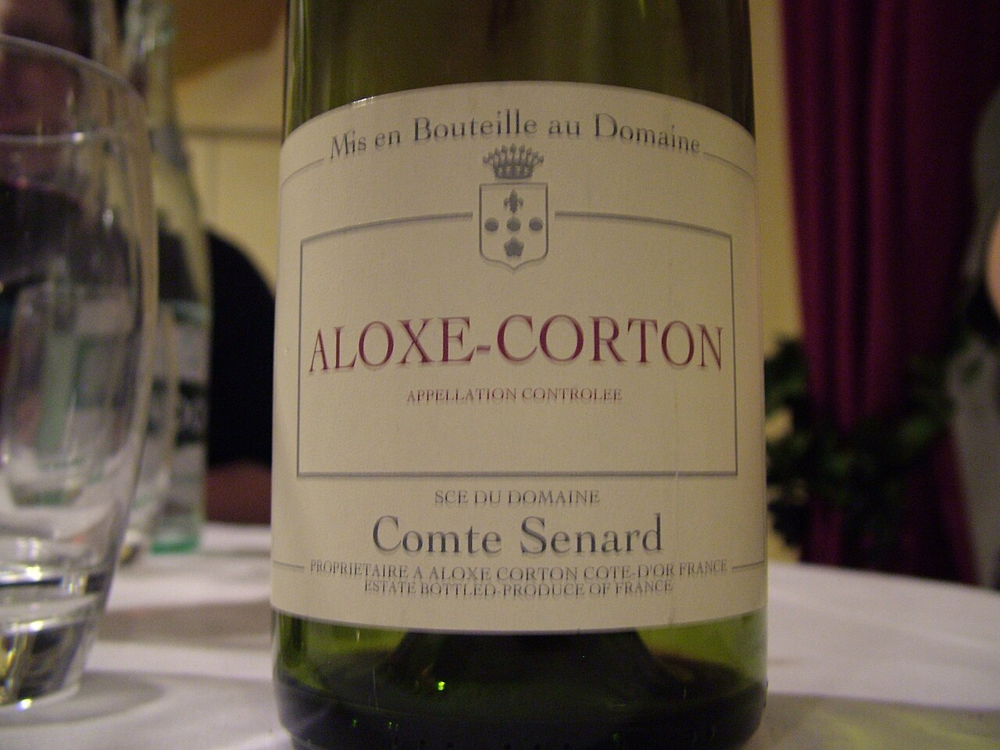

# Corton

Corton is a grand cru appellation on the hill of Corton in the Côte de Beaune of Burgundy, France, making [red wine](ref:red-wine) from [Pinot Noir](ref:pinot-noir) and [white wine](ref:white-wine) from [Chardonnay](ref:chardonnay). It is the only red grand cru of the Côte de Beaune, and the usual bottle is 750 mL at about 12.5%–13.5% vol.

Figure: Corton. Photograph: Domaine bottled Aloxe-Corton Bourgogne. Credit: tara hunt, CC BY-SA 2.0, via Wikimedia Commons ([source](https://commons.wikimedia.org/w/index.php?curid=6331154)).

## Definition and positioning

Start with the layers: red and white wine are the categories, Pinot Noir and Chardonnay are the varieties, Corton is a grand cru appellation, and individual sites and estates are the smaller levels. Grand cru is the highest tier of the Burgundy hierarchy, and the label carries the name Corton plus a site name.

Corton and Corton-Charlemagne are two separate grand cru appellations: Corton makes red wine and a small amount of white, while Corton-Charlemagne makes white only. The sites of the hill of Corton lie in the communes of Aloxe-Corton, Pernand-Vergelesses and Ladoix-Serrigny.

## Producers and brands

The sites of the hill of Corton are divided among many estates, including local family estates as well as producers from other Côte de Beaune villages and négociants. One grand cru site is often bottled by several estates, and only the combination of estate name and site name identifies a specific wine.

Appellation, producer and product are three levels: the appellation answers the rules and geography, the producer answers who farms, ferments and bottles, and the product answers vintage and site. A grand cru name does not guarantee the level of every bottle, and estate and vintage still matter.

## Region and raw materials

The hill of Corton lies in the north of the Côte de Beaune in [Burgundy](ref:burgundy), [France](ref:france). It is an isolated hill, and slope orientation and altitude differ clearly between sites. Soils are mainly clay-limestone and marl, thinner and better drained higher on the slope and deeper lower down.

The raw material is [grape](ref:grape): reds are made from [Pinot Noir](ref:pinot-noir) and whites from [Chardonnay](ref:chardonnay). On one hill, the difference between red and white styles comes mainly from position, soil and variety rather than from a simple change in process.

## Winemaking

Reds are built on [fermentation](ref:fermentation), where maceration time and temperature set colour, tannin and aroma; whites focus on cool fermentation and lees contact to keep acidity and texture. Both may use [oak ageing](ref:oak-ageing), with the share of new oak varying by estate and tier.

Specific parameters belong to individual estates, so no uniform figures are given here; refer to estate material and the bottle. Corton reds usually need longer ageing than village wines to soften tannin, while the whites come into their drinking window earlier.

## Format and labelling

The usual bottle is 750 mL at about 12.5%–13.5% vol. Check the grand cru name, colour, site name (if any), vintage, bottler and importer on the label; Corton-Charlemagne is a separate white grand cru name.

For Corton, label language varies by market, so the bottle itself is the reference. A grand cru name is not a quality grade, and sites and estates within one grand cru differ widely, so buy on specific information.

## Flavour and tasting

Corton reds show red cherry, blackberry, earth, leather and spice, with medium-plus acidity, firmer tannin and a medium-plus body. With age the aroma develops truffle, fallen leaves and dried flowers.

Corton whites and Corton-Charlemagne show citrus, white flowers, hazelnut, honey and minerality, with high acidity and a full texture. Serve reds at about 16–18 °C and whites at about 11–13 °C; firmly structured wines benefit from a brief decant.

## Drinking and pairing

Corton reds suit red meat, grilled meat, game and mushrooms; the whites suit seafood, poultry, creamy dishes and hard cheese. Pair by acidity and tannin rather than a fixed list.

Most reds reach their drinking window within 5–10 years, and top vintages can go longer; whites usually drink earlier. The window varies by vintage, site and estate. Reseal and refrigerate leftovers and drink soon. Excessive drinking is harmful to health, and minors should not drink.

## Buying and storage

Buy from reputable channels and check the grand cru name, site name, vintage and bottler. Prices for Corton and Corton-Charlemagne vary widely, so no figures are given here. A grand cru name cannot replace knowing the site and estate.

For Corton, store unopened bottles away from light, lying down in a cool place at about 12–15 °C, avoiding heat and sharp temperature swings. Keep the cork moist; lie bottles down

## Common misconceptions

First, believing Corton makes only red wine. Corton also makes white, and Corton-Charlemagne is white only.
Second, treating Corton and Corton-Charlemagne as the same appellation. They are separate grands crus with different variety and colour rules.
Third, believing the Côte de Beaune has no red grand cru. Corton is its only red grand cru.
Fourth, treating a grand cru name as a quality guarantee. Sites and estates within one grand cru differ widely.
Fifth, judging authenticity by price. Channel, back label and bottler information are more reliable.

Begin with the base and the stated strength, move on to the sweetness or bitterness, and finish with how it is served. That order keeps the reading of Corton practical.

Corton is the only red grand cru of the Côte de Beaune, and its white counterpart is Corton-Charlemagne.

**Key facts.**

| Item | Detail |
| --- | --- |
| In one line | A grand cru appellation on the hill of Corton in the Côte de Beaune, Burgundy, France, making red wine from Pinot Noir and white wine from Chardonnay and the only red grand cru of the Côte de Beaune; reds are known for s… |
| Style | Red wine、White wine |
| Region | France、Burgundy |
| ABV | 12.5–13.5% vol |

**Sources and limits.** The key claims about Corton are checked against the following sources: INAO (Used to check the areas, varieties and sites of the Corton and Corton-Charlemagne appellations), BIVB (Used to check the Côte de Beaune grand cru framework, the hill of Corton sites and styles), Oxford University Press (Consulted for entries on Corton, Corton-Charlemagne and Chardonnay). Prices, batches and status change; the body is project-written and does not reproduce source text.

## Further reading

- [Red wine](ref:red-wine): the category of Corton reds.
- [White wine](ref:white-wine): the category of Corton and Corton-Charlemagne whites.
- [Pinot Noir](ref:pinot-noir): the variety of Corton reds.
- [Chardonnay](ref:chardonnay): the variety of Corton whites and Corton-Charlemagne.
- [France](ref:france): French wine law and appellations.
- [Burgundy](ref:burgundy): the village, premier cru and grand cru hierarchy.
- [Grape](ref:grape): the basic structure of wine grapes and ripeness measures.
- [Fermentation](ref:fermentation): the logic of maceration and extraction.
- [Oak ageing](ref:oak-ageing): one source of spice and texture.
- [Alcohol by volume](ref:abv): what 12.5%–13.5% vol means on a label.
- [Pommard](ref:pommard): a structured Côte de Beaune red village useful for comparison.
- [Meursault](ref:meursault): a full-textured Côte de Beaune white village useful for comparison.
