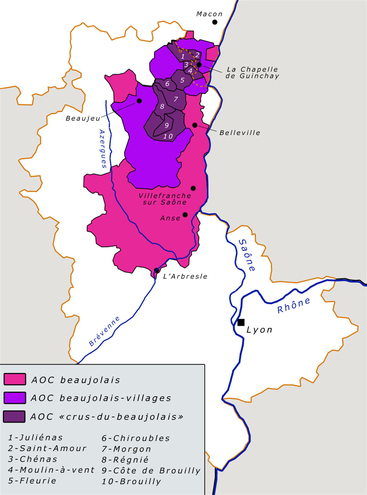

# Côte de Brouilly

On the label, Côte de Brouilly adds just one word to neighbouring [Brouilly](ref:brouilly): Côte. The word for slope is not decoration. It narrows the area from the foot of the hill to the hillside itself, and it pushes the wine from light fruit toward a firmer backbone. Getting these two names apart is more useful when buying than memorising any adjective. The usual bottle is 750 mL, at about 12.5%–13.5% [alcohol by volume](ref:abv).

Figure: Côte de Brouilly. Image: Cyril5555, CC BY-SA 3.0, via Wikimedia Commons ([source page](https://commons.wikimedia.org/wiki/File:Carte_vignoble_beaujolais.png)).

## The extra word, Côte

Côte de Brouilly and Brouilly are two separate crus, not two spellings of one appellation. The first covers only the slope of Mont Brouilly; the second circles the foot of the hill and the gentle ground around it, over a much larger area. Whether those three letters appear on the label decides the legal source of the wine in the bottle.

The division is not wordplay. Slope and foot differ in altitude, soil depth and drainage, and they ripen at different speeds, so the difference in style has a geological basis. Mix the two up when buying and you may judge a hillside wine by the expectations of the foot, concluding wrongly that it is "too tight and not charming enough".

## Blue porphyry and thin soil

The slope of Mont Brouilly is dominated by blue porphyry, pierre bleue, and granite. Porphyry is hard and weathers slowly, producing thin soils mixed with stones that drain very fast; weathered granite adds sandy particles. With the two parent rocks together, roots can only go down through a limited layer in search of water.

Thin soil and fast drainage have two results: yields are naturally limited, so flavours concentrate as the fruit ripens; and water stress arrives early, so acidity does not fall away too quickly. The minerality here is not mysticism but drainage and ripening rhythm showing up in the mouth. The official delimitation governs the detailed soil pattern and parcel assignments.

## Only the slope: altitude and late ripening

Because only the slope is taken, the vineyards sit higher overall than the foot of the hill. With greater altitude, night temperatures drop, the grapes respire less and acidity is better preserved, and picking usually comes a little later than at the foot. Late ripening means a longer window to mature, and in cool years it demands more patience.

The gradient also makes light and drainage more consistent: slopes facing south or south-east catch plenty of sun and drain freely, so parcels differ less in ripeness than on the flat ground below. As a result the style of Côte de Brouilly is more uniform and tighter than Brouilly, with a clearer acid line. There is no premier or grand cru tier here either; slope position and parcel names are the real internal layers.

## Small parcels and family estates

Côte de Brouilly is far smaller than Brouilly, and its vineyards are mostly small parcels held by family estates, with cooperatives and merchants also bottling. Small parcels and many holders mean that management on the same slope varies noticeably, and the style depends even more on the individual estate.

Bottler information therefore matters a great deal. Estate bottling can usually be traced to a specific slope position, while merchant bottling may blend several sources. With total volume limited, Côte de Brouilly is less common on the market than Brouilly, and a reliable family estate is often a better find than a big brand.

## Longer maceration and structure

Côte de Brouilly often uses whole clusters, and some estates practise semi-carbonic maceration: whole grapes start intracellular fermentation in a carbon-dioxide-filled vessel, then are pressed and finish a conventional [fermentation](ref:fermentation). Compared with the lighter crus, maceration is more often extended here to add colour, tannin and backbone.

Some wines go into used [oak](ref:oak-ageing); new barrels are usually a low proportion, so that toast does not cover the minerality and fruit. Moderate fermentation temperatures and a measured extraction at the end of maceration are the common combination. The aim is not a heavy wine but a clear structure built from acidity, tannin and minerality.

## Differences from Brouilly below and Fleurie to the north

Typical aromas are black cherry, raspberry, violet and earth, with some wines showing pepper and wet-stone minerality. The palate has clear acidity, medium tannin and a medium body, finishing longer and with more backbone than Brouilly.

Against Brouilly at the foot, Côte de Brouilly is tighter, more mineral and firmer in acidity; Brouilly is lighter, more direct in fruit and drinks earlier. Against Fleurie to the north, Fleurie is more floral and supple, while Côte de Brouilly is firmer and more chewy. None is better than the others; they divide the work by style: flowers for Fleurie, lightness for Brouilly, structure for Côte de Brouilly.

## Two faces of the slope in warm and cool years

In warm years the slope catches plenty of sun, ripening is more complete, fruit turns darker and sweeter, alcohol sits near the upper end of the range and tannin is more evident. In cool years acidity stands out, the body is leaner and minerality and pepper are stronger, but under-ripe tannin can feel dry.

Serving can follow the year: a warm-year wine needs about 30 minutes in a decanter, while a cool-year wine should be decanted less and given time before that. These are qualitative judgements, not vintage scores; performance still depends on slope position, picking date and estate.

## Relative price of Côte de Brouilly and how to check a label

Côte de Brouilly sits in the middle-upper band of the Beaujolais crus, usually above neighbouring Brouilly and below the top Moulin-à-Vent wines; the slope is small and volume limited, and estate-bottled wines that name a slope position move up another step. Only relative bands are described here; no figures are given.

Three checks help. First, whether the label spells out "Côte de Brouilly" in full, to avoid confusion with Brouilly. Second, the bottler: estate bottling reflects slope differences better. Third, vintage and alcohol: warm years run higher and cool years lower, a matter of style rather than rank. A proper channel and a complete back label are more reliable. Unopened bottles should be kept out of light, lying flat, at an ideal 12–15 degrees Celsius.

## Misunderstandings about "Côte" and Brouilly

First, treating Côte de Brouilly as another name for Brouilly. They are neighbouring but separate crus, with different areas and styles.
Second, assuming that a "Côte" wine must be lighter. The hillside Côte de Brouilly usually has more structure than Brouilly at the foot, not less.
Third, thinking all slope wines should be drunk early. The drinking window of Côte de Brouilly is usually longer than that of Brouilly, and some wines keep for several years.
Fourth, treating Côte de Brouilly as Beaujolais Nouveau. It is a separate cru built on acidity and structure, not a fruit wine of the harvest year.
Fifth, judging authenticity by price or packaging. The full label name, the bottler and the back label are more reliable.

**Short definition:** A cru-level red wine from the slopes of Mont Brouilly in southern Beaujolais, France, made from Gamay. It takes only the hillside and not the foot of the hill; blue porphyry and granite give clearer acidity and minerality, and the area is far smaller than neighbouring Brouilly, commonly 750 mL at about 12.5%–13.5% vol.

## Further reading

- [Red wine](ref:red-wine): the wider category to which this entry belongs.
- [Gamay](ref:gamay): the only grape variety in Côte de Brouilly.
- [France](ref:france): French wine law and appellations.
- [Beaujolais](ref:beaujolais): the ten-cru framework and the southern zone.
- [Grape](ref:grape): the structure of wine grapes and ripeness measures.
- [Fermentation](ref:fermentation): whole-cluster fermentation and semi-carbonic maceration.
- [Oak ageing](ref:oak-ageing): used-barrel ageing and structural integration.
- [Alcohol by volume](ref:abv): what 12.5%–13.5% vol means on a label.
- [Brouilly](ref:brouilly): the larger neighbouring cru on the same hill.
