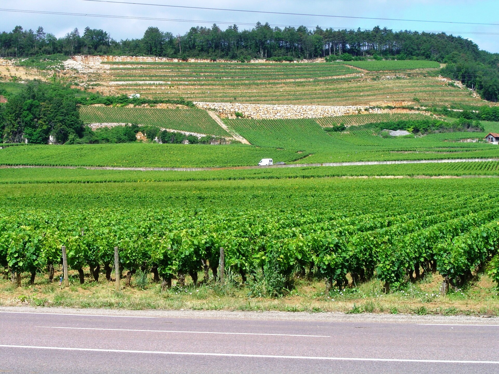

# Côte de Nuits-Villages

Côte de Nuits-Villages is a village appellation in the southern Côte de Nuits, Burgundy, France, with vineyards in villages including Brochon, Comblanchien, Corgoloin and Prémeaux-Prissey. The appellation is mainly [red wine](ref:red-wine) from [Pinot Noir](ref:pinot-noir), with some [white wine](ref:white-wine) from [Chardonnay](ref:chardonnay). It is commonly 750 mL at about 12.5%–13.5% [alcohol by volume](ref:abv).

Figure: Related photograph of Côte de Nuits-Villages. Image: Ile-de-re at German Wikipedia, Public domain, via Wikimedia Commons ([source page](https://commons.wikimedia.org/wiki/File:Cote-de-Nuits_01.JPG)).

## Definition and position

Start with the levels: [red wine](ref:red-wine) and [white wine](ref:white-wine) are the categories, Pinot Noir and Chardonnay are the varieties, Côte de Nuits-Villages is the appellation (AOC), and individual estates and wines are the producer level. Unlike an appellation named after a single village, Côte de Nuits-Villages is a collective name spanning several villages, and the label usually carries the appellation name rather than a single village name.

The appellation has no grands crus, and no premiers crus are labelled under its name; all wines are village-level. Neighbouring [Nuits-Saint-Georges](ref:nuits-saint-georges) and other villages have their own village and premier cru systems, and the two must not be mixed. The official delimitation governs the area and village list.

## Producer and brand

Estate sizes vary widely, and négociants and cooperatives are also active. Because the appellation spans several villages, a merchant may buy grapes or wine from different villages and bottle it as Côte de Nuits-Villages. The bottler information on the label is the key to telling estate wine from merchant wine.

Producer, appellation and product are three levels: the appellation answers for rules and parcel range, the producer answers for who farms, who makes and who bottles, and the product answers for vintage, village sources and red or white type. Even within the same appellation, different villages and estates can differ markedly.

## Region and ingredients

Côte de Nuits-Villages lies in the southern part of the Côte de Nuits in [Burgundy](ref:burgundy), [France](ref:france). Brochon borders Gevrey-Chambertin, Comblanchien and Corgoloin sit at the southern end of the Côte de Nuits, and Prémeaux-Prissey adjoins Nuits-Saint-Georges. Fixin has its own village appellation and should not be conflated with this page.

The slopes here mostly face east or south-east, with lower altitude and gentler gradients than the famous villages of the northern Côte de Nuits; soils are mainly limestone and marl, and the Comblanchien area is known for hard limestone. The milder terrain and more southern position give relatively steady ripening, and the wines are usually less firm than Nuits-Saint-Georges.

The raw material is [grape](ref:grape). Red wine uses [Pinot Noir](ref:pinot-noir) and white wine uses [Chardonnay](ref:chardonnay). Pinot Noir here tends to show direct red fruit and earth, while Chardonnay leans towards a fresh citrus and mineral style.

## Winemaking

For Côte de Nuits-Villages, red fruit is usually sorted after harvest, and some producers keep a proportion of whole clusters to add aromatic complexity. Fermentation runs in temperature-controlled vessels, where maceration time and temperature shape colour, tannin and aroma; wines made for early drinking usually see shorter maceration and lighter extraction. White fruit is usually pressed before fermentation, and some wines are stirred on the lees to add texture.

The wine then ages in [oak](ref:oak-ageing), usually with a lower proportion of new barrels than the famous Côte de Nuits villages, to keep the fruit and the earlier-drinking profile. Oak serves to integrate aroma and soften tannin rather than mask the variety's delicacy. Clarification and filtration before bottling depend on the producer.

## Specification and label

The common volume is 750 mL, with [alcohol by volume](ref:abv) at about 12.5%–13.5% vol, varying by vintage and red or white type. The label should be checked for the appellation name, red or white type, vintage, bottler and importer; some back labels name the source village, but that is not part of the legal appellation name.

Côte de Nuits-Villages carries no grand cru or premier cru designation, so if a label shows "Premier Cru" or "Grand Cru", check whether it actually belongs to another appellation. The Chinese back label, importer and anti-counterfeit information are the basis for checking identity.

## Flavour and tasting

Typical red aromas are red cherry, raspberry, strawberry and earth, with spice and light smoke in some wines; the palate has clear acidity, relatively fine tannin and a light-to-medium body, usually drinking earlier than Nuits-Saint-Georges. With age it can develop leaf litter, mushroom and leather notes.

White wines often show lemon, green apple, white flowers and flinty minerality, with high acidity and a fresh texture. Serve reds at about 15–17 degrees Celsius and whites at about 10–12 degrees Celsius; young reds can be decanted briefly, while older wines should be decanted only briefly.

## Drinking and pairing

For Côte de Nuits-Villages, reds suit poultry, roasted pork, mushrooms, sausages and medium-strength cheese; whites suit steamed fish, shellfish, poultry and soft cheese. Avoid very hot or sharply acidic dishes, which mask the fruit and delicate aromas.

Most reds are for drinking within 3–8 years, and the drinking window for whites is shorter. After opening, refrigerate and finish within a few days. Excessive drinking harms health and minors should not drink.

## Buying and storage

Buy from reputable channels and check the appellation name, red or white type, vintage and bottler information. Côte de Nuits-Villages is usually positioned as an entry to mid-level Côte de Nuits choice, and prices vary widely with village source, estate and vintage, so no figure is given here.

For Côte de Nuits-Villages, unopened bottles should be kept away from light, lying flat in a cool place at an ideal 12–15 degrees Celsius, avoiding heat and sharp temperature swings. Cork-sealed bottles need humidity and can be stored lying down. After opening, use a vacuum or inert gas and refrigerate rather than warming and cooling repeatedly.

## Common misconceptions

First, treating Côte de Nuits-Villages as a single village. It covers several villages and is a collective village-level appellation.
Second, assuming it is the same appellation as Nuits-Saint-Georges. Nuits-Saint-Georges has its own village and premier cru systems.
Third, counting Fixin within this appellation. Fixin has its own village-level appellation.
Fourth, assuming village level cannot be good. Village level states the legal tier, not a quality ceiling.
Fifth, judging authenticity by price or packaging. Channel, label and bottler information are more reliable.

Begin with the base and the stated strength, move on to the sweetness or bitterness, and finish with how it is served. That order keeps the reading of Côte de Nuits-Villages practical.

## Further reading

- [Red wine](ref:red-wine): the wider category to which the reds belong.
- [White wine](ref:white-wine): the wider category to which the whites belong.
- [Pinot Noir](ref:pinot-noir): the variety used for the reds.
- [Chardonnay](ref:chardonnay): the variety used for the whites.
- [France](ref:france): French wine law and appellations.
- [Burgundy](ref:burgundy): the grading framework of the region.
- [Grape](ref:grape): the basic structure of wine grapes and ripeness measures.
- [Fermentation](ref:fermentation): the logic of maceration and fermentation.
- [Oak ageing](ref:oak-ageing): the stage that integrates aroma and softens structure.
- [Alcohol by volume](ref:abv): what 12.5%–13.5% vol means on a label.
- [Nuits-Saint-Georges](ref:nuits-saint-georges): the village appellation immediately south of this area.
