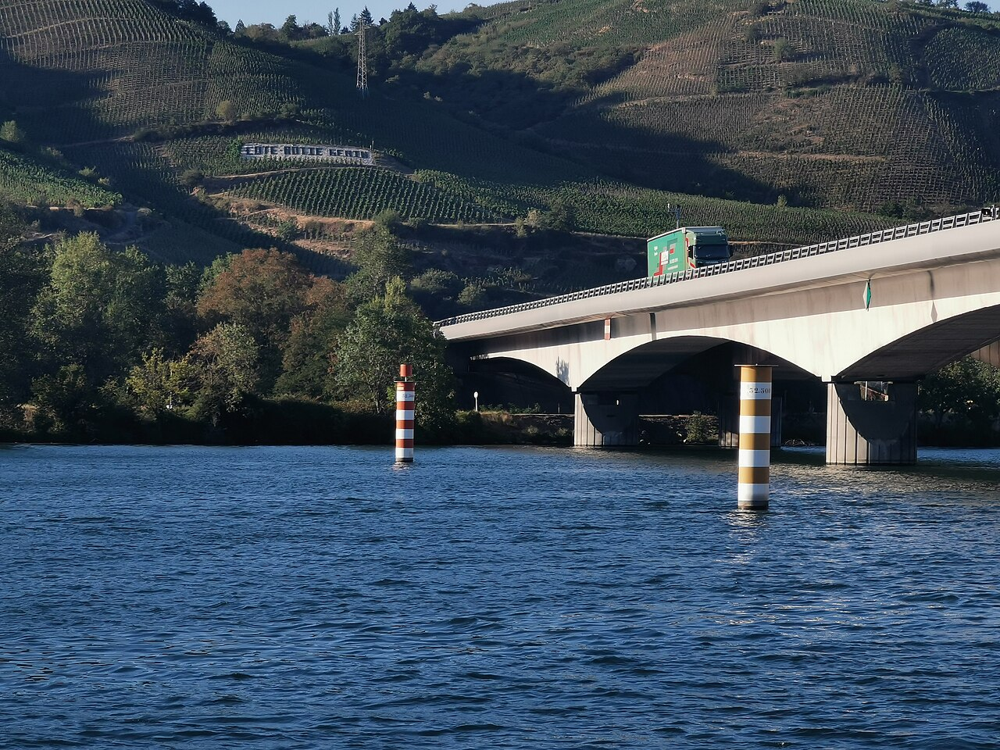

# Côte-Rôtie

Côte-Rôtie is the northernmost red-wine appellation of France's Rhône Valley, on the right bank of the Rhône around Ampuis south of Lyon, based on [Syrah](ref:syrah) with a permitted touch of Viognier. The vineyards hang on steep terraces, and the wines are known for black pepper, violet, olive and smoky notes. It is commonly 750 mL at about 12.5%–14% [alcohol by volume](ref:abv).

Figure: Côte-Rôtie. Image: SashiRolls, CC BY-SA 4.0, via Wikimedia Commons ([source page](https://commons.wikimedia.org/wiki/File:Autoroute_du_soleil_pr%C3%A8s_d%27Ampuis.jpg)).

## Definition and position

Start with the levels: [red wine](ref:red-wine) is the category, Syrah is the variety, Côte-Rôtie is the appellation (AOC), and individual estates and wines are the producer level. Keeping the three apart is what stops "Côte-Rôtie" from being read as a brand or as a grape.

Côte-Rôtie is a place name and an appellation marker, not a trademark. Only wine grown and made inside the delimited area under the appellation rules may carry the name. Other products described as "Côte-Rôtie style" are not appellation wine. Several communes may use the name, and Ampuis is the central one.

## Producer and brand

The appellation is dominated by family estates, alongside négociants and cooperatives. Sizes differ greatly: some estates own their terraces and farm, make and bottle themselves, while merchants buy grapes or wine and blend. The bottler information on the label is the key to telling an estate wine from a merchant wine.

Producer, appellation and product are three levels: the appellation answers for rules and geography, the producer answers for who farms, who makes and who bottles, and the product answers for vintage and specification. Famous and modest estates both sit inside Côte-Rôtie, and one wine cannot stand for the whole appellation's style.

## Region and ingredients

The appellation lies in the northern Rhône Valley of [France](ref:france), on the right bank of the Rhône. The climate mixes Mediterranean and continental influence: summers are warm and the autumn brings the famous northerly wind, and the grapes need enough heat and sun to ripen on steep slopes. Soils are mainly schist, mica-schist and gneiss, free-draining and poor, which limits yields.

The two best-known slope sections are often called the Côte Blonde and the Côte Brune: the former has lighter soils and gives more supple wines, the latter is iron-rich, darker and firmer in body. The terraces are so steep that machinery cannot enter, so farming and harvesting are largely manual, which is why volumes are limited and costs high.

The raw material is [grape](ref:grape), with [Syrah](ref:syrah) as the main variety. The appellation rules permit a small amount of Viognier to be fermented together with Syrah, and the exact proportion and use follow the regulations and the label. Viognier can add floral notes and soften the structure, but not every wine uses it.

The appellation's place in the northern or southern Rhone framework is covered on the [Rhone Valley](ref:rhone) page.

## Winemaking

After harvest the grapes are usually destemmed, and some producers keep a proportion of whole clusters to add spice and structure. Fermentation runs in temperature-controlled vessels, and the length of maceration shapes colour, tannin and aroma; too hot loses delicate aromas, too cool extracts too little.

The wine then ages in [oak](ref:oak-ageing), with the proportion of new barrels varying by producer. Côte-Rôtie tannin is not especially heavy, but acidity and structure are clear, so oak serves to integrate aroma and soften texture rather than mask fruit. Whether the wine is clarified and filtered before bottling also depends on the producer.

## Specification and label

The common volume is 750 mL, with [alcohol by volume](ref:abv) at about 12.5%–14% vol, varying with vintage and producer. The label should be checked for appellation name, vintage, alcohol, net volume, bottler and importer; some estates also name a specific site or parcel.

The appellation name is spelled with a circumflex (Côte-Rôtie), and Chinese back labels usually transliterate it. Identity is better checked through appellation name, bottler and vintage than through packaging design; label languages differ by market, so the bottle on hand governs.

## Flavour and tasting

Typical aromas are blackberry, black cherry, black pepper, violet, olive and smoked meat, developing leather, truffle and leaf litter with age. The palate has clear acidity, medium-plus but fine tannin and a medium body, with a finish of spice and minerality. Compared with the fuller wines of the southern Rhône, Côte-Rôtie is tighter and more layered in aroma.

For tasting, serve at about 16–18 degrees Celsius in a larger glass to gather aroma. Young wines can be decanted for around an hour to open reduction and tannin, while older wines should be decanted briefly. Watch for clear black pepper and floral notes; excessive oak or over-ripe fruit blunts the appellation's character.

## Drinking and pairing

It suits roasted and braised meat, game and hard cheese; protein and fat buffer the tannin and round the wine. Dishes seasoned with black pepper and herbs echo the spice in the wine. Avoid very sweet or sharply acidic dishes, which upset the balance.

Most Côte-Rôtie is for drinking within 5–10 years, while good vintages and famous estates can last longer; the window depends on vintage and producer. After opening, refrigerate and finish within a few days. Excessive drinking harms health and minors should not drink.

## Buying and storage

Buy from reputable channels and check appellation name, vintage, bottler and importer information. Prices vary widely with producer reputation, vintage and site, so no figure is given here; stylistic differences between estates in one appellation cannot be ranked by price alone.

For Côte-Rôtie, unopened bottles should be kept away from light, lying flat in a cool place at an ideal 12–15 degrees Celsius, avoiding heat and sharp temperature swings. Cork-sealed bottles need humidity and can be stored lying down. After opening, use a vacuum or inert gas and refrigerate rather than warming and cooling repeatedly.

## Common misconceptions

First, treating Côte-Rôtie as a brand. It is an appellation name.
Second, assuming Côte-Rôtie always includes Viognier. Permitting it does not mean every wine uses it.
Third, treating the Côte Blonde and Côte Brune as quality tiers. They describe slope sections and soils, not a classification.
Fourth, thinking the steep terraces are only scenery. Gradient directly limits mechanisation and yields.
Fifth, judging authenticity and quality by price. Channel, label and bottler information are more reliable.

**At a glance:** A red wine from the Côte-Rôtie appellation at the northern end of France's Rhône Valley, based on Syrah with a permitted touch of Viognier, grown on steep terraced slopes around Ampuis and known for black pepper, violet, olive and smoky notes. Commonly 750 mL at about 12.5%–14% vol. 

## Further reading

- [Red wine](ref:red-wine): the wider category to which Côte-Rôtie belongs.
- [Syrah](ref:syrah): the appellation's main variety and source of style.
- [France](ref:france): French wine law and appellations.
- [Rhone Valley](ref:rhone): the northern and southern framework, varieties and rules.
- [Grape](ref:grape): the basic structure of wine grapes and ripeness measures.
- [Fermentation](ref:fermentation): the logic of maceration and temperature-controlled fermentation.
- [Oak ageing](ref:oak-ageing): the stage that integrates aroma and softens structure.
- [Alcohol by volume](ref:abv): what 12.5%–14% vol means on a label.
