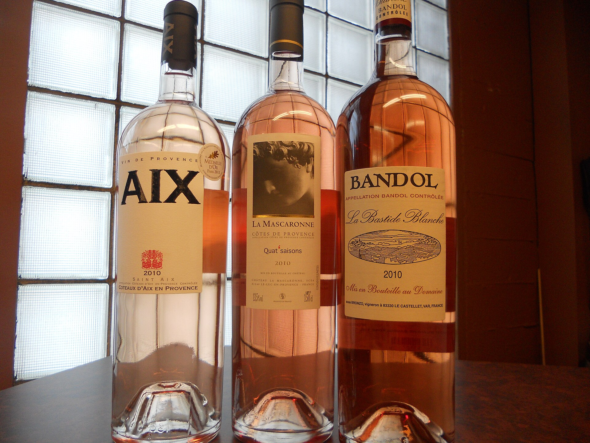

# Côtes de Provence Rosé

Côtes de Provence Rosé is the [rosé](ref:rose-wine) of the Côtes de Provence appellation in [Provence](ref:provence), [France](ref:france), and the best-known and largest-volume wine of the region. It blends Grenache, Cinsault, Syrah and Mourvèdre with short skin contact and pale colour. It is commonly 750 mL at about 12.5%–13.5% [alcohol by volume](ref:abv).

Figure: Related photograph of Côtes de Provence Rosé. Image: Jameson Fink, CC BY 2.0, via Wikimedia Commons ([source page](https://commons.wikimedia.org/wiki/File:Magnums_of_Provence_rose.jpg)).

## Definition and position

Start with the levels: [rosé](ref:rose-wine) is the type, Grenache and Syrah are among the varieties, Côtes de Provence is the appellation, and individual estates and wines are the producer level. "Provence rosé" can refer both to a style and to the rosé of the Côtes de Provence appellation.

Côtes de Provence also makes [red wine](ref:red-wine) and a little [white wine](ref:white-wine), but rosé dominates by volume. Equating Provence with rosé overlooks the region's reds and whites, and easily leads to mistaking rosé from other regions for Côtes de Provence.

## Producer and brand

The appellation is large and includes many producer types: family estates, cooperatives and big merchants. Rosé turns over quickly and demand is high, so many merchants take part by buying grapes or base wine.

Producer, appellation and product are three levels: the appellation answers for rules and parcel range, the producer answers for who farms, who makes and who bottles, and the product answers for vintage, colour and specification. The same Côtes de Provence Rosé differs between estates in colour depth, variety proportions and sweetness setting.

## Region and ingredients

Côtes de Provence lies on the Mediterranean coast of south-east France, with vineyards on coastal hills, in valleys and on inland highlands, from near sea level up to about 400 metres. The climate is Mediterranean, with hot dry summers and a clear mistral influence. Soils are mainly limestone, schist and gravel, well drained and low in fertility.

The raw material is [grape](ref:grape). Rosé usually blends [Grenache](ref:grenache), Cinsault, [Syrah](ref:syrah) and Mourvèdre, and some wines use the local Tibouren. Within the appellation there are geographical names such as Sainte-Victoire, Fréjus, La Londe and Pierrefeu.

## Winemaking

Rosé colour comes from skin contact. A common method is direct pressing, in which the grapes are pressed soon after crushing so only a little pigment enters the wine; another is short maceration, with about 2–12 hours of skin contact before the free-run juice is separated.

Fermentation usually runs at low temperature to preserve red fruit and floral notes; some wines block malolactic fermentation to keep acidity fresh. See [fermentation](ref:fermentation) for the basic process. Compared with reds that need long maceration, the focus in rosé is less extraction and quick separation.

## Specification and label

The common volume is 750 mL, with [alcohol by volume](ref:abv) at about 12.5%–13.5% vol, varying by vintage and estate. The label should be checked for the Côtes de Provence appellation, colour, vintage, bottler and importer.

Some wines name a geographical area such as Sainte-Victoire, or a specific estate and cuvée. The Chinese back label and importer information are the basis for checking identity, and the bottle on hand governs.

## Flavour and tasting

Typical aromas are red currant, strawberry, citrus, white flowers and saline notes, with some wines showing peach and melon; the palate has clear acidity, a light-to-medium body and a clean finish. Colour ranges from pale salmon to deeper pink, and depth mainly reflects skin-contact time and variety rather than quality.

Serve at about 8–10 degrees Celsius in a tulip-shaped glass or a dedicated rosé glass. Too cold masks the aroma and too warm makes the wine feel loose; smell the fruit and flowers first, then judge the balance of acidity and saline notes.

## Drinking and pairing

It works as an aperitif and with seafood, salads, Mediterranean vegetables, poultry and soft cheese. Clear acidity and a light body do not suit heavy red meat or rich sauces.

Most rosé is for drinking within 1–2 years, and a few structured wines can be kept a little longer. Refrigerate after opening and finish within a few days; excessive drinking harms health and minors should not drink.

## Buying and storage

Côtes de Provence Rosé is best read by starting with the base and the stated strength, moving to the sweetness or bitterness, and ending with how it is served.

For Côtes de Provence Rosé, unopened bottles should be kept away from light, lying flat or upright in a cool place at an ideal 12–15 degrees Celsius, avoiding heat and sharp temperature swings. Rosé is fairly sensitive to light and heat, so long storage needs stable temperature. After opening, use a vacuum and refrigerate, and finish soon.

## Common misconceptions

First, thinking paler colour means better quality. Colour reflects skin-contact time and variety, not quality directly.
Second, equating Provence with rosé. The region also makes red wine and a little white wine.
Third, thinking all rosé is sweet. Côtes de Provence Rosé is mostly dry.
Fourth, thinking rosé cannot age. Most is best drunk early, but a few structured wines can be kept short term.
Fifth, conflating Côtes de Provence with Bandol. They are neighbours, but their appellations and stylistic focus differ.

**In brief:** The rosé of the Côtes de Provence appellation in the Provence region of France, the best-known and largest-volume wine of the region; a blend of Grenache, Cinsault, Syrah and Mourvèdre with short skin contact and pale colour, showing red fruit, citrus, white flowers and saline notes, commonly 750 mL at about 12.5%–13.5% vol. 

Read [France](ref:france) for the style side of Côtes de Provence Rosé, and [Rosé Wine](ref:rose-wine) for the region and vintage side. Together they locate it.

**Key facts.**

| Item | Detail |
| --- | --- |
| In one line | The rosé of the Côtes de Provence appellation in the Provence region of France, the best-known and largest-volume wine of the region; a blend of Grenache, Cinsault, Syrah and Mourvèdre with short skin contact and pale co… |
| Style | Rosé Wine |
| Region | France、Provence |
| ABV | 12.5–13.5% vol |

**Sources and limits.** The key claims about Côtes de Provence Rosé are checked against the following sources: INAO (the area, varieties and geographical names of the Côtes de Provence appellation), European Union (EU wine categories, geographical indications and labelling rules), Oxford University Press (Consulted for entries on Côtes de Provence, Provence and rosé; Migrated from the former reference list at the end of the article; access date not re-verified). Prices, batches and status change; the body is project-written and does not reproduce source text.

## Further reading

- [Provence](ref:provence): the overall framework of the region to which Côtes de Provence Rosé belongs.
- [Rosé](ref:rose-wine): the category and its winemaking routes.
- [Red wine](ref:red-wine) and [white wine](ref:white-wine): the other two categories of Côtes de Provence.
- [Grenache](ref:grenache) and [Syrah](ref:syrah): the main varieties in the rosé blend.
- [Bandol](ref:bandol): a Provence appellation known for red wine.
- [Grape](ref:grape): the basic structure of wine grapes and ripeness measures.
- [Fermentation](ref:fermentation): the basic process step in rosé winemaking.
- [Alcohol by volume](ref:abv): what 12.5%–13.5% vol means on a label.
