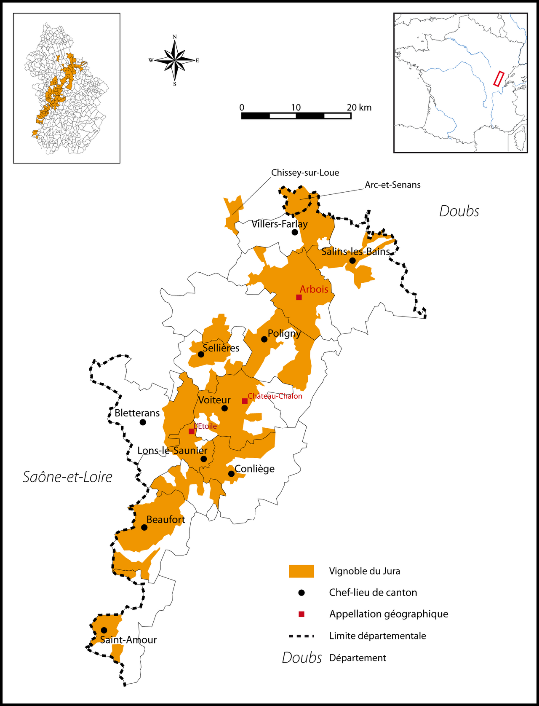

# Côtes du Jura

Côtes du Jura is the widest appellation in the [Jura](ref:jura), in eastern [France](ref:france): 105 communes from north to south, but only about 551 hectares of vines. It is led by [white wine](ref:white-wine) and crémant, while also producing [red](ref:red-wine), [yellow](ref:yellow-wine), vin de paille and the grapes behind Macvin du Jura. Bottles are typically 750 mL at 12.5%–14.5% [alcohol](ref:abv).

Figure: Côtes du Jura. Image: DalGobboM ¿!i?, CC BY-SA 3.0, via Wikimedia Commons ([source page](https://commons.wikimedia.org/wiki/File:Vignobles_jura.png)).

## 31 July 1937: the Jura's widest protected name

The AOC was created by the decree of 31 July 1937, one year after [Arbois](ref:arbois). From the start it was designed not as a single village but as a common framework for the Jura foothills: any site inside the defined communes, farmed to the variety and yield rules, could use the name. Because it is wide, it is often misread as a regional table wine. It is not. It is an AOC on the same legal footing as Arbois, [L'Étoile](ref:letoile) and [Château-Chalon](ref:chateau-chalon); only its geography is larger.

## From 60 communes to 105, yet only 551 hectares

In 1937 the list contained about 60 communes; today it has 105, while the vineyard covers roughly 551 ha and ranks second in the Jura by volume. The "wide but thin" structure matters. Many communes mean wide climatic and soil variation; a small area means each commune averages only a few hectares of vines. Arlay, Beaufort, Buvilly, Gevingey, Lavigny, Mantry, Passenans, Poligny, Rotalier, Saint-Lothain and Voiteur are among the larger names. A village name on the label usually tells you more than "Côtes du Jura" alone.

## Two hundred to four hundred metres, facing south

Most vineyards lie at 200–400 m on south or south-west slopes. The climate is semi-continental: cold winters, warm summers, a mean of about 11–13 °C, roughly 1,150 mm of rain and 1,700–1,900 hours of sunshine. Aspect matters more than latitude. South-facing slopes capture the extra hours that late-ripening Poulsard and Trousseau need; valley floors and north-facing parcels often stay too acidic. Spring frost is a real risk, so choosing a slope is also choosing a risk profile.

## Whites and crémant lead, reds follow

The rules make [Chardonnay](ref:chardonnay) and Savagnin the principal whites, and [Pinot Noir](ref:pinot-noir), Poulsard and Trousseau the principal reds; varieties from the other group are accessories only. In practice, whites and crémant dominate, with reds concentrated in a smaller set of villages. Chardonnay in the ouillé style gives hazelnut, yellow apple and cream; Savagnin under the veil moves to walnut, curry and salt. In both cases the [grapes](ref:grape) go through temperature-controlled [fermentation](ref:fermentation), and wines that need texture see [oak](ref:oak-ageing). The reds are usually lighter and more direct than Arbois, and Poulsard can be as pale as a rosé.

## Vin de Paille: twenty hectolitres and six weeks of drying

Vin de paille is the region's sweet calling card, but it is neither fortified nor sweetened. Grapes are dried on straw or racks for at least six weeks, concentrating sugar and acid, then pressed and fermented. The juice yield is so low that the law caps production at 20 hl/ha. The wine shows dried apricot, honey, orange peel and nuts, with high sugar balanced by high acidity. It is a different process from [vin jaune](ref:yellow-wine): concentration by drying versus veil ageing and oxidation.

## Macvin du Jura: the unfermented sweet wine of 1991

Macvin du Jura is a separate AOC, recognised on 14 November 1991, covering all Jura AOC areas and accounting for about 5% of Jura AOC output. Unfermented must is mixed with local marc spirit — roughly two-thirds must to one-third spirit — which stops fermentation, and the blend ages at least 10 months in oak. The result is 16–22% alcohol, high in residual sugar, amber in colour, with raisin, orange peel and spice. It belongs to the small French AOC category of mistelles, and all five Côtes du Jura varieties may supply the must.

## How it differs from Arbois: breadth versus depth

Arbois is the deep appellation: 12 villages, 766 ha, a red bias and a clear village identity for vin jaune and vin de paille. Côtes du Jura is the broad one: 105 communes, 551 ha, a white and crémant bias, a wider stylistic range and less single-village recognition. Neither is superior; they differ in scale. For a consistent house style, choose a known Arbois village. To explore the Jura's soils in cross-section, Côtes du Jura is more interesting, and usually cheaper.

## Estates and bottles: Rotalier, Voiteur and Poligny

Domaine Ganevat in Rotalier, with old vines, low yields and natural winemaking, sits at the top of the price and attention ladder; Domaine Jean Bourdy in Château-Chalon also has a full Côtes du Jura range; Fruitière Vinicole de Voiteur is the cooperative reference, with volume and consistency; Domaine de la Pinte in Pupillin is known for Savagnin and Poulsard. Cooperatives matter especially in a wide appellation like this: they aggregate small parcels and keep entry prices viable.

## What Côtes du Jura bottles cost

In French retail in 2026, allowing for vintage, channel and scores, ordinary reds and whites sit around €14–20, village or single-site wines €22–32, vin jaune and vin de paille mostly €35–55, and names such as Ganevat €60–150. Entry prices are lower than in Arbois because brand premiums are smaller and cooperative supply is steadier, but the top end is not cheap: old vines and low yields cost money.

## The myth that Côtes du Jura is a table wine

The most common mistake is to treat "Côtes du Jura" as a generic foothills table wine, or to confuse it with the Jura IGP. It is not an IGP. It has been an AOC since 1937, with full rules on varieties, yields, alcohol and ageing, and it is not a junior Arbois: the two are parallel appellations. A second myth is that the area only makes yellow wine; whites and crémant are the volume leaders. A third is that Poulsard is always thin; in good vintages it can be extraordinarily aromatic, even if pale.

## At the table: creamy chicken and blue cheese

The whites suit creamy mushroom chicken, baked river fish, snails and soft cheese; the sous-voile Savagnin style works with Comté, walnuts and curry dishes. Reds go with roast pork, sausage and braised beef; vin de paille with blue cheese, apricot tart or foie gras. [Crémant du Jura](ref:cremant) is the most useful aperitif in the region, high in acid and fine in bead, reliable with fried food and canapés. Try the same white with a cream sauce and with steamed fish: the first amplifies texture, the second amplifies acidity — another sense in which Côtes du Jura is "wide". Serve whites at 10–12 °C, reds at 15–16 °C and vin jaune at 13–15 °C.

The value of Côtes du Jura is its cross-section: one variety gives different answers across 105 communes. Treat it as a map, not a brand, and the 551 hectares repay the attention.

Read [France](ref:france) for the style side of Côtes du Jura, and [Red wine](ref:red-wine) for the region and vintage side. Together they locate it.

**Short definition:** The broadest appellation in the Jura region of France, recognised on 31 July 1937 and spanning 105 communes while covering only about 551 hectares; whites and crémant dominate, with red and white wines plus vin jaune and vin de paille, commonly 750 mL at about 12.5%–14.5% vol.
