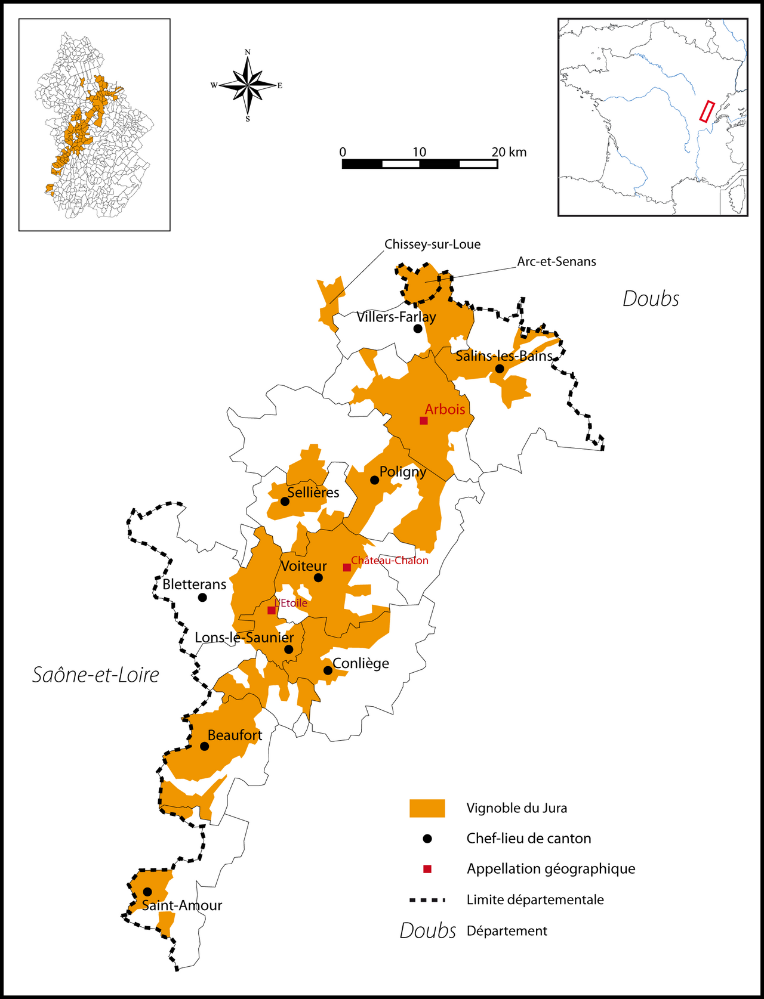

# Crémant du Jura

Crémant du Jura is the traditional-method [sparkling wine](ref:sparkling-wine) appellation of [Jura](ref:jura) in [France](ref:france). It is made from Chardonnay, Savagnin, Pinot Noir, Poulsard and Trousseau, with the second fermentation in bottle and at least 9 months on the lees. It is commonly 750 mL at about 12.0%–12.5% [alcohol by volume](ref:abv).

Figure: Crémant du Jura. Image: DalGobboM ¿!i?, CC BY-SA 3.0, via Wikimedia Commons ([source page](https://commons.wikimedia.org/wiki/File:Vignobles_jura.png)).

## Definition and position

Start with the levels: [sparkling wine](ref:sparkling-wine) is the category, Chardonnay and the other varieties are the grapes, Crémant du Jura is the appellation, and individual estates and wines are the producer level. "Crémant" is a French legal designation for a group of traditional-method sparkling wines, not a brand.

Crémant du Jura and [Côtes du Jura](ref:cotes-du-jura) relate as sparkling and still: Côtes du Jura makes still reds, whites and vin jaune, while Crémant du Jura is devoted to sparkling wine. They draw on the same vineyards, but harvest timing, winemaking route and rules differ.

## Producer and brand

Family estates and cooperatives dominate, with merchants also present. Sparkling wine needs bottle ageing plus riddling and disgorging, which takes equipment and time, so producer scale is usually modest.

Producer, appellation and product are three levels: the appellation answers for rules and area, the producer answers for farming, making and bottling, and the product answers for vintage, type and specification. The same Crémant du Jura can differ between estates in base-wine blend, lees ageing and sweetness setting.

## Region and ingredients

Crémant du Jura vineyards overlap with those of the still Jura appellations, on the rolling slopes of western Jura at about 250–450 metres. Soils are mainly limestone, marl and scree, well drained and low in fertility.

The raw material is [grape](ref:grape). The varieties include [Chardonnay](ref:chardonnay), Savagnin, [Pinot Noir](ref:pinot-noir), Poulsard and Trousseau. Base wines are usually picked earlier to keep higher acidity and lower alcohol, leaving room for the second fermentation.

## Winemaking

The base wine completes a first [fermentation](ref:fermentation) in stainless steel or old barrels, then goes into bottle with sugar and yeast for a second fermentation that creates the bubbles. The wine spends at least 9 months on the lees in bottle, which makes the bubbles finer and the flavour more complete.

After ageing, the bottles are riddled and disgorged, and a dosage is added as needed to set the final sweetness. White sparkling wine is based on white grapes, and rosé gains colour from short skin contact. The acidity and structure of the base wine set the skeleton of the finished wine.

## Specification and label

The common volume is 750 mL, with [alcohol by volume](ref:abv) at about 12.0%–12.5% vol. The label should be checked for the Crémant du Jura appellation, the type, the sweetness indication, the bottler and the importer.

French sparkling wine is usually dry, with sweetness terms such as brut and extra brut. The Chinese back label and importer information are the basis for checking identity, and the bottle on hand governs.

## Flavour and tasting

White sparkling wine shows green apple, lemon, white flowers and mineral notes with high acidity and fine bubbles; rosé adds red fruit and citrus. Wines with longer lees ageing develop bread, cream and nut notes.

Serve at about 8–10 degrees Celsius in a tulip-shaped or flute glass. Watch the fineness and persistence of the bubbles, then smell, then judge the balance of acidity and sweetness. Avoid over-chilling, which masks the aroma.

## Drinking and pairing

It works as an aperitif and with seafood, salads, poultry and soft cheese. Dry versions suit light dishes, and slightly sweeter versions suit fruit desserts.

Bubbles fade after opening, so refrigerate and finish within a few days, using a stopper to slow the loss. Excessive drinking harms health and minors should not drink.

## Buying and storage

Crémant du Jura is best approached through the base and the stated strength, then the sweetness or bitterness, and then how it is served. One check alone will not settle it.

For Crémant du Jura, unopened bottles should be kept away from light, lying flat in a cool place at an ideal 12–15 degrees Celsius, avoiding heat and sharp temperature swings. Long storage needs stable temperature; after opening, refrigerate and drink soon.

## Common misconceptions

First, conflating Crémant du Jura with Champagne. Their regions, varieties and rules differ.
Second, thinking "Crémant" is a brand name. It is a French legal designation for traditional-method sparkling wines.
Third, thinking sparkling wine is always sweet. Dry styles dominate, and sweetness comes from the dosage.
Fourth, thinking more bubbles means better quality. Fineness and persistence matter more than quantity.
Fifth, judging quality by price alone. Appellation, sweetness and bottler information is more specific.

**Short definition:** The traditional-method sparkling wine appellation of the Jura region in France, made from Chardonnay, Savagnin, Pinot Noir, Poulsard and Trousseau, with the second fermentation in bottle and at least 9 months on the lees; the style is fresh with high acidity and fine bubbles, in white and rosé versions, commonly 750 mL at about 12.0%–12.5% vol.

Treating Crémant du Jura as a drink style or a brand mixes two different questions: identity and use. Separate them before comparing.

The entry on Crémant du Jura draws on INAO, Légifrance, Oxford University Press.

Crémant du Jura is the Jura's traditional-method sparkling appellation, made from Chardonnay, Savagnin, Pinot Noir, Poulsard and Trousseau; the second fermentation is in bottle and the wine rests at least 9 months on the lees. The style is fresh and high-acid, with fine bubbles, and it can be white or rosé. Unlike Champagne, it is not aged for years in most cases; the point is freshness and a light yeasty note. A label should name Crémant du Jura, not just Jura, because the latter could be a still wine.

**Key facts.**

| Item | Detail |
| --- | --- |
| In one line | The traditional-method sparkling wine appellation of the Jura region in France, made from Chardonnay, Savagnin, Pinot Noir, Poulsard and Trousseau, with the second fermentation in bottle and at least 9 months on the lees… |
| Style | Sparkling wine |
| Region | France、Jura |
| ABV | 12–12.5% vol |

**Sources and limits.** The key claims about Crémant du Jura are checked against the following sources: INAO (the area, varieties and lees-ageing rules of the Crémant du Jura appellation), Légifrance (rules including at least 9 months of bottle ageing on the lees), Oxford University Press (Consulted for entries on Crémant du Jura and Jura; Migrated from the former reference list at the end of the article; access date not re-verified). Prices, batches and status change; the body is project-written and does not reproduce source text.

## Further reading

- [Sparkling wine](ref:sparkling-wine): the process and style framework of traditional-method sparkling wine.
- [Jura](ref:jura): the overall framework of the region to which Crémant du Jura belongs.
- [Côtes du Jura](ref:cotes-du-jura): the still-wine appellation on the same vineyards.
- [Chardonnay](ref:chardonnay) and [Pinot Noir](ref:pinot-noir): two main varieties for the base wine.
- [Grape](ref:grape): the basic structure of wine grapes and ripeness measures.
- [Fermentation](ref:fermentation): the logic of the first fermentation and the second in bottle.
- [Alcohol by volume](ref:abv): what 12.0%–12.5% vol means on a label.
