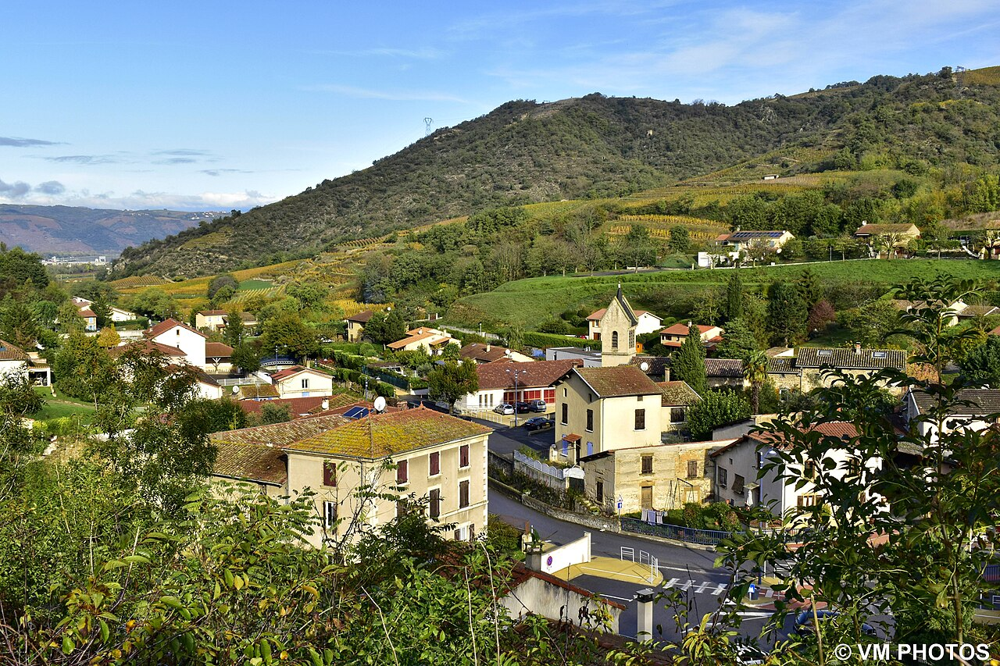

# Crozes-Hermitage

Crozes-Hermitage is a [red wine](ref:red-wine) appellation in the Northern Rhône Valley of France, on the east bank of the Rhône around Tain-l'Hermitage and the Hermitage hill, and the largest appellation in the northern Rhône. Reds are made from [Syrah](ref:syrah), a small amount of white wine is also made, and the usual bottle is 750 mL at about 12.5%–14% vol.

Figure: Crozes-Hermitage. Image: VM PHOTOS FRANCE, CC BY-SA 4.0, via Wikimedia Commons ([source page](https://commons.wikimedia.org/wiki/File:VM_PHOTOS_CROZES_PLACE_DE_LA_MAIRIE.jpg)).

## Definition and positioning

Start with the layers: [red wine](ref:red-wine) is the category, Syrah is the variety, Crozes-Hermitage is the appellation (AOC), and individual estates and wines are the producer level. The name comes from the village of Crozes-Hermitage and is distinct from the Hermitage appellation on the Hermitage hill.

Crozes-Hermitage was granted appellation status in 1937. Its area surrounds the Hermitage hill, but the hill itself belongs to the much smaller Hermitage appellation; the two can be neighbours but cannot replace each other. In the northern Rhône it is often compared with [Saint-Joseph](ref:saint-joseph) and [Cornas](ref:cornas).

## Producers and brands

The appellation is dominated by family estates and cooperatives, with estates of very different sizes. Plots near Tain in the north are mostly on slopes, while the south extends into broad alluvial plains and is more mechanised than Hermitage. Bottler information on the label is the key to telling estate wine from négociant wine.

For Crozes-Hermitage, appellation, producer and product are three levels: the appellation answers the rules and geography, the producer answers who farms, ferments and bottles, and the product answers vintage and format. Estates within one appellation differ markedly, so one wine cannot stand for the whole area.

## Region and raw materials

Crozes-Hermitage lies in [France](ref:france)'s Northern Rhône Valley, on the east bank of the Rhône in the Drôme department. The climate is continental, with hot summers, a drying and cooling mistral, and late-season rain that affects picking decisions.

Soils fall into two groups: plots near the Hermitage hill in the north are mostly granite and slope, with good drainage; the south is flatter alluvial terraces and clay-limestone, with deeper soil. The raw material is [grape](ref:grape); reds are made from [Syrah](ref:syrah), while whites are mainly Marsanne and Roussanne and account for a small share.

The appellation's place in the northern or southern Rhone framework is covered on the [Rhone Valley](ref:rhone) page.

## Winemaking

Reds are built on [fermentation](ref:fermentation), where maceration time and temperature set colour, tannin and fruit. Some estates use whole-cluster fermentation for extra spice and herbal layers, and many use [oak ageing](ref:oak-ageing), usually with a lower share of new oak than the top Hermitage wines so as to keep the fruit.

Whites are often fermented in barrel with lees stirring for texture and nut notes. Specific parameters belong to individual estates, so no uniform figures are given here; refer to estate material and the bottle.

## Format and labelling

The usual bottle is 750 mL at about 12.5%–14% vol. Check the appellation, colour (red or white), vintage, bottler and importer on the label; some wines also name a village or a site.

For Crozes-Hermitage, label language varies by market, so the bottle itself is the reference. An appellation name is not a quality grade, and estates and vintages within one appellation differ widely, so buy on specific information.

## Flavour and tasting

Young reds show blackberry, black pepper, violet and black olive, with medium-plus acidity and medium tannin, and a more open, approachable style than Hermitage. With age they develop leather, tobacco and truffle; wines from the southern plain usually have more fruit and a softer structure.

Whites show white flowers, apricot, honey and hazelnut, with medium acidity and a rounder texture. Serve reds at about 16–18 °C and whites at about 10–12 °C; a brief decant helps reds, while whites should not be over-chilled.

## Drinking and pairing

Reds suit red meat, grilled meat, poultry and mushrooms; lighter vintages also work with spiced stews. Whites suit seafood, white meat and creamy dishes. Pair by acidity and tannin rather than a fixed list.

Most reds suit drinking within 3–8 years, and firmer vintages can go longer; the window varies by vintage and estate. Reseal and refrigerate leftovers and drink soon. Excessive drinking is harmful to health, and minors should not drink.

## Buying and storage

Buy from reputable channels and check the appellation, vintage and bottler. Prices within one appellation vary widely, so no figures are given here. An appellation name and packaging cannot replace knowing the estate and vintage.

For Crozes-Hermitage, store unopened bottles away from light, lying down in a cool place at about 12–15 °C, avoiding heat and sharp temperature swings. Keep the cork moist; lie bottles down for long storage. After opening, reseal, refrigerate and drink within a few days.

## Common misconceptions

First, treating Crozes-Hermitage and Hermitage as the same appellation. The names are neighbours, but the areas and outputs differ greatly.
Second, assuming Crozes-Hermitage makes only red wine. It also makes a small amount of white wine, mainly from Marsanne and Roussanne.
Third, assuming the whole appellation is granite slope. The south has broad alluvial terraces and clay-limestone.
Fourth, treating black pepper as a fault. It is typical of Syrah and the northern Rhône.
Fifth, thinking every wine needs long ageing. Drinking windows vary by estate and vintage.

Crozes-Hermitage is best read by starting with the base and the stated strength, moving to the sweetness or bitterness, and ending with how it is served.

[Red wine](ref:red-wine) and [Rhône Valley](ref:rhone) answer different questions about Crozes-Hermitage: style and region and vintage. Read them as a pair, not as alternatives.

**Key facts.**

| Item | Detail |
| --- | --- |
| In one line | A Syrah red wine appellation on the east bank of the Rhône in the Northern Rhône Valley, France, spread around Tain-l'Hermitage and the Hermitage hill and the largest appellation in the northern Rhône; reds are made from… |
| Style | Red wine |
| Region | France、Rhône Valley |
| ABV | 12.5–14% vol |

**Sources and limits.** The key claims about Crozes-Hermitage are checked against the following sources: INAO (Used to check the area, varieties and red and white wine rules of the Crozes-Hermitage appellation), Inter Rhône (Used to check the Northern Rhône appellation framework, soils and styles), Oxford University Press (Consulted for entries on Crozes-Hermitage and Syrah). Prices, batches and status change; the body is project-written and does not reproduce source text.

## Further reading

- [Red wine](ref:red-wine): the category Crozes-Hermitage belongs to.
- [Syrah](ref:syrah): the core variety of Crozes-Hermitage reds.
- [France](ref:france): French wine law and appellations.
- [Rhone Valley](ref:rhone): the northern and southern framework, varieties and rules.
- [Grape](ref:grape): the basic structure of wine grapes and ripeness measures.
- [Fermentation](ref:fermentation): the logic of maceration and extraction.
- [Oak ageing](ref:oak-ageing): one source of spice and texture.
- [Alcohol by volume](ref:abv): what 12.5%–14% vol means on a label.
- [Saint-Joseph](ref:saint-joseph): a Syrah appellation across the Rhône, useful for comparison.
- [Cornas](ref:cornas): a smaller, firmer Syrah appellation in the northern Rhône.
