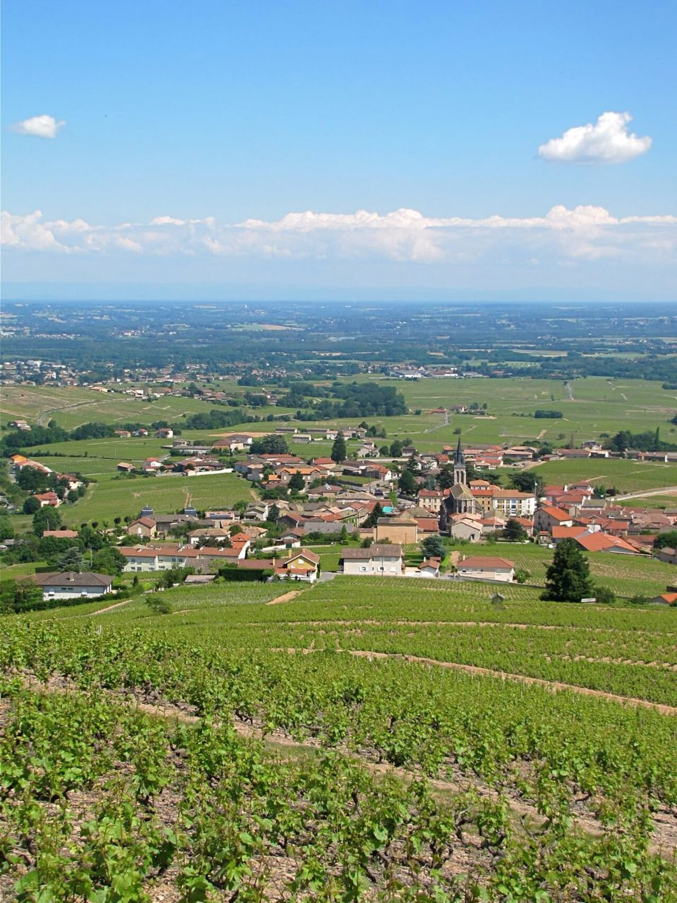

# Fleurie

On the slopes of northern Beaujolais, the vineyards of Fleurie stand on a layer of pink weathered granite. The wines are famous for flowers, but what really shapes a given bottle is often the slope it came from: small place names printed on the label, such as La Madone and Grille-Midi, say more about the direction of the wine than the word Fleurie alone. The usual bottle is 750 mL, at about 12.5%–13.5% [alcohol by volume](ref:abv).

Figure: Fleurie. Image: Nicolas Baldeck, CC BY-SA 3.0, via Wikimedia Commons ([source page](https://commons.wikimedia.org/wiki/File:Fleurie_Rhone_France_28_May_2012.jpg)).

## The name, the nickname, and La Madone

Fleurie is both a village name and an appellation name. The Chinese nickname "flower village" was given by later drinkers and comes from the floral impression that keeps appearing in tasting notes; it has nothing to do with anything added in the cellar. The name itself is a place name, not a winemaking term.

The slopes inside the village are not uniform. Near the village the incline is gentler; higher up the slope steepens and the soil thins. La Madone belongs to the sites that are labelled separately and is often treated by producers as a flagship parcel. It does not create a legal tier; it is simply a parcel name inside the same cru. Once that is clear, it is easy to see why two bottles both labelled Fleurie can differ so much in price and style.

## Pink granite and layered sites

The area is dominated by weathered sand from pink granite, mixed with quartz grains and a little schist. The sandy soil is thin, drains fast and holds little fertility, so the vines must root deep and yields are naturally limited. The pink colour comes from the weathering of feldspar; this parent rock is not rare in northern Beaujolais, but it is especially concentrated in Fleurie.

Aspect and altitude then act as a second filter. South- and south-east-facing slopes receive plenty of sun and ripen more fully; higher parcels are cooler at night and keep more acidity. A single village therefore produces two families of style: lower ground is rounder and more fruit-forward, higher ground is leaner and more floral. There is no premier or grand cru tier inside the village, and the official delimitation governs the boundaries and parcel assignments.

## Place names and bottlers on the label

Beyond La Madone and Grille-Midi, a Fleurie label may carry only the village name, or add a small site term such as "Clos". A site name is not a legal classification, but it does signal how confident the producer is: wines that name a parcel usually come from owned vines, in smaller volume, with a more focused style.

Bottling information matters just as much. "Mis en bouteille au domaine" means the estate bottled the wine itself; "par un négociant" means a merchant did. Family estates dominate Fleurie, with cooperatives and merchants also taking part, and grapes from the same parcel may be bought by different parties. Checking the bottler tells you more about the kind of producer than the look of the packaging.

## Whole clusters and light extraction

Fleurie often uses whole clusters, and many estates practise semi-carbonic maceration: whole grapes begin intracellular fermentation in a carbon-dioxide-filled vessel, then are pressed and finish a conventional [fermentation](ref:fermentation). This brings direct red-fruit aroma and lighter tannin, which fits the floral profile neatly.

Maceration is usually on the short side and extraction light, so that the delicate aromas are not pressed down. Estates chasing more structure may extend maceration, or send a small part of the wine into used [oak](ref:oak-ageing); the proportion of new barrels is generally very low, because sweet new-oak notes would cover the iris and peony. Moderately cool fermentation temperatures also help to preserve aroma.

## Aromas, palate and differences from neighbours

Typical aromas are red cherry, raspberry and strawberry, layered with violet, iris and peony; some wines show white pepper or a wet-stone minerality. The palate has clear acidity, fine tannin, a light-to-medium body and a supple finish.

Compared with its neighbours, the difference is not whether flowers are present but how much weight and backbone sits underneath. Chénas is tighter than Fleurie, with tannin that grips more; Moulin-à-Vent is clearly fuller, darker in colour and longer-lived; further south, [Morgon](ref:morgon) is more solid and leans toward black fruit. Ask who is most floral and Fleurie is usually near the front; ask who is fullest and it is not in the running.

## From warm to cool years: how the aroma shifts

In warm years the fruit ripens fully, alcohol tends toward the upper end of the range, the fruit tastes sweeter and riper, acidity is less sharp than in a cool year, and the flowers are sometimes buried under fruit. In cool years ripening is slower, the body is lighter and the acidity clearer, while iris and peony come forward; if ripening falls short, however, green stalk and unripe notes can appear.

For Fleurie, begin with the base and the stated strength, then the sweetness or bitterness, and finish with how it is served; that order keeps the account grounded.

## Pairing and serving

Serve at about 14–16 degrees Celsius in a tulip-shaped or Burgundy glass. Young wines can be lightly chilled and need no long decanting; older wines should be decanted briefly so the aroma does not fade.

It suits poultry, roast pork, charcuterie, mushrooms and soft cheese, and also works with salads and light seafood. Most wines are for drinking within 3–8 years, and core sites such as La Madone can go a little longer. After opening, refrigerate and finish within a few days. Excessive drinking harms health and minors should not drink.

## Price steps in Fleurie and the order of checks

Fleurie sits in the upper-middle band of the Beaujolais crus: usually above regional Beaujolais and below the top Moulin-à-Vent wines. Bottles with only the village name tend to fall in the entry to mid band, while wines that name a core site such as La Madone and are estate-bottled move up one step. Only relative bands are described here; no figures are given.

Three checks help. First, the bottler: estate bottling is usually dearer and more consistent. Second, the site name: parcel-labelled wines generally come in smaller volumes. Third, vintage and alcohol: warm years run higher in alcohol and cool years lower, and that is a difference of style rather than of rank. A proper channel and a complete back label are more reliable than fancy packaging. Unopened bottles should be kept out of light, lying flat, at an ideal 12–15 degrees Celsius.

## Common misreadings of "the flower village"

First, thinking Fleurie means flowers were added in winemaking. The name is a place name, and the flowers come from Gamay and granite, not from an added ingredient.
Second, treating La Madone as a premier cru. Fleurie has no premier or grand cru tier; site names are a labelling habit of producers.
Third, assuming every Fleurie is light and none will keep. Core parcels can hold for several years; lightness is the norm, not the ceiling.
Fourth, confusing Fleurie with Moulin-à-Vent. The villages are neighbours, but the latter is fuller and keeps longer.
Fifth, judging authenticity by price or packaging. The bottler, site name and back label are more reliable.

**At a glance:** A cru-level red wine from the village of Fleurie in northern Beaujolais, France, made from Gamay. Its vineyards sit on pink weathered granite, and named sites such as La Madone and Grille-Midi are often labelled on their own; the style is known for floral aroma, a light body and a supple texture, commonly 750 mL at about 12.5%–13.5% vol. 

## Further reading

- [Red wine](ref:red-wine): the wider category to which this entry belongs.
- [Gamay](ref:gamay): the only grape variety in Fleurie.
- [France](ref:france): French wine law and appellations.
- [Beaujolais](ref:beaujolais): the ten-cru framework and the northern zone.
- [Grape](ref:grape): the structure of wine grapes and ripeness measures.
- [Fermentation](ref:fermentation): whole-cluster fermentation and semi-carbonic maceration.
- [Oak ageing](ref:oak-ageing): used-barrel ageing and aroma integration.
- [Alcohol by volume](ref:abv): what 12.5%–13.5% vol means on a label.
- [Morgon](ref:morgon): a fuller cru to the south.
