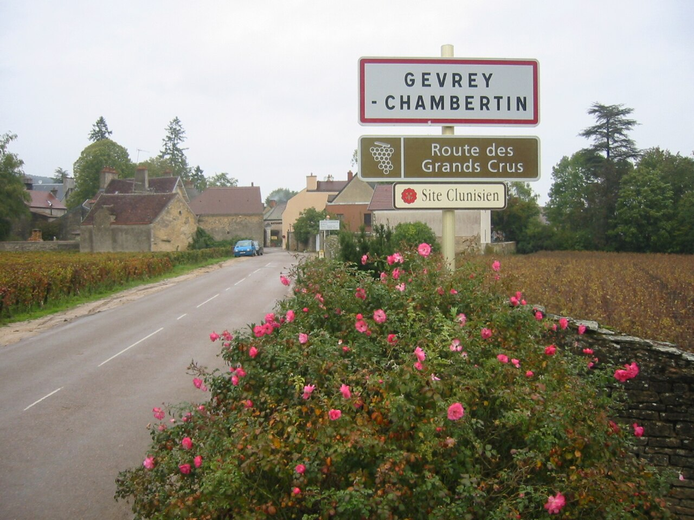

# Gevrey-Chambertin

Gevrey-Chambertin is a famous red-wine village in Burgundy's Côte de Nuits, France, its wines made entirely from [Pinot Noir](ref:pinot-noir). The village holds nine grands crus, of which Chambertin and Chambertin-Clos de Bèze are the best known, and the style is known for structure, dark fruit and ageing potential. It is commonly 750 mL at about 12.5%–13.5% [alcohol by volume](ref:abv).

Figure: Gevrey-Chambertin. Image: Arnaud 25, CC BY-SA 3.0, via Wikimedia Commons ([source page](https://commons.wikimedia.org/wiki/File:Panneau_Gevrey_Chambertin.JPG)).

## Definition and position

Start with the levels: [red wine](ref:red-wine) is the category, Pinot Noir is the variety, Gevrey-Chambertin is the appellation (AOC), and individual estates and wines are the producer level. Gevrey-Chambertin is both a village name and an appellation name that may appear on a label.

Wines from the village fall into three tiers: village, premier cru and grand cru. Grand cru names appear on their own, such as Chambertin, Chambertin-Clos de Bèze, Charmes-Chambertin and Griotte-Chambertin; village wine usually carries only the village name, while premier cru names its specific site. Tier changes yield, price and style.

## Producer and brand

The village has many estates, from long-established family domaines to négociants and cooperatives. An estate may own grand cru parcels, while a merchant may buy grapes or wine and bottle it. The bottler information on the label is the key to telling estate wine from merchant wine.

Producer, appellation and product are three levels: the appellation answers for rules and parcel range, the producer answers for who farms, who makes and who bottles, and the product answers for vintage, tier and specification. The same grand cru made by different estates can differ greatly, so the site name alone is not enough.

## Region and ingredients

Gevrey-Chambertin lies in the Côte de Nuits of [Burgundy](ref:burgundy) in [France](ref:france), one of the northernmost red-wine villages of the Côte de Nuits. Slopes mostly face east with gentle sun and a long ripening season; soils are mainly limestone and marl, thinner and free-draining upslope and richer in clay downslope.

The vineyards run from the top of the slope to the foot, and different combinations of altitude and soil produce differences in ripeness and structure. Grands crus mostly sit mid-slope, premiers crus around them, and village parcels lower down and on flatter ground. The official delimitation governs the boundaries.

The raw material is [grape](ref:grape), of the [Pinot Noir](ref:pinot-noir) variety. Pinot Noir has thin skins, pale colour and high acidity, is highly sensitive to climate and viticulture, and on Burgundy's limestone soils shows fine aroma and structure. Gevrey-Chambertin is usually firmer than neighbouring villages, with darker fruit.

## Winemaking

After harvest the fruit is usually sorted, and some producers keep a proportion of whole clusters to add aromatic complexity and structure. Fermentation runs in temperature-controlled vessels, where maceration time and temperature shape colour, tannin and aroma; too hot loses delicate aromas.

The wine then ages in [oak](ref:oak-ageing), with the proportion of new barrels varying by estate and tier. Grands crus usually see more new oak, village wines less. Oak serves to integrate aroma and soften tannin rather than mask Pinot Noir's delicacy. Clarification and filtration before bottling depend on the producer.

## Specification and label

The common volume is 750 mL, with [alcohol by volume](ref:abv) at about 12.5%–13.5% vol, varying by vintage and tier. The label should be checked for village name, tier (village, premier cru, grand cru), site name, vintage, bottler and importer.

Grand cru names must match the official list, and premier cru names its specific climat. The Chinese back label, importer and anti-counterfeit information are the basis for checking identity; label languages differ by market, so the bottle on hand governs.

## Flavour and tasting

Typical aromas are red cherry, black cherry, raspberry, rose and earth, developing leather, mushroom and leaf litter with age; the palate has clear acidity, fine tannin and a medium-plus body with obvious structure. Compared with the supple style of Chambolle-Musigny, Gevrey-Chambertin is usually firmer and darker in fruit.

For tasting, serve at about 15–17 degrees Celsius in a Burgundy-shaped glass. Young wines can be decanted for around an hour, while older wines should be decanted briefly. Watch the layering of fruit and earth; excessive oak masks Pinot Noir's delicacy.

## Drinking and pairing

It suits poultry, roasted veal, mushroom dishes and medium-strength cheese; the wine's structure carries fat and savoury depth. Avoid very hot or sharply acidic dishes, which mask the delicate aromas.

Most village wine is for drinking within 5–10 years, while premiers crus and grands crus last longer; the window depends on vintage, tier and estate. After opening, refrigerate and finish within a few days. Excessive drinking harms health and minors should not drink.

## Buying and storage

Buy from reputable channels and check village name, tier, site name, vintage and bottler information. Prices vary widely with tier, site and estate reputation, so no figure is given here. A grand cru is not necessarily great in every year, and vintage fit matters too.

For Gevrey-Chambertin, unopened bottles should be kept away from light, lying flat in a cool place at an ideal 12–15 degrees Celsius, avoiding heat and sharp temperature swings. Cork-sealed bottles need humidity and can be stored lying down. After opening, use a vacuum or inert gas and refrigerate rather than warming and cooling repeatedly.

## Common misconceptions

First, treating Gevrey-Chambertin as a brand. It is an appellation name.
Second, assuming every wine from the village is grand cru. Grands crus are only a small share.
Third, confusing Chambertin with Chambertin-Clos de Bèze. They are two separate grands crus.
Fourth, thinking pale Pinot Noir must be light-bodied. Colour and structure are not the same thing.
Fifth, judging authenticity by price or packaging. Channel, label and bottler information are more reliable.

**Short definition:** A red wine from the Gevrey-Chambertin commune in Burgundy's Côte de Nuits, France, made entirely from Pinot Noir. The commune holds nine grands crus including Chambertin and Chambertin-Clos de Bèze, and the style is known for structure, dark fruit and ageing potential; commonly 750 mL at about 12.5%–13.5% vol.

**Key facts.**

| Item | Detail |
| --- | --- |
| In one line | A red wine from the Gevrey-Chambertin commune in Burgundy's Côte de Nuits, France, made entirely from Pinot Noir. The commune holds nine grands crus including Chambertin and Chambertin-Clos de Bèze, and the style is know… |
| Style | Red wine |
| Region | France、Burgundy |
| ABV | 12.5–13.5% vol |

## Further reading

- [Red wine](ref:red-wine): the wider category to which Gevrey-Chambertin belongs.
- [Pinot Noir](ref:pinot-noir): the only grape variety on this page.
- [France](ref:france): French wine law and appellations.
- [Burgundy](ref:burgundy): the grading framework of the region.
- [Grape](ref:grape): the basic structure of wine grapes and ripeness measures.
- [Fermentation](ref:fermentation): the logic of whole-cluster fermentation and maceration.
- [Oak ageing](ref:oak-ageing): the stage that integrates aroma and softens structure.
- [Alcohol by volume](ref:abv): what 12.5%–13.5% vol means on a label.
