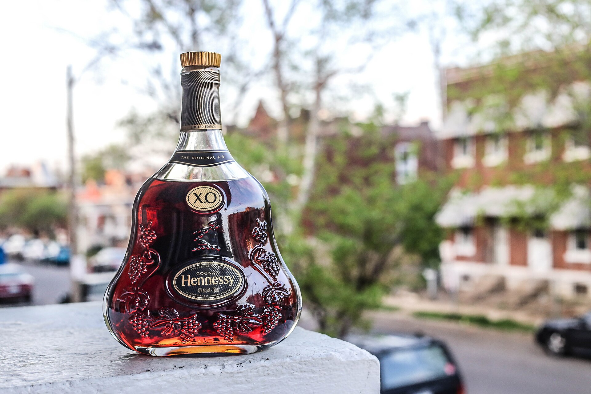

# Hennessy X.O

Hennessy X.O is a brandy from the Cognac region of France, produced by Maison Hennessy. It is blended from more than a hundred eaux-de-vie and is normally bottled at 40% ABV. In Cognac regulation, X.O denotes a minimum ageing grade rather than a single vintage or a single vineyard.

Figure: Related photograph of Hennessy X.O. Image: Paul Sableman, CC BY 2.0, via Wikimedia Commons ([source page](https://commons.wikimedia.org/wiki/File:Hennessy_XO_(34071154281).jpg)).

## Definition and identity

Cognac is a grape-based spirit from the Cognac region of France and a type of [brandy](ref:brandy). It must be made from grapes, fermented, distilled and aged in French oak, and its region, varieties, distillation and ageing are regulated by the Bureau National Interprofessionnel du Cognac (BNIC). Hennessy X.O is one product inside that system, not a synonym for all Cognac or for all X.O.

X.O stands for Extra Old. Historical usage differed between markets; since 2018, BNIC rules have required a minimum of 10 years in oak for the X.O grade. The label indicates that the youngest eaux-de-vie in the blend meet that requirement. It does not state the average age of the bottle, and it certainly does not identify a single vintage.

## History

Maison Hennessy was founded in 1765 by Richard Hennessy, an Irish-born officer, and grew into one of the leading Cognac houses. In 1870, Maurice Hennessy and cellar master Émile Fillioux created X.O: it began as an "extra old" blend reserved for the family and friends, and only later entered the market. The house describes it as one of the first Cognacs to carry the X.O name.

In 1947, designer Gérald de Geoffre created the first Hennessy X.O decanter, whose curved silhouette became a long-running visual signature. Three time scales should be kept apart: the founding of the house, the creation of a specific product, and the actual ageing of the liquid in a given bottle.

## Region and ingredients

The Cognac region lies in south-western France around the Charente river and the Charente-Maritime department, with legally defined growing zones based on soil and climate. The main variety is Ugni Blanc, alongside Folle Blanche and Colombard. Grapes are pressed and fermented into a low-alcohol base wine, which then enters [distillation](ref:distillation); Cognac is normally distilled twice in copper Charentais pot stills to produce high-strength eaux-de-vie.

Region and raw material enter the final flavour. Ugni Blanc is high in acidity and neutral in aroma, which suits distillation; different limestone, clay and sand layers affect ripening and acidity. The exact blend and the parcels used for Hennessy X.O are not public, so the label cannot be used to infer a single vineyard or a single year.

## Process and ageing

The eaux-de-vie are aged in French oak through [oak ageing](ref:oak-ageing). The species, toast level, barrel age and warehouse humidity all affect oxygen exchange and the evolution of tannins and aromas. Hennessy's public description of X.O stresses the use of younger barrels to keep power and energy, while long ageing brings roundness.

Blending is the central craft of Cognac: eaux-de-vie from different regions, years and barrel ages are combined to achieve a stable, complex style. The "extra old" meaning comes from that process: the bottle is not a single vintage but a layered construction of older stocks. The formula is a trade secret, so outsiders can only read the official tasting notes and the regulated grade.

## Flavour and tasting

The producer's official tasting description includes candied fruit, a rising sense of warmth and spice, a peppery edge with a hint of chocolate, a full body, dark chocolate, oak and vanilla, and a long echo. These are sensory prompts, not chemical analysis; different batches and serving temperatures will shift the impression.

Start neat, in a tulip glass or a small thin-walled glass at room temperature. Cupping the glass in the hand can help release aroma, but do not heat the liquid. Notice the first sweet and spicy impressions, then the wood and cocoa in the middle, and finally whether the finish is clean or bitter. Ice lowers aromatic intensity but makes high strength easier to drink, which suits hot weather or younger batches.

## Drinking and pairing

Neat is the classic way to drink X.O; one large ice cube or a little water changes the pace of aroma release. It can be used in cocktails, but the complexity is easily buried under juice and syrup, so recipes that keep the spirit central work better. After dinner it is often paired with dark chocolate, nuts or spice-based desserts. With delicate seafood or sharply acidic dishes, the alcohol and wood can overpower the food.

Once opened, Cognac does not deteriorate as quickly as wine, but the aroma still fades. Keep it out of direct sunlight and heat, seal the bottle and leave as little headspace as possible. Before drinking a long-opened bottle, taste a small amount to check for cardboard or mouldy notes.

## Common misconceptions

First, treating X.O as a vintage. It is a minimum ageing grade, and the bottle usually carries no single guaranteed vintage.
Second, reading "more than a hundred eaux-de-vie" as a precise formula. The public statement describes the scale of the blend, not its proportions.
Third, assuming higher ABV means better quality. 40% ABV is the standard specification; complexity comes from materials, ageing and blending.
Fourth, treating brand fame as a verdict on a specific batch. Labels and versions differ between markets and need to be checked.
Fifth, confusing the hierarchy: all Cognac is brandy, but not all brandy is Cognac.

**Short definition:** A Cognac brandy from France, blended from more than a hundred eaux-de-vie; since 2018 the X.O grade has required at least 10 years in oak, with 40% ABV in the standard bottling.

**Key facts.**

| Item | Detail |
| --- | --- |
| In one line | A Cognac brandy from France, blended from more than a hundred eaux-de-vie; since 2018 the X.O grade has required at least 10 years in oak, with 40% ABV in the standard bottling. |
| Style | Brandy |
| Region | France |
| ABV | 40–40% vol |

**Sources and limits.** The key claims about Hennessy X.O are checked against the following sources: Hennessy (the 1870 creation, blending style, tasting description and 1947 bottle design; Used to cross-check the account of Maurice Hennessy and blender Émile Fillioux creating X.O in 1870), Bureau National Interprofessionnel du Cognac (the Cognac region, double distillation and the minimum ageing requirement for X.O), Oxford University Press (Consulted for entries on Cognac, the X.O grade and blending). Prices, batches and status change; the body is project-written and does not reproduce source text.

## Further reading

- [Brandy](ref:brandy): the distilled category to which Cognac belongs.
- [Grape](ref:grape): the raw material for fermentation.
- [Distillation](ref:distillation): the step that turns base wine into eaux-de-vie.
- [Oak ageing](ref:oak-ageing): the main stage shaping structure and aroma.
- [France](ref:france): an overview of the region, its rules and its drinks.
