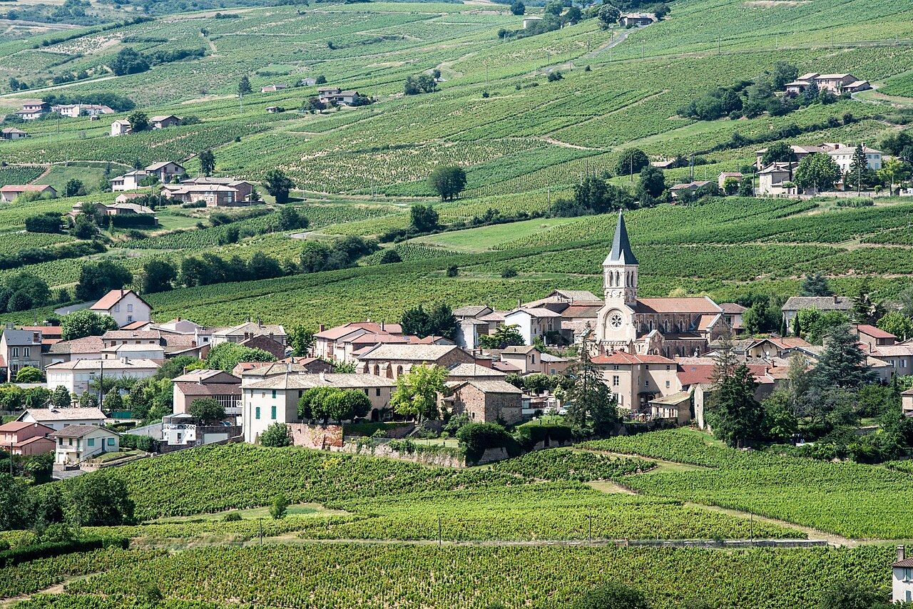

# Juliénas

On a Juliénas label, the word that catches the eye first is often not "Beaujolais" but the village name standing on its own. For the narrow cru belt of northern Beaujolais this is a statement of identity: the wine comes from the slopes around the village of Juliénas rather than from a regional blend. The other side of the bottle usually gives 750 mL and about 12.5%–14% [alcohol by volume](ref:abv), and those two facts say more about the wine's outline than any adjective.

Figure: Juliénas. Image: Sunappu-shashin, CC BY-SA 4.0, via Wikimedia Commons ([source page](https://commons.wikimedia.org/wiki/File:Juli%C3%A9nas_-_zoom.jpg)).

## What the name on the label means

Take the levels apart: [red wine](ref:red-wine) is the category, [Gamay](ref:gamay) is the variety, Juliénas is one of the ten village crus of [Beaujolais](ref:beaujolais), and individual estates and wines are the producer level. The name refers both to the village and to an appellation that can appear alone; the regional Beaujolais name usually does not appear alongside it, and that is the first clue separating it from ordinary Beaujolais.

The village has no premier or grand cru tiers, and all parcels sit inside one village-level AOC framework. So a bottle is judged by slope position, estate and vintage rather than by a famous plot name; the official delimitation governs the boundaries.

## Juliénas and the Julius Caesar story

Local telling links the village name to Julius Caesar, holding that the Roman commander camped or passed through the slopes nearby. The story cannot be checked line by line, but it explains why this name in northern Beaujolais is often presented as one with a past. For a reader, the practical point is that the name comes from the place and its historical storytelling, not from an estate or a trademark.

Partly because of that story, the market sometimes packages Juliénas as a wine of emperors. That belongs to storytelling; quality still comes back to parcel and winemaking.

## Slopes where granite and schist interleave

Juliénas lies in northern Beaujolais in [France](ref:france), with vineyards spread over the slopes around the village. The geology is not one uniform granite but weathered granite sand interleaved with schist: the first drains quickly and holds little fertility, the second retains water more readily, and the mixture makes ripening vary even inside one village.

Aspect and gradient widen the differences further: south-facing parcels of moderate slope see plenty of sun and reach higher ripeness, while shaded or high parcels keep more acidity. The raw material is still [grape](ref:grape), of the Gamay variety, thin-skinned and high in acidity, showing red cherry, black cherry and spice on poor granite.

## Neighbours: Chénas and Moulin-à-Vent

Juliénas borders [Chénas](ref:chenas) and Moulin-à-Vent, and the three are often compared on one map of northern Beaujolais. Chénas is generally lighter and more floral, while Moulin-à-Vent is known for deeper colour and stronger structure; Juliénas sits between them, usually with more backbone than Chénas but without needing long ageing to open like Moulin-à-Vent.

That middle position is not vague but perceptible: in the same cool or warm year, Juliénas often balances fruit concentration against tannin support, neither as airy as Chiroubles nor as weighty as Moulin-à-Vent.

## How Gamay is handled here

Juliénas often uses whole clusters, and some estates use semi-carbonic maceration: whole grapes first ferment inside the berry in a carbon-dioxide-filled vessel before pressing and a conventional [fermentation](ref:fermentation). Compared with the villages that chase extreme lightness, maceration is more often extended here so colour, tannin and structure are more complete.

Fermentation temperature and maceration time decide the final style. Wines aiming for weight extract more; some go into [oak](ref:oak-ageing), usually with a restrained share of new barrels so oak does not cover Gamay's fruit. The bottler line also matters: estate wine and merchant wine under the same village name can differ sharply in concentration and consistency.

## Backbone in the glass: how it differs from Fleurie and Chiroubles

Typical aromas are red cherry, black cherry, raspberry, violet and spice, with some wines showing earth and minerality. The palate has clear acidity, medium tannin and a medium-to-full body, and the finish usually runs longer than in many Beaujolais.

Against Fleurie, Juliénas is usually fuller and fleshier, with flowers less dominant; against Chiroubles it is clearly firmer in structure and pushes the fruit further back. In one line: Fleurie is more perfumed, Chiroubles is lighter, Juliénas is firmer.

## Typical vintages and vintage variation

In warm years, with high ripeness and early picking, Juliénas shows darker fruit, a stronger sense of alcohol and thicker tannin, and can feel tight when young. In cool years, with slow ripening and more retained acidity, the body narrows, red fruit and flowers come forward, and the structure feels more linear. Vintage judgement does not need scores: look at alcohol, at whether the fruit is red or black, and at whether the tannin is wrapped in or standing out.

Parcels behave differently across warm and cool years too: south-facing sites recover ripeness more easily in cool years, while high parcels keep freshness more easily in warm years. That is why vintage-to-vintage difference in the same village wine can be larger than estate-to-estate difference.

## Serving temperature, pairing and drinking window

Serve at about 15–17 degrees Celsius in a tulip-shaped or Burgundy glass. Young wines can be decanted for around 30 minutes, while older wines should be decanted briefly so the aroma does not fade.

It suits poultry, roast pork, roast veal, game and mushroom dishes, and medium-strength cheese. Most wines are for drinking within 4–10 years, and core parcels can go longer; after opening, refrigerate and finish within a few days. Excessive drinking harms health and minors should not drink.

## Buying and price band

Within the market tiers of the Beaujolais crus, Juliénas usually sits in the middle-to-upper band: dearer than ordinary Beaujolais and most light crus, but generally below villages known for long ageing such as Moulin-à-Vent. Price depends mainly on parcel, estate and vintage, and no figure is given here.

Method beats the price tag: first check whether the cru name stands alone, then whether the bottler is the estate itself, and finally whether vintage and alcohol match the estate's usual style. Keep unopened bottles away from light, lying flat at 12–15 degrees Celsius and away from heat and sharp swings; after opening, use a vacuum or inert gas and refrigerate.

## Common misconceptions

First, treating Juliénas as Beaujolais Nouveau. It is a separate village cru built on structure and fruit, not an easy wine for the year of release.

Second, assuming the village name must come from an estate. It comes from the place and its history, not from a brand.

Third, assuming Juliénas is always heavy. Slope position and extraction vary a lot, and the same village name can range from medium to fairly full.

Fourth, confusing Juliénas with Chénas. The two villages are neighbours, but Juliénas usually has more backbone and Chénas is lighter.

For Juliénas, a common mistake is judging authenticity by price or packaging alone. Channel, cru name, bottler and importer information are more reliable.

Start with the base and the stated strength. From there, consider the sweetness or bitterness, then how it is served. That is how a practical judgment about Juliénas is built.
