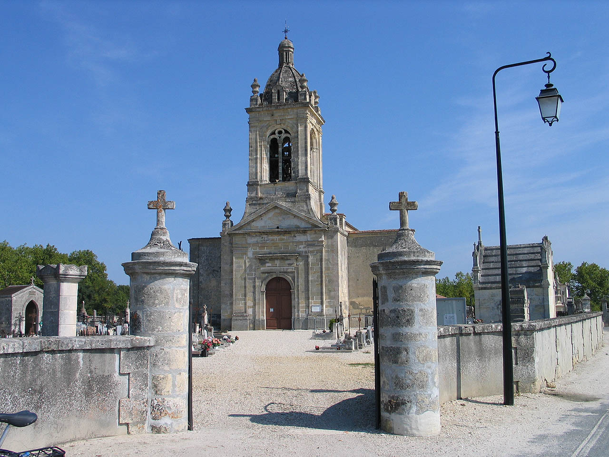

# Margaux

Margaux, in [France](ref:france)'s [Bordeaux](ref:bordeaux), is the southernmost and largest communal appellation in the Médoc and makes [red wine](ref:red-wine) only: its vineyards are spread over four communes — Arsac, Labarde, Margaux-Cantenac and Soussans — and cover just over 1,500 hectares. Sixty-two estates produce roughly 56,000 hectolitres a year, around seven million bottles, or about 1% of all [Bordeaux](ref:bordeaux). It only obtained AOC status on 10 August 1954, eighteen years after Pauillac and Saint-Julien, yet it holds 21 of the 61 estates in the 1855 classification. Late legislation, a wide area and a dense cluster of classified growths: that combination is the starting point for understanding Margaux.

Figure: Margaux. Image: No machine-readable author provided. Luidger assumed (based on copyright claims)., CC BY-SA 3.0, via Wikimedia Commons ([source page](https://commons.wikimedia.org/wiki/File:Margaux_Eglise.jpg)).

## Four communes behind the largest communal appellation

The village lies about 25 kilometres north of the city of Bordeaux, on the left bank of the Gironde. Unlike many Médoc AOCs that map onto a single parish, Margaux's legal area covers four communes: Margaux-Cantenac (formed in 2017 by merging Margaux and Cantenac), Soussans, Arsac and Labarde. This explains a fact that is easily missed: a wine labelled Margaux need not come from an estate inside the village called Margaux. The official cahier des charges describes it as the largest communal appellation in the Médoc, a point often obscured by the "southernmost" label.

The four communes are not one continuous block. Their parcels follow the gravel croupes, separated by woodland, pasture and riverside low ground. Among the 62 registered producers, the smallest holds 0.2 hectares and the largest just over 120 hectares within the appellation. That scale and fragmentation go a long way to explaining the wide stylistic spread inside one name.

## 1954: a border drawn by thirty years of litigation

The boundary was not settled by a single administrative stroke. On 3 December 1923 the Bordeaux civil court first recognised the "Margaux region" as comprising Margaux, Cantenac, Soussans, Arsac and Labarde. Only the decree of 10 August 1954 wrote that geography into the AOC. The five communes have since become four, with no change to the legal area. This history explains why parcels in Soussans or Arsac may legitimately carry the name Margaux: the appellation describes a historic group of gravel rises, not the administrative outline of one village.

## Gravel terraces from 6 to 33 metres

Margaux's topography is a set of gravel terraces between 6 and 33 metres above sea level. The rules distinguish two levels. The high terrace in southern Arsac is Villafranchian, with pebbles normally no larger than 35 mm, known locally as "graves dragées" (sugar-coated gravel). The middle and low terraces carry coarser alluvium, where pebbles over 80 mm are common. Further east, beside the estuary, lie the palus, below 5 metres and dominated by silt and clay. Within one appellation, these three parent materials set very different ripening rhythms.

Decanter's account of Médoc geology gives the scale: even the highest points barely exceed 35 metres, and most vineyards sit between 10 and 20 metres. Dig one metre down and you find gravel; below that lie limestone and oyster-shell marl, with occasional old limestone outcrops inside Margaux. Margaux is neither especially high nor especially thick. What matters is the ratio of gravel to fine soil.

## Gravel croupes versus clay palus

Gravel croupes drain freely, absorb heat by day and release it at night, which is where [Cabernet Sauvignon](ref:cabernet-sauvignon) reaches structural ripeness most reliably. Clay and palus hold water and warm slowly; they suit [Merlot](ref:merlot) and can rescue a crop in a dry year. Margaux's vineyard is therefore more fragmented than Pauillac's: thick gravel on top, sandy or clay-rich slopes at the foot. That heterogeneity is written into the wine — within one commune, parcels can give wines with quite different tannin mass. The raw material is still [grape](ref:grape), but which parcel's grapes decide the skeleton.

## Twenty-one seats in the 1855 classification

The 1855 classification left Margaux with 21 classified growths, more than any other communal appellation in the Médoc: the first growth [Château Margaux](ref:chateau-margaux); second growths Rauzan-Ségla, Rauzan-Gassies, Durfort-Vivens, Lascombes and Brane-Cantenac; third growths Palmer, Giscours, d'Issan, Kirwan, Malescot St-Exupéry, Cantenac-Brown, Desmirail, Ferrière, Marquis d'Alesme and Boyd-Cantenac; fourth growths Pouget, Prieuré-Lichine and Marquis de Terme; and fifth growths Dauzac and du Tertre. The classification applies to estates, not to the name Margaux, and many unclassified estates remain in the commune.

## Sixty-two estates, from 0.2 to 120 hectares

The 62 producers include family estates that farm their own parcels and bottle their own wine, alongside négociants who buy grapes or wine and blend. The "mis en bouteille" wording on the label tells you more than the word Margaux: estate bottling usually means a more consistent parcel origin, while merchant bottling may combine several sources. Appellation, producer and product are three separate levels and cannot substitute for one another.

## The 57 hl/ha base and the 63 hl/ha ceiling

The rules work on two levels: 57 hl/ha is the base yield and 63 hl/ha the ceiling (reduced to 60 hl/ha where row spacing is 1.40–1.50 m and the leaf wall is 0.6–0.7 times the row width). Planting density must be at least 7,000 vines per hectare, row spacing no more than 1.50 m, and each vine may occupy no more than 1.43 m²; the maximum load is 9,500 kg per hectare. Minimum natural [alcohol by volume](ref:abv) is 11%, with minimum sugar of 189 g/L for Merlot and 180 g/L for other varieties. Wine must be aged at least until 1 June of the year after harvest, released from 1 September, and bottled no later than 31 December of the third year after harvest. Classified growths usually crop far below the ceiling — the clearest proof that a legal maximum is not a target.

## Fermentation, maceration and new oak

Margaux reds are built on [fermentation](ref:fermentation), where temperature and maceration time determine extraction: gentle extraction preserves perfume and fine tannin, while longer maceration buys structure. Cabernet Sauvignon is high in both tannin and acidity, so blend proportions and picking dates often matter more than any single process number; small additions of [Cabernet Franc](ref:cabernet-franc) and Petit Verdot fill in aroma and structure. [Oak ageing](ref:oak-ageing) follows, with the share of new barrels varying by estate and level, from partial new oak to 100% new. New oak brings vanilla, smoke and a tighter texture, but in a commune built on aroma, too much of it can bury the violet and blackcurrant.

## Why Margaux tannin feels silkier

Margaux tannin is finer and opens earlier than Pauillac's, and the reason is the mix of varieties and parent materials rather than a vague sense of place. Pauillac's gravel croupes are deeper and more uniform, Cabernet Sauvignon usually accounts for a higher share, and the tannin frame is firmer. Margaux's soils include more clay, sand and riverside silt, Merlot is often planted in greater proportion, and ripening is more even. Combined with the "shallow gravel but fast drainage" pattern described above, Cabernet Sauvignon keeps its aroma and acidity without building excessive coarse tannin. That is a causal chain, not a slogan about softness.

## Price bands: from a few dozen euros to nearly $900

Wine-Searcher's November 2026 international averages for 750 ml bottles give an order of magnitude: Château Giscours about $92, Brane-Cantenac about $95, Rauzan-Ségla about $129, Palmer about $402 and Château Margaux about $884. Everyday unclassified Margaux commonly trades at €30–60. Prices move with vintage, scores, channel and exchange rates, so any single figure is only a rough scale.

## Correcting "Margaux only makes soft wine"

This is the most common misconception. Margaux is indeed known for violet, blackcurrant and silky tannin, but its 21 classified growths include both the structurally imposing Château Margaux and wines whose tannin needs a decade or more to unfold. "Soft" describes a typical style, not a quality ceiling. Treating floral notes as "perfume" or a fault misses the appellation's most important signature. A second confusion equates the appellation with Château Margaux: the former is a geographic area, the latter only one producer within it.

## Serving temperature and pairing

Most wines show best at 16–18 °C; decant young, firmly structured vintages for one to two hours. Red meat, poultry, mushrooms and medium-bodied stews all work, and finer-tannin wines can accompany hard cheese. Pair by acidity and tannin rather than a fixed list. Reseal and refrigerate leftovers and drink within a few days; excessive drinking is harmful to health, and minors should not drink.

For Margaux, begin with the base and the stated strength. Then look at the sweetness or bitterness, and finally ask how it is served. The answers point to different choices, not to a single score.