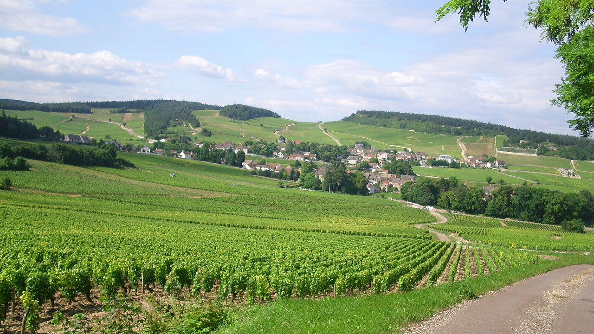

# Mercurey

On restaurant wine lists, Mercurey is often placed in the entry-to-middle range of Burgundy reds: it is not a Côte de Nuits name that must be booked in advance, nor is it as rarely seen as some small Côte Chalonnaise villages. That "easy to find" impression is both its advantage and the reason it has long been underrated. Mercurey is one of the larger village appellations of the Côte Chalonnaise, makes both colours, and its reds are known for structure and direct red fruit. Bottles are commonly 750 mL at about 12.5%–13.5% [alcohol by volume](ref:abv); [red wine](ref:red-wine) is made from [Pinot Noir](ref:pinot-noir) and [white wine](ref:white-wine) from [Chardonnay](ref:chardonnay).

Figure: Mercurey. Image: Mpmpmp, CC BY-SA 3.0, via Wikimedia Commons ([source page](https://commons.wikimedia.org/wiki/File:IMG_Vignoble_de_Mercurey_12.JPG)).

## The largest village appellation in the Côte Chalonnaise

Mercurey lies in the northern Côte Chalonnaise of [Burgundy](ref:burgundy), [France](ref:france), close to the plain of Chalon-sur-Saône to the east, with a stretch of hills separating it from the southern Côte de Beaune where [Santenay](ref:santenay) lies to the north. The vineyards sit around the village and on slopes on both sides of the valley, over a wider area than most Côte Chalonnaise villages.

Size has a direct consequence: the product range is broad. From village to premier cru, from red to white, from light early-drinking styles to firmer wines that need a few years in bottle, all can be found under one village name. It also means no single label can sum up Mercurey; buyers need to look at the specific site, slope position and producer rather than the village name alone. The official delimitation governs the boundaries.

## Clay-limestone and the slopes on both sides of the valley

The climate here is warmer than in the Côte de Nuits, and ripeness is usually higher; the soil is mainly clay and limestone with stones mixed in, draining well upslope and holding more water at the foot. The two sides of the valley face different ways: south- or south-east-facing parcels ripen faster, while north-facing or better-ventilated parcels keep more acidity. Differences in aspect, altitude and soil depth drive the stylistic spread within the village.

The warmer position makes Pinot Noir ripen more easily, and the reds are usually fuller with more obvious tannin than in the northern Côte de Beaune; Chardonnay shows rounder citrus and white-flower aromas. Compared with the Côte de Nuits, Mercurey has less floral finesse and more direct fruit and backbone, which also explains its restaurant positioning.

## Many premiers crus, no grand cru

Wines from the village fall into two tiers, village and premier cru, with no grand cru. Village wine usually carries only the village name; premier cru names its specific site, such as Clos des Myglands, Clos du Roy, Les Montaigus and Les Naugues. There are many premiers crus on the different slopes of the valley, and their styles vary: some lean towards red fruit and flowers, others are fuller and need more time. Premier cru names must match the official list.

No grand cru does not mean no good sites. The premier cru system carries the village's highest tier, and estates often put their best parcels under a premier cru label. For drinkers, it makes more sense to study the premier cru names, aspects and owners than to look for a grand cru that does not exist.

## Merchants, cooperatives and family estates

Family estates dominate the village, with merchants and cooperatives also taking part. The merchant system is quite active in the Côte Chalonnaise, and one merchant may buy grapes or wine from several villages and bottle it; cooperatives gather fruit from many small growers. The bottler information on the label is the key to telling estate wine from merchant wine.

Producer, appellation and product are three levels: the appellation answers for rules and parcel range, the producer answers for who farms, who makes and who bottles, and the product answers for vintage, tier and colour. The same Mercurey can differ noticeably by slope position and estate; even within one premier cru, cooperative bottling and estate bottling may show different ripeness and extraction.

## Winemaking: longer maceration and firmer tannin

After harvest the red fruit is usually sorted, and some producers keep a proportion of whole clusters to add aromatic complexity. [Fermentation](ref:fermentation) runs in temperature-controlled vessels, where maceration time and temperature shape colour, tannin and aroma. Wines made for structure usually see longer maceration and heavier extraction, matching Mercurey's firmer market image; wines made for early drinking shorten maceration and lighten extraction. Whites are usually pressed before fermentation, and some are stirred on their lees to add texture.

The wine then ages in [oak](ref:oak-ageing), with the proportion of new barrels varying by estate and tier. Premiers crus may see more new oak and village wines less. Oak integrates aroma and softens tannin rather than masking the variety's fruit; Mercurey's tannin is already fairly obvious, and too much new oak can make the wine feel dry. Clarification and filtration before bottling depend on the producer.

## Against Santenay and its neighbours

Typical Mercurey reds show red cherry, black cherry, raspberry and earth, with spice and smoke in some wines; the palate has clear acidity, medium-plus tannin and a medium-to-full body. Compared with [Santenay](ref:santenay) to the north, Mercurey is fuller with more obvious tannin, while Santenay is usually lighter with more flowers and acidity. Compared with Rully, another Côte Chalonnaise village, Mercurey reds have more backbone, while Rully's reds are lighter and its whites are known for finesse. Compared with Givry, Mercurey is firmer and needs food more, while Givry is usually rounder and ready earlier.

The whites commonly show lemon, white flowers, hazelnut and minerality, with moderate acidity and a rounder texture. Serve reds at about 15–17 degrees Celsius and whites at about 10–12 degrees Celsius. Mercurey's tannin feels harder when the wine is too cold, and dishes with good fat are easier to balance.

## Warm and cool years: ripeness and tannin

Warm years usually bring riper black fruit, a tendency towards higher alcohol and a fuller body, with rounder tannin but possibly lower acidity; cool years retain higher acidity, push red fruit forward, give a firmer tannin line and a leaner body. Mercurey is already warmer than the Côte de Nuits, so a cool year can give the wines more energy, while a warm year needs watching for over-ripeness and heaviness.

In rainy years, parcels with clay at the foot can dilute, while fast-draining slopes are more stable. For buyers, warm-year Mercurey is for earlier drinking and cool-year wines can stay longer; comparing one estate's warm and cool years says more about vintage than comparing two estates. This section describes direction only and gives no scores.

## Price positioning in restaurant channels

Village-level Mercurey red usually sits in the entry-to-middle band of Burgundy reds, with premier cru one step up; whites usually cost less than reds at the same tier. It is often chosen for everyday drinking and food matching in restaurants, which is one reason its prices stay relatively restrained. Judge by site name, bottler, vintage and back-label information rather than by the village name or the packaging.

A low price does not mean poor quality: Mercurey's value lies in getting clear Burgundy structure and red fruit for a modest budget. If you want floral finesse and a lighter texture, Santenay or a Côte de Nuits village may suit you better. No specific figures are given here. For Mercurey, unopened bottles should be kept away from light, lying flat at about 12–15 degrees Celsius, avoiding heat and sharp temperature swings; most reds are for drinking within 4–10 years, and premiers crus can go longer.

## Five misconceptions about the Côte Chalonnaise position

First, treating Mercurey as part of the Côte de Beaune. It belongs to the Côte Chalonnaise, across a stretch of hills from Santenay.
Second, assuming the village makes only red wine. The village appellation covers both colours, and whites are a real share.
Third, thinking no grand cru means no good wine. Tier is not quality, and some premiers crus are standout sites.
Fourth, treating all Côte Chalonnaise reds as light-bodied. Mercurey has more backbone and more obvious tannin, so no blanket rule applies.
Fifth, judging authenticity by price or packaging. Channel, label and bottler information are more reliable.

## Further reading

- [Red wine](ref:red-wine): the wider category to which the reds here belong.
- [White wine](ref:white-wine): the wider category to which the whites here belong.
- [Pinot Noir](ref:pinot-noir): the variety used for the red wines.
- [Chardonnay](ref:chardonnay): the variety used for the white wines.
- [France](ref:france): French wine law and appellations.
- [Burgundy](ref:burgundy): the grading framework of the region.
- [Grape](ref:grape): the basic structure of wine grapes and ripeness measures.
- [Fermentation](ref:fermentation): the logic of maceration and fermentation.
- [Oak ageing](ref:oak-ageing): the stage that integrates aroma and softens structure.
- [Alcohol by volume](ref:abv): what 12.5%–13.5% vol means on a label.
- [Santenay](ref:santenay): the village-level appellation in the southern Côte de Beaune to the north.
