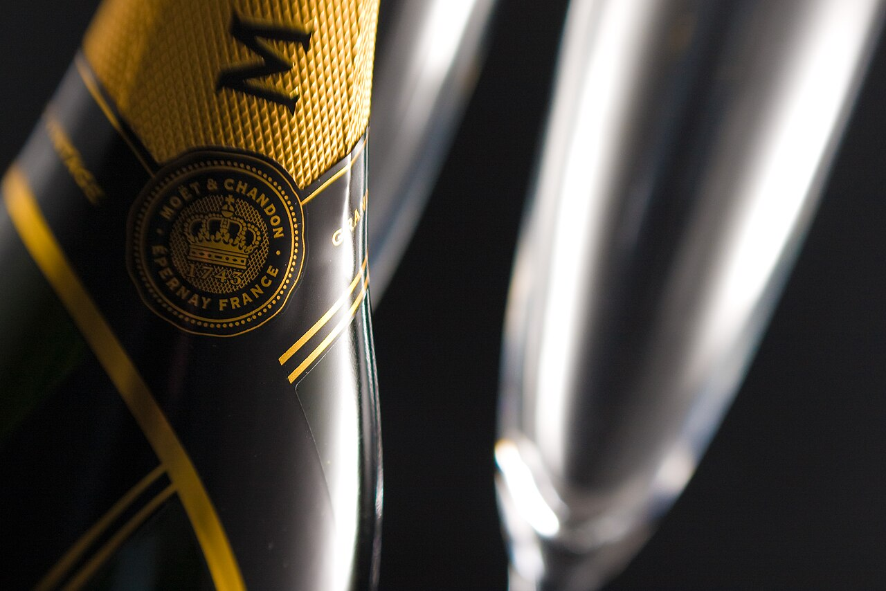

# Moët & Chandon

Moët & Chandon is a Champagne house in Épernay, France, founded in 1743 by Claude Moët and now part of [LVMH](ref:lvmh) through Moët Hennessy. It belongs to the wider category of [sparkling wine](ref:sparkling-wine), and its most familiar bottle is the non-vintage Brut Impérial, usually 750 mL at about 12% [ABV](ref:abv). The house also makes a vintage line, Grand Vintage, and owns the vintage-only prestige brand Dom Pérignon.

Figure: Moët & Chandon. Image: Andreas Levers from Potsdam, Germany, CC BY 2.0, via Wikimedia Commons ([source page](https://commons.wikimedia.org/wiki/File:Mo%C3%ABt_et_Chandon.jpg)).

## A 1743 House on the Avenue de Champagne

Claude Moët founded the business in Épernay, in the [Champagne](ref:champagne) region of [France](ref:france), in 1743. The address on the Avenue de Champagne is still the visitor's entrance today. His grandson Jean-Rémy Moët turned a regional merchant into an international brand by selling to European courts and overseas markets.

The contrast with [Krug](ref:krug), another LVMH house, is useful. Krug works at small scale, with parcel-level selections and long ageing; Moët works at enormous scale, with a blend designed to taste consistent every year. Confusing group ownership with a single bottle's quality is a common category error.

## 1,300 Hectares and 28 Kilometres of Cellar

LVMH puts the estate at about 1,300 hectares, roughly 50% Grand Cru and 25% Premier Cru, making it one of the largest vineyard holders in Champagne. The cellars run for more than 28 kilometres beneath Épernay. The house's own visitor page calls the site part of a UNESCO World Heritage property: the “Champagne hillsides, houses and cellars” inscription of 2015.

Sources do not always agree on the vineyard figure. Some critic notes use 1,190 hectares. The gap probably reflects different counting of owned, leased and long-term contracted fruit, so the number should always be quoted with its basis.

## Brut Impérial: The 1869 Benchmark

Brut Impérial has been the flagship non-vintage since 1869. It is assembled from more than 200 crus, or 288 villages in some accounts. [Pinot Noir](ref:pinot-noir) supplies roughly 30%–40%, followed by Meunier and a smaller share of [Chardonnay](ref:chardonnay). Reserve wines, usually 30%–50% of the blend, smooth out vintage variation.

The dosage is 7 g/L, which makes it a dry Brut rather than a sweet wine. It rests on the lees for at least 24 months, well above the legal floor. Chardonnay gives citrus and florals, Pinot Noir gives the frame, and Meunier gives earlier approachability and roundness. That trio is the recipe for consistency and easy drinking.

## The Legal Floor: 15 Months and 7 Grams

After the in-bottle [secondary fermentation](ref:fermentation), Champagne must rest horizontally on its lees. France's DGCCRF states that non-vintage Champagne ages for at least 15 months; vintage Champagne is kept longer. The fermentation itself takes about six to eight weeks, followed by disgorgement, [dosage](ref:dosage) and corking.

Dosage determines the sweetness label. Brut is normally up to 12 g/L, so Moët's 7 g/L sits firmly in the dry range. Extra Brut is lower; Demi-Sec is higher. Reading “Brut” as “sweet” is one of the most common label mistakes. The alcohol level, about 12% [ABV](ref:abv), should also be checked alongside bottle size and origin.

## Grand Vintage and Dom Pérignon Are Not the Same Job

Moët's own vintage line is Grand Vintage, made only in years the house considers worthy. The 2015 release was the 76th vintage of the series: 44% Pinot Noir, 32% Chardonnay and 24% Meunier, with six years in the cellar and a 5 g/L dosage in an Extra Brut style.

Dom Pérignon is the group's prestige vintage brand, made only as a vintage Champagne, with its own identity and a longer-ageing positioning. It is produced within the Moët Hennessy system, but it is not the same wine as Grand Vintage. One is Moët's vintage expression; the other is a separate luxury line.

## 2015: A Vintage of Tension

Moët describes 2015 as a year of tension: heat, uneven ripening and a harvest that rewarded the red-skinned varieties, which is why Pinot Noir reached 44%. The blend keeps a substantial Chardonnay share to restore freshness, and the dosage is pulled down to 5 g/L so fruit and mineral notes stay clear.

This is a useful way to understand vintage Champagne. A vintage is not simply “better” or “worse”; it is the house's answer to a particular season, expressed through variety proportions, time on lees and dosage. Non-vintage works the other way around, using reserve wine to make the difference disappear.

## Why It Reads as a Banquet Champagne Next to Veuve Clicquot

Compared with Veuve Clicquot's Yellow Label, Moët Brut Impérial uses less Pinot Noir (about 30%–40% versus 50%), draws from a much larger blend base (more than 200 crus versus 50–60) and carries a lower dosage (7 g/L versus 9 g/L). The result is softer, more neutral and harder to fault at a large table, but with less grip and drive than Clicquot.

This is not a ranking. The two houses have different jobs. Moët serves the world's largest banquet and gifting occasions; Clicquot makes Pinot Noir structure the signature. Understanding that difference is more useful than memorising a hierarchy.

## Price Bands: From Brut Impérial to Dom Pérignon

Using major-market retail prices in November 2026 as a reference, Brut Impérial typically sits around US$50–80; Grand Vintage is usually higher; Dom Pérignon commonly runs around US$180–300. Prices move with vintage, channel, gift packaging and exchange rates, so no single shelf tag should be treated as a fixed value.

There are also differences within one line. Standard bottles, gift boxes, limited editions and different formats such as half-bottles or magnums can carry very different prices while the liquid inside may be the same. Check the product name, vintage and volume before the packaging.

## Serving Temperature and Table Position

Chill thoroughly to 8–10°C and use a tulip-shaped glass or a white-wine glass. The bubbles stay more focused and the aromatics are less suppressed by cold. Open slowly, easing the cork out rather than letting it pop, especially if the bottle has warmed up.

Brut Impérial works as an aperitif and with oysters, fried food, white meat and salty snacks. Grand Vintage is better with creamy seafood or poultry. Sweetness levels also point to different pairings: Extra Brut suits light starters, while Demi-Sec is the one for dessert.

## The Misconception: Moët Is Not Dom Pérignon

The most common misunderstanding is that Moët and Dom Pérignon are the same wine, or that buying Moët means buying Dom Pérignon. They belong to the same Moët Hennessy group, but Dom Pérignon is a separate vintage-only prestige brand with different ageing and pricing. Moët's flagship is the non-vintage Brut Impérial.

A second frequent error is to treat Brut as sweet. Brut usually carries a low dosage; Moët's 7 g/L is dry. The genuinely sweet styles are Demi-Sec and Doux, and the label will say so.

## Reading a Bottle of Moët

Start with the front label: house name, cuvée (Brut Impérial, Grand Vintage or Rosé), vintage if any, sweetness level, origin, volume and alcohol. Then check the back label and bottle code. “NM” stands for négociant manipulant, the registration category common among large houses; batch and disgorgement details help judge freshness.

Finally, look at the channel. Champagne is widely counterfeited. A price far below market, poor printing, a missing import back label or absent anti-counterfeit information should all prompt caution. Gift packaging is not a grade.

## Further Reading

- [Sparkling wine](ref:sparkling-wine): the broad category to which Champagne belongs.
- [LVMH](ref:lvmh): the group that owns the house.
- [France](ref:france): the national context of the Champagne region.
- [Champagne](ref:champagne): the legal region and its production rules.
- [Chardonnay](ref:chardonnay): one of the three main Champagne varieties.
- [Pinot Noir](ref:pinot-noir): the structural backbone.
- [Fermentation](ref:fermentation): the logic of the second fermentation in bottle.
- [Blending](ref:blending): how non-vintage Champagne stays consistent.
- [Dosage](ref:dosage): the link between grams per litre and sweetness.
- [Alcohol by volume](ref:abv): what the roughly 12% figure means.
- [Krug](ref:krug): another Champagne house in the same group.
